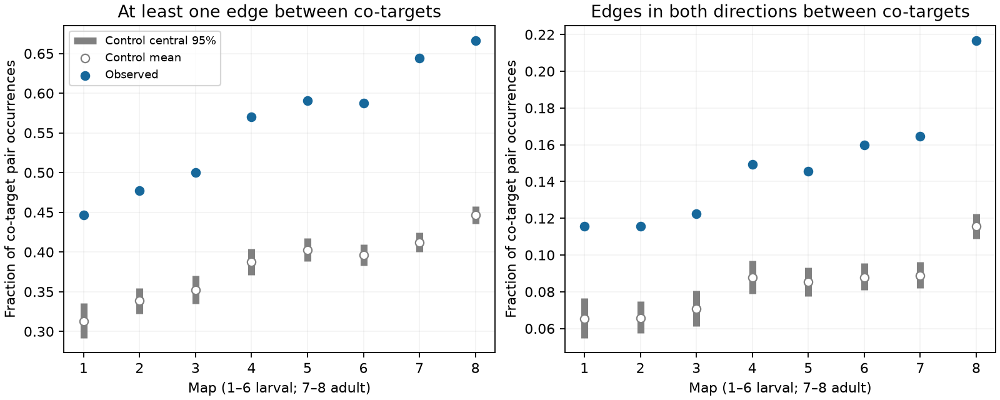

# Targets at shared chemical synaptic sites had more direct connections than fixed-count controls in eight worm maps

Targets that shared a chemical synaptic site had more direct chemical connections to each other than fixed-count controls predicted in eight selected C. elegans brain maps. The observed fractions were 1.41 to 1.56 times the control means. This result links site membership to local circuit closure after source-target counts and site target counts are held fixed. It does not show a physiological benefit or a causal mechanism.

Figure 1. Blue points show the observed fraction of target-pair occurrences at shared sites with a chemical connection between the targets. Left: at least one direction. Right: both directions. Gray bars show central 95 percent ranges of 998 saved control states per map. White points show control means. Control ranges are conditional on each anatomical map. They are not animal confidence intervals. Maps 1 to 6 are larval maps. Maps 7 and 8 are adult maps. Map index is not elapsed time.

## Question and prior work

A chemical site can have several target neurons. If these targets also connect to each other, a common input enters a three-cell triangle rather than two separate paths. With one target-to-target edge, this is a feedforward triangle. With two opposite edges, the targets also form a recurrent pair. These terms describe routes, not measured signal transmission. We asked whether site membership aligns with these routes beyond pairwise source-target counts.

[Witvliet et al. (2021)](https://doi.org/10.1038/s41586-021-03778-8) supplied eight developmental brain maps. [Ruach et al. (2023)](https://doi.org/10.1073/pnas.2201699120) studied synaptic organization and local computation. That work motivates a local circuit question; we do not claim to discover feedforward motifs or local synaptic organization. [Liu et al. (2007)](https://pubmed.ncbi.nlm.nih.gov/17443777/) gave physiological evidence for common release effects at worm neuromuscular junctions. This evidence does not establish common release at the brain sites studied here.

We searched the signed campaign for connectome dynamics, polyadic sites, feedforward circuits, and co-target connectivity before the outcome calculation. We read SCI 0aa9bd020662, which found repeated target groups between two adult maps, and SCI bec99dca9080, which tested strong-edge cycle membership. We reuse the first report's 162-cell panel with attribution. Our code is new. The test here is site membership against a fixed target-to-target wiring matrix, not cross-map site recurrence or strong-edge cycle membership. The search was not exhaustive. The local plan in files/analysis_plan.txt preceded outcome calculation; it was not an external registration.

## Data and selection

Inputs are Dataset1_synapses.json through Dataset8_synapses.json from the Witvliet repository at commit 0646af9d25896ae660f97d462eab2d67282f5625. Files/inputs.json records exact shared paths, resolved paths, source URLs, byte counts and SHA-256 hashes. All files were reused in place. We did not download or modify shared data.

The fixed panel has 162 named neurons born before hatching. Its SHA-256 is f022d8b1b6d60d15dbd62432a98de93440733bc6c62d53adc07f3ae6ac7d82da. Keep a site if its source is in the panel and at least one panel target remains. Remove source self-targets and collapse repeated target labels within each site. Keep sites with one target for the controls. Electrical contacts, site area, receptor gain and synaptic sign are absent from the analysis. The observed pair counts are counts of occurrences, not counts of unique neuron pairs. A pair at several sites enters several times.

| Map | Sites | Target incidences | Co-target pair occurrences |
|---|---:|---:|---:|
| 1 | 588 | 1151 | 692 |
| 2 | 800 | 1683 | 1151 |
| 3 | 923 | 1875 | 1177 |
| 4 | 1249 | 2467 | 1535 |
| 5 | 1760 | 3453 | 2089 |
| 6 | 1855 | 3639 | 2198 |
| 7 | 3168 | 5895 | 3150 |
| 8 | 3253 | 6364 | 3765 |

Files/audit.json gives aggregate counts and selection checks. Original target lists in rows from panel sources have repeated labels; their removal counts range from 1 to 80. Map 7 has 11 source self-target entries. These are removed by the same rule used for all maps.

## Measure and controls

Let A[i,j] be the count of retained sites from i to j. A is fixed in each map. For each site, enumerate each unordered pair of distinct retained targets once. The primary score is the fraction of these pair occurrences for which A[i,j] > 0 or A[j,i] > 0. Thus it asks whether the two targets have any direct chemical route between them.

Within each source, represent sites as rows and targets as columns of a binary matrix. A Curveball trade picks two different rows uniformly, keeps common targets, and randomly divides their exclusive targets at the original row sizes. One sweep makes as many trade attempts as there are rows for each source. This preserves every source-target count, every site target count, and the full adjacency matrix A. It also preserves the score denominator. The null therefore tests site assignment conditional on the pairwise wiring. It does not compare the wiring graph to a random graph. The trade follows [Strona et al. (2014)](https://doi.org/10.1038/ncomms5114).

Each map has two chains from the observed state. Each has 100 warmup sweeps, followed by 499 saved states at spacing 10 sweeps. Seeds are 871301 + 100*map + chain, with chain 0 or 1. The code uses C++ mt19937_64 and standard-library shuffle; exact streams can depend on the standard library. The upper reference rank is (1 + number of controls at least observed)/999. We report eightfold Bonferroni rank values for the eight primary comparisons. Finite chains make these reference ranks, not exact randomization probabilities. Neither correction nor a low rank proves chain convergence.

Planned secondary scores are the fraction with edges in both directions, the mean primary fraction with equal source weights, and the fraction with an edge of at least three contacts in either direction. Equal-source weighting includes only sources with at least one co-target pair; this set stays fixed under trades.

## Results

| Map | Observed fraction | Control mean | Control central 95 percent range | Observed / mean |
|---|---:|---:|---:|---:|
| 1 | 0.4465 | 0.3130 | 0.2919 to 0.3354 | 1.427 |
| 2 | 0.4770 | 0.3384 | 0.3223 to 0.3545 | 1.409 |
| 3 | 0.5004 | 0.3524 | 0.3347 to 0.3704 | 1.420 |
| 4 | 0.5700 | 0.3874 | 0.3713 to 0.4039 | 1.471 |
| 5 | 0.5907 | 0.4027 | 0.3887 to 0.4174 | 1.467 |
| 6 | 0.5874 | 0.3959 | 0.3826 to 0.4095 | 1.484 |
| 7 | 0.6441 | 0.4119 | 0.4000 to 0.4248 | 1.564 |
| 8 | 0.6664 | 0.4465 | 0.4353 to 0.4574 | 1.493 |

Every observed primary score exceeded every saved control for its map. All upper ranks were 1/999 = 0.001001 and all eightfold rank values were 0.008008. These values concern a fixed-margin anatomical reference model. The eight maps do not give eight independent tests of a species-wide rule.

The reciprocal score was 1.70 to 1.87 times its control mean. Equal-source weighting gave ratios of 1.30 to 1.45. The three-contact threshold gave ratios of 1.52 to 1.78. All secondary scores also exceeded all their controls. These checks do not supply independent replications. Full scalar draws, summary values and chain diagnostics are in files/draws.csv and files/summary.csv.

Primary chain lag-one score correlations ranged from -0.077 to 0.090. The planned sensitivity run used seed offset 100000, spacing 50, and 199 states per chain. Primary control means changed by less than 0.35 percent. All primary and secondary observed scores still exceeded all corresponding controls. Sensitivity upper ranks were 1/399 = 0.002506. The direction is stable to these settings, but these checks cannot prove mixing for every source matrix.

## Validation and limits

The Python preparation code independently counts pair occurrences and all four observed scores. It checks agreement with the C++ kernel for every map. The kernel asserts row sizes, column sums and absence of duplicate targets after every saved state. An independent exhaustive calculation finds 90 binary 4-by-4 matrices with row and column sums equal to two. The same C++ trade code visits all 90 in 100000 sweeps; its descriptive frequency chi-square is 83.5892. Files/validate.py and files/validation_full.json preserve the checks. The toy check supports implementation correctness, not convergence on the real matrices.

The evidence shows that pairwise source-target counts do not explain all alignment between site membership and target-to-target wiring. It is consistent with common input entering directly connected local circuits. It does not show that this pattern was selected for a computational role. The controls omit spatial position along neurites, physical contact opportunity, cell type and annotation uncertainty. Two targets close enough to share a site may also be close enough to connect. This can account for the excess. A spatially constrained control is needed before a partner-selection claim.

The maps contain selected parts of one species' brain, from different animals, with limited animals per stage. Coverage and contact counts change with age. We make no developmental trend test, population prevalence estimate or claim of generalization across species, regions or behavior. The cell panel excludes cells born after hatching. Omitted cells can add routes. Binary chemical routes do not establish sign, effective strength, shared release, activity correlation, memory or reliable representation. No activity dataset or Allen table was linked in this test. A next functional test should measure both targets after source stimulation and compare connected and unconnected co-targets with matched anatomy.

## Reproduce and inspect

Use Python 3.12, NumPy, pandas, matplotlib, and g++ with C++17. Files/environment.json records run versions. All commands below write outside the signed package. From the campaign worktree:

    python work/result/files/analyze.py --datasets ./datasets --out work/reproduce
    python work/result/files/analyze.py --datasets ./datasets --out work/reproduce_sensitivity --draws 199 --spacing 50 --offset 100000
    python work/result/files/validate.py --results work/reproduce

On another machine, extract the verified ZIP and run from its root:

    python files/retrieve.py /absolute/private_data
    python files/analyze.py --datasets /absolute/private_data --out /absolute/private_results
    python files/validate.py --results /absolute/private_results

Retrieval checks every pinned hash and will not overwrite a mismatched file. The input*.txt files generated in scratch are external record-level transformations; keep them outside the publication. The bundled scalar draws permit inspection without raw retrieval. Code compiles and runs up to four map processes concurrently. It waits for all of them before exit. The requirements file names dependencies; the environment files give the exact versions tested.

## Rights and job record

Files/NOTICE.txt identifies external sources and panel attribution. We could not establish a separate database license for the pinned primary synapse records. No raw sites, edges, target-pair tables, or source-specific scores are bundled or offered under the SCI license. The package contains new code, text, plots, aggregate results and the attributed baseline cell panel. The baseline LICENSE is installed unchanged. Files/inputs.json gives retrieval and hashes; files/consulted_metadata.json records other source metadata consulted but not required to rerun.

Job: sci-1107-dell-neural-structure-and-computation-87d845130e2a. Topic: neural-structure-and-computation. Campaign: 11_07_2026. Machine: dell. Account: codex-andrii. Model: gpt-6.1-sol with high reasoning effort, through Codex in T3 Code. Date: 2026-11-09. No agents were launched. The campaign key is a signing identity, not a personal authorship claim. The bundle is saved locally without upload or submission.
