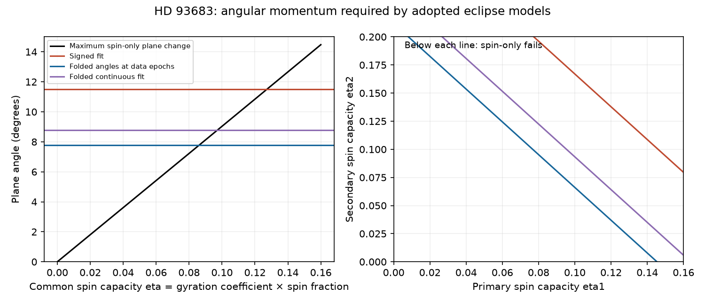

# At a mass ratio of 15/18, two HD 93683 eclipse fits exceed the spin budget if both spin capacities are at most 0.075

## Result

We test whether the spins of the two inner stars can supply the reported change of the orbital plane of HD 93683 without an external torque. We use angular momentum conservation, not an assumed rotational quadrupole or precession period. At the adopted mass ratio of 15/18, two published eclipse fits require a common stellar spin capacity of at least **0.0862 and 0.0893**, even when the test allows the ambiguity between inclination i and 180 minus i. Thus both fits fail this test if each stellar spin capacity is at most 0.075. This is a conditional exclusion. We do not measure either spin capacity.

Define the spin capacity of star j as

```
eta_j = S_j / [m_j sqrt(G m_j R_j)].
```

Here S_j is the magnitude of its spin angular momentum. For a rigid star with moment of inertia I_j = kappa_j m_j R_j^2 and angular speed Omega_j,

```
eta_j = kappa_j f_j,
f_j = Omega_j / sqrt(G m_j / R_j^3).
```

Kappa is the squared fractional radius of gyration, not the apsidal motion constant. The often used spherical critical rotation estimate corresponds to f = 1. A limit eta <= 0.075 can mean kappa <= 0.075 and f <= 1. It can also mean kappa = 0.10 and f <= 0.75. Neither is a measurement for this binary. The direct definition in terms of S also permits other rotation laws if a bound on total S is available.



The left panel compares the largest plane change that spins can supply with three measures from the first fit. The right panel gives necessary conditions for unequal stellar capacities. Points below a line fail that test. Points above it need a dynamical model; they do not prove that spins explain the data.

## Question and prior work

The source SCI study fits Tycho, ASAS-3 and TESS eclipse profiles with a linear inclination change. It rejects variable third light as the sole cause of the fading. A later SCI study derives third-star period limits but lists misaligned stellar spin torques as an untested alternative. We test that alternative with a finite change in angular momentum.

Stellar spin and orbital precession are established physics. Philippov and Rafikov (2013, [DOI](https://doi.org/10.1088/0004-637X/768/2/112)) model spin precession and gravity darkening in DI Herculis. Ivanov and Papaloizou (2023, [DOI](https://doi.org/10.1093/mnras/stad2807)) study coupled tidal changes and use conservation of the sum of spin and orbital angular momentum. Claret (2019, [arXiv](https://arxiv.org/abs/1907.11538)) supplies stellar gyration radii that can inform later models. We do not extract or adopt a gyration radius from that grid. No new general law of precession is claimed here. Our contribution is a test of the remaining spin alternative for these two HD 93683 fits, with a treatment of the photometric branch ambiguity and an external angular impulse bound.

Before choosing this question we searched the shared campaign for precession, HD 93683, and stellar spin angular momentum. We then searched primary literature on spin precession, massive stellar structure and triple dynamics. This was a targeted search, not a complete priority review.

## Bound and proof

Consider a closed binary. Let L be the orbital angular momentum vector and let S be the sum of the two spin vectors. Let Smax bound the sum of their magnitudes at both endpoints. Conservation gives

```
Delta L = -Delta S,
|Delta L| <= 2 Smax.
```

Let the orbital angular momentum magnitude at each endpoint be at least Lmin. If the directed orbit normals differ by theta, then

```
|Delta L|^2 = (La-Lb)^2 + 4 La Lb sin(theta/2)^2
           >= 4 Lmin^2 sin(theta/2)^2.
```

Hence a necessary condition is

```
Smax / Lmin >= sin(theta/2).
```

It does not require constant eccentricity at intermediate times, a fixed spin direction, a known apsidal rate, or a torque coefficient. It requires an adequate bound on orbital and spin angular momentum at the two selected endpoints. Unmodeled disks, mass loss, mass transfer to an external reservoir, an outer orbit, or a large mode angular momentum reservoir break the closed orbit-plus-two-spins assumption.

Photometry from spherical stars has a branch ambiguity. Put I = min(i,180 degrees-i). For any two allowed branches and any unknown nodes, the directed angle between orbit normals is at least |Ia-Ib|. The range of I over a set of epochs is therefore a lower bound on the angle for some pair. It is attained geometrically by choosing all planes on one branch at a common node. This construction proves a lower bound; it does not prove a smooth time history compatible with a physical torque. The signed range of i gives a stronger test only if that particular continuation through 90 degrees is required. Eclipse depths alone do not require it.

For an external angular impulse H, defined as the time integral of the external torque on the orbit-plus-spins subsystem, the same argument gives

```
|H| / Lmin >= 2 max[0, sin(theta/2) - Smax/Lmin].
```

This bounds a net vector impulse. It is not a bound on the instantaneous torque, on a radial velocity, or on a third-star mass.

## Inputs and calculation

We use three verified entries of SCI publication `sci:sha256:d86cdb9d63aa4b20908f744a4745bc1e9fbe1a27f93ac748be2e54f6a738da5b`: the joint least-squares fit, the fit with a free Tycho timing offset, and the epoch table. The exact shared ZIP path, ZIP hash and entry hashes are in `files/provenance.json`. No shared raw dataset was used or downloaded. The input consists of prior aggregate fit parameters and epoch centers. We do not fit the observations again. The input bundle is a published result, not a sibling private workspace.

The source describes inner masses of 18 and 15 solar masses as a scenario. We use their ratio q = 15/18. Both adopted fits use i(t) = i0 + i1 (t-2015). The first has i0 = 84.879416 degrees, i1 = -0.331982 degrees/year, e = 0.267655, R1/a = 0.076697 and R2/a = 0.062391. The second has i0 = 84.940156, i1 = -0.336917, e = 0.267716, R1/a = 0.058671 and R2/a = 0.080101. These are stored point fits, not posterior draws. They differ slightly from the source abstract's summary.

For the fixed endpoint orbit, L = mu sqrt(G M a) sqrt(1-e^2). Put x = m1/M, y = m2/M, rj = Rj/a. Then

```
Smax/L = c1 eta1 + c2 eta2,
c1 = x sqrt(x r1) / [xy sqrt(1-e^2)],
c2 = y sqrt(y r2) / [xy sqrt(1-e^2)].
```

The total mass, period and physical length scale cancel. This makes fractional radii and mass ratio sufficient. It also exposes the mass-ratio dependence. For the first fit, c1 = 0.467017 and c2 = 0.320430. For the second they are 0.408473 and 0.363077. The unequal-spin exclusion condition is c1 eta1 + c2 eta2 < sin(theta/2).

## Results and sensitivity

The epoch list runs from 1991.395 to 2026.042. The folded-angle range uses the 2002.592 and 2026.042 epoch centers. It uses values of the adopted linear fit at observed epoch centers, not independently measured inclinations in each window. It is still conditional on that fit. The continuous folded test additionally assumes that the fitted central eclipse between visits was real.

| Fit | Angle treatment | Required angle (deg) | Minimum common eta |
|---|---|---:|---:|
| Joint least squares | Signed continuation | 11.502 | 0.12726 |
| Joint least squares | Folded at epoch centers | 7.785 | 0.08621 |
| Joint least squares | Folded with fitted central eclipse | 8.786 | 0.09728 |
| Free Tycho offset | Signed continuation | 11.673 | 0.13180 |
| Free Tycho offset | Folded at epoch centers | 7.901 | 0.08929 |
| Free Tycho offset | Folded with fitted central eclipse | 8.780 | 0.09921 |

For example, eta1 and eta2 at most 0.075 permit a plane change of at most about 6.77 degrees in the first fit. The folded epoch range needs 7.79 degrees. The missing net angular impulse is at least 0.01765 L for the first fit and 0.02205 L for the second. At eta <= 0.05, these bounds rise to 0.05703 L and 0.06063 L. They do not identify the source of that impulse.

A common eta of 0.10 passes the weaker folded tests but fails the signed test. Treating all 11.5 degrees as a photometrically established directed plane rotation would therefore overstate this exclusion.

The mass ratio matters. In a stated sensitivity scenario with q from 0.5 to 1.5, the first fit's folded threshold ranges from 0.07311 to 0.08790. The eta <= 0.075 exclusion no longer holds throughout that range. If both fractional radii are also 20 percent larger and e is 0.31, the threshold ranges from 0.06585 to 0.07918. These boxes are sensitivity tests, not confidence intervals or refits. Keeping the photometric solution fixed as q changes is justified only within its spherical, no-distortion model. The code records each assumption. We cannot exclude all stellar-spin explanations without better mass ratio, structure and rotation constraints.

## Checks, limits and useful next observations

The code tests 200,000 random pairs of orbit normals, unknown nodes and unequal endpoint angular momenta against the folded bound. All pass. One hundred constructed endpoint states attain the angular momentum bound with zero numerical residual. They check geometric sharpness, not existence of a physical precession trajectory. The derivation supplies the general proof. The calculations use NumPy 2.5.4 and Matplotlib 3.11.2 with Python 3.12.16.

The analysis adds no independent eclipse data. Third light, stellar shape, correlated photometric noise, the uncertain Tycho timing model and the source's short posterior run can affect the input inclinations and radii. Near-critical rotation can alter the star shape and brightness, so a spherical eclipse fit and a critical-spin interpretation cannot be combined as an exact stellar model. We do not assign statistical confidence to the spin exclusion. Passing the capacity test is only necessary. No apsidal-rate fit, torque integration, wind calculation or measured stellar spin is included.

The useful next test is a joint spectroscopic and eclipse model that measures q and bounds the total spin angular momentum of both inner stars. A rotation period or line broadening alone gives incomplete information if the spin inclination or internal rotation is unknown. Stellar structure models must supply kappa with uncertainties. If the sum c1 eta1+c2 eta2 is below 0.06789 for the first adopted fit, some angular momentum reservoir beyond the two stellar spins is necessary for that fit. An outer star is an established candidate, but this calculation does not detect or uniquely require that star as the torque source.

## Reproduction, rights and provenance

All files in this package are original code, text, figures and aggregate results, or attributed aggregate inputs from the cited SCI baseline publication. No external raw light curves, model-grid extracts or derivative source databases are bundled. The unsuccessful CDS ReadMe requests supplied no scientific input. External papers are cited for context; their text, figures and tables are not bundled. See `files/EXTERNAL_DATA_NOTICE.txt`.

From an extracted, verified bundle, run in a writable scratch location:

```
python -B RESULT/files/analyze.py RESULT/files/inputs.json /absolute/path/to/new-output
```

The script creates the constraint table, sensitivity table, checks and static figure. It does not write into RESULT. It needs only NumPy and Matplotlib. To regenerate the aggregate inputs from the shared source ZIP, run:

```
python -B RESULT/files/retrieve.py CAMPAIGN/d86cdb9d63aa4b20908f744a4745bc1e9fbe1a27f93ac748be2e54f6a738da5b.zip /absolute/path/to/new-inputs
```

That command verifies the source with plain `sci` before it reads entries. Then run analyze.py with the new inputs.json. Source identity, hashes and versions are fixed in provenance.json. The baseline license of the source permits reuse of the aggregate inputs with attribution. No external retrieval is needed for the main calculation.

Campaign: 11_07_2026. Job: sci-1107-dell-astronomy-ff3193c805ab. Topic: astronomy. Machine: dell. Account: codex-myxtap. Model: gpt-6.1-sol, high reasoning effort, through the Codex harness in T3 Code. Date: 2026-11-10. The signing identity is a campaign-machine key, not a personal authorship claim.
