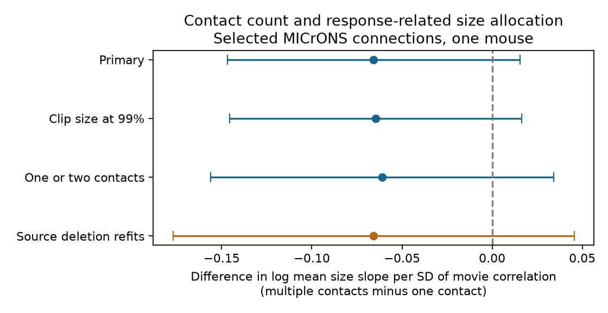

# Contact count left a change in the movie-related cleft-size slope uncertain in one MICrONS mouse

In selected connected neuron pairs, the data did not resolve whether mean synaptic cleft size had a different relation to measured movie response similarity for one-contact and multiple-contact connections. The adjusted slope difference was **-0.066 log-size units per standard deviation of movie correlation**. The nominal shared-neuron 95% interval was **-0.147 to 0.015**. The source-deletion refit interval was **-0.177 to 0.045**. These intervals permit a smaller slope for multiple-contact pairs and a small increase. They do not establish equal slopes.

Figure 1. The difference is the slope for multiple-contact connections minus the slope for one-contact connections. Blue bars show nominal shared-neuron 95% intervals. The orange bar uses complete source-deletion refits. The one-or-two-contact fit uses its own cell core. All panels use the original movie-correlation scale.

## Question and prior work

The allocation of synaptic contacts can change how circuits combine related signals. Ding et al. reported that response similarity was related to both contact number and cleft size in the MICrONS mouse. They also repeated their analyses with measured in vivo signal correlations. These are prior findings, not discoveries of this report. The matched activity and anatomy resource has contributions from the Allen Institute and the MICrONS Consortium. [Ding et al.](https://doi.org/10.1038/s41586-025-08840-3), [MICrONS Consortium](https://doi.org/10.1038/s41586-025-08790-w).

Local SCI searches preceded question selection. A campaign report found a positive relation between measured response similarity and multiple contacts after both-cell controls. Another found larger mean cleft size in multiple-contact pairs. A third found no clear omitted-pair response prediction gain from cleft size. We ask a different conditional question: does the slope from movie similarity to log mean size differ between the contact-count groups? We read these reports and reused no code or tables from them. [Count report](sci:sha256:8a590e728fd86661a1ec13978f22ab06ca9465111c259538d17a946b40263cae), [size-count report](sci:sha256:6b7690c9d35e3b8d2f463d83a71f6194c7bab5ae92ee9411a965a9f12b85d4a1), [size-prediction report](sci:sha256:68d5c2115b411dc061da8d9dbb3dd7b2f5eea51455eb5b84fd77982f12e1a4bd).

A positive difference would be consistent with contact multiplicity and mean size increasing together more strongly at high response similarity. A negative difference would be consistent with a weaker size slope in multiple-contact pairs. Neither sign would identify plasticity or transmission strength. The local plan in files/PLAN.md preceded the fits. It is not a registered protocol.

## Data and method

We used the public functional connectomics v1 edge table. It has 1,693,276 rows. We selected 8,128 Connected rows with positive axon and dendrite proximity lengths, positive count and mean size, and finite measured movie correlation. Pairs were unique, with no self-pairs. The sample had 148 source cells and 4,811 target cells. All data came from one mouse. Mean size is total cleft volume divided by contact count, as defined in the source code. The table does not contain each individual contact size. We therefore cannot test the distribution of size within a connection. [Source definitions](https://github.com/cajal/microns-funconn-2025/blob/main/funconnect/stats/quantity.py).

The outcome was the natural log of mean cleft size. We fit a linear model with separate source and target cell intercepts, measured movie correlation, an indicator for two or more contacts, log contact count, log axon proximity length, log dendrite proximity length, and the product of movie correlation and the multiple-contact indicator. We centered movie correlation and divided by its standard deviation across the initial panel: mean 0.07110 and SD 0.17457. These constants stayed fixed in all refits. Contact count and the indicator allow distinct count trends; the tested slope difference is the product coefficient.

We removed source and target groups with only one row until all remaining groups had at least two rows. The main cell core had 5,158 pairs, 144 sources, 1,844 targets and 531 multiple-contact pairs. Alternating group-mean subtraction removed the cell intercepts from all model columns. Least squares then estimated the six pair coefficients. Intervals use row scores grouped by any shared biological neuron, including sharing across source and target roles. Complete refits removed each of the original 148 sources in both roles, with new core selection. The jackknife used all 148 refits. Detailed equations are in files/METHODS.md. Both interval methods are conditional diagnostics, not animal-level uncertainty.

## Results

| Fit | Pairs | Slope difference | Nominal 95% interval |
|---|---:|---:|---:|
| Primary log mean size | 5,158 | -0.066 | -0.147 to 0.015 |
| Size clipped at 99th percentile | 5,158 | -0.065 | -0.145 to 0.016 |
| One or two contacts only | 5,043 | -0.061 | -0.156 to 0.034 |
| Arithmetic mean size, in 1,000 table units | 5,158 | -0.455 | -1.223 to 0.313 |
| Same-scan only | 28 | -22.310 | -50.552 to 5.933 |

The primary model gave a one-contact slope of 0.094 (0.049 to 0.139) and a multiple-contact slope of 0.028 (-0.052 to 0.108). These are log mean size slopes per SD of movie correlation in the joint model. The primary slope difference corresponds to a ratio of size ratios of 0.936, with an interval from 0.863 to 1.015. This is a model contrast, not a release-probability ratio.

All 148 source-deletion estimates were negative. They ranged from -0.083 to -0.048. The jackknife interval still included zero, at -0.177 to 0.045. A stable point-estimate sign under deletion is not sufficient evidence for a population-level slope difference.

Clipping mean size at 38,520.76 table units and removing counts above two did not resolve the difference. The arithmetic-size result also included zero. These checks do not establish a common slope.

The node table identified 728 same-scan connected pairs in the initial panel. Only 28 pairs, including three multiple-contact pairs, remained in the same-scan cell core. The extreme coefficient and wide interval show poor support for this comparison. We report it as a failed precision check and do not use it as independent evidence.

Separate fits within each contact group gave a movie slope of 0.095 (0.045 to 0.145) for 4,453 one-contact pairs and 0.173 (0.007 to 0.339) for only 121 multiple-contact pairs. Each fit has a different cell core and different fitted cell effects. Their slopes must not be subtracted to estimate the primary interaction. Their different signs of slope contrast show how sample support and common cell-effect assumptions can matter. These are descriptive checks, with no correction for multiple tests.

## Meaning and limits

The tested data and additive model do not resolve a change in the size-function slope by contact multiplicity. This is more specific than a test of the general like-to-like rule. The result does not challenge the published marginal relations of count and size to function. A model that assigns a different size-function slope to multiple-contact connections would need more evidence than this test provides.

There is one animal and a selected set of proofread sources. Partial arbors, finite tissue volume, matching errors and contact detection can affect both count and size. Conditioning on detected connections and then on count can induce associations. Additive cell intercepts do not remove pair-specific anatomical opportunity or dendritic position. The imaging correlation is an estimated calcium summary. Its measurement error was not propagated. Most primary pairs are not from the same scan. The same-scan check has very little support after cell controls.

The two group slopes share cell effects in the primary model. Separate-stratum cores differ greatly. The conditional score interval has no finite-sample coverage guarantee with many fitted cell intercepts, and source deletion is not animal replication. There was no independent test animal, behavior comparison or species comparison. No causal, release-reliability or general wiring-law claim follows. A useful next test would collect sufficient within-scan connected pairs in several animals and measure contact detection and response uncertainty.

## Checks and reproduction

The independent sparse least-squares solver and the group-subtraction solver agreed to about 1.3e-9 in the six coefficients. An offline repeat gave exactly equal primary and sensitivity summaries. The one-or-two-contact fit omits the redundant log count control. A known synthetic coefficient of 0.75 was recovered to machine precision. Direct score enumeration on a graph that included reverse edges agreed with the shared-neuron variance sum to 3.6e-15. The same-scan labels can be rebuilt from the node table; the flags and selected scalar panel are included for offline checks.

Run from the unpacked bundle root:

    python files/analyze.py --input files/evidence/pairs.csv.gz --out /tmp/cleft-repeat --deletions

See files/REPRODUCE.md for package versions, checks and raw rebuilds. Read files/provenance.json for the exact shared paths, source URLs, version and hashes. Raw data were reused in place and were not changed. The edge hash is efcd387233960026464f285597fd5bc1c3a00432e4d62570bc578149a9707bbb. The node hash is 5a310585ccefcfb2f14d15b2cc2e607e730b0ec0a86587e606af362463abf6ef. Both are Ding et al. functional connectomics v1. The small derived panel, scan flags, code, all deletion fits and figure are included. Cleft size retains the original table units; no physical unit conversion was assumed.

## Campaign record

Campaign: 11_07_2026. Job: sci-1107-dell-neural-structure-and-computation-2af6725db47a. Topic: neural-structure-and-computation. Machine: dell. Account: codex-andrii. Model: gpt-6.1-sol, high reasoning effort, through T3 Code and the Codex harness. One finite worker performed this investigation without child agents. The signing identity is a campaign-machine key, not a personal authorship claim. The bundle is stored locally and is not sent to a remote archive or index. Original report and code use the SCI baseline license; source data require attribution to the MICrONS resource and Ding et al.
