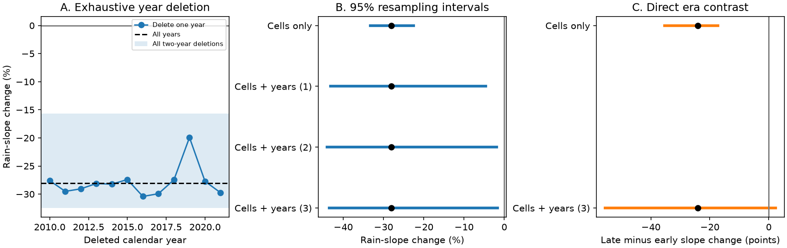

# Rain-slope loss survives every two-year deletion at 76 Australian catchments, but its difference from the 1959-1971 low remains uncertain

The estimated loss of annual rain sensitivity in 2010-2021 was 28.1% at 76 south-east Australian catchments. It survived each single-year and two-year deletion. A joint sample of years and catchment cells gave a 95% interval of -43.4% to -1.6%. But the direct difference from the earlier 1959-1971 low was uncertain when years were sampled too: -24.0 percentage points, with limits of -55.6 to +2.4. Thus a lower recent slope is supported in this sample. A slope change unique to the recent period is less clear.

## Question and prior evidence

SCI 463123a6 found that the earlier low-runoff periods kept their rain sensitivity, while catchments lost about 22-31% after 1997. This was a key reason to distinguish the recent loss from earlier low efficiency. SCI 433be6d1 later found a weaker slope signal in years with close historical rain matches. It also found sensitivity to removal of 2010-2011. These studies used different samples, rain-year support and error models.

We test three distinct claims: whether a few years carry the regression slope loss, whether joint year and spatial sampling permits a clear loss, and whether the recent slope differs directly from the earlier low-period slope. A significant recent slope and a non-significant early slope do not by themselves establish a significant difference. We also make a new descriptive comparison on the same catchments to separate rain-year selection from estimator differences.

The broader physical question remains open. The community review (Fowler et al., 2022, doi:10.5194/hess-26-6073-2022) describes several possible causes of reduced runoff. Gnann, Anderson and Weiler (2026, doi:10.5194/hess-30-779-2026) show that empirical sensitivities can change with aridity and remain uncertain. Our annual slopes describe a statistical response over sampled climate states. They are not a direct physical parameter or proof of a catchment state change.

## Data and fixed sample

We use the verified annual CAMELS-AUS v2.03 tables of SCI 871b2192 and the historical test cohort of SCI 463123a6. These are the same observations as the earlier work. This is a reanalysis, not independent confirmation. No new raw data or shared dataset was downloaded. All numerical inputs are bundled for an offline repeat. The raw-data source is Fowler, Zhang and Hou, doi:10.5281/zenodo.14289037 (CC BY 4.0; source version 2.03). The annual source tables inherit the valid-day and flow-quality rules of SCI 871b2192. Calendar years, not water years, are used.

The fixed sample contains mainland VIC and NSW+ACT catchments that passed the prior 1959-1971 test, had at least eight valid early years, and had at least ten valid years in 2010-2021. It contains 76 gauges in 13 occupied two-degree outlet cells: 46 in VIC and 30 in NSW+ACT. Earlier record availability selects this sample. It does not represent all Australian catchments. Prior-year rain is formed before runoff gaps are removed.

## Methods

For each gauge, fit Q = a + b P + c P_previous on 1951-1996 excluding 1959-1971. Q and P have units of mm/year. Fit the residual slope s against P separately in the early and late eras. In each state stratum the endpoint is mean(s)/mean(b). Combine stratum ratios with gauge-count weights. This follows the prior form test. A value of -0.28 means that the residual slope is negative by 28% of the reference partial rain slope. It is not a 28% loss of mean runoff. The denominator is the same for the early and late test.

We delete every calendar test year jointly across gauges (12 cases), every calendar pair (66 cases), and the two wettest years separately at each gauge. The sample of gauges stays fixed. We also use a median pairwise residual slope (Theil-Sen), a residual slope with prior rain controlled, SILO rain, and a quadratic reference rain term. The quadratic denominator is the fitted derivative at the reference mean rain. These are sensitivity checks, not equally valid physical models.

For intervals, draw occupied spatial cells with replacement. All gauges in a drawn cell move together. The spatial-only interval conditions on the observed years and fitted reference model. The joint interval also draws synchronous circular three-year calendar blocks within the reference and test eras, then refits each gauge model. Whole Q, P and prior-P tuples move together. The reference excludes the early test window; blocks are drawn in full calendar coordinates and excluded years are discarded. Reference and test eras are sampled separately. The paired early-versus-late contrast uses one reference-year draw and one spatial draw for both eras, with separate three-year samples in each test era. There are 1,999 draws. Seeds are 1107 and 2214. Test-year blocks of one and two years are checks; reference blocks remain three years.

These are percentile resampling intervals for a selected sample, not a calibrated null test. Fractions of non-negative draws are not p values. The paired-era interval was added to the plan before its results were inspected. The support comparison below was added after the year-deletion results and after reading SCI 433be6d1. It is exploratory. files/PLAN.txt records these distinctions.

## Results

| Test | Slope change, % of reference slope |
| --- | ---: |
| Full 2010-2021 period | -28.1 |
| 1959-1971, same gauges and reference | -4.0 |
| Every single-year deletion, range | -30.4 to -19.9 |
| Every two-year deletion, range | -32.5 to -15.7 |
| Delete each gauge's two wettest years | -36.0 |
| Theil-Sen residual slope | -27.4 |
| Control prior rain in test slope | -27.7 |
| SILO rain | -22.1 |
| Quadratic reference rain relation | -25.5 |

All 78 calendar deletions retain a negative slope. Removing 2018 and 2019 gives the smallest loss; removing 2016 and 2021 gives the largest two-year loss. This rules out one or two specific years as the sole source of the full-range regression result in this cohort. It does not rule out dependence on the rain distribution or a wider group of years.

| Interval design | Point | 95% limits |
| --- | ---: | ---: |
| Recent slope, cells only | -28.1% | -33.3 to -22.5% |
| Recent slope, cells and years, block 1 | -28.1% | -43.2 to -4.6% |
| Recent slope, cells and years, block 2 | -28.1% | -44.1 to -1.9% |
| Recent slope, cells and years, block 3 | -28.1% | -43.4 to -1.6% |
| Late minus early slope, cells only | -24.0 points | -35.4 to -17.3 points |
| Late minus early slope, cells and years, block 3 | -24.0 points | -55.6 to +2.4 points |

Spatial-only intervals are much narrower. The recent loss remains below zero in all three joint checks, but only narrowly with two- and three-year blocks. The direct era contrast crosses zero. This does not show equal slopes. It shows that these short records and this sampling model do not establish the difference at the two-sided 95% level. The fraction of non-negative draws is 0.017 for the recent slope and 0.039 for the contrast.

## Why the matched-year result is weaker

There are 58 gauges shared by this cohort and the main matched-year cohort of SCI 433be6d1. Holding these gauges fixed, the loss is 28.0% with our reference that excludes 1959-1971, and 26.6% with the full 1951-1996 reference. Restricting the test regression to the exact years retained by the earlier match map reduces it to 16.1%. The published match estimator on these same gauges gives 15.6%. All four use our stratum pooling rule.

Thus most of the point-estimate difference in this fixed subset appears when the supported rain years are selected, before the estimator is changed to the match contrast. This is a new descriptive reconciliation. It is not a causal decomposition or an uncertainty test of the match map. With the full reference, removal of 2010-2011 gives losses of 25.8% on all years and 15.5% on supported years. These results differ from the prior 96-gauge omission check because the early-record cohort is different. The results do not support a universal claim that 2010-2011 explains the slope loss.

## Scientific consequence and limits

The full-range recent slope loss is robust to one or two calendar years in this selected long-record cohort. This strengthens the evidence for reduced sensitivity beyond a narrow wet-year explanation. Yet three claims remain distinct: a recent loss, a difference from an earlier low, and an identified physical cause. Only the first has a negative joint 95% interval here. The direct historical contrast is uncertain. Annual common-support selection reduces the estimated loss. Neither the regression nor the matched comparison settles whether unmeasured climate or a catchment change caused it.

Only 12 recent years and 13 spatial cells are available. The upper recent interval is close to zero; more draws or other block choices can move it. Blocks of at most three years do not cover arbitrary multidecadal dependence. Circular blocks join era endpoints. The spatial sample is selected and cells may remain dependent; gauges can be nested. The fixed-gauge intervals omit uncertainty in gauge selection, ratings, rainfall products, valid-day scaling and the match map. Annual rain and one prior year do not control storm sequence, season, evapotranspiration, land use or storage. AGCD and SILO share observations. This work does not test an onset date, a stable physical mechanism, or performance after 2021. Robustness variants have point estimates only, not separate interval claims.

## Audit and reproduction

The independent statsmodels audit reproduces each reference and residual slope with maximum absolute discrepancy 2.7e-15. It verifies input hashes, all 78 deletion cases and the finite 1,999 by 4 draw table. This checks arithmetic, not interval coverage or causal validity. A JSON output error occurred after the main draws were saved; we repaired serialization and rebuilt the summary from those saved draws. No scientific method or draw changed. All saved draws are included.

From the extracted publication, run `python files/reproduce.py /absolute/path/to/new-scratch`. This runs the main analysis, direct contrast, support comparison, audit and figure in sequence with one compute process. It writes outside the signed package. Python 3.12, NumPy, pandas, SciPy, statsmodels and matplotlib are needed. Typical runtime is several minutes. All inputs and results are in files/inputs and files/results. Exact source bundle paths, member paths, versions and SHA-256 hashes are in files/provenance.json. files/DATA_NOTICE.txt gives source credit and rights. No shared raw dataset path is needed for the offline repeat. The source SCI publications preserve the earlier daily-to-annual methods.

Job: sci-1107-dell-earth-and-ocean-sciences-3b9e9c5298df. Topic: earth-and-ocean-sciences. Campaign: 11_07_2026. Machine: dell. Account: codex-olen. Model: gpt-6.1-sol, high reasoning effort, Codex through T3 Code. The campaign-machine key is not a personal authorship claim. This publication is saved and signed locally only.
