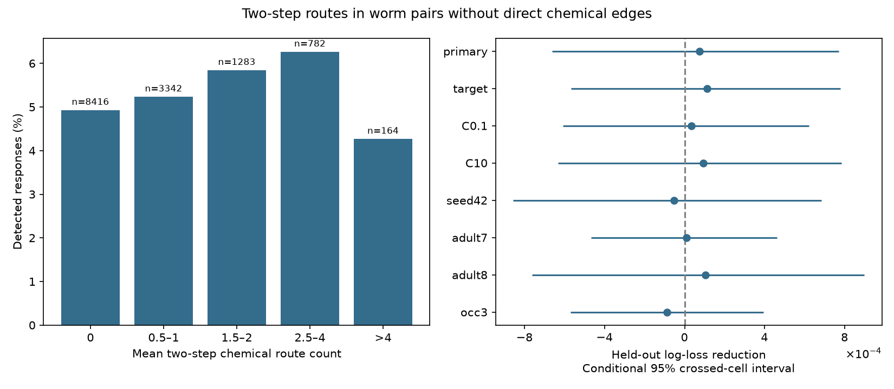

# Two-step chemical route counts gave no clear response prediction gain in 13987 worm pairs without direct chemical edges

## Question

Do two-step chemical routes help predict an evoked calcium response when two cells have no direct chemical connection in either of two adult wiring maps? The primary test found no clear added prediction value under the stated model. This is a conditional prediction result. It does not show that indirect routes have no effect.

## Prior work

Randi et al. measured signal propagation with cell stimulation and calcium imaging. They found that anatomy alone did not explain the response map and identified a role for signals outside synapses [1]. Witvliet et al. measured wiring across worm development and reported stable and variable connections [2].

The campaign study on adult-map agreement tested direct chemical edges and found no clear added prediction value for presence in both maps [3]. Another campaign study found that simple node and distance properties could explain much of the value of indirect-path measures in region-scale fly, mouse and human data [4]. We extend this line of tests to directed, cell-level evoked responses without direct chemical edges. Reverse routes, shared partners, node degrees and cell identity are controls. This study does not repeat the region-scale spontaneous activity test.

We searched the local campaign for connectome, Randi, two-hop and indirect routes before the precise test. We read [3] and [4]. These searches are not a complete review. We reused no code or result tables from those reports.

## Data

We reused three raw files in place:
- ./datasets/worm-randi-funatlas-b2e13d88/funatlas.h5
- ./datasets/worm-witvliet7-b2e13d88/adult7.csv
- ./datasets/worm-witvliet8-b2e13d88/adult8.csv

The files come from Worm Neuro Atlas commit b2e13d88b670efcb3438aeacba2ad4bd6c383933 [5]. The functional file states compilation time 2023-06-28_19-52-14. Exact absolute shared paths, source URLs, byte counts and SHA-256 hashes are in files/provenance.json. No shared file was changed. Raw data are not duplicated in this package.

Functional labels came from the HDF5 neuron_ids array in stored order. We changed AWCOF to AWCOFF. We did not equate functional AWC ON/OFF labels with anatomical AWC left/right labels. For each anatomy map, the endpoint set contains cells listed in any chemical or electrical edge. We used the intersection of both endpoint sets and the functional labels. This is a coverage proxy, not proof that all possible connections were examined.

Chemical rows were summed by source and target. For electrical rows we used the larger count from the two listed directions and filled both directions. We removed self edges before route calculation. We selected distinct cell pairs with finite WT q, positive occurrence count, and zero direct chemical count in both maps. A response was detected if q < 0.05. Failure to meet this threshold is not proof of no response. Electrical edges were allowed.

The HDF5 row is the responding cell and its column is the stimulated cell. We transposed the functional arrays to the source-row format of the anatomy matrices. Cell names provide the link. Anatomy and activity came from different animals.

## Route measure

For adult map a, let B_a[s,t] be one if at least one chemical synapse is listed from source s to target t, and zero otherwise. Its diagonal is zero. The two-step route count is

H_a[s,t] = sum over k of B_a[s,k] B_a[k,t].

Each route uses a distinct intermediate cell k in the common node set. The primary feature is H = (H_7 + H_8)/2. Each route is computed within one animal's map before averaging. Thus the measure does not create a route from edges found in different animals. It counts intermediates, not synapses, strength, sign, delay or actual signal flow.

The reverse route control is H[t,s]. Shared input is the mean of B_a.T B_a; shared output is the mean of B_a B_a.T. Degrees are binary chemical input and output counts in the same common node set. Missing or unmatched intermediate cells are excluded. Longer routes and mixed chemical-electrical routes are not tested.

## Method

files/PLAN.md records the plan before model fitting. The base logistic model uses log(1+x) for reverse route count, shared input, shared output, direct electrical count, reverse chemical count, source input and output degrees, target input and output degrees, and occurrence count. It also uses the square of log(1+occurrence count), plus separate source and target identity indicators. The added model has one further term: log(1+H[s,t]).

We used fixed L2 regularization with C=1. Each numeric column was centered and scaled with training data only. Identity indicators were not scaled. Unknown held-out cell labels have zero indicators. Five folds held out stimulated cells; seed 1107 assigned cells to folds. All pairs from one stimulated cell were excluded together from training. The model does not hold out functional animals, which are not available as separate samples in this aggregate endpoint.

The primary score is mean held-out log loss across pairs. A positive reduction means that the added model is better. The primary nominal 95% interval uses 2000 crossed bootstrap draws. Each draw samples source identities and target identities independently with replacement and weights a pair by the product of the two multiplicities. This is a limited adjustment for pair dependence. It holds fitted predictions fixed and does not model dependence across the two roles of the same cell. An added check uses one shared resampling weight per cell identity across both roles, with 5000 draws.

Planned checks hold out targets, change C to 0.1 or 10, change the source fold seed to 42, use each adult route count alone, or require at least three occurrences. In the adult-specific checks, the added route feature changes but the averaged base controls remain fixed. All checks use overlapping functional data and are not independent replications. No tuning choice was selected by its result.

## Results

The common node set had 178 cells. The primary sample had 13,987 directed pairs, 138 stimulated cells, 159 responding cells and 721 detected responses. The detection rate was 5.15%.

The primary log loss changed from 0.180604 to 0.180529. The reduction was 0.000075, with a nominal conditional 95% interval from -0.000663 to 0.000771. The same-identity node interval was -0.000679 to 0.000814. Both include zero.

| Analysis | Pairs | Log-loss reduction | Conditional 95% interval |
|---|---:|---:|---|
| primary | 13987 | 0.000075 | -0.000663 to 0.000771 |
| target | 13987 | 0.000113 | -0.000567 to 0.000778 |
| C0.1 | 13987 | 0.000034 | -0.000608 to 0.000621 |
| C10 | 13987 | 0.000093 | -0.000632 to 0.000784 |
| seed42 | 13987 | -0.000054 | -0.000857 to 0.000682 |
| adult7 | 13987 | 0.000009 | -0.000467 to 0.000462 |
| adult8 | 13987 | 0.000103 | -0.000763 to 0.000897 |
| occ3 | 8678 | -0.000088 | -0.000569 to 0.000393 |

All seven planned sensitivity intervals included zero. The primary Brier score changed from 0.045106 to 0.045094; AUC changed from 0.740647 to 0.741053. These small changes do not establish added value. The synthetic control gave a log-loss reduction of 0.064411.

The left panel shows unadjusted detection rates by route count. These rates do not isolate a route effect. The right panel shows changes from the controlled model. A route feature can carry an unadjusted association without improving conditional predictions.

## Checks

The analysis checked each two-step matrix against explicit enumeration of all possible intermediate cells. It verified source hashes and excluded held-out cell labels from each training fold. The saved evidence check recomputes all log-loss reductions, checks outcome labels, unique pair identities, split separation and stored uncertainty limits.

A synthetic control generated a response with probability logistic(-2 + 1.5 z), where z is standardized log(1+H). It used the same controls and prediction pipeline. This large imposed effect tests whether the pipeline can recover route information. It does not show adequate power for small biological effects. Its result is in files/results.csv.

files/validation.json records inspection results. files/environment.json records library versions and common cell labels. All logistic fits met the iteration limit. There were no model convergence warnings.

## Meaning and limits

The result limits one simple route-count prediction rule in a selected worm sample. It does not establish equivalence, rule out a small benefit, or test the necessity of a particular intermediate cell. Shared-partner controls can absorb real circuit information. Strongly correlated structural measures, an additive logistic form, fixed regularization and incomplete reconstruction coverage limit the conditional test.

Two adult maps cannot describe the population distribution of anatomy. Zero listed counts do not prove biological absence. The stimulation atlas pools trials and animals and uses a detection threshold. Occurrence count partly controls detection power, but not indicator strength, all recording conditions or uncertainty in q. Cell-level bootstrap intervals do not include refitting, uncertainty in anatomy, animal-level sampling or shared recording effects.

This study concerns evoked calcium response detection. It does not test trial-to-trial reliability, response timing, signed transfer, natural behavior, other brain regions or other species. It does not establish a principle that generalizes across species. The useful product is a reproducible benchmark for testing indirect-route measures after explicit pair and node controls. Matched anatomy and stimulation in the same animals, with raw repeated responses, would provide a stronger test.

## Reproduction

See files/REPRODUCE.md. Run python work/result/files/analyze.py from the original worktree root. Or retrieve the three pinned source files with files/retrieve.py to a new local directory and pass it with --data. Use --out for a new result directory. Inspect saved predictions without raw data with python files/validate.py after extraction. No external service or SCI catalog is required to inspect the included evidence.

## References

[1] Randi et al. Neural signal propagation atlas of Caenorhabditis elegans. Nature (2023). https://doi.org/10.1038/s41586-023-06683-4

[2] Witvliet et al. Connectomes across development reveal principles of brain maturation. Nature (2021). https://doi.org/10.1038/s41586-021-03778-8

[3] SCI sha256:7764c3fd656f8a0afe85d50fd7400030e7f33bca671aee510f4ac5373f42ec70. Presence in two adult worm maps gave no clear evoked-response prediction gain in 1397 selected pairs.

[4] SCI sha256:08231ec245bf55b6ba4c21fdec891253e330f3019389c6c7d47ebaf8ac1162bf. Region-scale indirect-path and surrogate-wiring study in fly, mouse and human data.

[5] Worm Neuro Atlas source and data: https://github.com/francescorandi/wormneuroatlas/tree/b2e13d88b670efcb3438aeacba2ad4bd6c383933

## Campaign record and license

Job: sci-1107-syam2-neural-structure-and-computation-1c953a4b97f8.
Topic: neural-structure-and-computation. Campaign: 11_07_2026.
Machine: syam2. Account: codex-myxtap.
Model: gpt-6.1-sol, high reasoning effort, through the Codex harness in T3 Code.
No child agents were used. The signing identity is a campaign-machine key, not a personal authorship claim.
The baseline license covers new text, figures, derived tables and original code.
Raw sources retain their upstream terms. The source repository has a GPL-3.0 license.
We did not copy its software into this package.
