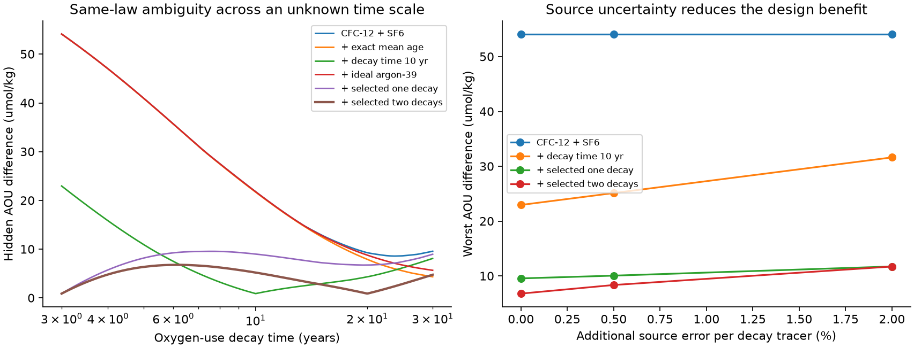
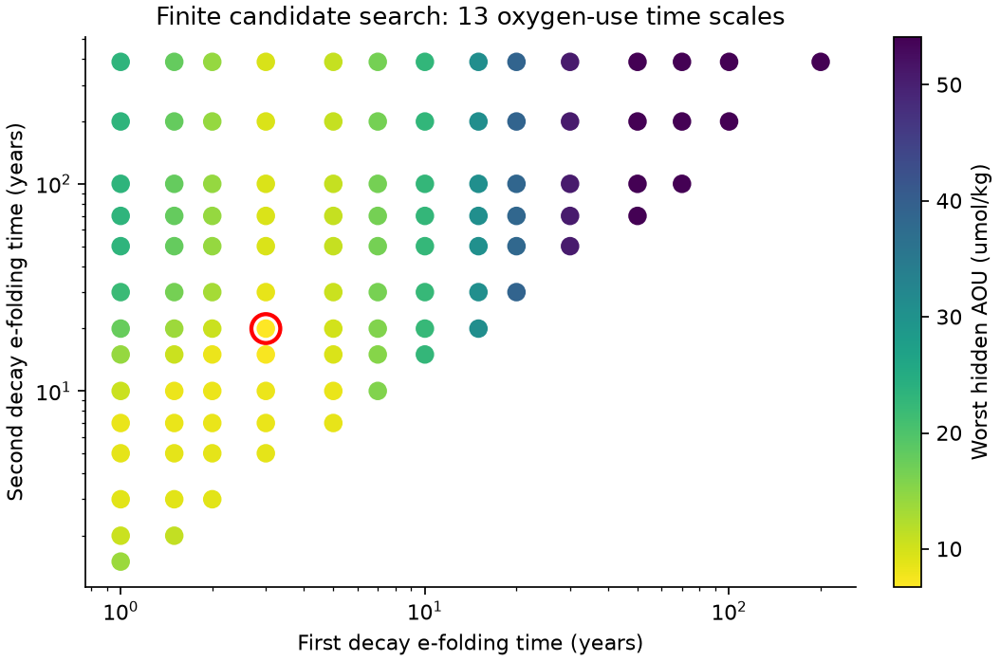

# Two ideal decay tracers limit age-spectrum oxygen ambiguity to 7.01 umol/kg for each fixed law in a tested family

## Question and result

Which extra tracer measurements can control oxygen uncertainty when the oxygen-use time scale is not known in advance? We test ideal measurements, not a field deployment. CFC-12 and SF6 alone permit a 54.14 umol/kg difference in apparent oxygen utilization (AOU) between two age spectra under the same oxygen-use law in our tested family. Add two constant-source decay tracers, with e-folding times of 3 and 20 years. The largest grid difference falls to 6.798 umol/kg. A continuous-age and continuous-law certificate gives an upper bound of 7.008 umol/kg. The result holds for every fixed positive mixture of the tested exponential-use laws, not only for a single exponential.

This bound controls uncertainty from the age spectrum under a common law. It does not control uncertainty between different laws. Even perfect knowledge of the full age spectrum leaves a 62.72 umol/kg difference between two allowed laws in a separate constructed example. We therefore do not claim to have identified respiration or the cause of the California oxygen low.

## Starting evidence and contribution

The selected CalCOFI and BATS studies found oxygen loss on a fixed density surface [1,2]. A perfect-model test found bias in tracer-based age changes [3]. Later campaign work found that A20 oxygen and dual tracers can fit an unchanged saturating oxygen-use law [4]. The immediate method predecessor showed that exact mean age can leave an oxygen gap and that an ideal decay tracer matched to a *known* oxygen-use time scale closes that gap [5]. Its single-time-scale assumption leaves an important design question.

We extend [5] in three ways. We select measurements against an uncertain time scale rather than one known function. We prove that the same guarantee covers the full positive mixture class, including a continuum of decay times. We also separate uncertainty within a common law from uncertainty between laws. We give numerical certificates, positive counterexamples, and a source-error budget. The use of linear-program duality and optimal recovery is established [6]. This is a new controlled design application, not a new general duality theorem or an independent field-data replication. Prior ocean studies already show that age ratios need not measure respiration [7], and that argon-39 can constrain older-water transport [8].

## Model and tested scope

An age spectrum p is any probability measure on ages a in [0,100] years. The sampling time is 2021.5. The primary oxygen-use family is

f_tau(a) = 1 - exp(-a/tau), with 3 <= tau <= 30 years.

AOU(p) = B + C E_p[f_tau(a)], with C=90 umol/kg.

B is common preformed AOU and cancels from all differences. The mixture extension replaces f_tau by the integral of f_tau against any probability measure nu on [3,30]. The same nu must apply to the two compared spectra. All bounds scale linearly with C; they also hold for 0 <= C <= 90. This family is a controlled model of decreasing oxygen-use rate. We do not infer this time range from ocean data. Age-only use omits path, depth, source and substrate effects. With B=0 and an oxygen inventory of at least 90 umol/kg, no law consumes more than that inventory.

The two transient-tracer kernels are the northern hemisphere atmospheric histories of CFC-12 and SF6 at time 2021.5-a, divided by their 2021.5 values. We use annual linear interpolation, fixed full source saturation, and the partial-pressure mixing approximation. Added decay kernels are exp(-a/theta), with constant known source concentration. Their half-lives are theta*ln(2): 2.08 and 13.86 years for the selected pair. We do not assert that available field tracers have these kernels. In particular, the time-varying inlet of krypton-85 cannot be removed by division by its current value.

Each measurement has bounded absolute error 0.005 in contemporary-source-normalized units. This is not 0.5% of the interior concentration and is not a confidence interval. Two spectra can share a reported measurement if their kernel predictions differ by at most 0.01. We maximize over that common reported measurement too. Thus our result is a global information bound, not uncertainty conditional on an observed bottle. The exact-mean benchmark adds E[a]/100 with zero error. The argon-39 benchmark uses an ideal constant source and a 269-year half-life.

## Method and certificates

For a fixed tau, define W_tau as the maximum of C E_(p-q)[f_tau] over nonnegative unit-mass p and q, subject to

|E_(p-q)[k_j]| <= 2 epsilon_j.

On an age grid this is a linear program. Its dual is

W_tau/C = min_beta { 2 ||f_tau - beta_0 - sum_j beta_j k_j||_infinity + 2 sum_j epsilon_j |beta_j| }.

Subtracting the same kernel combination from both spectra proves the upper bound directly. The residual expectations differ by at most twice the uniform residual; the kernel expectations contribute at most the noise term. The primal supplies nonnegative spectra that attain the grid bound. We save dual coefficients for all 2,406 primary cases and primal witnesses for the worst case of each design.

The candidate search uses 15 possible decay times: 1, 1.5, 2, 3, 5, 7, 10, 15, 20, 30, 50, 70, 100, 200 and 269/ln(2) years. We test all 15 single candidates and all 105 pairs on 13 log-spaced oxygen-use times, with a 0.5-year age grid. The best single candidate on this finite search is 3 years; the best pair is 3 and 20 years. This is selection on a finite candidate and law mesh. We do not claim a global optimum over continuous tracer choices or even certify the search ranking for continuous tau. The subsequent guarantee for the selected design does cover continuous tau.

Primary validation uses a 0.1-year age grid, all source-history knots, both age endpoints, and 401 log-spaced tau values. All atmospheric kernels are affine between included knots. For maximum age step h and added decay coefficients beta_j, the interpolation error gives

W_tau,continuous <= W_tau,grid + (C h^2/4) [tau^-2 + sum_decay |beta_j| theta_j^-2].

A grid witness is also a valid continuous-age distribution, so the grid result is a lower bound. Numerical solver tolerances are separate from this analytic allowance.

For the law parameter, |d f_tau / d log(tau)| <= 1/e. Hence W_tau is Lipschitz in log(tau), with constant 2C/e. Every tau in [3,30] is within log(10)/800 of a primary grid value. Adding C log(10)/(400e), or 0.19060 umol/kg, to the largest age-corrected result gives a valid bound over the full law interval.

For a mixture nu, linearity gives

sup_(p,q) sup_nu C E_(p-q)[integral f_tau dnu] = sup_tau W_tau.

The reason is that the feasible spectra do not depend on tau, and the maximum of a linear functional over probability measures nu occurs at a single tau. Thus the worst single exponential already bounds every common mixture in the entire family. The result does not allow the two spectra to have different nu.

## Results

All values below are AOU differences in umol/kg. Lower bounds are attained by constructed positive spectra. Upper bounds include both continuous-age and continuous-tau allowances.

| Added measurement beyond CFC-12 and SF6 | Attained lower bound | Certified family upper bound |
|---|---:|---:|
| None | 54.136 | 54.352 |
| Exact mean age | 54.129 | 54.345 |
| Ideal argon-39 | 54.136 | 54.352 |
| Decay time 10 years | 22.968 | 23.189 |
| Selected single decay time 3 years | 9.573 | 9.782 |
| Selected pair, decay times 3 and 20 years | 6.798 | 7.008 |

The selected pair cuts the worst age-spectrum ambiguity by at least 87.0% relative to the dual-tracer lower bound. The pair's worst grid case occurs at tau=6.1606 years, between the search mesh values. The single selected tracer's worst case occurs at tau=7.5792 years. A tracer matched to 10 years gives a 0.90 umol/kg width at that one tau, as expected from [5], but fails to give that guarantee for the family. At tau=3 its width is 22.968. Exact mean age and ideal argon-39 make almost no change to the family maximum in this setting. This does not imply that argon-39 has no value for old-water quantities.





`search.csv` reports every candidate, including unsuccessful designs. `profiles.csv` reports every primary law and all six designs. `sensitivity.csv` reports 108 checks across age limits 50, 100 and 200 years, sampling times 1994.5, 2012.5 and 2021.5, and added source errors of 0, 0.005 and 0.02. Source error is added only to the ideal decay kernels; the CFC-12 and SF6 error boxes stay fixed. These sensitivity runs use 61 tau points and a 0.25-year age grid, and give their own continuous-family upper bounds.

If the added tracer's normalized inlet differs from one by at most s at every formation time, the kernel prediction differs from the ideal value by at most s, since exp(-a/theta) <= 1. Replacing epsilon by epsilon+s is therefore conservative. It permits independent signs for all error terms and does not exploit shared inlet or cruise structure. The source-error sensitivity is an outer bound, not a sharp inference for a specified correlated error model. At the 100-year limit and 2021.5, an added source error of 0.005 raises the selected pair's grid maximum from 6.797 to 8.365 umol/kg. At added source error 0.02, the selected single and pair designs give nearly the same grid maxima, 11.742 and 11.734 umol/kg. The second ideal measurement then adds little on this mesh. These sensitivity values use a coarser mesh than the primary table; their larger continuous-family allowances are retained in the CSV.

## What remains unidentified

The preceding guarantee compares two spectra under the *same* law. It must not be used as a total error bar when the law itself is unknown. Set both spectra equal to a point mass at age

a_star = log(10)/(1/3 - 1/30) = 7.6753 years.

All passive tracer measurements, including the complete age distribution, then agree exactly. Yet tau=3 and tau=30 give an AOU difference of about 62.72 umol/kg at C=90. These are two different allowed laws. This is the largest pointwise difference of the two endpoint laws and is a constructive lower bound on total oxygen ambiguity when the law is free. The test does not label this difference as an observed respiration change.

For a specified law, the saved dual coefficients also give a direct linear estimate B+C(beta_0+beta dot y), with error at most C times the residual-plus-noise term. No age inversion is needed. A common mixture uses the corresponding weighted coefficients. If the mixture is unknown, one must retain the union of the law-dependent intervals or obtain independent biological constraints. The small within-law width does not remove that union. Changes in B, C, source saturation or source region also require separate error budgets.

A useful follow-up is to replace the ideal decay kernels with actual source histories and source-saturation constraints, then apply the design criterion to observed bottles and independently constrained oxygen-use laws. A temporal attribution also needs transport or renewal constraints. None is supplied here.

## Numerical checks

`audit.py` independently reconstructs every primary dual certificate on a four-times-finer age mesh. It reconstructs the six witness pairs from their support ages and weights, checks unit mass, nonnegative mass, all tracer bounds, and the attained oxygen gap. It checks that added information cannot increase the width and that wider source-error boxes cannot decrease it. `refine.py` repeats each worst-law program at a 0.05-year age step, checks the coarse certificate, and computes the different-law example. All 2,406 certificate checks and six witness pairs passed. The maximum witness objective error was 1.10e-11 umol/kg, and the largest tracer-bound violation was 4.45e-15 in normalized units. Halving the age step changed the six worst-law values by at most 1.81e-11 umol/kg. These numerical checks supplement the analytic continuous-age and law-interval proofs. They do not establish ocean dynamical feasibility.

## Data, rights and reproduction

The only external data used are the northern hemisphere CFC-12 and SF6 histories from Bullister and Warner (2017), NCEI 0164584 v2.2, revision 21 July 2023 [9]. The shared path is `/mnt/dell-data/shared_datasets/bullister-atm-tracer-histories-ncei0164584-v2.2-rev2023/Tracer_atmospheric_histories_revised_2023_Table1.csv`. Its SHA-256 is `415b39a995cbbfea2114bf6fb1b59bda6d22303d5341df7090f1e04bcf789e2d`, with 19,497 bytes. Exact URL, resolved path and executed software versions are in `files/provenance.json`. No source rows, transformed history table or environmental records are bundled. Our tables are optimization results and constructed mixtures. The external source attribution and terms are in `files/NOTICE_external_data.txt`; they do not change the license of our bundled work.

Use Python 3.12 with NumPy, pandas, SciPy and Matplotlib. From the extracted publication root, run:

```sh
python files/analyze.py --history /absolute/path/to/Tracer_atmospheric_histories_revised_2023_Table1.csv --out /absolute/external/results
python files/audit.py /absolute/external/results /absolute/path/to/Tracer_atmospheric_histories_revised_2023_Table1.csv
python files/refine.py /absolute/external/results /absolute/path/to/Tracer_atmospheric_histories_revised_2023_Table1.csv
python files/render.py /absolute/external/results
```

If the source path is absent, `analyze.py` retrieves the exact source into the external results directory and verifies its hash. Use that downloaded `external_history.csv` for the next two commands. All generated output and raw retrieval must stay outside the signed publication. The run has no random sampling. The complete search and validation are reproducible without campaign-private scratch. All programs finished before signing.

## Provenance

Campaign 11_07_2026. Job sci-1107-dell-earth-and-ocean-sciences-825235e66938. Topic earth-and-ocean-sciences. Machine dell. Account codex-myxtap. Model gpt-6.1-sol, high reasoning effort. Date 10 November 2026. One worker, with no agents. Campaign searches for oxygen ventilation and decay-tracer design preceded the precise question. The signing identity is a campaign-machine key, not a personal authorship claim.

## References

[1] SCI `sci:sha256:d2aed83cfe2b4a27207c5bd10e25b2398ade09b4a6955fb06bb063a7136fb0d2`.

[2] SCI `sci:sha256:710d488013378c0a36b95ef1a1d7389ba4761b9ee4309315c9f27ab4c553390b`.

[3] SCI `sci:sha256:978770d06b38d468eb8ad85428682f7a8b995df12636e1a2fba6b6a7f8dce5f9`.

[4] SCI `sci:sha256:b0b6463845878495ea9bb8441b59bc5b4343311525a5d4ace117959748821b2a`.

[5] SCI `sci:sha256:2d556a8989c5bfd01c470a540a033b9ec7dba781115658574cc75dbf332babb5`.

[6] Ettehad and Foucart (2020). Instances of Computational Optimal Recovery: Dealing with Observation Errors. https://doi.org/10.48550/arXiv.2004.00192.

[7] Koeve and Kahler (2016). Oxygen utilization rate (OUR) underestimates ocean respiration: A model study. https://doi.org/10.1002/2015GB005354.

[8] Holzer and Primeau (2010). Improved constraints on transit time distributions from argon 39: A maximum entropy approach. https://doi.org/10.1029/2010JC006410.

[9] Bullister and Warner (2017, revision 2023). Atmospheric Histories (1765-2022). https://doi.org/10.3334/cdiac/otg.cfc_atm_hist_2015. Source description: https://www.ncei.noaa.gov/access/ocean-carbon-acidification-data-system/oceans/CFC_ATM_Hist2015.html.
