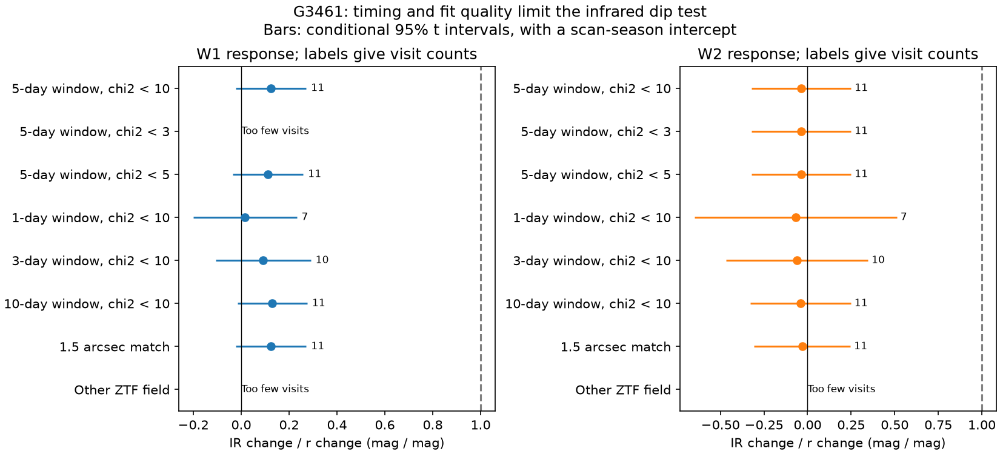
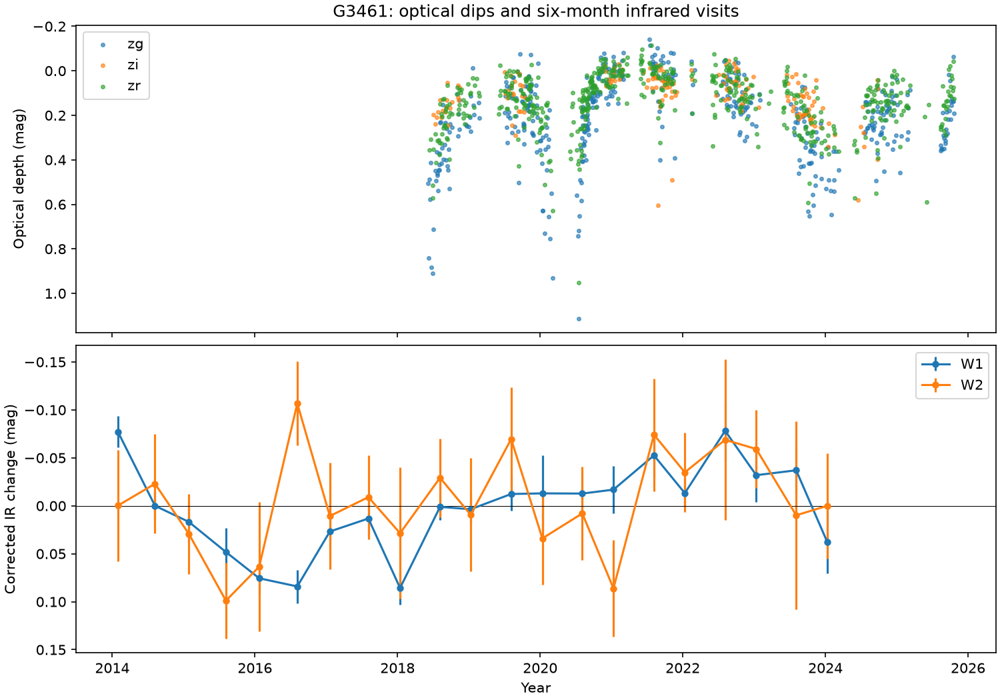

# NEOWISE does not establish an infrared dip signal for the field-dwarf candidate G3461

Job: sci-1107-dell-astronomy-fb9bc1f6a16e. Topic: astronomy. Machine: dell. Account: codex-olen. Model: gpt-6.1-sol, high reasoning effort, Codex harness in T3 Code. Campaign: 11_07_2026. Date: 2026-11-11. The signing key is a campaign-machine key. It is not a personal authorship claim.

## Result

We tested the infrared history of Gaia DR3 346100804155947392 (G3461), an M0 dwarf candidate from the PS1 versus Gaia XP epoch survey. That survey reported a 0.54 mag r-band fade in the Gaia era and later irregular ZTF dips. It did not test the NEOWISE history. Our new reduction does not establish an infrared dip signal. It also does not rule out dust. The data permit weak infrared extinction, constant infrared emission, and several other causes.

The result is useful because an optical dip with little infrared loss can support small dust grains only when the infrared measurement and the optical state are reliable. Here, sparse time sampling and poor W1 profile fits prevent that inference. A five-day matching window gives a weak W1 correlation. A one-day window gives a value near zero with fewer visits. Neither gives a positive response at the conditional 95 percent level after a scan-season offset is fitted. W2 gives no positive response in either test.

Figure 1. Infrared response to optical r depth. Bars are conditional 95 percent Student-t intervals from unweighted regression with an intercept and a scan-season offset. Numbers give matched visit counts. The vertical line at one is the response of one undiluted grey variable source with no changing emission. These are response coefficients, not measured dust opacities. Timing errors, blending and errors in optical depth are not included in the intervals.

## Prior work and the question

SCI 18a495b2ffb3 found two long dust-like fades among 29 million dwarfs. One was G3461: quiet PS1 measurements in 2010-2014, a faint mean in Gaia, and irregular ZTF dips through 2025. Its spectral type, age and dust identification remain unconfirmed. The survey reported W1-W2 = -0.03 and a tentative W3 signal. It specifically lacked a NEOWISE analysis for this candidate.

Other campaign work has shown weak infrared extinction during deep optical dips, and variable dust emission in some stars (SCI e9c525bef489). Extreme warm dust occurs around some genuine dimmers, but WISE blends are frequent in excess-selected samples (SCI f7d8682b6cf3). These results motivate an independent infrared test for G3461. A local campaign search for the full Gaia identifier returned only SCI 18a495b2ffb3. A broader search for Gaia20cdd was also made before this question was selected. Public prior work includes the ZTF main-sequence dipper search of Tzanidakis et al. (2025), arXiv:2508.03964. We do not claim a new star or a new physical mechanism.

Question: does G3461 show a stable infrared response to its optical dips or a persistent change between its early and late NEOWISE visits?

## Data and method

All raw inputs remain outside this publication. Exact source URLs, shared paths, byte counts and SHA-256 hashes are in `files/provenance.json`. The shared store is accessed through `./datasets`; the resolved paths point to the HP SSD through the compatibility mount. No failed HDD was accessed.

We retrieved the public AllWISE catalogue in a 0.06 degree cone, the NEOWISE single-exposure database in the same cone, and the SNAD mirror of ZTF DR24 within 1.5 arcseconds of the published Gaia position. There are 212 AllWISE sources and 34,979 NEOWISE records in the cone. NEOWISE contains 317 detections matched within two arcseconds of the target, in 21 visits from 2014 to early 2024. A gap larger than 50 days defines a new visit. A record must be within ten days of its visit centre. The target AllWISE centroid is 0.233 arcseconds from the published Gaia position. The nearest separate AllWISE source is 7.52 arcseconds away. Its W1 magnitude is about 1.1 mag fainter; this source has a W1 artefact flag. It is a contamination warning, not proof of a physical neighbour or of a blend in every frame. We do not treat a small catalogue centroid offset as proof that W3 is circumstellar.

For each band we require frame quality greater than zero, positive SAA separation, moon flag 00, a zero contamination flag for that band, and a profile-fit reduced chi-squared below the tested limit. The default exploratory limit is 10. Limits of 5 and 3 test quality sensitivity. We use the median profile-fit flux in each visit, then convert that flux to a relative magnitude. We impose no signal-to-noise cut on the band flux. This avoids discarding faint W2 measurements and avoids using an upper-limit magnitude as a detection. A visit needs at least five retained records. Its formal error is 1.253 times the larger of the median reported flux error and the robust flux scatter, divided by the square root of the record count, then propagated to magnitude. These errors are approximate and need not describe correlated frame noise.

Controls have AllWISE W1 within one magnitude of the target, zero catalogue flags, no extension, and no separate AllWISE source within 12 arcseconds. Ten controls have at least 15 usable visits in each band. For each control, subtract its median visit magnitude. Subtract the median control residual of each visit from the target. No control is selected for a small observed variability amplitude. Control count is small, and the controls have no independent proof of constant flux. We do not remove unresolved Gaia neighbours or fit the WISE images.

The primary optical series uses ZTF field 697 only, which has g, r and i data. This avoids mixing camera offsets. We use nightly median magnitudes and define each band's depth from its 10th percentile magnitude. This gives relative depths rather than absolute extinction. The mirror light curves already contain its good-epoch subset. The independent field 1737 is tested separately. There is no transformation to the PS1 system, no stellar template, and no claim of an absolute optical zero point.

For each infrared visit, take the median r depth of nights within the tested half-window of 1, 3, 5 or 10 days of the infrared median time. A match needs at least one r night. These are near-time measurements, not simultaneous measurements. The five-day test has 11 matched visits and r depths from -0.026 to 0.322 mag; it does not sample the deepest published dips. Fit

    IR_relative = intercept + slope * r_depth + season_offset * (visit_index modulo 2).

The last term allows the two alternating scan seasons to have different offsets. It is a proxy for scan direction; no attitude solution was retrieved. The regression is unweighted. Its error comes from its residual variance with n-3 degrees of freedom. The tabulated t intervals condition on fixed optical depths, independent equal-variance residuals, and the selected visits. They do not give full physical uncertainty. Control response fits and leave-one-visit-out checks are also stored. A second calculation removes the two intercept terms first and verifies the slope independently. A synthetic unit response on each available design matrix recovers one to numerical precision. This checks algebra, not end-to-end detection completeness.

## Quantitative results

| Test | Band | Matched visits | Response in mag per r mag | Conditional 95 percent interval |
| --- | --- | --- | --- | --- |
| Five-day window, profile chi2 < 10 | W1 | 11 | 0.124 | -0.024 to 0.272 |
| One-day window, profile chi2 < 10 | W1 | 7 | 0.015 | -0.201 to 0.232 |
| Five-day window, profile chi2 < 5 | W1 | 11 | 0.112 | -0.036 to 0.259 |
| Five-day window, profile chi2 < 3 | W1 | 1 | Not fitted | Not available |
| Five-day window, profile chi2 < 10 | W2 | 11 | -0.036 | -0.323 to 0.250 |
| One-day window, profile chi2 < 10 | W2 | 7 | -0.068 | -0.650 to 0.513 |

A simple five-day regression without the scan-season term gives W1 slope 0.147 +/- 0.062 and nominal p = 0.040. This is not stable evidence for a physical extinction law: it is weak before the season term, it passes no 95 percent test with that term, and the closer-time subset gives a smaller value with a larger error. Since the subsets overlap and have different sizes, their coefficient difference is not itself evidence of bias or a measured time lag.

Quality is a major limitation. The target median reduced profile chi2 is 3.845 in W1 and 0.871 in W2. Only 26.5 percent of its raw W1 detections have chi2 < 3, versus 99.4 percent in W2. The strict W1 cut leaves five usable visits and only one optical match. Thus the W1 result uses many fits that the strict reduction rejects. It must not be used as a precise grain-size measurement. A 1.5 arcsecond match radius leaves the W1 coefficient unchanged and changes the W2 coefficient to -0.030. The other ZTF field has too few matched visits for the three-parameter regression.

For the five-day main fit, leaving out one matched visit at a time gives W1 slopes 0.088-0.159 and W2 slopes -0.081 to 0.107. W2 control slopes span -0.278 to 0.342. The absence of a W2 correlation is consistent with the control variation. No statistical test here establishes infrared brightening during the optical dips.

As a separate slow-change test, compare all visits before 2018 with visits from 2020 onward. There are eight early and nine late visits in the relaxed reduction. Early minus late corrected magnitude is +0.0476 in W1 and +0.0189 in W2. Formal errors are 0.0113 and 0.0272 mag. The scatter of the same contrast among ten controls is 0.0164 and 0.0395 mag. Adding those terms in quadrature gives descriptive errors of about 0.020 and 0.048 mag. These are noise scales, not calibrated confidence intervals. Under the strict cut, W1 gives +0.0473 with only three early and two late visits and a formal error of 0.0320 mag. W2 stays close to the relaxed result. The control rank cannot give a tail probability below 1/11. The weak W1 slow change is not an independently confirmed dust event.

Figure 2. ZTF nightly relative depths and control-corrected NEOWISE visits. Each band has its own optical or infrared reference level. Optical points and infrared visits are not simultaneous. The large difference in time sampling is part of the result. W1 uses the relaxed quality cut for this figure.

## What this changes and what it does not show

This adds an independent infrared check to the new epoch-selected candidate. NEOWISE does not yet give a stable positive dip response for G3461. It does not independently strengthen the dust classification. A shallow infrared response remains permitted and is compatible with small-grain extinction. Within the specified regression, an undiluted unit grey response is outside the intervals. This is not a general exclusion of a grey occulter: constant contaminating light, variable dust emission, timing error, and regression dilution can all change the response.

No ice band, warm-dust temperature, dust supply, grain radius, stellar age or new prevalence is measured. Starspots are not excluded. The reported W3 excess is weak and has not been remeasured on images. The target may be young. There are too few independent infrared visits to test rapid optical events well. Residuals may be correlated, control corrections share errors, optical reference levels can change, and the error model does not include all these effects. The eight analysis variants were chosen after inspecting fit quality and the first result; they are sensitivity checks, not independent replications.

The decisive next observations are simultaneous optical and infrared photometry in a dip, WISE image fitting that models the nearby source, and spectra for youth and activity. Those are proposed tests, not completed work.

## Reproduction and rights

Use Python 3.12 with numpy, pandas, scipy, astropy and matplotlib. Exact versions are in `files/provenance.json`. Use one numerical thread. All reproduction outputs must go to separate scratch, never into the signed package.

With the shared immutable inputs:

    bash /path/to/publication/files/reproduce.sh /path/to/datasets /path/to/scratch

Without the shared inputs:

    python /path/to/publication/files/retrieve.py /path/to/external_data
    bash /path/to/publication/files/reproduce.sh /path/to/external_data /path/to/scratch

Compare scratch/results with files/results. Retrieval checks hashes. Live Gator output can have new header times, and live archives can change data. A changed hash must be inspected; a fresh download is not claimed to be the identical frozen input. The shared immutable files are the exact evidence used here. The reproduction takes minutes with cached inputs and uses at most one compute process. The scratch cache and scratch_target.csv are external intermediate tables and are not bundled.

The package contains original code, text, two figures, aggregate visit results, all sensitivity summaries, numerical checks and source provenance. It contains no raw catalogue extract or raw light curve. See files/NOTICE.md for external terms and credits. IRSA states that its public data have no usage restrictions, except for separately identified copyrighted products; no such product was used here. We claim the SCI baseline terms only for the bundled original material. This publication is saved locally. No remote submission was made by this worker.
