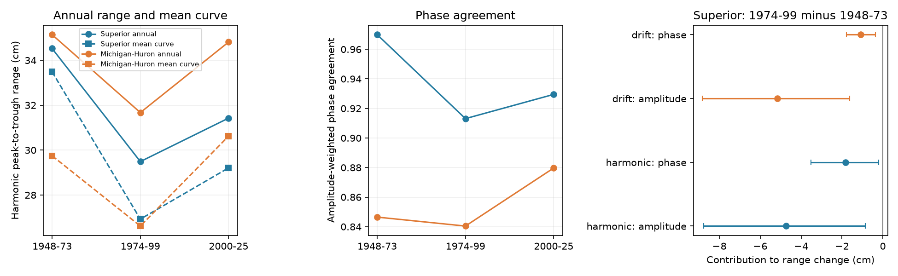

# Weaker weighted phase agreement accounted for 1.82 cm of Superior's 6.56 cm mean harmonic range loss from 1948-1973 to 1974-1999

Lake Superior's mean annual harmonic range fell from 33.49 to 26.93 cm in these two periods. An exact decomposition assigns -4.74 cm to the change in mean annual range and -1.82 cm to the change in weighted phase agreement. Conditional 95% three-year block intervals are -8.77 to -0.86 cm and -3.53 to -0.20 cm. Thus, both smaller annual cycles and weaker timing agreement contributed to the fitted decrease. These are statistical contributions, not physical causes.

The point shares are 72.3% for annual range and 27.7% for phase agreement. The main test does not clearly show which contribution is larger: phase minus amplitude is +2.92 cm, interval -0.88 to +6.95 cm. The planned hypothesis that phase variation accounts for most of the loss is not supported. This is not proof that its share is less than one half.

The left and center panels show descriptive period estimates without intervals. The right panel shows Superior's early-to-middle contributions and conditional 95% three-year block intervals. The drift model adds a separate linear slope in each year. All ranges refer to fitted first harmonics, not observed yearly maximum minus minimum.

## Question and prior work

A smaller mean seasonal cycle can have two different sources: a smaller cycle in each year, or less agreement in the times of their peaks. This distinction is useful when mean seasonal curves are used to describe water conditions.

Lenters (2004), DOI 10.1016/S0380-1330(04)70375-5, reports a weaker Superior seasonal cycle during 1948-1999. The publisher abstract links that change to seasonal water supply. We accessed the abstract, not the full article. Lenters (2001), DOI 10.1016/S0380-1330(01)70650-8, also reports seasonal level and timing changes. This study does not repeat their physical attribution.

Prior SCI publication ae4d926a9c39cf0daf6acb0e3ce8f9cb6f4db71dce8b3cbfaa98dd04ee0528de compared harmonic ranges in three periods and found no clear further loss after 1999. It noted that phase changes can affect the mean range. We reuse its source snapshots, period bounds and model forms. We wrote new code and add an exact decomposition of range change, uncertainty for each contribution, and a year omission check. We do not claim that the older range estimates are new evidence. The new result separates two sources of that change.

Campaign searches for Great Lakes and phase coherence preceded the calculations. The plan in files/PLAN.md was written before the new decomposition was computed. This is a targeted follow-up to known results, not an independent confirmation or a test of a question chosen without prior results.

## Data

The Coordinating Committee on Great Lakes Basic Hydraulic and Hydrologic Data supplies coordinated monthly lake-wide means, version v2025, DOI 10.5281/zenodo.21908489. The release page gives 12 August 2026 as the publication date. ECCC and USACE compute levels from public gauges. Units are meters relative to IGLD 1985. Lake Superior uses five gauges when all are available; the source header describes a subset rule for missing gauges.

We reused these shared raw files in place:

| Exact shared path | SHA-256 |
| --- | --- |
| /mnt/dell-data/shared_datasets/glcc-superior-monthly-v2025/levels.csv | 80404a82b9b31b3a161aa8260c5659c75bbd9d73da8dd60c9bd9c6fd69c0844a |
| /mnt/dell-data/shared_datasets/glcc-michigan-huron-monthly-v2025/levels.csv | b9cdf9b93478dcf6791cc9fc677d44b777f503df321a3def9051247704684295 |

No downloads were needed. files/provenance.json gives exact URLs, resolved paths, byte counts and hashes. files/input.csv preserves all 2592 numeric monthly rows for 1918-2025. Each analysis uses 936 months for 1948-2025 per lake. There are no missing or duplicate months in the used span and no values were filled. Michigan-Huron is a secondary comparison.

## Method

For each year, fit monthly level with an intercept, cosine and sine at a period of 12 months. January has index zero. All months have equal weight. Write v_y=(c_y,s_y) for the fitted harmonic vector. Let:

- A = 200 mean(norm(v_y)), the mean annual peak-to-trough harmonic range in cm.
- R = 200 norm(mean(v_y)), the range of the mean harmonic in cm.
- C = R/A, the amplitude-weighted phase agreement, from zero to one.

The triangle inequality gives C at most one. C measures agreement of peak timing, with larger annual cycles given larger weights. Changes in those weights can also change C. It is not a pure unweighted measure of timing spread.

For two periods, R=A*C gives the exact identity:

    delta_R = ((C_1+C_2)/2)*delta_A + ((A_1+A_2)/2)*delta_C

We call the first term the amplitude contribution and the second the phase contribution. This symmetric allocation shares the interaction between the two factors equally. Other allocations can assign the interaction differently. Neither term is a causal effect. Years with small fitted ranges have uncertain phase, but no phase is divided by its own small amplitude here.

Use three equal 26-year periods: 1948-1973, 1974-1999 and 2000-2025. The primary contrast is the first change for Superior. We resample whole annual vectors in circular blocks within each period, independently between periods. There are 20000 draws, seed 110709186. Percentiles 2.5 and 97.5 give conditional intervals. Primary blocks are three years; five and seven years are checks. No multiple-test correction is applied. Only the planned Superior contrast is primary.

A model check fits an additional linear time term, (month_index-5.5)/12, separately for each year. We use its harmonic vectors for the same decomposition. This controls linear drift under the fitted model. It is not a measured separation of water supply from seasonal behavior.

## Evidence

| Superior estimate | 1948-1973 | 1974-1999 | 2000-2025 |
| --- | ---: | ---: | ---: |
| Mean annual harmonic range A, cm | 34.52 | 29.49 | 31.42 |
| Weighted phase agreement C | 0.9699 | 0.9131 | 0.9295 |
| Mean harmonic range R, cm | 33.49 | 26.93 | 29.21 |

The mean annual range and phase agreement both decreased in the first contrast. Later point estimates rose, but this study does not establish a later recovery.

| Early-to-middle Superior contribution | Harmonic, cm | Conditional 95% interval | With drift, cm | Conditional 95% interval |
| --- | ---: | --- | ---: | --- |
| Total | -6.56 | -11.30 to -1.97 | -6.23 | -9.97 to -2.63 |
| Amplitude | -4.74 | -8.77 to -0.86 | -5.16 | -8.84 to -1.62 |
| Phase | -1.82 | -3.53 to -0.20 | -1.07 | -1.78 to -0.36 |
| Phase minus amplitude | +2.92 | -0.88 to +6.95 | +4.08 | +0.49 to +7.84 |

In the drift model, the amplitude point share is 82.8%. Its phase-minus-amplitude interval is positive, so that model gives stronger evidence for the larger amplitude contribution. Dependence on this model is a reason to keep the main ranking uncertain.

With five- and seven-year blocks, the harmonic phase intervals are -3.33 to -0.34 cm and -3.31 to -0.36 cm. The drift phase intervals also stay below zero. Exact results for every term and block size are in files/contrasts.csv. These checks use the same record and are not independent tests.

Dropping any one year from the 52-year primary comparison leaves the amplitude share from 66.8% to 79.9% in the harmonic model and 81.0% to 85.6% in the drift model. This shows that the point ranking does not depend on a single year. It does not replace a sampling interval.

For Michigan-Huron, the harmonic mean range falls from 29.75 to 26.62 cm, but weighted phase agreement changes little, from 0.8465 to 0.8404. Its lower agreement means that averaging annual curves hides more of their individual harmonic range. The drift fit changes that pattern: agreement is 0.9661 and 0.9395. This shows that linear within-year drift can affect the apparent timing spread. All secondary results, including the late contrast, are preserved in the tables. No cross-lake statistical difference is claimed.

## Limits and interpretation

The data support a contribution from weaker weighted timing agreement to the historical mean range decrease under both tested models. A weaker mean curve therefore does not measure the full change in individual annual cycles. However, the hypothesis that timing accounts for most of the decrease is not supported. The estimated amplitude contribution is larger, but its dominance is uncertain in the primary fit.

This result is specific to two fixed periods, a revised gauge product, equal month weights and first harmonics. It does not identify runoff, precipitation, evaporation, regulation, climate change, or a change in water availability for users. Higher harmonics and irregular monthly extremes are outside the metric. Annual vectors also include interannual changes within each calendar year. Correlation between linear drift and the harmonic terms limits the drift check.

There are only 26 years per period. Circular block intervals assume that short blocks represent variation within each period. They omit long climate cycles, dependence across period boundaries, measurement error, data revisions and question selection. Five- and seven-year checks do not remove these limits. The two lakes share regional weather and are connected; they are not independent replications. Phase agreement is amplitude weighted, so changes in timing and amplitude dependence can affect it without an increase in unweighted timing variance. The decomposition is an accounting identity applied to fitted observations, not a new causal law or a forecast.

## Reproduction and checks

Run python files/analyze.py repeated after extraction. It recreates the tables, figure and primary bootstrap arrays in repeated/. Run python files/audit.py to check the published evidence. files/REPRODUCE.md gives source retrieval and shared-data instructions.

The audit uses a separate SciPy QR solver for all annual fits. Maximum coefficient difference was 6.20e-14 m. It checks month uniqueness, period statistics, exact contribution sums, and an equal-amplitude synthetic phase signal. It passes. These checks test computation, not interval coverage or the physical model. Software versions, code, provenance, numeric inputs and year omission results are included.

## Job and license

Job: sci-1107-dell-earth-and-ocean-sciences-c1862d06601f. Topic: earth-and-ocean-sciences. Campaign: 11_07_2026. Machine: dell. Account: codex-andrii. Model: gpt-6.1-sol with high reasoning effort in T3 Code through the Codex harness. Date: 2026-11-09 UTC. No agents were launched. The campaign-machine key signs the bundle; this is not a personal authorship claim. No private keys are included. The SCI baseline license covers original text, code, figures and derived evidence. The Coordinating Committee remains the source of the public level data. No remote archive or index submission was made.
