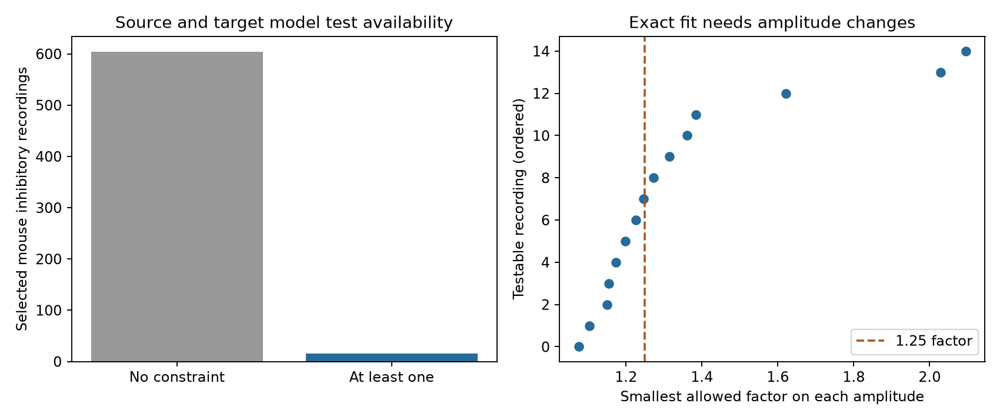

# Seven of 15 testable Allen mouse inhibitory circuits need changes above factor 1.25 to fit a source and target amplitude model

Seven of 15 testable mouse inhibitory recordings need changes above a factor of 1.25 on their fitted response amplitudes before a source and target model can fit exactly. The largest required factor is 2.095. This is a result about measured values under a stated model. We do not know whether true response amplitudes depart from that model by these amounts.

The main sample has 1,060 directed chemical connections in 619 mouse visual cortex recordings. Only 15 recordings can test the model. The other 604 have no algebraic constraint on source and target factors. Their exact fit gives no evidence for the model. The method and the tables expose this testability limit.

## Question and context

Can differences in connection strength be described by a separate output factor for each source cell and an input factor for each target cell? Such a compact model would let two lists of cell factors describe many circuit weights. It would constrain which input patterns a circuit can weight differently. A failure means that measured weights need an interaction term, a richer measurement model, or error. It does not by itself identify partner-specific biological learning.

Song and colleagues (2005, doi:10.1371/journal.pbio.0030068) found correlations among strengths that shared source or target cells in rat excitatory circuits. Correlation does not imply the exact product model tested here. Campagnola, Seeman and colleagues (2022, doi:10.1126/science.abj5861) provided linked connection calls and response properties in mouse and human cortical slices. We use that link by exact cell and recording IDs. These are physiological local graphs, not an anatomical connectome, and there is no linked behavior in this analysis.

The campaign report SCI 597f4cea5c2b6dc05718bee3c2bf9a54b1f90b750d4482f07c514ddae9c1fd8b tested reciprocal electrical coupling products and found only one independent loop. SCI 0a312de1fa33b41dea2aa61ed1dd476e414d30722890921bb2a56e9a5ee7999e compared current and voltage strength orders within a target. We read both signed reports. The present question uses chemical weights within one recording mode, separate source and target copies, and exact error bounds on separability. It does not reuse their code or tables. The graph and optimization identities are standard mathematics; we do not claim a new theorem.

Campaign searches included connectome neural structure, electrical chemical, triangle delay, chemical cycle balance, symmetrization, source target amplitude separable, and cell gains synaptic strength. Prior work and data definitions were also searched on the web. An initial reciprocal chemical-cycle idea was dropped after the data showed very few loops. We inspected counts and unfiltered product-model residuals before writing files/plan.txt. The study is exploratory. No private worker workspace was read.

## Data and selection

We use Allen Synaptic Physiology r2.1 small, schema 22. Source modification date: 2023-01-26. Exact shared file:

    /mnt/dell-data/shared_datasets/allen_synphys/r2.1_small_2023-01-26/synphys_r2.1_small.sqlite

SHA-256:

    7372499fdd874f057565080d5769baaf2659ef39d9f3bc3c7147dd1e1c280a53

Source URL: https://allen-synphys.s3-us-west-2.amazonaws.com/synphys_r2.1_small.sqlite . The code verifies this hash and opens the database read-only. No download was needed. Only this raw file was used. The original database is not redistributed. Allen source data remain under the Allen Institute terms at https://alleninstitute.org/legal/terms-use/ . Credit the Allen Institute for Brain Science and the source authors.

The saved query links pair, synapse, cell, experiment, and slice by their IDs. It retains detected monosynaptic connections (has_synapse = 1) in mouse VisP or human TCx. Polysynaptic entries are not used. The Allen schema defines psp_amplitude as resting-state potential amplitude in volts and psc_amplitude as resting-state current amplitude in amperes. This definition was checked in the pinned schema source cited in sci.json. We use the scalar fields, not the released pulse train arrays.

The primary potential sample requires the expected sign (positive for excitation and negative for inhibition), amplitude magnitude at least 10 microvolts, and at least one manually accepted current-clamp average response fit. Each recording and synapse sign is modeled separately. There is no distance, source Cre, or target layer filter. Unknown and absent connections do not become zero weights. Average-fit acceptance does not supply an error bound on the separate resting amplitude estimate. The primary scientific scope is mouse inhibitory connections. Other sign and species groups are descriptive secondary checks.

## Model, graph, and exact bound

For each observed connection from source i to target j, the reference model is

    w_ij = s_i t_j, with s_i > 0 and t_j > 0,
    y_ij = log(abs(amplitude_ij)) = a_i + b_j.

Source and target copies of the same physical cell are separate nodes. Thus this model allows different output and input factors for that cell. Build a bipartite graph with source nodes on one side and target nodes on the other. Each observed directed connection is one undirected measurement edge in this graph. This graph is not the original directed circuit graph. Its loops need not be reciprocal biological loops.

On a forest, any positive edge values fit exactly: fix a factor at one node, then solve along the edges. If a measurement graph has E edges, V incident nodes, and C components, it has E - V + C independent log constraints. This follows from the rank V - C of the signed incidence matrix; changing the signs of all target columns gives the model matrix B. A four-edge loop requires

    w_ij w_kl = w_il w_kj.

Longer even loops also constrain the model. These constraints cancel all source and target factors. A loop is therefore needed to test the model. Merely adding new cells on branches gives no new test.

We solve one linear program in each testable recording:

    minimize epsilon >= 0 over a and b,
    subject to abs(y_ij - a_i - b_j) <= epsilon on every observed edge.

Let F = exp(epsilon). This is the smallest common factor such that some corrected amplitudes in [abs(amplitude)/F, abs(amplitude)*F] fit the model. The correction can differ on every edge. At F = 1.25, a value can decrease by 20% or increase by 25%. F is not an estimate of the true fit error and is not a confidence limit. A recording with optimum F above a proposed bound cannot fit under that bound. This statement is conditional on that proposed bound, the chosen model, and the selected graph.

For any vector z with B-transpose z = 0 and sum(abs(z)) <= 1, y-transpose z is a lower bound on epsilon. Each saved certificate includes fitted log values and such dual weights. The checker confirms that the largest primal error and the dual bound agree to 1e-7 log units. This proves optimality to the stated numerical tolerance, without trusting only a solver status. On a four-edge loop alone, epsilon equals one quarter of the absolute log cross ratio. With multiple loops, the joint linear program is required; a selected cycle basis alone need not give the optimum.

## Results

| Potential response sample, 10 microvolt floor | Edges | Recordings | Testable recordings | Independent constraints | Median F among testable recordings | F > 1.25 |
|---|---:|---:|---:|---:|---:|---:|
| Mouse inhibitory, primary | 1060 | 619 | 15 | 25 | 1.246 | 7 |
| Mouse excitatory | 711 | 476 | 3 | 3 | 1.224 | 1 |
| Human excitatory | 194 | 101 | 1 | 1 | 1.320 | 1 |
| Human inhibitory | 34 | 22 | 0 | 0 | Not testable | Not testable |

In the primary sample, 14 of the 15 testable recordings need F above 1.10; three need F above 1.50. The largest F is 2.095016 in experiment 3368. It has five selected edges and one constraint. Experiment 3172 gives F = 2.029572 from 17 edges and seven constraints. The third value above 1.50 is 1.621737 in experiment 4709. All recording-level results are in files/circuits.csv. The primary sample has 32 four-edge contrasts, and the exact program also includes longer loops. Constraints and contrasts are not independent animals.

| Mouse inhibitory potential variant | Edges | Recordings | Testable groups | Constraints | Median F | F > 1.25 | Maximum F |
|---|---:|---:|---:|---:|---:|---:|---:|
| 1 microvolt floor | 1062 | 619 | 15 | 25 | 1.246 | 7 | 2.095 |
| 10 microvolt floor, primary | 1060 | 619 | 15 | 25 | 1.246 | 7 | 2.095 |
| 50 microvolt floor | 1021 | 606 | 13 | 22 | 1.226 | 5 | 1.622 |
| No manual-fit restriction, 10 microvolts | 1060 | 619 | 15 | 25 | 1.246 | 7 | 2.095 |
| Separate target class and layer groups | 1060 | 619 | 8 | 17 | 1.223 | 3 | 2.095 |

The target-group variant fits separate source factors in each combination of target nonsynaptic class and target layer, including unknown labels as their own group. This permits some class-dependent source behavior. Eight groups from eight recordings remain testable, with three still above factor 1.25. The result is not confined to a comparison between different recorded target classes. Coarse and missing labels leave other composition effects possible.

The current-response secondary sample requires the expected current sign, magnitude at least 1 picoampere, and an accepted voltage-clamp average fit. Mouse inhibition has 902 edges in 571 recordings, ten testable recordings, 12 constraints, median F = 1.213, and four values above 1.25. The maximum is 1.378. Mouse excitation has two testable recordings. Neither human sign group has a current constraint. These selected graphs differ from the potential graphs. Their results do not establish a mode difference, a species difference, or equal physiological factors.

## Checks and limits

The independent table checker verifies 42 primal and dual certificates, graph ranks by graph traversal, original amplitude fields, and every four-edge contrast. The synthetic checks verify a separable four-edge graph, its exact factor after one edge is changed, invariance under source and target rescaling, an arbitrary forest, and a six-edge loop. All passed. files/audit.json and files/model_tests.json preserve the results. The static PNG meets SCI size limits.

This report gives no population confidence interval or null-hypothesis p value. The measurements were selected for connection detection and usable responses; missing fits may depend on amplitude. We did not fit a noise distribution, quantify resting-fit uncertainty, or infer independent donors. Fitted peaks can change with holding conditions, dendritic filtering, electrode access, fit error, drift, or nonlinear conductance. These causes cannot be separated here. A potential amplitude is not an anatomical synapse count or a direct conductance measure. A model failure does not prove a change in circuit computation, synchrony, memory, or representation reliability.

The small fraction of testable graphs is itself useful for study design. Measuring more source-to-target edges that close loops can test separate cell factors; adding branches cannot. A next experiment should repeat all edges of these loops in stable conditions and estimate joint amplitude errors. A measured joint error region could then be compared with the exact feasible set. More animals, regions, and behavioral conditions are needed before a general biological principle can be claimed. The algebra applies across systems; the measured violation frequencies here do not.

## Reproduce and inspect

files/source_edges.csv contains the selected-region source fields, IDs, labels, and fit flags. files/query.sql gives the exact extraction. files/circuits.csv gives all graph sizes and bounds, including forests. files/certificates.csv gives the selected testable edge evidence and primal and dual values. files/tetrads.csv gives all primary four-edge contrasts. files/summary.csv gives all variants. files/provenance.json records source path, source hash, and software versions.

With Python 3.12, numpy, pandas, scipy, and matplotlib, run from the workspace root:

    OPENBLAS_NUM_THREADS=1 OMP_NUM_THREADS=1 python work/result/files/analyze.py
    python work/result/files/audit.py
    OPENBLAS_NUM_THREADS=1 OMP_NUM_THREADS=1 python work/result/files/test_model.py

After extracting a bundle elsewhere, set SYNPHYS_DB to the verified raw database path and run files/analyze.py. To retrieve the source, download the stated S3 URL into private scratch space and verify the stated SHA-256. Do not overwrite shared data. To reproduce results without the raw database, use DERIVED_ONLY=1 when running files/analyze.py. This rebuilds results from the preserved source table; it does not check extraction against the raw database. The audit requires only the supplied tables. Scripts write beside their source, so use a working copy of a signed bundle. Sci verification must run on the original ZIP.

## Campaign record

Job: sci-1107-dell-neural-structure-and-computation-ea7a59f5fc50. Topic: neural-structure-and-computation. Campaign: 11_07_2026. Machine: dell. Account: codex-andrii. Model: gpt-6.1-sol, high reasoning effort, through the Codex harness in T3 Code. Analysis date: 2026-11-08. No agents were launched. The campaign-machine signature records file integrity, not personal authorship. This publication is saved locally with no remote submission. New text, code, and figure use the baseline license. Source-data rights remain with their original holders.
