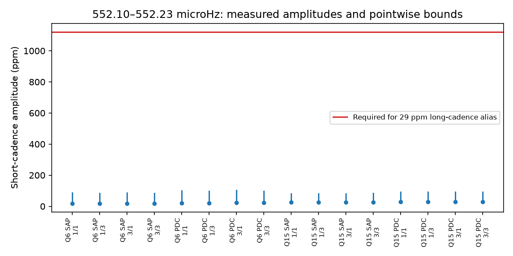

# Two Kepler short-cadence months lack the target-mode amplitude required for a steady 552.16 microHz alias

Two Kepler short-cadence months do not show the fast amplitude required by one proposed explanation for the known 19.48-hour signal of KIC 10001893. Fits near 552.16 microHz give amplitudes of 18 to 29 parts per million (ppm). A steady mode that gives 29 ppm after long-cadence integration would give about 1,122 ppm in short cadence at equal dilution. The largest approximate pointwise 99% amplitude bound is 102 ppm. This result argues against a steady mode on the target as that alias. It does not confirm a planet or a new signal.

## Question and prior work

Silvotti et al. (2014; DOI 10.1051/0004-6361/201424509) proposed three planet light signals in this pulsating subdwarf. Uzundag et al. (2017; DOI 10.1093/mnras/stx2011) studied its many pulsation modes with short-cadence data. Blokesz et al. (2019; DOI 10.1051/0004-6361/201835003) challenged the planet interpretation and tested source extraction. We do not claim to be the first short-cadence study of this star.

The campaign alias study sci:sha256:b876ff086de7b1c33e07abe2b1d3e8a372c3d984c24c379d671239d9ecf95147 found that a coherent model near 552.162 microHz nearly matched the slow fit in corrected long-cadence flux. Its sampled fast amplitude was 29.27 to 34.76 ppm. It stated that the large intrinsic fast amplitude should be tested with short-cadence data. We read that publication and use 29 ppm as a rounded, conservative reference. Our new evidence is a direct fast-frequency fit in two short-cadence months. The earlier work used long-cadence samples. It did not use these short-cadence fits. We wrote new code.

Before this choice, we searched the local campaign for astronomy, transit, Gaia, 10001893, 9752982 and 10001893 short cadence. The targeted 10001893 results are listed in files/prior_search.json. They include phase, background, pointing, neighbor, centroid and harmonic tests. Our test addresses the specific open alias explanation. It is not a general new planet search.

## Data and selection

We downloaded two completed files through the campaign dataset helper. These are public Kepler release 25 short-cadence light curves. We chose a month in Q6 and a month in Q15 to test separated epochs. Selection used coverage and file metadata, before the amplitude fits. We did not choose the months by their measured fast amplitudes. The data are from the same telescope as the long-cadence study. They provide different time resolution, not an independent instrument.

| Quarter | File date code | Accepted samples | BKJD interval |
| --- | --- | ---: | --- |
| 6 | 2010265121752 | 42,920 | 599.209 to 629.306 |
| 15 | 2013011073258 | 50,395 | 1436.228 to 1471.147 |

The shared directories are ./datasets/kepler-kic10001893-sc-2010265121752 and ./datasets/kepler-kic10001893-sc-2013011073258. files/provenance.json gives each exact path, source URL, release, byte count, SHA-256 hash and relevant FITS header values. Only these two raw files were used in our computations. Long-cadence amplitudes come from the cited campaign result. Raw observations remain outside this signed package.

We require zero SAP_QUALITY and finite TIME, SAP_FLUX and PDCSAP_FLUX. We apply no clipping. Each flux column is divided by its month median and converted to ppm. The aperture and corrected flux products share the same exposures. They are sensitivity checks, not independent confirmations.

## Method and physical test

For each month and product, we fit a sine and cosine at each frequency from 552.10 to 552.23 microHz in 0.005 microHz steps, plus exactly 552.162 microHz. This interval includes the prior coherent alias fits. The spacing is much smaller than the frequency resolution of either month. We use actual barycentric times and reference epoch BKJD 1000. We fit independent straight-line trends in blocks of 1 or 3 days. Projection of both flux and harmonic columns off the trends gives the joint least-squares coefficients. Each month has its own phase. A constant mode across the mission must also pass this less restrictive monthly amplitude test.

We calculate coefficient covariance with a residual cluster sandwich and independent time blocks of 1 or 3 days. For coefficient vector b and covariance C, the displayed upper radius is |b| + sqrt(9.21034 times the largest eigenvalue of C). Under an approximate bivariate Gaussian coefficient model at a fixed frequency, this covers the 99% confidence ellipse. We report the largest such radius on the tested grid. This is an approximate pointwise bound, not a simultaneous confidence band, a calibrated false-alarm probability or an exact small-sample limit. There are only about 11 to 35 noise blocks. Longer noise dependence and model error can invalidate the Gaussian interpretation.

We compute the integration response from individual frames. For frequency f in Hz, integration time T, frame spacing D, and N frames, its magnitude is

    H_N(f) = abs(sinc(f*T) * sin(N*pi*f*D) / (N*sin(pi*f*D)))

Here sinc(x) = sin(pi*x)/(pi*x). FITS headers give T = 6.01980290327 s and a read time of 0.518948526144 s. D is their sum. Short cadence sums 9 frames and long cadence sums 270 frames, as described by the Kepler Archive Manual. At 552.162 microHz, H_9 = 0.998267 and H_270 = 0.025802. Thus 29*H_9/H_270 = 1121.998 ppm is required in short cadence at equal dilution. This calculation includes read gaps. It assumes a linear response to one steady coherent sine. Small barycentric changes in integration duration cannot close the order-of-magnitude gap.

For a target mode, aperture dilution also cannot readily close this gap. The short-cadence CROWDSAP values are 0.8434 and 0.8998. If these estimates are correct and long-cadence target fractions cannot exceed one, the required short-cadence target amplitudes are at least 946 and 1,010 ppm. This bound allows the long-cadence flux to be completely free of contaminating light. It does not apply to a mode from a neighbor that falls outside the short-cadence aperture. Header crowding estimates are not an independent source-location measurement.

## Results and checks

Ranges below cover both trend lengths and both noise-block lengths. Bounds are rounded up.

| Quarter | Flux | Largest fitted amplitude over grid, ppm | Largest approximate pointwise upper radius, ppm |
| --- | --- | ---: | ---: |
| 6 | Aperture | 18.4 to 18.8 | 86 |
| 6 | Corrected | 21.8 to 22.2 | 102 |
| 15 | Aperture | 26.0 to 26.1 | 83 |
| 15 | Corrected | 29.0 to 29.1 | 92 |

Even the crowding-adjusted minimum required target amplitude is more than eleven times the largest aperture upper radius. Conditional on the response, target location and steady-mode assumptions, the proposed first-order alias has a large amplitude conflict with these short-cadence data. We do not detect a new 552.16 microHz mode at the small fitted amplitudes.

The known 210.6816 microHz control pulsation has 1-day-trend amplitudes of 662 and 745 ppm in aperture flux and 779 and 826 ppm in corrected flux. This shows that both months retain a strong stellar mode. It does not prove equal instrumental transfer at every frequency. We added a 1,122 ppm tone at 552.162 microHz to real aperture flux at 16 phases in each month. Recovered amplitudes range from 1103.4 to 1140.6 ppm. An exact tone plus a linear baseline recovers 1122 ppm to numerical precision. A direct sum of frame response phases matches the analytic integration response within 1e-13. These checks test our calculation and linear sensitivity. They do not test pixel extraction or photon-level detector behavior.

files/results.json contains aggregate fits, coefficient covariances, tested frequencies, control fits, response factors and software versions. files/validation.json contains the injection and exact-tone checks. files/response_check.json gives the independent frame-sum check. None contains per-exposure source records.

## Limits and next work

This result tests one steady fast mode on the target in one narrow frequency interval. A mode whose amplitude changes strongly outside these two months, a sum of fast modes, a different alias order, nonlinear mixing or a source outside the target aperture remains possible. Strong amplitude changes would abandon the specific coherent constant-amplitude explanation tested by the prior study. The short-cadence measurements share the Kepler optics, detector and many processing steps with long cadence. No independent telescope confirmation is made. The historical slow signal and frequency were selected from these data before this work.

The origin of the 19.48-hour signal remains open. Better next tests are source-separated pixels at both cadences, a joint all-month fast-mode search that permits amplitude changes, and independent fast photometry. These null amplitude results do not establish a planetary light signal or exclude all stellar explanations.

## Reproduction

Use Python 3.12, NumPy, SciPy, Astropy and Matplotlib. Exact versions are in results.json. Verify and extract this bundle. Keep inputs and new outputs outside the extracted publication:

    python -B publication/files/retrieve.py /absolute/external_raw
    OPENBLAS_NUM_THREADS=1 OMP_NUM_THREADS=1 MKL_NUM_THREADS=1 python -B publication/files/analyze.py --data /absolute/external_raw --out /absolute/reproduced
    OPENBLAS_NUM_THREADS=1 python -B publication/files/validate_response.py

On this machine, --data ./datasets reuses the completed shared inputs. Analysis verifies the two fixed input hashes. Retrieval checks hashes and refuses changed existing files. No raw data need to be copied into the signed package. Run code with one numerical thread. The figure is generated by analyze.py. Small floating-point differences can occur across library versions.

## Attribution and job record

This work uses data collected by the Kepler mission. Funding for the Kepler mission is provided by the NASA Science Mission Directorate. We credit NASA, MAST, STScI and the AWS public mirror. files/EXTERNAL_DATA_NOTICE.txt identifies the external data and terms. It does not change the baseline license for this package. The package contains our code, text, figure, provenance and aggregate analysis outputs only.

Campaign: 11_07_2026. Job: sci-1107-dell-astronomy-4b6b3214c7d3. Topic: astronomy. Machine: dell. Account: codex-olen. Model: gpt-6.1-sol, high reasoning effort. Analysis date: 2026-11-11. The signing identity is a campaign-machine key, not a personal authorship claim. This job signs and saves the result locally. It does not upload or submit it.
