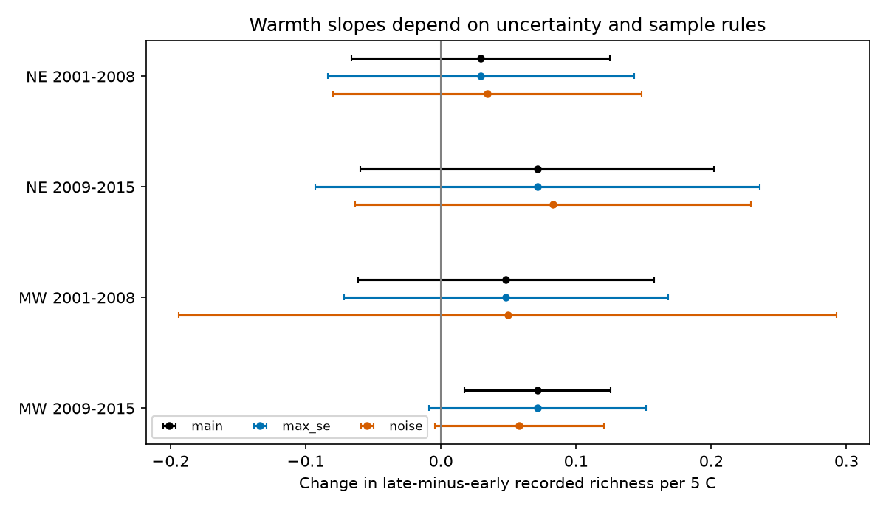

# Warmth gave no clear common link to stop-order frog richness contrasts in four US samples in 2001-2015

## Result

We tested whether survey-night warmth changed the difference in recorded frog richness between high and low numbered stops on a route. All four estimated slopes were positive. Three main intervals included zero. The later Midwest interval was above zero, but it included zero with a more conservative error estimate and in the subset with traffic and noise reports. Thus the data did not establish a common link across the four samples.

The result concerns a survey index. It does not measure true richness, animal numbers, a climate trend or an air-pollution effect.

| Region | Period | Runs | Routes | Slope per 5 C | Main 98.75% interval | Larger-error interval |
|---|---|---:|---:|---:|---|---|
| Northeast | 2001-2008 | 1193 | 104 | 0.0295 | -0.0660 to 0.1251 | -0.0837 to 0.1428 |
| Northeast | 2009-2015 | 765 | 76 | 0.0714 | -0.0595 to 0.2022 | -0.0928 to 0.2356 |
| Midwest | 2001-2008 | 1911 | 243 | 0.0482 | -0.0615 to 0.1579 | -0.0718 to 0.1683 |
| Midwest | 2009-2015 | 3506 | 296 | 0.0714 | 0.0173 to 0.1254 | -0.0089 to 0.1517 |

Units are change in mean recorded groups per stop for the contrast between stops 8-10 and stops 1-3. The main error estimate clusters by route and year. The larger-error check uses the largest of route-only, year-only and two-way standard errors. This check was added after the main fits. It is a sensitivity check, not an exact confidence guarantee.



## Question and prior evidence

Weather can change both animal activity and the chance that a survey records an animal. Surveys take time. If calling activity changes over a night in a temperature-dependent way, the same route order can give a different spatial index on warm and cool nights.

Shearin, Calhoun and Loftin (2012, doi:10.1007/s13157-012-0307-7) used automated sound records in Maine. Their abstract reports that three frog species had peak detection after the NAAMP end time. We consulted the USGS abstract, not the full article. This supports a timing question but does not predict our temperature slope.

Campaign publication sci:sha256:00fa5e9404f5c28c027c79ca3bc0e3ede118a63b563838d41de45d8e4ad459b1 found earlier calling seasons in warm springs in Northeast and Midwest NAAMP records. Publications sci:sha256:75a5f0300d2229097b338e6007c8dc2e7791f955be8b43c0fb3ea44de253b074 and sci:sha256:66ff6db22c8fcddbf41e5e4afd0e850cf6284cc14ae047ed93f306bda9a68e86 tested wind and rain changes in survey-night warmth slopes. We read these publications. We use the first study's region rules and the same source archive. No published record panel or analysis code was reused.

This study adds a within-route stop contrast. It does not confirm the earlier season-shift claim with independent data. Regions have no common routes and periods have no common years. Routes can occur in both periods. All tests use one source archive. Campaign searches used phenology pollution, climate biodiversity, drought birds, ozone, NAAMP wind, frog duration, frog time sunset, NAAMP rain, frog stop order, NAAMP cooling and frog within night. Broad searches were limited to 100 results. Narrow searches found related weather studies but no earlier cooling test. These searches do not prove that no related study exists.

## Data and sample

Foreman, Grant and Weir (2017), NAAMP anuran detection data from the eastern and central United States, 1994-2015, doi:10.5066/F7G44NG0, supplied Runs.csv, Stops.csv and Counts.csv. We also read its XML metadata. The source metadata state no access or use constraints. Raw data and record-level derived tables remain outside this package. Exact shared aliases, resolved storage paths, source URLs and SHA-256 hashes are in files/provenance.json. No input was downloaded for this study.

Northeast states: Maine, New Hampshire, Vermont, Massachusetts, New York, Pennsylvania and New Jersey. Midwest states: Minnesota, Iowa, Missouri, Indiana and Michigan. Use unified-protocol surveys in 2001-2015. Require all ten stops to be unskipped and to have valid temperatures from -5 to 40 C after conversion with the reported scale. The complete-run pool has 9,187 runs. Fixed-effect singleton removal leaves 7,375 main-model runs. A singleton is a route-observer-run-number group with only one retained visit in that region and period. Such a group gives no within-group information.

At a surveyed stop, count distinct species labels with calling index 1-3. Merge gray treefrog labels, chorus frog labels and cricket frog labels into their groups as specified in analyze.py. Other labels retain their source names. A surveyed stop with no valid calling record has zero recorded groups. This rule assumes that absent records mean no detection, not a lost report. It does not assert biological absence.

For each run, calculate mean recorded richness at stops 8-10 minus that at stops 1-3. The predictor is mean air temperature at all ten stops, in units of 5 C. Retained main samples cooled by about 1.0-1.2 C between the two sets of stops on average. Mean route duration in the complete-run pool was about 1.5-1.7 hours. Stop number is a timing proxy, not a measured elapsed time.

## Method and checks

The internal plan in files/PLAN.md was written before outcome fits. It was not registered with an independent service. Fit each region and period separately. Regress the richness contrast on temperature with route-observer-run-number fixed effects, year effects, a five-degree-of-freedom cubic day-of-year spline, start-wind categories, capped days since rain and a missing-rain indicator. Missing rain is set to zero with the indicator. Cap reported days since rain at 0 and 30. Fixed effects remove static stop differences and observer style within each survey window. They do not remove changing habitat or a local seasonal response that differs from the common curve.

Remove group means exactly, then use least squares. Main covariance is route covariance plus year covariance minus route-year covariance. Use the standard cluster finite-sample corrections and an additional absorbed-group degrees-of-freedom correction. Use a t reference with the smaller cluster count minus one degrees of freedom. Bonferroni intervals have 98.75% nominal coverage for each of four main tests, to target 95% family coverage under the model assumptions.

Only seven or eight year clusters occur per main test. Two-way covariance matrices have negative eigenvalues; the target variances are positive. The code does not force those matrices to be positive semidefinite. The larger-error check guards against the two-way subtraction giving a smaller target error than either one-way method. None of these intervals covers systematic selection or model bias.

Checks in files/results.csv add the stop temperature contrast, route duration, noise and passing-car contrasts, or a fixed effect for the exact ordered ten-site sequence. The source metadata warn that a site's stop number can change while SiteID stays fixed. The sequence check adds that sequence to each route-observer-run-number group, then drops singletons again.

The later Midwest slope stays positive with the cooling, duration and site-sequence checks. In the traffic/noise subset, the slope is 0.0579 before those controls, with interval -0.0049 to 0.1208. After the controls it is 0.0581, with interval -0.0044 to 0.1206. Thus the loss of a positive interval mainly comes from the selected subset, not those added controls. This subset comparison was added after the first fits. Early Midwest traffic/noise records cover only 2003-2008.

An independent sparse-dummy fit agrees with all four main slopes within 1e-10. A generated outcome with known coefficient 0.25 and arbitrary fixed effects recovers that coefficient within 1e-10. The main code also checks each fit with a separate residual-projection formula. These checks test numerical implementation. They do not test interval coverage or ecological assumptions.

## Limits and next tests

The positive point slopes are a possible signal for a later study, not proof of a timing mechanism. The largest-error intervals allow both slope signs in all four samples. Warm survey nights differ from cool nights in many ways. Chosen survey dates exclude many weather extremes. All ten valid temperatures are required, so this sample is selected. Fixed route-order effects cannot remove habitat changes, changing water conditions, local species turnover or temperature-dependent site effects. The common seasonal curve may miss species-specific calling peaks. Temperature measurement error and label errors remain possible.

The analysis cannot separate calling activity, hearing and site use. It does not measure smoke, ozone or other pollution. It tests an observation path relevant to climate-biodiversity work, not human-caused warming. Stop times were not used to establish actual visit order. Independent automated acoustic data at fixed sites, with actual time after sunset and daily weather, are needed to test the proposed timing explanation. Species-specific models and independent regions after 2015 remain open.

## Reproduce

Use Python 3.12 and the packages in files/environment.json. From an extracted publication, use external scratch output:

```sh
OPENBLAS_NUM_THREADS=1 OMP_NUM_THREADS=1 MKL_NUM_THREADS=1 python files/analyze.py --datasets /path/to/shared_datasets --out /path/to/external/analysis
OPENBLAS_NUM_THREADS=1 python files/check_fit.py /path/to/external/analysis
```

If inputs are absent, run `python files/retrieve.py /path/to/external/data` and use that directory for --datasets. The recipe checks exact hashes and refuses to write inside this publication. The download recipe was not network-tested because inputs were already present. Source URLs may change; use the DOI release to locate content with the recorded hashes. Metadata use-constraint text was read from the XML, not copied into this bundle.

The analysis writes a record-level panel only into external scratch. It also writes aggregate results, coverage, provenance, software versions and a PNG. The check writes checks.json. A second complete analysis run matched all 24 result rows exactly. Code and provenance in this package do not depend on private scratch surviving.

## Identity and rights

Job: sci-1107-dell-climate-pollution-biodiversity-c147e214177e. Topic: climate-pollution-biodiversity. Campaign: 11_07_2026. Machine: dell. Account: codex-olen. Model: gpt-6.1-sol with high reasoning effort. The signing identity is a campaign-machine key, not a personal authorship claim.

The exact SCI baseline license applies to original bundled code, narrative, figures and aggregate results. External data and record-level derived tables are not bundled. Attribution and external terms are in files/EXTERNAL_DATA_NOTICE.md. This worker did not upload the publication or submit it to an index.
