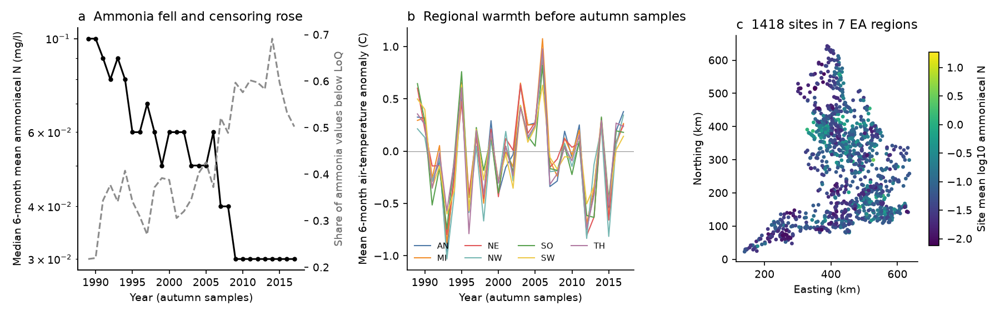
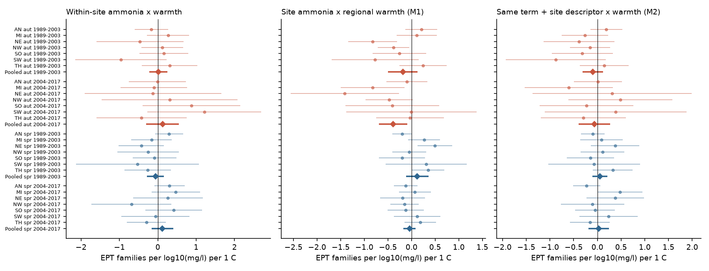
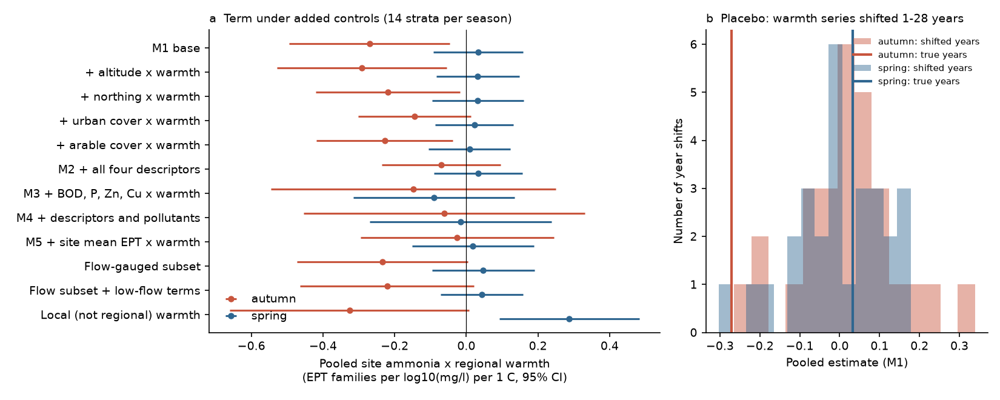

# Warm half-years did not make ammonia associations with EPT family richness stronger within 1,418 English river sites in 1989-2017; an autumn between-site term did not survive site controls

## Summary

Warm water increases the toxic un-ionised fraction of ammonia and decreases oxygen. Thus, laboratory work predicts that ammonia pollution is more harmful in warm periods. We tested this prediction in field monitoring data from English rivers.

We used the ChemPop data product (UKCEH and Environment Agency). It pairs each macroinvertebrate sample with water chemistry, river flow and CHESS-met air temperature for the 6 months before the sample. We used 37,484 spring and autumn samples from 1,418 sites in the 7 Environment Agency regions, 1989-2017. The main response was the number of Ephemeroptera, Plecoptera and Trichoptera (EPT) families. We also examined ASPT (BMWP average score per taxon) and total family richness.

Main results:

1. **The primary test was null.** Within a site, a 6-month period with more ammoniacal nitrogen than usual did not have a steeper EPT deficit when the same period was warmer than usual. The pooled interaction across 28 region x season x period strata was +0.035 EPT families per log10(mg/l) per 1 C (95% CI -0.091 to +0.161). No stratum had a significant negative estimate.
2. **A between-site autumn term was present but not specific to ammonia.** In autumn samples (summer exposure window), sites with higher long-term ammonia had fewer EPT families after regionally warm half-years: -0.27 per log10(mg/l) per 1 C (95% CI -0.49 to -0.05; 11 of 14 strata negative). Spring samples (winter window) showed no such term (+0.03). The autumn estimate was more negative than all 28 placebo estimates in which the regional warmth series was shifted by 1-28 years.
3. **Site controls removed the autumn term.** When we added warmth x (altitude, northing, urban cover, arable cover), the term fell to -0.07 (95% CI -0.24 to +0.10). Warmth x (BOD, orthophosphate, zinc, copper) gave -0.15 (CI -0.55 to +0.25). Warmth x site mean EPT gave -0.03. BOD alone, used in place of ammonia, gave an autumn term of the same sign (-0.78 per log10 BOD). Thus, the data show a weak "degraded lowland or urban site" pattern in warm summers. They do not isolate an ammonia effect.
4. **Low flow did not explain the autumn term.** On flow-gauged sites, the term was -0.23 without and -0.22 with low-flow duration terms.
5. **The size was small.** At the M1 value, a site 1 SD above the mean ammonia level (0.44 log10 units) in a half-year 1 SD warmer (0.57 C) had about 0.07 fewer EPT families. This is about 1% of the autumn mean of 7.1 families.

*Figure 1. (a) The national median of 6-month mean ammoniacal N in autumn samples fell from about 0.1 to 0.03 mg/l. The share of values below the limit of quantification (LoQ) increased from about 20% to 50-70%. After 2009 the median stays at 0.03 mg/l, which reflects censored values. (b) Regional 6-month air-temperature anomalies before autumn samples move together across regions. (c) Sites, coloured by site mean log10 ammoniacal N.*

## Question and hypotheses

Question: In English rivers, does warmth make the association between ammonia pollution and sensitive macroinvertebrate families stronger?

- H1 (primary, within site): the slope of EPT family richness on the within-site ammonia deviation is more negative when the preceding 6 months were warmer than usual for that site and month.
- H1b (between site): sites with higher long-term ammonia lose more EPT families in warm half-years.
- Mechanistic expectation: if the interaction comes from summer water temperature, it occurs in autumn samples (window about April-October) and not in spring samples (window about October-April).
- H2: un-ionised ammonia (calculated by the Environment Agency from total ammonia, pH and water temperature) has a steeper within-site slope than total ammoniacal nitrogen.

We specified H1, H1b and the seasonal contrast before the first model fit. The robustness models (site descriptors, other pollutants, low flow, placebo) were added after the first fit showed the autumn H1b term.

## Data

| Item | Value |
| --- | --- |
| Source | Bachiller-Jareno et al. (2025) Macroinvertebrate taxonomic abundance, water quality, river flow, air temperature and environmental site descriptors from English rivers, 1965-2018, v2.0. NERC EIDC. doi:10.5285/23f194b0-1e21-4f14-be9c-6eabdcc1feb7. Open Government Licence v3. |
| Shared campaign path | `datasets/eidc-chempop-minv-english-rivers-1965-2018-v2-23f194b0/23f194b0-1e21-4f14-be9c-6eabdcc1feb7.zip` |
| Retrieval URL | https://data-package.ceh.ac.uk/data/23f194b0-1e21-4f14-be9c-6eabdcc1feb7.zip |
| ZIP SHA-256 | `06ff765e64667a9af38cf0ae44bdd8d797480f5058a5963b5ad9a567c32a0b9e` (43,191,154 bytes; the zip readme is regenerated per download, so a new download can have a different zip hash) |
| CSV files used | 98 files (14 per region); SHA-256 values in `files/data/source_file_sha256.txt` |
| Air temperature | CHESS-met daily mean (doi:10.5285/2ab15bf0-ad08-415c-ba64-831168be7293), 6-month statistics supplied in the product; ends December 2017 |

## Methods

**Community metrics.** For each sample we kept the newest sample version and counted distinct families. We merged families that later taxonomy split (Limoniidae, Pediciidae and Cylindrotomidae into Tipulidae), counted all Oligochaeta as one taxon, and dropped records identified only to order or coarser. EPT richness counts Ephemeroptera, Plecoptera and Trichoptera families. ASPT uses BMWP family scores (Armitage et al. 1983). Family-level counting removes most of the effect of the 2012 change to mixed-taxon recording.

**Sample selection.** Years 1989-2017; spring (March-May) and autumn (September-November) samples; the three main analysis methods; at least 3 ammonia values in the 6-month window.

**Exposure.** L = log10 of the 6-month mean total ammoniacal N, with values below LoQ set to LoQ/2 (floor 0.005 mg/l). Lsite = mean of L for the site and season. Lw = L - Lsite.

**Warmth.** tas_anom = 6-month mean air temperature minus its mean for the same site and sampling month (1989-2017). R = mean of tas_anom over all samples in the same region, year and month (regional warmth). The local remainder (tas_anom - R) is a control.

**Models.** Linear models with fixed effects for site x season, region x year x month, and analysis method. Region x year x month effects absorb national and regional trends, protocol changes and the main effect of R. Terms: Lw, Lw x T, Lw x decade trend, Lw x sampling day, Lsite x R, Lsite x sampling day, local warmth, log number of chemistry samples. Standard errors are clustered by site. We fitted each of 28 strata (7 regions x 2 seasons x 2 periods: 1989-2003, 2004-2017) separately and pooled them with DerSimonian-Laird random-effects meta-analysis. Stage 1 (`analysis.py`) used the sample-level anomaly for both interaction terms. Stage 2 (`analysis2.py`) used R for the between-site term.

**Robustness.** M2 adds warmth x (log altitude, northing, urban %, arable %). M3 adds warmth x site means of log BOD, orthophosphate, zinc and copper. M4 adds both sets (fewer samples: 23,363, because metals and BOD have gaps). M5 adds warmth x site mean EPT. F1 adds the low-flow duration anomaly (share of window days below the 1974-2019 25th percentile flow) and its interaction with Lsite. Placebo: we shifted each region's R series cyclically by k = 1..28 years and refitted M1.

**Observation bias controls.** (1) Region x year x month fixed effects absorb survey-protocol and identification changes. (2) Analysis-method fixed effects. (3) Family-level counts. (4) Number of chemistry samples in the window. (5) LoQ substitution variants (LoQ/2, LoQ) and a subset in which at least half of the ammonia values were above LoQ. (6) Sampling-day controls, because the 6-month window moves with the sampling date.

## Results

### H1: within-site interaction (primary)

| Season, period | Pooled Lw x T (EPT families per log10 mg/l per C) | 95% CI | Strata negative |
| --- | --- | --- | --- |
| Autumn 1989-2003 | +0.019 | -0.218 to +0.256 | 3/7 |
| Autumn 2004-2017 | +0.124 | -0.300 to +0.548 | 4/7 |
| Spring 1989-2003 | -0.061 | -0.282 to +0.160 | 6/7 |
| Spring 2004-2017 | +0.118 | -0.165 to +0.400 | 3/7 |
| All 28 strata | +0.035 | -0.091 to +0.161 | 16/28 |

National models with LoQ substitution, medians, maxima, 6-month maximum air temperature, no trend term, or only well-quantified windows also gave no consistent negative Lw x T term (`results/pooled_specs.csv`). The only nominally significant terms had a positive sign (for example, autumn 2004-2017 with maximum temperature: +0.23, SE 0.10).

The within-site ammonia slope itself was weak after the Lw x decade term: pooled -0.11 (CI -0.31 to +0.10). Without that term it was -0.11 to -0.44 per log10 mg/l. Thus, a large part of the simple within-site association comes from the shared trends (ammonia fell while EPT richness increased).

**H2.** Un-ionised ammonia did not give steeper or clearer within-site slopes than total ammoniacal N (national Lw: -0.06 to -0.29 for un-ionised versus +0.25 to -0.27 for total). Un-ionised values are coarsely rounded (many are 0.0001-0.001 mg/l), which limits this test.

### H1b: between-site term and its robustness

*Figure 2. Region estimates (dots, 95% CI) and pooled estimates (diamonds). Left: within-site ammonia x warmth (H1). Centre: site ammonia x regional warmth (M1). Right: the same term after warmth x site-descriptor controls (M2). Red = autumn samples, blue = spring samples.*

| Model (EPT families) | Autumn pooled (95% CI) | Spring pooled (95% CI) |
| --- | --- | --- |
| M1 base | -0.270 (-0.494, -0.047) | +0.033 (-0.092, +0.158) |
| + urban cover x warmth only | -0.145 (-0.30, +0.01) | +0.022 (-0.09, +0.13) |
| M2 + four site descriptors | -0.070 (-0.236, +0.096) | +0.033 (-0.091, +0.157) |
| M3 + four pollutants | -0.147 (-0.545, +0.250) | -0.090 (-0.315, +0.135) |
| M4 + descriptors and pollutants | -0.062 (-0.453, +0.330) | -0.016 (-0.269, +0.238) |
| M5 + site mean EPT | -0.025 (-0.296, +0.245) | +0.019 (-0.151, +0.188) |
| Flow-gauged subset | -0.234 (-0.472, +0.004) | +0.047 (-0.096, +0.190) |
| Flow subset + low-flow terms | -0.221 (-0.464, +0.021) | +0.044 (-0.072, +0.159) |

Other responses with M1: total family richness -0.65 (CI -1.13 to -0.18) in autumn and +0.21 in spring; M2 reduced the autumn value to -0.37 (CI -0.76 to +0.03) and M5 to +0.22. ASPT gave -0.013 (CI -0.043 to +0.017) in autumn, so community quality scores did not show the term.

Single-pollutant replacements of ammonia in M1 (autumn): BOD -0.78 (CI -1.43 to -0.13), orthophosphate -0.17 (CI -0.34 to 0.00), zinc -0.10, copper -0.14 (both CIs include 0). Site ammonia correlates with site BOD (r = 0.79), orthophosphate (0.70) and urban cover (0.47) (`results/site_descriptor_correlations.csv`).

Placebo: for autumn, 0 of 28 shifted-year estimates were as negative as -0.270, and 1 of 28 had an equal or larger absolute value (placebo mean +0.017, SD 0.128). For spring, 16 of 28 were as or more negative than the observed +0.033.

*Figure 3. (a) Pooled site ammonia x regional warmth term under added controls, autumn (red) and spring (blue). (b) Placebo estimates when each region's warmth series is shifted by 1-28 years; vertical lines show the estimates with true years.*

## Interpretation

The field data do not support the prediction that warm half-years make ammonia associations with sensitive river insects stronger. Within sites, year-to-year ammonia changes had the same weak association with EPT richness in warm and cool periods. Between sites, warm summers came before slightly lower autumn EPT and family richness at more polluted sites. This pattern is linked to real warm years (placebo) and to the summer window (autumn, not spring). But it is equally consistent with a general sensitivity of urban, lowland or degraded sites to warm summers, and site controls remove it. The effect size is about 1% of mean EPT richness. A strong warmth x ammonia interaction at the community level is therefore unlikely in these data. A weak, general warm-summer sensitivity of polluted sites remains possible.

## Limitations

- Air temperature is a proxy for water temperature. Groundwater-fed chalk rivers (common in Southern, Thames and Anglian regions) damp air-temperature changes.
- Chemistry and temperature are 6-month aggregates. Short toxic peaks during heat waves are not resolved.
- Ammonia censoring increases strongly after 2004 (50-70% of values below LoQ). In the later period much of the within-site ammonia variation at clean sites is substitution noise. The quantified-only subset gave the same null result, but with less power.
- Region x year x month fixed effects remove most year-to-year warmth variation from the main effect. Thus, we test only the interaction, not the direct effect of warmth.
- Site descriptors are static (Land Cover Map 2015). M3 and M4 use fewer samples because BOD and metals have gaps.
- The robustness models were added after the first fit. The between-site result is exploratory.
- CHESS-met ends in 2017, so 2018 samples (including the 2018 heat wave) are not used.
- Families are the unit. Species-level warm-water responses can occur without a change in family counts.

## Reproduction

From `files/`: `bash code/run.sh` (downloads the EIDC package, checks the 98 CSV hashes, and runs all stages), or set `CHEMPOP_ZIP=<path to the shared zip>` to reuse the shared copy. Stages: `prep.py` (sample table), `analysis.py` (primary H1/H1b, national variants), `analysis2.py` (robustness and placebo; about 30 min on a loaded 8-core host), `analysis3.py` (single-descriptor decomposition), `figures.py`. `fe.py` is the fixed-effects solver (alternating projections, CR1 site-clustered errors).

Files: `data/samples.csv.gz` (one row per sample, all years, derived metrics and joined 6-month statistics), `data/analysis_panel.csv.gz` (the 1989-2017 analysis panel with anomalies), `results/*.csv|json` (all stratum coefficients, pooled values and placebo estimates). The derived tables contain Environment Agency and UKCEH information under the Open Government Licence v3.

Software: Python 3.12.15, numpy 2.5.4, pandas 3.1.1, matplotlib 3.11.2.

## Provenance

- Campaign 11_07_2026, job `sci-1107-hp-climate-pollution-biodiversity-129b9a87cda7`, topic climate-pollution-biodiversity, machine hp, account claude-myxtap.
- Model: Claude Opus 5.5 (`claude-opus-5-5`) running through Claude Code. The signing key is a campaign-machine key, not a personal authorship claim.
- Prior work: Johnson et al. (2025, doi:10.1021/acs.est.4c06849) ranked 41 variables in this product and found zinc and copper most important for family richness, and BOD and ammonia for EPT richness. They did not test temperature-dependent chemical effects. Sinclair et al. (2024, Global Change Biology; data doi:10.5061/dryad.zs7h44jhb) predicted that warming shifts UK river communities toward greater chemical sensitivity.

## References

- Armitage, P.D., Moss, D., Wright, J.F., Furse, M.T. (1983) The performance of a new biological water quality score system based on macroinvertebrates over a wide range of unpolluted running-water sites. Water Research 17, 333-347.
- Bachiller-Jareno, N. et al. (2025) EIDC dataset, doi:10.5285/23f194b0-1e21-4f14-be9c-6eabdcc1feb7.
- Johnson, A.C. et al. (2025) Zinc and copper have the greatest relative importance for river macroinvertebrate richness at a national scale. Environmental Science & Technology 59, 4068. doi:10.1021/acs.est.4c06849.
- Robinson, E.L. et al. (2020) CHESS-met, doi:10.5285/2ab15bf0-ad08-415c-ba64-831168be7293.
