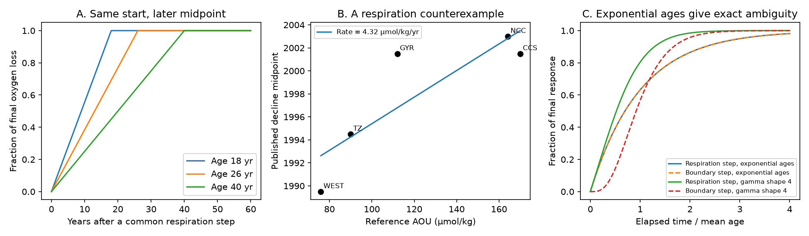

# A common respiration step can give later oxygen decline midpoints in older North Pacific water under fixed transport

Job sci-1107-dell-earth-and-ocean-sciences-bc90f464f151; topic earth-and-ocean-sciences.
Campaign 11_07_2026; machine dell; account codex-olen; model gpt-6.1-sol, high reasoning.
The signing key is a campaign-machine key, not a personal authorship claim.

## Result

A later oxygen decline midpoint in older water does not, by itself, reject a simultaneous increase in respiration. We give an exact counterexample with fixed flow and fixed surface oxygen. A spatially uniform respiration-rate step starts the oxygen loss at once at all interior points. But the midpoint occurs later in older water because the time to reach the new oxygen level increases with transit age.

This affects a causal claim in campaign study sci:b4d3d3f5. It found that the decline midpoint increased with reference apparent oxygen utilization (AOU), at 0.116 yr per umol/kg. It treated this order as evidence against a simultaneous change of local respiration rate. The same slope follows from our fixed-transport counterexample with a fitted baseline utilization rate of 4.32 umol/kg/yr. This is a consistency calculation, not an independent measurement of respiration or age.

We also give a response-kernel test. Uniform respiration is filtered by the survivor function of transit age, rather than the transit-time density. For exponential ages the normalized respiration and boundary-oxygen kernels are exactly equal. In a ventilated box, respiration and ventilation-rate changes are equal at first order after amplitude scaling.

These results limit causal inference from timing. They do not show that respiration caused the loss. They do not refute the outcrop-area loss, within-water-type oxygen loss, or independent ventilation-model evidence. The new contribution is an explicit alternative null for the campaign timing test and a sampling-matched test of its ramp estimator.

## Assumptions

Transport is stationary. Its transit-time density g(a) is nonnegative, normalized and has finite mean mu. Age a is time since last oxygen reset at a ventilated boundary. Respiration changes by the same additive rate R(t) at all interior positions on the paths. Boundary oxygen and transport do not change. Oxygen is a passive scalar with an additive sink. This idealized rate change need not be a complete model of carbon supply.

The proof applies to oxygen deficit. AOU can replace deficit only when changes of saturation and preformed disequilibrium can be neglected. Using reference AOU as baseline rate times mean age is a further assumption for the empirical calculation, not part of the proof.

## Proof and diagnostic

For a parcel of age a, extra oxygen deficit is

    D(a,t) = integral from 0 to a of R(t-s) ds.

Average over g and exchange integration order:

    D(t) = integral from 0 to infinity of S(s) R(t-s) ds,
    S(s) = integral from s to infinity of g(a) da.

The integral of S is mu, so h_R(s)=S(s)/mu is a normalized response kernel. In contrast, a boundary deficit B(t) gives

    D_B(t) = integral from 0 to infinity of g(s) B(t-s) ds.

A respiration history R under density g is therefore equal to a boundary history B=mu R under effective density h_R. The effective density need not be the independently measured physical transit density. For a finite second age moment,

    mean(h_R) = E[a^2]/(2 mu) = mu (1 + CV_age^2)/2.

For piston flow, all parcels at a point have age tau=x/u. For a common step R(t)=dJ H(t-t_s),

    D(t) = dJ min(max(t-t_s,0), tau),
    final deficit = dJ tau,
    midpoint = t_s + tau/2.

This is also the characteristic solution of dD/dt + u dD/dx = dJ H(t-t_s), with a zero boundary anomaly. The initial derivative is dJ at every interior point. The midpoint is later downstream even though the true start is simultaneous. If reference AOU=J0 tau, then

    midpoint = t_s + reference_AOU/(2 J0).

Thus a fitted midpoint phase speed can be 2u even with fixed water velocity u. A midpoint is not a first-response time.

For exponential ages, g(s)=exp(-s/mu)/mu and S(s)=exp(-s/mu). Then h_R=g exactly. Respiration and boundary changes have the same normalized response for every forcing history, not just steps. Both step responses are 1-exp(-s/mu), with half-response time mu ln(2).

Boundary oxygen is not ventilation rate. A separate box-model linearization connects the two:

    dC/dt = lambda(C_b-C)-J,
    d(delta C)/dt + lambda_0 delta C
      = (C_b-C_0) delta lambda - delta J + lambda_0 delta C_b.

At a steady baseline, respiration increase delta J and ventilation decrease delta lambda=-delta J/(C_b-C_0) give equal first-order forcing. Finite rate changes can have different time constants. We claim exact equality for exponential boundary/respiration kernels and first-order equality for ventilation-rate perturbations in a box, not equality for all circulation changes.

The kernel diagnostic also shows that respiration need not always respond faster than boundary forcing. For gamma ages of shape 0.5, 1, 2, 4 and 16, the respiration half-response times divided by mean age are 0.950, 0.693, 0.573, 0.522 and 0.500. Boundary half-times are 0.455, 0.693, 0.839, 0.918 and 0.979. Age-distribution shape matters.

## Application to published North Pacific timing

We reuse published aggregates, not raw casts. Five disjoint main regions, annual ship oxygen series, reference AOU and midpoint bootstrap draws come from sci:b4d3d3f5. It fitted a ramp with two flat ends and called the midpoint the onset. We use its full-precision point estimates.

| Region | Reference AOU (umol/kg) | Published midpoint | Piston age from timing fit (yr) |
|---|---:|---:|---:|
| WEST | 75.95 | 1989.5 | 17.56 |
| TZ | 90.00 | 1994.5 | 20.81 |
| GYR | 112.00 | 2001.5 | 25.90 |
| NCC | 164.20 | 2003.0 | 37.97 |
| CCS | 170.00 | 2001.5 | 39.32 |

An unweighted fit gives slope 0.11563 yr per umol/kg, intercept 1983.84, and r=0.855. The piston counterexample therefore has J0=4.324 umol/kg/yr and a common step near 1984. This reproduces the published slope because it uses the same data; it is not independent validation. The gyre midpoint is about five years later than the fitted line. We do not explain every regional midpoint.

The supplied 300 within-region bootstrap arrays give slope percentiles 0.0770, 0.1399 and 0.2010 when paired by draw index. All paired slopes are positive. This reuses the earlier resamples; it is not a new confidence interval on J0. It omits AOU uncertainty, model-form uncertainty and inter-cruise calibration error. The five main regions do not overlap, but some cruises can be shared; the pairing is not a joint cruise bootstrap. We make no tail probability claim.

## Sampling and estimator test

We evaluate noiseless respiration-step series at the actual ship oxygen years in each region, 1970-2025. The illustrative increment is 15% of J0. It sets amplitude only and has no effect on fitted timing. We test piston and gamma age densities of shape 1 and 4, with mean reference_AOU/J0.

We reimplement the published ramp grid: start 1978-2015, duration 2-20 yr, and at least four sampled years on each plateau. We also allow durations through 80 yr, retaining the four-year condition.

For piston ages, the true start is 1983.84 everywhere. True midpoints run from 1992.63 in WEST to 2003.50 in CCS. The 20-yr grid recovers WEST 1992.5, TZ 1994.0, GYR 1997.0, NCC 1999.0 and CCS 1999.0. It reports later midpoints in older water despite the simultaneous start. It also advances the CCS midpoint by 4.50 yr. Allowing 80 yr gives CCS 2000.0, still 3.50 yr early: limited late sampling and the four-observation plateau rule also censor the fit. Removing only the duration cap cannot remove the bias.

For exponential ages the CCS true half-response is 2011.09, while the 20-yr ramp gives 1996.0. There is no true final plateau in this case. A finite ramp can be a poor estimator of the physical half-response.

The fixed 15% rate increment does not fit the observed regional loss amplitudes, especially the large transition-zone loss. These synthetic tests prove possibility, not observational bias. They do not establish how much the published slope is biased or that respiration fits every observation. All cases are in synthetic_ramp.csv.

## Secondary shape check and null result

We fit two restrictive common-step models to annual ship oxygen anomalies. Both have mean age=reference_AOU/rate, one common start and rate, one common age shape (1, 4 or piston), and independent regional offsets and negative amplitudes. Loss is the mean of the five regional mean squared errors. Rate grid: 1-8 in steps of 0.25 umol/kg/yr. Start grid: 1975-2000.5 in steps of 0.5 yr.

| Step input | Best shape | Rate scale | Start | Equal-region RMSE (umol/kg) |
|---|---:|---:|---:|---:|
| Respiration | Exponential | 2.25 | 1990.5 | 7.627 |
| Boundary deficit | Gamma shape 4 | 3.75 | 1978.5 | 7.611 |

The errors are nearly equal. These are in-sample descriptive fits with free amplitudes, not causal model selection. The boundary model is a transported oxygen anomaly, not a complete outcrop-loss model. The rate scales convert AOU to age; they are not measured rates. Their difference from 4.32 shows that the timing counterexample is not a uniquely identified physical reconstruction. Annual errors have unequal uncertainty, temporal dependence and shared estimation steps. We use no nominal likelihood test and tested no held-out forecast.

## Implications

The midpoint gradient rejects a model in which oxygen itself changes at once everywhere. It does not reject a simultaneous change of respiration rate: oxygen is an accumulated quantity whose response depends on renewal.

This leaves the outcrop mechanism viable but removes one proposed discriminator in its favor. A nutrient rise is also an accumulated regeneration signal, so it alone cannot distinguish a rate increase from longer exposure to the old rate. A useful next test is to forward-model direct transient-tracer concentrations and oxygen under both mechanisms. This avoids treating a single inferred tracer age as known. Independent constraints on age-distribution shape, respiration and boundary oxygen are needed. If ages are close to exponential, oxygen response shape supplies little discrimination.

We make no numerical revision to CMIP6 projections. This result specifies a causal test that must be satisfied before outcrop-to-oxygen scaling is treated as a unique projection constraint.

## Prior work and contribution

Ito and Deutsch (2010, doi:10.1029/2009GL041595) showed that ventilation integrates respiration and circulation forcing and generates low-frequency oxygen variability. Holzer (2022, doi:10.1029/2022JC018802) developed transport-based oxygen-use sensitivity and discussed limits of age-based local rates. Mecking and Drushka (2024, doi:10.5194/bg-21-1117-2024) linked North Pacific oxygen to upstream outcrop variation. We do not claim that transport memory is a new idea.

Our contribution is the explicit counterexample to the campaign midpoint-based exclusion, its survivor-kernel formulation and exponential ambiguity, and the sampling-matched ramp test. No campaign result matched the precise search “respiration midpoint transit response”. Broader campaign results and relevant prior literature were read. The plan was written after the earlier results were read and before these computations; it is not a blinded preregistration.

## Validation and limits

The main script checks the piston transport equation by finite differences away from its kink (error below 3.2e-10), and gamma responses against survivor integration (below 1.3e-13). An independent script checks kernel normalization and first moments for five gamma shapes. Direct nested parcel-age integration and survivor convolution agree for a signed oscillating forcing to 2.3e-16. A small finite ventilation-rate step in a box differs from its linear respiration equivalent by 3.9e-8 umol/kg. These are numerical checks, not observational precision.

Uniform additive respiration is an idealized counterexample, not a carbon-budget attribution. The real transit density is not inferred here. AOU need not equal rate times age because of source disequilibrium, heterogeneous use and mixing. Variable transport and multiple reset boundaries need a more general operator. Sparse offshore cruises and the earlier fixed-effect estimation affect all empirical summaries. We add no independent observations or raw-cast reanalysis. Synthetic tests use the earlier sampling schedule without noise. The timing fit uses five previously selected regional summaries. The exact kernel result concerns fixed transport and boundary oxygen; general outcrop or circulation changes need separate physical models.

## Provenance and reproduction

The three unchanged aggregate inputs are under files/inputs. The full SCI source ID, exact campaign ZIP path, member names and SHA-256 hashes are in files/input_provenance.json. No shared raw dataset is used. No download is needed. Attribution and source terms are in files/NOTICE.md.

Use Python 3.12 and the versions in files/requirements.txt. From an unpacked bundle:

    sh files/reproduce.sh /absolute/path/to/independent-output

This uses one compute process and one BLAS/OpenMP thread. It writes outside the signed publication directory. Compare JSON, CSV and PNG outputs with their bundled versions. Grids are deterministic; no new random draws are made. Runtime is a few minutes on the shared host.

To retrieve inputs separately, verify the source with sci verify SOURCE.zip --json, then run sci read SOURCE.zip --file MEMBER --output SCRATCH_FILE for each entry in input_provenance.json. This writes outside the publication. Recreating the original aggregates from WOD is a separate task documented in the cited SCI source; it is not needed for this proof.

The package preserves code, aggregate inputs, aggregate results, checks and figure under the SCI baseline terms. It includes no private keys, raw cast records or external paper copies.

The final packaged wrapper was run independently. All six output files match the bundled results byte for byte; see files/reproduction_check.json. The wrapper exited successfully.
