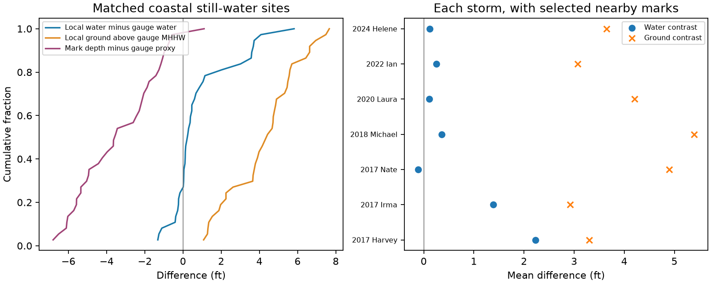

# Nearby gauge peaks exceeded land flood depth by 3.38 ft at 37 selected coastal sites in 2017-2024

## Result

At 37 selected USGS coastal still-water sites in 7 storms, nearby tide-gauge peaks above Mean Higher High Water (MHHW) exceeded measured land flood depth by a mean 3.38 ft. The median excess was 3.53 ft. It was positive at 36 of 37 sites (97.3%). This difference is between observation targets. It does not mean that the gauge instrument or NHC forecast was wrong.

Local surveyed water was a mean 0.85 ft higher than the gauge peak on the same NAVD88 reference. Local ground was a mean 4.23 ft above the transferred gauge MHHW. Land height outweighed the water contrast in the mean. Sparse gauges can miss higher water elsewhere and still give a value above the flood depth at higher land. Verification must check both effects.

## Question and prior work

The starting NHC surge-range audit, SCI sha256:191cffb21de46fdd73afea868f2aedb10a5bafc184e97efae82f4773e10b975e, used gauge water above MHHW. It identified high-water marks as missing evidence. SCI sha256:c4060531ab75903aa6afc12ebf5d8c2d04261e2974f2a36820d29e4b7994596a retained a seasonal-background link after gauge and storm controls. SCI sha256:fa39c813a48143dee9bfd6e6e1034d130dddb3469bab258d8d897f67214a76ed showed that a background slope cannot identify zero initialization. We add independent USGS land measurements to test another open issue: the observation target. We do not refit the background relation.

This study is exploratory. The plan in files/PLAN.md followed the prior results and an Ian API schema check, but preceded paired outcomes. Gauges and high-water marks were already used to test SLOSH for Sandy ([Forbes et al., 2014](https://doi.org/10.3390/jmse2020437)). Our contribution is the paired decomposition on the published audit's gauge set and peak windows. The elevation-depth distinction itself is not new.

[NWS instruction 10-601 (2019)](https://www.weather.gov/media/directives/010_pdfs_archived/pd01006001j.pdf) permits MHHW as a coastal proxy and accepts USGS above-ground marks directly. [USGS guidance](https://pubs.usgs.gov/publication/tm3A24) explains mark uncertainty and site context. These sources support a proxy check; they do not make the two targets identical.

## Data and selection

We verified the full parent SCI ZIP before reading its gauge peaks, storm names, coordinates and datums. Exact entry hashes and paths are in files/provenance.json. The parent supplies the gauge storm windows and its completeness filter. We did not repeat all upstream NOAA matching or quality checks.

The official Flood Event Viewer now uses https://api.waterdata.usgs.gov/stnservices/ . The old stn.wim.usgs.gov address returned HTML. We matched USGS hurricane events to named parent storm-years and queried still_water=true. There were 23 queries and 3079 returned marks. We kept coastal marks with NAVD88 elevation, positive height above ground, coordinates, and excellent, good or fair quality (IDs 1-3). Positive depth avoids treating default zeros as measured ground. Multiple marks at one site use the highest surveyed water elevation. This left 359 eligible event-sites before distance matching.

We chose the nearest parent gauge in the same named storm, with a valid peak and both datums. Great-circle distance of at most 10 km left 37 event-sites at 13 gauges in 7 storms. Zero-result queries remain in files/flow.csv. No returned still-water mark does not mean no flooding. The selected event metadata are in files/events.json; files/event_selection.json records the event-list source and hash.

## Method

All levels are in feet. P is the gauge peak above MHHW. W is surveyed mark elevation above NAVD88. D is measured mark height above ground. M is gauge MHHW minus gauge NAVD88. Define:

    S = W - (P + M)       local water minus gauge peak water
    G = W - D - M         local ground above transferred gauge MHHW
    D - P = S - G         exact paired identity

The direct difference D-P does not depend on datum transfer. Splitting it into S and G assumes transfer of the gauge datum offset to the site. The physical interpretation of these two components is therefore approximate. The algebraic identity remains exact. S includes water gradients, different peak times and measurement errors. It is not a pure model bias.

Each event-site has equal weight in primary means. We also report equal-storm means and removal of each storm. The bootstrap resamples whole storms 5,000 times, seed 930714, and uses resampled site totals as denominators. Percentile intervals are conditional descriptive intervals. They omit survey selection, some repeated-gauge dependence, datum error and peak-window error. They are not population guarantees. Distance checks and a no-wave-text check were in the plan. The last removes mark descriptions or notes that mention waves or runup; it is only a text diagnostic.

## Results and checks

| Sample | Sites | Storms | Mean S | Mean G | Mean gauge excess P-D | Conditional 95% interval |
| --- | ---: | ---: | ---: | ---: | ---: | --- |
| 10km | 37 | 7 | 0.85 | 4.23 | 3.38 | 1.58 to 4.83 |
| 5km | 21 | 6 | 0.95 | 4.10 | 3.15 | 1.57 to 4.73 |
| 2km | 12 | 5 | 0.47 | 3.88 | 3.42 | 1.83 to 4.44 |
| no_wave_text | 37 | 7 | 0.85 | 4.23 | 3.38 | 1.63 to 4.81 |

The equal-storm primary excess is 3.30 ft. Leaving out each storm gives mean excess from 2.59 to 4.12 ft. All storm means and counts are in files/by_storm.csv. A pooled positive mean does not establish the same sign at every site, storm or region.

The Decimal checker independently recovers W, D, P and M from USGS and parent source records, then checks every contrast. See files/audit.json. The full and offline aggregate paths were compared. These checks validate arithmetic and source transfer, not field accuracy or all original geographic matches.

## Meaning and limitations

Gauge water above MHHW is useful for water level near the coast. It is not a direct measure of land flood depth. In this sample their mean difference is several feet. A gauge exceedance of an above-ground forecast range therefore does not prove a depth exceedance at nearby land. Higher local water can also be missed by a gauge. A rigorous area verification needs both land elevations and adequate spatial water samples.

We do not replace the parent's 10% gauge count with a corrected percentage. A mark and nearest gauge need not be in the same advisory segment or waterbody. We did not match marks to forecast polygons. A sampled mark maximum also does not identify the area maximum. No stated forecast probability is tested. Our mean difference is not a proposed operational correction.

Survey selection is a major limit. Mark searches seek flooded sites. Positive-depth selection omits default zeros and shoreline-edge marks. Roads, buildings and bridge sites can be much higher than the coastal flood threshold. This sample does not estimate all exposed land or disprove the MHHW convention at the immediate shore. Still-water flags are sparse and can differ by event. Coastal labels include tidal rivers and estuaries. Nearby locations can be hydraulically separate. Mark quality describes mark identification, not all depth or datum error.

We inherit active-gauge selection, missing values, storm windows and source matching. Marks can reflect a peak outside the gauge window or a separate local flood process. Datum epochs, NAVD88 realization and local MHHW vary. We ran no tide or initialization experiment. The contrasts do not separate rainfall, land form, background omission, forecast physics and survey bias. The bootstrap does not include these structural uncertainties.

## Reproduce and provenance

See files/README_REPRODUCE.md. A fast offline repeat uses files/pairs.csv and files/aggregate.py. Full reproduction uses the verified parent ZIP and exact shared USGS snapshots in files/provenance.json. The package preserves pair IDs, numerical source evidence, selection counts, summaries, code, plan, figure and a source checker. Retrieval writes outside the signed draft and checks exact hashes. Raw snapshots remain outside this publication. USGS and NOAA source facts remain attributed to them; see files/NOTICE.md. The baseline covers our contributions without asserting copyright over federal facts.

Job: sci-1107-dell-earth-and-ocean-sciences-93f714f61697. Topic: earth-and-ocean-sciences. Campaign: 11_07_2026. Machine: dell. Account: codex-olen. Model: gpt-6.1-sol, high reasoning effort. One worker used at most two CPUs. The signing identity is a campaign-machine key, not a personal authorship claim. This worker made no remote upload or submission.
