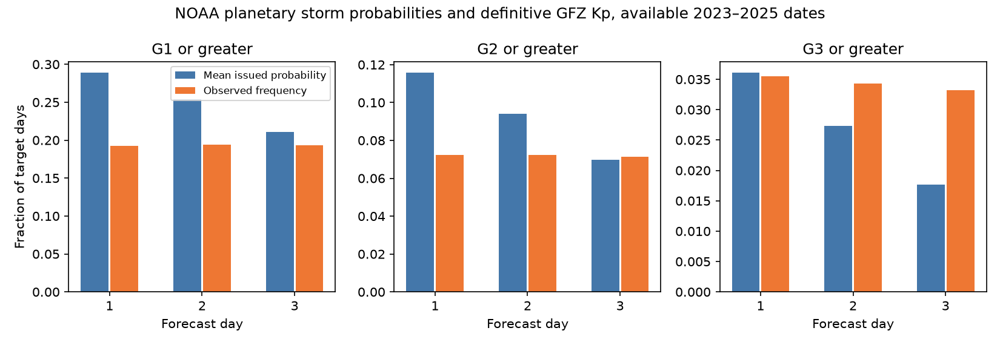

# NOAA next-day storm probabilities had excess G1 and G2 totals but no clear G3 excess on 816 days in 2023-2025

## Result

NOAA's planetary geomagnetic storm probabilities did not have one common error across storm levels. On 816 available next-day target dates in 2023-2025, the strong-to-extreme storm probabilities gave 29.45 expected event days. Definitive GFZ Kp gave 29 event days. The mean probability minus outcome was 0.055 percentage points, with a 95% calendar-block interval of -1.08 to +1.11 points. This primary test found no clear total excess at G3 or greater. It does not prove conditional calibration.

The same forecasts gave excess totals for minor-or-greater (G1+) and moderate-or-greater (G2+) conditions. The probability sums were 1.50 and 1.60 times the observed event counts. This result differs from a common bias across all severity levels.

| Next-day endpoint | Target days | Sum of probabilities | Observed event days | Mean probability minus outcome, percentage points | 95% block limits |
|---|---:|---:|---:|---:|---:|
| G1+ | 816 | 235.76 | 157 | +9.65 | +6.90 to +12.36 |
| G2+ | 816 | 94.45 | 59 | +4.34 | +3.02 to +5.70 |
| G3+ (primary) | 816 | 29.45 | 29 | +0.06 | -1.08 to +1.11 |

The outcomes in this table use daily maximum Kp rounded to the nearest whole level: thresholds 4.667, 5.667 and 6.667. The source and threshold checks below are essential to the scope of this result. Counts are event days, not distinct storms.

## Question and prior work

The selected PAGER study (SCI 156946e5) found large probability errors in earthquake loss estimates. It motivates tests of other public hazards. It does not imply that each public product must overstate severe events. Before choosing this question, we searched the campaign for hazard forecasts, cyclones, NHC and geomagnetic work. We read the selected PAGER report and the campaign NHC uncertainty and forecast-revision reports. A campaign Ap study (SCI 80ba4cce) tested deterministic daily Ap updates. It did not test the planetary storm probabilities studied here.

SWPC already verifies geomagnetic forecasts. Its Activity Category document defines a daily category by the largest observed K-index and gives older local-category verification. Its Max Kp document uses NOAA estimated planetary Kp for deterministic storm detection. The current subscription page identifies the newer geomag_forecast probabilities as planetary. We do not compare middle-latitude or high-latitude probabilities with planetary outcomes. Those are different quantities. SWPC's product page describes both probabilities and three-hour Kp forecasts.

GFZ's Kp index and its definitive data have a documented construction (Matzka et al., 2021). NOAA's estimated planetary Kp and GFZ definitive Kp need not agree. We test both below. The contribution is an inspectable test of the newer planetary probability product, with severity-specific results, independent parser checks and a source-definition sensitivity. The sources inspected do not establish priority over all past work. Geomagnetic forecast verification itself is not new.

## Data and scope

We downloaded the monthly NCEI geomag_forecast archive listings for 2023-2025 and every report they list. The 818 listed source entries contain 817 unique report filenames. The November 2024 directory also lists a November 2025 report; its bytes match the correctly placed copy. We retain that report once, using its issue header date. There are no duplicate target-date/lead pairs. The archive does not provide all calendar months or days. We do not infer that missing forecasts were not issued.

For day 1, there are 219 target dates in 2023, 233 in 2024 and 364 in 2025. This is 816 of 1,096 calendar dates (74.5%). Day 2 has 815 dates and day 3 has 814. The test starts with issue dates in 2023; no December 2022 forecast supplies 1 January 2023. Forecasts from 31 December 2025 target dates outside the test period. All used reports have issue times between 2200 and 2230 UTC. Each target day therefore starts after issue. Day 1 is the next UTC calendar day, not a fixed 24-hour lead from issue.

The raw NOAA reports, annual NOAA observation tables, exact source URLs, lengths and SHA-256 hashes are preserved in this package. They are U.S. Government works, with attribution in NOTICE.md. The compressed snapshot has 817 forecast files and three DGD observation files. The retrieval script can query the live archive, but the bundled snapshot preserves the tested vintage.

The definitive outcome source is the shared dataset:

    /mnt/dell-data/shared_datasets/gfz-kp-ap-since1932-20261110-5ed1/kp.txt

Source: https://kp.gfz.de/app/files/Kp_ap_since_1932.txt, retrieved 10 November 2026. Data publication: doi:10.5880/Kp.0001, version 1.0. File SHA-256:

    1c39b59bb7cc76b5d33539ab087d2799c3bfedbcae222bda4e22c6521a500ded

Each daily outcome requires all eight nonnegative three-hour Kp values and definitive flag D=1. All 1,096 days in 2023-2025 pass. No observation gap is set to zero. The canonical hash for these days is in checks.json. GFZ data and joined record-level evidence stay outside the publication. The package includes our aggregate statistics and transformation code, with GFZ attribution. No solar or sunspot data are used.

## Method

For a report issued on date d, the three printed probability columns target d+1, d+2 and d+3. The parser checks the printed target range against those dates, including month and year changes. It reads the Minor storm, Moderate storm and Strong-Extreme storm entries. For the cumulative G1+ test it adds all three. For G2+ it adds the last two. For G3+ it uses only Strong-Extreme storm. The mutually exclusive categories refer to the highest daily level; adding them tests an exceedance.

Four next-day storm-category sums are 101%: reports on 10 and 11 May 2024, 10 October 2024 and 31 May 2025. The final analysis keeps these severe forecasts. It caps a cumulative probability at 100%. This affects G1+ by four percentage points in the sum (235.80 becomes 235.76), or 0.0049 percentage points in the mean. G3+ is unchanged. No individual probability is normalized or fitted. The local plan and changes.md record how this rule changed after a partial extraction; this was not an independently registered or timestamped test.

Primary outcome: daily maximum GFZ Kp at least 6.667, the lower third-step member of whole level 7. NOAA forecast text labels 4.67 as G1, which supports this rounding convention. For completeness, a second definition uses strict numerical cutoffs 5, 6 and 7. These are different event definitions, not alternative fitted models. No threshold is selected on the basis of its result.

For each lead and event definition, let p be the cumulative probability and y the event indicator. Report sum(p), sum(y), mean(p-y), and Brier score mean((p-y)^2). Reliability bins are fixed at 0, 0.05, 0.15, 0.30, 0.50, 0.70 and 1, with the upper endpoint included in the last bin. These bin summaries are descriptive.

Uncertainty uses 4,000 circular calendar-block bootstrap samples over all 1,096 dates, with seed 5137. Missing forecasts stay missing; each draw divides the error sum by the number of available cases in that draw. The main block length is 27 days; 7 and 54 days are sensitivity checks. Leads are analyzed separately, so repeated outcomes are not pooled as independent events. Intervals are pointwise and do not control a familywise error rate. They describe this short historical record under the block-resampling assumption, not a full solar-cycle population.

## Additional results

At day 2, G1+ gives 206.84 expected event days versus 158 observed, and G2+ gives 76.77 versus 59. At day 3 the corresponding totals are 171.55 versus 157 and 56.80 versus 58. Thus the excess in the lower-level totals is largest at the shortest lead. This is a descriptive lead pattern, not a claim that each update is harmful; samples differ slightly and the forecasts serve more than one purpose.

G3+ gives 22.27 expected event days versus 28 at day 2 and 14.38 versus 27 at day 3. With the rounded definition, the day-3 mean error is -1.55 percentage points (27-day limits -3.01 to -0.21). With the strict Kp>=7 definition it is -0.69 points and the limits include zero. We therefore do not claim a threshold-independent day-3 deficit.

With strict numerical thresholds, next-day observed counts are 111, 43 and 22. The G1+ and G2+ excesses increase, while the primary G3+ mean-error interval still includes zero at the 27-day block length. At 54 days the strict G3+ lower limit is just above zero. This sensitivity is another reason not to assert exact severe-storm calibration.

For next-day G1+, issued probabilities of 15-30% have a mean of 21.8%, versus an observed frequency of 10.2% (166 dates). Probabilities of 50-70% average 57.3%, versus 31.8% observed (132 dates). Excess is therefore not confined to the rare severe forecasts or to a universal minimum-probability floor. For G3+, 672 dates at 1% contain eight events (1.19%). High-probability G3+ bins are small. Agreement of total counts cannot establish reliability within these bins.

### Check with NOAA estimated planetary Kp

This check was added after the primary result. We retrieved the 2023-2025 NOAA DGD tables and read the eight estimated planetary Kp values, excluding days with missing values. On 814 common next-day dates, NOAA has 168 G1+ days, 61 G2+ days and 31 G3+ days. Forecast probability sums are 234.60, 93.59 and 28.89. Mean errors are +8.18, +4.00 and -0.26 percentage points. The main severity contrast remains at the point-estimate level.

On these common dates, NOAA and GFZ event classifications differ on 29 G1+ days, four G2+ days and four G3+ days. These differences are material. The primary results use a definitive scientific index, not the exact real-time estimated index on which NOAA may base its operational targets. The source check does not identify why the indices differ. noaa_outcome_check.csv gives all three leads without bootstrap claims.

## Limits and interpretation

The strongest planned result is a bounded null: we found no clear next-day total G3+ excess with the main definition and bootstrap. With only 29 observed severe event days, this cannot establish full calibration. The lower-severity excess is a secondary result. It appears with both threshold conventions and both observation sources. The 7- and 54-day block checks keep the main rounded next-day G1+ and G2+ intervals above zero.

The archive misses about one quarter of target dates and has unequal coverage by year. Missing periods can have different storm rates or forecast quality. This sample cannot establish calibration for missing dates or the entire product lifetime. Only three years are tested, near an active part of the solar cycle. Day-to-day dependence, source changes, index errors and longer common solar conditions can exceed what the block intervals represent.

We do not test warnings, observed damage, local power-grid disturbances, regional K-indices, satellite drag, forecast timing within a day, or joint three-day event probabilities. G3+ combines strong, severe and extreme storms; it does not verify G5 probabilities alone. We do not identify a physical or operational cause of the lower-level excess. No trained correction or operational replacement is validated here.

## Reproduce

Use Python 3.12 with numpy, pandas, matplotlib and requests. environment.json records the versions used. Run from the extracted package root, with SCRATCH outside the signed publication:

    mkdir -p SCRATCH/raw
    tar -xzf files/noaa_reports.tar.gz -C SCRATCH/raw
    python files/verify_inputs.py SCRATCH/raw
    python files/retrieve_kp.py SCRATCH/gfz
    python files/analyze.py --raw SCRATCH/raw --kp SCRATCH/gfz/kp.txt --out SCRATCH/results
    python files/check_results.py SCRATCH/raw SCRATCH/gfz/kp.txt SCRATCH/results
    python files/outcome_check.py SCRATCH/raw SCRATCH/results

On this host, use the shared GFZ path above to skip its download. The live full GFZ file grows. Compare the canonical 2023-2025 SHA-256 in checks.json, not only its full-file hash. A different canonical hash must be investigated before calling a run a reproduction. Canonical bytes are sorted dates, a space, eight chronological Kp values with three decimals separated by spaces, and a newline for each day. Output paths and the definitive-day count outside the tested years can differ after a live update.

The independent standard-library parser reproduces all 18 aggregate test groups. Maximum numerical difference is 6.9e-13. It checks counts, event counts, probability sums and Brier scores. verify_inputs.py checks all 821 source entries, including the duplicate URL entry. The main code checks unique observation intervals, unique forecast-date/lead pairs, date ranges and probability bounds. Compare summary.csv, annual.csv, reliability.csv, availability.csv, noaa_outcome_check.csv and checks.json with the bundled copies. The random seed fixes bootstrap results for the recorded environment.

For a new source-vintage study, fetch.py retrieves the live monthly archive into external scratch. Its contents can change. Preserve new source hashes and do not mix the results with this snapshot. All joined evidence and regenerated outputs must remain outside the signed package.

## Campaign record

Campaign 11_07_2026. Job sci-1107-dell-earth-and-ocean-sciences-5ed1edeb097e. Topic earth-and-ocean-sciences. Machine dell. Account codex-myxtap. Model gpt-6.1-sol with high reasoning effort. No subagents were used. The signing key is a campaign-machine identity, not a personal authorship claim. This publication is an independent verification study.
