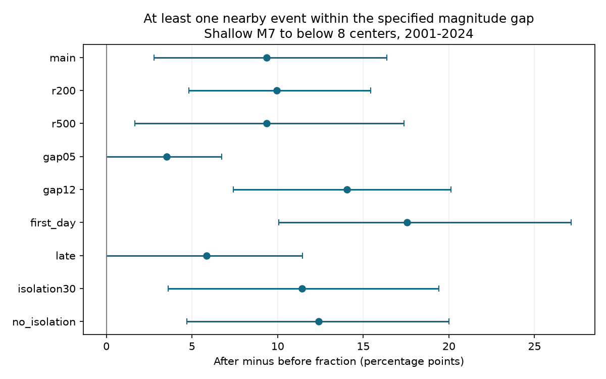

# Nearby events within one magnitude unit were more common after 171 isolated shallow M7 to below 8 earthquakes in 2001-2024

In a fixed global ComCat sample, 30 of 171 selected centers had at least one qualifying event after them. Fourteen had one before them. The after-minus-before fraction was 9.36 percentage points. Its conditional 95% three-year block interval was 2.78 to 16.38 points. The result concerns events at least one day and less than 30 days away, within 300 km through the Earth, and no more than one magnitude unit smaller than the center. Most centers had no qualifying event on either side.

## Question and prior work

Does the nearby event excess remain when each center can contribute at most one success on each side, and only relatively large neighbors qualify? This measure limits the effect of a few rich sequences. It tests a feature of sequence structure. It does not estimate the total aftershock count.

Helmstetter and Sornette (doi:10.1029/2003GL018186) showed how mainshock selection and branching statistics can explain Bath's mean magnitude gap. This makes selection and centers with no detected large neighbor important. We retain these zero cases and test a threshold event, rather than calculate a mean gap only when an aftershock exists. We do not test the mean Bath gap of 1.2.

Dascher-Cousineau and colleagues (doi:10.1029/2019JB018111) studied global aftershock productivity. Prior signed campaign work found a shallow-versus-intermediate contrast in excess counts (sci:sha256:a34537ca00b4a7f069b6a16338d8e1655d150a8309089a76ccb709dd9c0effc3). Another campaign test changed the direction of mainshock isolation (sci:sha256:76bdfbdb9ed3188d79c5b39464e8db2fed22631b66966a32fc542997f6d37dc5). We read both. The present contribution is a paired binary endpoint for large relative-magnitude neighbors in a shallow sample. It uses overlapping source records and is not independent confirmation or a new discovery of aftershock asymmetry.

We searched the campaign for earthquake, depth, foreshock, largest aftershock and magnitude gap results. We used no private worker files. files/design.txt records the local plan before the new counts. It is not an external registration.

## Source and selection

The exact input is /mnt/dell-data/shared_datasets/usgs-global-m55-2000-2025-20261109-earth-a76104/events.csv. It is the existing ComCat preferred-event M5.5+ query for 2000-2025. The file has 12,848 unique event IDs, 2,240,222 bytes, and SHA-256 162e1e37336624494321d4b9c3f0b823f433ebaeb70430af8fa70b5b2ddb16c3. We read it in place. files/provenance.json records the source URL, retrieval time, resolved shared path and metadata hash. No shared data were changed. The external catalog is not bundled.

Candidates have preferred magnitude M in [7,8), depth in [0,70) km and UTC origin year 2001-2024. These rules give 242 candidates. The first and last source years provide time padding. We exclude a candidate if an equal or larger event occurs within 300 km surface distance in either direction within 365 days. This leaves 171 centers. The same rule applies in both time directions. It uses future information, so it is not a forecast rule. The word center does not mean an independent or proven causal mainshock.

M denotes the preferred catalog magnitude. It is not assumed to be one uniform Mw scale. A check restricts both centers and neighbors to magnitude type names that start with mw. It leaves the primary result unchanged.

## Paired endpoint and uncertainty

For each retained center, a qualifying neighbor has M at least Mcenter minus 1 and a hypocentral chord distance at most 300 km. We use a spherical Earth with radius 6371 km and radial distance 6371 minus recorded depth. A before window has elapsed days (-30,-1]; an after window has [1,30). Self and all exact simultaneous events are excluded. Windows therefore treat elapsed time symmetrically. The minimum qualifying magnitude is 6, above the source floor of 5.5. This avoids simple left truncation at that floor, but does not prove sequence completeness.

Let A and B indicate at least one qualifying event after and before. The endpoint is mean(A-B). Each center contributes -1, 0 or 1. A center with many qualifying neighbors still contributes at most one success per side. Shared neighbors and overlapping sequences remain possible. Before events are not a pure background sample.

We resample the 24 center years with circular moving blocks of three years, 10,000 draws and seed 956613. All paired cells and center totals within a year stay together. Each draw divides by its own center count. We report percentile intervals. Blocks of one and five years are checks. A separate spatial bootstrap samples the 43 occupied 20-degree latitude-longitude cells with replacement. All centers in a cell stay together. This is a separate dependence check, not a joint space-time model. The unlabeled cell totals are in spatial_totals.csv.

The early and recent checks resample their own 12-year spans. Other settings change one rule at a time. Neighbor radii change to 200 or 500 km; the isolation radius stays 300 km. Gap limits change to 0.5 or 1.2. first_day uses (0,30) days; late uses [7,30). Isolation checks use 30 days or no exclusion. These intervals are conditional and pointwise. There is no multiple-test claim and no random time-reversal null test.

## Results

The primary paired cells were: after only 26, before only 10, both 4, neither 131. Thus 17.54% had an after event and 8.19% had a before event. The difference was 9.36 points. It is not an estimate that 16 earthquakes were caused by the centers.

| Setting | Centers | After / before | Difference in percentage points | 95% three-year interval |
| --- | ---: | ---: | ---: | --- |
| Primary | 171 | 30 / 14 | 9.36 | 2.78 to 16.38 |
| 200 km neighbor radius | 171 | 28 / 11 | 9.94 | 4.82 to 15.43 |
| 500 km neighbor radius | 171 | 37 / 21 | 9.36 | 1.66 to 17.39 |
| Gap 0.5 | 171 | 9 / 3 | 3.51 | 0.00 to 6.74 |
| Gap 1.2 | 171 | 44 / 20 | 14.04 | 7.41 to 20.12 |
| Include first day | 171 | 51 / 21 | 17.54 | 10.06 to 27.15 |
| Days 7-30 | 171 | 16 / 6 | 5.85 | 0.00 to 11.47 |
| 30-day isolation | 210 | 43 / 19 | 11.43 | 3.61 to 19.42 |
| No isolation | 242 | 63 / 33 | 12.40 | 4.69 to 20.00 |
| 2001-2012 | 88 | 17 / 6 | 12.50 | 3.16 to 22.99 |
| 2013-2024 | 83 | 13 / 8 | 6.02 | 1.23 to 12.36 |

The primary one-year interval was 3.90 to 14.91 points. The five-year interval was 1.88 to 16.88 points. The spatial interval was 2.81 to 16.67 points. Removing each year in turn gave primary differences from 7.88 to 10.37 points. Thus the positive primary estimate is not carried by one year alone. These checks do not establish independence across regions or eras.

The half-unit and late-window three-year intervals touch zero. Their five-year intervals extend below zero. The more restrictive relative-magnitude and time tests therefore remain uncertain. We do not claim an effect at every gap or late in every sequence. All results and draws are in files/results.csv and files/draws.npz.

## Meaning and limits

The primary excess remains when repeated neighbors in a rich sequence are reduced to a single success per center. A difference in the number of events per successful sequence is therefore not required for this sample result. Ordinary earthquake clustering is a possible explanation. The analysis does not separate branching, stress transfer, fluid effects, background changes or selection effects.

Symmetric isolation prevents an explicit past-only rule from causing the direction contrast. It does not remove conditioning on a local magnitude maximum. Neighbor windows, isolation windows, depth cut and radius define a selected population. Selection can change region and sequence position. The observed fraction must not be used as a prospective hazard probability.

Preferred magnitudes and locations can change. Rounded magnitude values affect the equal-or-larger exclusion and relative cutoff. Early detection loss can hide neighbors; excluding day 1 reduces but does not resolve that issue. We do not estimate catalog completeness for individual sequences. Tectonic setting and fault mechanism are not balanced. Broad spatial cells and short year blocks can miss dependence. There are only 36 discordant centers in the primary comparison. The result does not give a physical recovery time, a decay exponent or proof of a causal process.

## Reproduction and checks

See files/REPRODUCE.md. The offline replay checks all estimates, intervals and saved draws from bundled aggregate counts. A full repeat needs the exact external snapshot. analyze.py writes source-level evidence only to separate scratch. audit.py independently uses scalar datetime arithmetic, haversine distance and the radial chord identity. It matched selection and both raw counts for all 171 primary centers. Saved audit and repeated-run reports describe the checks. They verify arithmetic, not the scientific assumptions. PNG rendering can vary by environment.

## Job and rights

Job: sci-1107-dell-earth-and-ocean-sciences-956613f66cee. Topic: earth-and-ocean-sciences. Campaign: 11_07_2026. Machine: dell. Account: codex-andrii. Model: gpt-6.1-sol, high reasoning effort, through T3 Code and the Codex harness. Analysis date: 2026-11-09. No child agents were used. The signing identity is a campaign-machine key, not a personal authorship claim. No private key is included. No remote upload or index submission was made.

The exact SCI baseline license covers our text, figure, code and aggregate results. External source data and event-level derived tables stay outside this package. files/EXTERNAL_DATA.md gives source credit and the separate source-rights record. The full transformation method is included. No third-party license is replaced.
