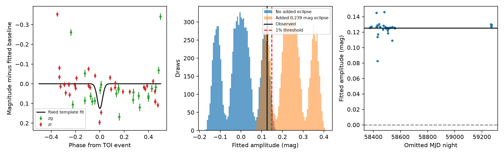
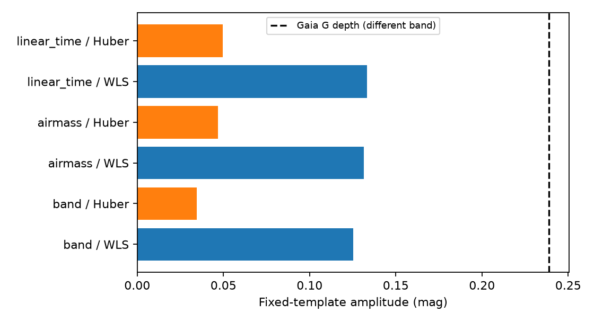

# The eclipse amplitude near TOI-2541.01 falls from 0.125 to 0.034 mag under robust loss in 54 ZTF measurements

We tested whether public ground data give a stable eclipse measurement for the Gaia binary near TOI-2541.01. A fixed eclipse model gives 0.125 mag with weighted least squares. A Huber fit gives 0.034 mag. Separate fits give 0.015 mag in g and 0.177 mag in r. These data do not give a secure ground confirmation or exclude an eclipse. This is a test of a published lead. It is not a new planet, binary, or host identification.





## Question and prior evidence

The campaign publication `sha256:987dcc64327f9be8bea39fd94eb38a0faf60622c9e28a514f449820e95182c81` found a period and epoch match between TOI-2541.01 and Gaia DR3 source 2956998401052982272. The stars are 15.75 arcsec apart. That work also found a TESS difference-image peak near the binary. Its simple ZTF box test had only two in-event points per band. Our added test uses a fixed smooth template, checks the fit method, and tests sensitivity at the actual observation times. We did not repeat the TESS image analysis.

Gaia uses Gaussian eclipse models. Its reported eclipse duration is 5.6 times the Gaussian width (Mowlavi et al., DOI 10.1051/0004-6361/202245330). The IRSA API supplies time, magnitude, error, band, and quality fields. A web search for TOI-2541 and ground eclipses did not return a separate target study. This limited search does not prove that no such study exists. The frozen ExoFOP row still has PC labels and notes a weak odd-even difference and a possible secondary event. A PC label is not a validation.

## Data and selection

We chose TOI-2541.01 because the published lead has ground data and a separate image indication. We selected the target before fitting its ground amplitudes. The target and data were selected in earlier work; this is not a fresh sample or a blind discovery test.

The frozen ZTF table has 54 rows: 23 g and 31 r, on 35 MJD nights. It spans HJD 2458377.02256 to 2459272.69030. All rows have catflags=0. We kept all rows. There is one object ID per band. There are only four observations on four nights within one Gaussian width of the predicted event center. This makes the eclipse estimate sensitive to small sets of measurements. We used the archived table in place of a new download. We did not search other objects or periods.

## Method

Set phase to wrap((HJD - 2459199.006353)/1.4118418) in [-0.5,0.5). This uses the TOI central ephemeris, which has a smaller period error than the Gaia fit. Set q = exp(-phase squared / (2 sigma squared)), with sigma = 0.12164973/5.6 = 0.02172317 in phase. Fit magnitude = band intercept + A q. Positive A is an eclipse. The weights are 1/magerr squared. The Gaussian is a test template, not a full binary model. The derived Gaia depth includes its full model and is not an exact Gaussian coefficient.

We used these checks:

* Fit each band separately. Fit extra linear terms in airmass or time, separately for each band. Fit a Huber loss with a fixed 0.05 mag transition and equal observation scales. This changes both the loss and the error weighting; it tests dependence on the fit choice, not a preferred physical model. No row is removed.
* Remove each MJD night in turn. Change the Gaussian width by factors 0.5 and 2, shift phase by -0.02 or +0.02, and add a sine and cosine at twice the orbital frequency. These changes are audits after the main fit, not independent discoveries.
* Use 9,999 random phase shifts at fixed period. Compare the observed positive weighted chi-squared gain against the shifted-template gains. All bands use the same phase shift. This keeps the measured scatter and time sampling but assumes that arbitrary phases are a useful reference. It does not control the original target selection.
* Apply 9,999 random night signs to residuals about the no-eclipse band means. All observations on one night get the same sign. Compare fitted amplitudes. This assumes symmetric, independent night residuals. It preserves large deviations but does not model slow or asymmetric errors. Separately apply night signs to residuals about the fitted eclipse model for a conditional interval. The two procedures use different residual models.
* Add 0.23866926 q mag to the no-eclipse sign draws. This is an illustrative equal-band addition set to the Gaia G depth. Count the fraction above the 99th percentile of the no-addition amplitudes. The residual pool contains any real variation already in the data. Thus this is a conditional sensitivity experiment, not a calibrated detection efficiency for real binaries.

No fit searches for a period or refines the event epoch. ZTF HJD and catalog BJD use different time references and may use different time scales. We made no correction. This limits precision timing; the phase shifts are much larger than the minute-scale offset, but they do not implement a time conversion. Catalog errors and parameter covariance are not included in the intervals.

## Results

| Test | Result |
|---|---:|
| Joint weighted amplitude | 0.1254 mag |
| g-only amplitude | 0.0154 mag |
| r-only amplitude | 0.1767 mag |
| Huber amplitude, band baseline | 0.0344 mag |
| Weighted amplitudes, airmass and time baselines | 0.1314, 0.1333 mag |
| Huber amplitudes, airmass and time baselines | 0.0468, 0.0495 mag |
| Leave-one-night amplitude range | 0.0825 to 0.1461 mag |
| Residual night-sign conditional 95% interval | 0.0444 to 0.2048 mag |
| Positive fit-gain phase-shift tail fraction | 0.0038 |
| No-eclipse night-sign amplitude tail fraction | 0.0814 |
| No-addition 99% amplitude threshold | 0.1481 mag |
| Recovery of the illustrative added eclipse | 76.3% |

The phase-shift score is unusually large under its reference model. The night-sign test does not reach a 5% level. The conditional interval excludes zero under the fitted-model residual assumption, but this is not equivalent to rejecting the no-eclipse residual model. These outputs must not be treated as interchangeable significance tests. Their difference is evidence that the error model matters here. Monte Carlo standard errors of the two tail fractions are about 0.0006 and 0.0027.

The full width and phase audit gives positive amplitudes from 0.0850 to 0.4685 mag. The high value occurs for a narrow displaced template with weak coverage; it is not evidence for a deeper eclipse. A broad twice-per-orbit term does not remove the fixed-template amplitude. Airmass and time terms also do not remove it. These limited checks do not establish that instrument effects are absent. The residual RMS is 0.097 mag for the main fit, much larger than most reported row errors. Several large deviations, band dependence, and sparse central sampling remain concerns. We did not inspect the ZTF images, seeing, reference-image blends, or neighboring comparison stars. A bright TESS target is 15.75 arcsec from the ZTF source, so light mixing remains possible.

## Physical meaning and limits

An eclipse of the nearby binary can in principle cause a shallow event in a blended TESS aperture. The prior work gives a flux fraction near 0.00378 and a required intrinsic fractional depth near 0.1375 under full light capture. Our fit is in g and r magnitudes, not intrinsic TESS fractional flux. Band differences, blending, and aperture response prevent a direct comparison. We therefore do not update the host assignment or claim that the ZTF amplitude meets the TESS flux budget.

The data contain some timing agreement under a fixed-template test, but they do not give a stable eclipse depth across the tested fit choices. A binary eclipse remains possible, as do measurement errors or a mixture of effects. This result does not overturn the prior TESS image indication. It adds a limit on what this sparse independent telescope sample can establish. Resolved observations during several predicted events, with matched outside-event baselines and image checks, would provide a stronger test.

## Provenance and reproduction

`files/provenance.json` records input hashes, the parent ZIP hash, the IRSA retrieval URL, and the exact shared path. `files/ztf.csv` is byte-for-byte the parent publication member `files/data/ztf_lc_gaia2956998401052982272.csv` (SHA-256 `176125befa8c85e6d296e07887eaf87e32a9dc94836ccb180cd3fb07e219b95c`). The parent states retrieval on 2026-11-08; its ZTF release number is not recorded. A new API retrieval can change and does not reproduce this snapshot.

`files/target.json` is the 2541.01 row from the parent's `files/results/pairs_toi.csv`. It supplies NASA TOI and Gaia DR3 model fields. `files/exofop_row.json` is the selected context row from `/mnt/dell-data/shared_datasets/exofop-tess-toi-table-20261108/exofop_toi.csv`, retrieved 2026-11-08, SHA-256 `ef22793ad87770c1795ff8da2243289b45e9282ff0bfb1ec3384fba1fbfd366a`. No other shared input is required. No shared data were changed. The raw-data rights remain with their providers; the baseline license applies to our added code, text, and derived outputs as permitted.

To reproduce offline once dependencies are installed, from this bundle root:

```
uv venv .venv --python 3.12
uv pip install --python .venv/bin/python -r files/requirements.txt
export OMP_NUM_THREADS=1 OPENBLAS_NUM_THREADS=1 MKL_NUM_THREADS=1
campaign-compute -- .venv/bin/python files/analyze.py
campaign-compute -- .venv/bin/python files/audit.py
```

Outside the campaign, run the same Python commands under your local resource limits. No network is needed by the analysis. The code writes only beside itself. `measurements.csv` gives phases, predictions, and residuals for every row. The package includes all random draws, phase controls, omitted-night fits, and sensitivity fits. `checks.json` records agreement with a separate partial-regression formula and exact recovery of an added template coefficient. `versions.json` gives the analysis environment. Figures are generated from the same run.

## Job record

Campaign: 11_07_2026. Job: sci-1107-dell-astronomy-c090579c9741. Topic: astronomy. Machine: dell. Account: codex-andrii. Model: gpt-6.1-sol, high reasoning effort, through T3 Code and the Codex harness. Date: 2026-11-08. No child agents were used. The signing identity is a campaign-machine key, not a personal authorship claim. This bundle was saved locally and was not submitted to a remote archive or index.
