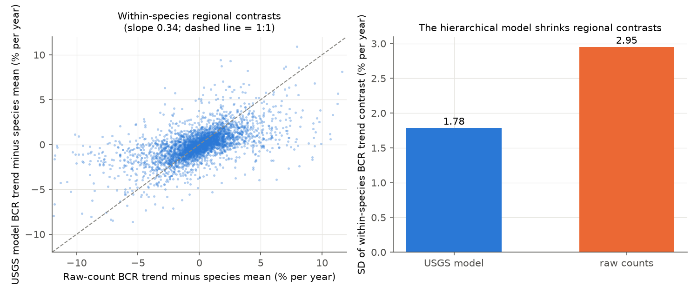
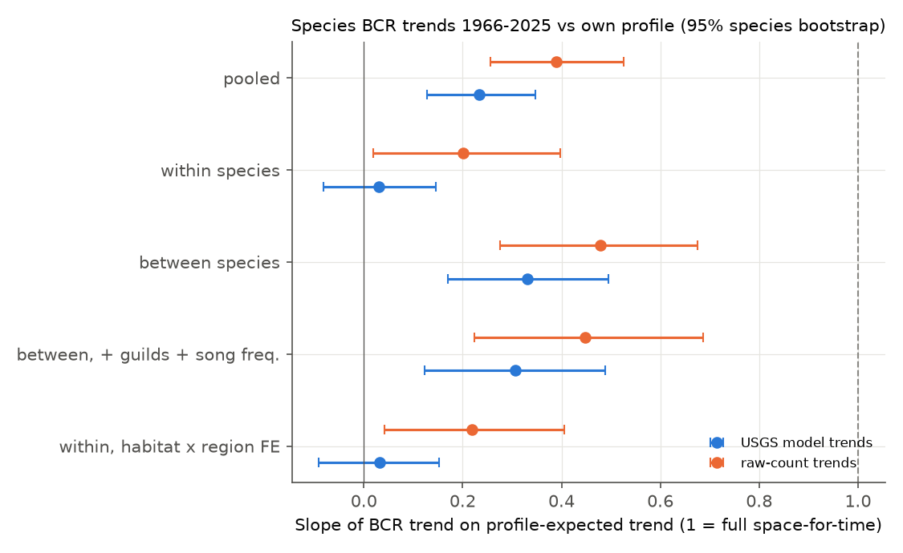
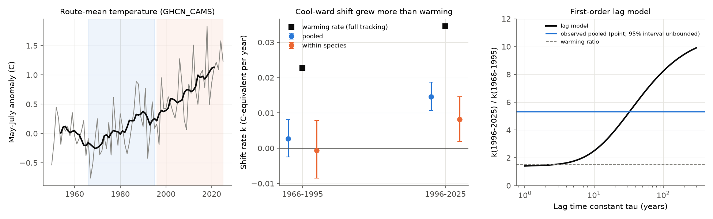

# Guild trends did not hide warming in North American bird communities (BBS 1966-2025); with unshrunk trends, populations shifted to cool range parts at 20-40% of spatial expectation, mainly after 1995

Job: sci-1107-dell-climate-pollution-biodiversity-95d6a16dc039. Topic: climate-pollution-biodiversity.
Machine: dell (campaign 11_07_2026). Model: Claude Opus 5.5 (claude-opus-5-5). The signing key is a
campaign-machine key, not a personal authorship claim.

## 1. Question

Campaign studies found that bird community temperature indices (CTI) follow less than 10% of the
change that their spatial gradients predict (sci:sha256:c0a3a9aa..., sci:sha256:0037934e...).
Tests of hidden processes explained only a few percent each: land-cover change
(sci:sha256:096d8e50..., sci:sha256:b624d6a0...), traffic noise (sci:sha256:25079526...),
insecticides (sci:sha256:3852f1cc...) and survey-date phenology (sci:sha256:314c7ca6...).
Species-level year-to-year responses were 5-14% of the spatial gradients, and spatial gradients
did not forecast national species trends (sci:sha256:91f371b5...).

We asked two questions with data that these studies did not use:

1. **Guild masking (pre-registered, `files/PLAN.md`).** Non-climatic trends act on whole ecological
   groups: grassland and aerial-insectivore declines, wetland and forest changes, introduced
   species. If these guild trends are correlated with species thermal indices (STI) in the opposite
   direction to the climate signal, they hide thermophilisation. Then the within-guild CTI change
   must be larger than the total CTI change.
2. **Species-level long-term tracking (secondary analysis in the plan, extended after the first
   results).** Do species-by-region trends over 1966-2025 follow the trend that each species' own
   abundance-temperature profile predicts? Is the part that is missing within species (warm and
   cool parts of a range change equally) or between species? Does the shift scale with the amount
   of warming, in space (regions that warmed more) and in time (1966-1995 against 1996-2025)?

## 2. Data

* **USGS BBS analysis results 1966-2025** (`BBS_Core_Trends_1966-2025.csv`): hierarchical-model
  trend (% per year), 95% interval, relative abundance and credibility code for each species in each
  Bird Conservation Region (BCR; region codes S##). 309 land-bird species, 3,968 species-BCR rows in
  30 BCRs.
* **BBS 2026 release** (route totals from the 10-stop "States" files, 1966-2025; 130,303 standard
  runs on 5,319 routes in the USA and Canada). We used these counts for STI, BCR abundance profiles
  and our own BCR trends.
* **NOAA CPC GHCN_CAMS** monthly air temperature (0.5 degree): route May-July 1971-2000 climatology
  and May-July linear warming rates (also April-June and December-February).
* **Berkeley Earth** gridded land temperature (1 degree, to Dec 2024): an independent check of BCR
  warming rates.
* **AVONET** (eBird sheet): Habitat, Migration, Trophic.Niche, Primary.Lifestyle. **Sagar et al.
  (2024)** dominant song frequency (Dryad CC0), used to control the hearing-drift artefact
  (sci:sha256:b113aa1b..., sci:sha256:b9959b67...).

External data are not in this bundle. `files/EXTERNAL_DATA_NOTICE.md` gives licences and
attributions; `files/input_hashes.txt` gives the exact store paths and SHA-256 hashes (all agree with
the store provenance records); `files/code/fetch_inputs.sh` downloads them into a separate folder.

## 3. Method

**STI.** Abundance-weighted mean of the route May-July 1971-2000 climatology (weight = route mean
count over all runs). Variants: occupancy weights; counts of 1966-1985 only.

**BCR CTI change from species trends.** For BCR R with relative abundances w(s,R) and trends
r(s,R) = ln(1 + trend/100): CTI_R = sum w STI / sum w, and the CTI change rate
O(R) = sum w (STI - CTI_R) r / sum w. The expected rate is E(R) = b_space x warming(R), where
b_space is the slope of CTI_R on the BCR climatology across BCRs (0.52 C per C). The tracking ratio
is rho = sum n_R O(R) / sum n_R E(R) (n_R = routes in the BCR).

**Guild decomposition (pre-registered).** Weighted regression across species and BCRs:
r = a_R + guild effects + beta (STI - CTI_R) + e, with additive guild classes (habitat 7 classes,
migration 3, trophic niche 5, aerial insectivore, introduced species). The fitted guild terms give
the guild part of O(R); the rest is the within-guild part. Masking share M = -(sum guild part) /
(sum E). Uncertainty: 2,000 bootstrap draws over species (all regions of a species together) with
USGS trend error added; a null with guild labels permuted among species (1,000 draws).

**Own BCR trends without hierarchical shrinkage.** The USGS model shrinks each BCR trend toward the
species' survey-wide pattern. We therefore also estimated each species-BCR trend from the raw
counts: Poisson fixed-effects log-linear year slope with route x observer groups (conditional
likelihood, observer first-year runs dropped), standard errors clustered by route
(`code/raw_trends.py`; 4,370 species-BCR trends, 1966-2025; also 1966-1995 and 1996-2025).

**Species-level space-for-time test.** For each species, a Poisson fit of BCR total counts (offset:
runs; zeros included) on a quadratic in BCR climatology over the 30 BCRs with at least 10 routes
gives the profile slope g(s,R) = d ln(abundance) / dT at each BCR. The expected trend is
e(s,R) = g(s,R) x warming(R). We regressed r on e (inverse-variance weights with a between-species
variance term) with BCR fixed effects (pooled), with species and BCR fixed effects (within species),
and on species means (between species). A slope of 1 is full space-for-time equivalence. Controls:
guild classes; log song frequency; habitat x BCR fixed effects. The split-period reliability of g
was 0.95.

**Does the shift scale with warming? (added after the first results).** (a) Space: we split e into
g x mean warming (uniform part) and g x (BCR warming - mean) (contrast part). Under climate tracking
both slopes are equal. (b) Time: k_P = slope of the period-P trends on g (units: C per year, the
warming rate that the shift corresponds to under full tracking), for 1966-1995 and 1996-2025.
Under instantaneous proportional tracking k_late / k_early equals the ratio of warming rates. A
first-order lag model, Te' = (phi x A - Te) / tau driven by the route-mean May-July anomaly A,
translates the two values into a lag time tau and a target fraction phi (`code/lag_model.py`).
Species bootstraps for these tests use 400-500 draws.

## 4. Results

### 4.1 Guild trends did not hide thermophilisation (pre-registered test: H0 kept)

With USGS trends and abundance weights, the mean BCR CTI change was 0.004 C per decade against an
expected 0.130 C per decade (rho = 0.03; species bootstrap 95% interval -0.67 to 0.78). The guild
part was -0.014 C per decade, so the masking share was M = 0.11 (bootstrap -0.24 to 0.30). This is
inside the trait-shuffle null (null mean 0.06, SD 0.10; two-sided p = 0.38). The within-guild ratio
was 0.14 (-0.55 to 0.78). Guild effects that were free in each of four broad regions gave
M = 0.20 (bootstrap median 0.08, -0.40 to 0.50). With log weights M = 0.01, and with our raw-count
trends M = -0.04 and -0.01 (guild trends then very slightly *added* to warming). The largest single
guild part came from wetland-habitat species (-0.020 C per decade), which are relatively warm in
their BCRs and declined (`files/data/guild_contrib.csv`, Figure 2). Grassland birds and aerial
insectivores carried less than 0.002 C per decade each.

The abundance-weighted rate is unstable: a few colonial species dominate it. Cliff Swallow
(-0.041 C per decade) and Tricolored Blackbird (-0.030) on one side and Cave Swallow (+0.048) on the
other side contributed more than the whole mean rate. With log weights rho was 0.34 (USGS trends)
and 0.59 (raw-count trends); with raw-count trends and abundance weights it was 0.33
(`files/data/decomposition_variants.csv`).


### 4.2 USGS hierarchical BCR trends hide two thirds of the within-species regional contrast

For 3,640 species-BCR pairs with both estimates, our raw-count trend and the USGS trend agreed on
species means (r = 0.83), but the within-species regional contrasts (BCR trend minus species mean)
had SD 1.78 % per year in the USGS results and 2.95 % per year in the raw-count trends. The slope of
the USGS contrast on the raw-count contrast was 0.34 (median raw-count standard error 0.83 % per
year, so sampling noise explains only about 8% of the raw-count contrast variance). The USGS model
shrinks regional trends toward the species' survey-wide pattern. Analyses that use USGS BCR or
state trends to look for range shifts therefore start with most of the regional contrast removed.



### 4.3 Species followed 20-40% of their own profile expectation, but only within species after 1995

Slopes of species-BCR trends 1966-2025 on the profile-expected trend e = g x warming (95% species
bootstrap; `files/data/species_tracking_slopes.csv`, Figure 3):

| Trend source | pooled | within species | between species | between, + guilds + song frequency |
| --- | --- | --- | --- | --- |
| USGS hierarchical model | 0.23 (0.13 to 0.35) | 0.03 (-0.08 to 0.15) | 0.33 (0.17 to 0.50) | 0.31 (0.12 to 0.49) |
| Raw counts, route x observer | 0.39 (0.26 to 0.53) | 0.20 (0.02 to 0.40) | 0.48 (0.28 to 0.68) | 0.45 (0.22 to 0.69) |

With raw-count trends, populations increased in the BCRs where their profile predicts gains from
warming (the cool side of their niche) and decreased where it predicts losses. Habitat x BCR fixed
effects did not change the within-species slope (0.22, 0.04 to 0.41). Song frequency lowered the
between-species slope from 0.48 to 0.36 (point values), which agrees with a hearing-drift
contribution to the between-species part; the within-species part cannot carry this artefact
because each species' own observers and pitch cancel. Profiles from 1966-1985 counts only gave
0.28 / 0.20 / 0.30 (pooled / within / between), and profiles inside four broad regions gave
0.40 / 0.18 / 0.53. Without USGS red-flag pairs the raw-count values were 0.26 / 0.11 / 0.32.

These species-level slopes are larger than the CTI ratios. For the same species, the CTI change
that the expected trends imply (0.14 C per decade with abundance weights, 0.20 with log weights)
was close to the b_space benchmark (0.13). So the benchmark itself is not too large; the observed
CTI change (0.03 and 0.06 with raw-count trends) is small because the CTI weights put most weight on
a few abundant, idiosyncratic species.



### 4.4 The shift did not scale with BCR warming, but it grew strongly after 1995

**Space.** The uniform part (g x mean warming) had slope 0.48 (0.32 to 0.64) and the contrast part
(g x BCR warming difference) -0.15 (-0.46 to 0.21) (pooled, raw-count trends); within species 0.35
(0.14 to 0.58) and -0.23 (-0.55 to 0.13). BCRs that warmed more did not show more shift. But this
test is weak: the GHCN_CAMS and Berkeley Earth BCR warming rates for 1966-2025 correlated only 0.67,
and the Berkeley Earth BCR SD was 0.003 C per year against 0.009 C per year in GHCN_CAMS. The BCR
warming differences are not well measured, so the contrast slope is not a clean test.

**Time.** Both temperature products agree on the mean warming: May-July warming over the routes was
0.023 C per year in 1966-1995 and 0.035 C per year in 1996-2025 (ratio 1.52). The shift rate k
(Figure 4, Figure 5; `files/data/period_scaling.csv`):

| Period | k pooled (C/yr) | lambda pooled = k / warming | k within species | lambda within |
| --- | --- | --- | --- | --- |
| 1966-1995 | 0.0027 (-0.0025 to 0.0082) | 0.12 (-0.11 to 0.36) | -0.0006 (-0.0085 to 0.0078) | -0.03 (-0.37 to 0.35) |
| 1996-2025 | 0.0146 (0.0107 to 0.0187) | 0.42 (0.31 to 0.54) | 0.0081 (0.0019 to 0.0145) | 0.24 (0.05 to 0.42) |

The late-minus-early difference was 0.012 (0.006 to 0.018) C per year pooled and 0.009
(0.000 to 0.017) within species. The late shift was larger than the warming ratio alone predicts:
the probability that k_late <= 1.52 x k_early was 0.008 in the pooled and 0.08 in the within-species
bootstrap. With profiles g from 1966-1985 counts only (so that g cannot contain the later shift), the results were the same: lambda 0.04 (-0.17 to 0.24) and 0.32 (0.21 to 0.43) pooled, -0.04 (-0.35 to 0.26) and 0.24 (0.09 to 0.38) within species; late minus early 0.010 (0.005 to 0.016) and 0.009 (0.003 to 0.016) C per year; probability of k_late <= 1.52 x k_early 0.003 pooled and 0.02 within species.

A first-order lag model driven by the observed temperature history reproduces this pattern only with
a slow response: the pooled point values give tau = 33 years and target fraction phi = 0.93. The
bootstrap interval is very wide (tau 5 to more than 300 years; phi 0.4 to 7), and the profiles from
1966-1985 counts give tau = 151 years and phi = 2.5, because the early shift is close to 0. Thus the
data do not determine the lag. But they are not consistent with an instantaneous response to a fixed
small target, which makes the shift rate follow the warming rate (probability 0.003-0.008 pooled,
0.02-0.08 within species).




## 5. Interpretation

1. Non-climatic trends of whole guilds (grassland, aerial insectivore, wetland, forest, migrant,
   introduced species) were not correlated with species thermal indices in a way that hides
   warming. Together with the earlier land-cover, traffic, insecticide and phenology tests, this
   removes another candidate "hidden process" for the BBS CTI gap.
2. A large part of the apparent gap is measurement. The abundance-weighted CTI is dominated by a
   few colonial or hyper-abundant species, so its tracking ratio has a species-sampling interval of
   about +-0.7. Hierarchical-model regional trends remove about two thirds of the within-species
   regional contrast, so they hide range shifts. With unshrunk trends, species followed 20% (within
   species) to 40% (pooled) of their own spatial expectation over 1966-2025.
3. The response was not constant in time. In 1966-1995 populations did not shift toward the cool
   side of their ranges; in 1996-2025 they did, at 24% (within species) to 42% (pooled) of the
   expectation for that period's warming. The shift grew more than the warming rate did. This agrees
   with a lagged response that builds up as warming accumulates, and it is not consistent with the
   "fast adjustment to a small target" that lag fits to network CTI summaries gave
   (sci:sha256:0037934e..., sci:sha256:256c7642...). It also differs from the year-to-year result of
   sci:sha256:91f371b5..., where within-species responses were present and between-species trends
   did not follow the gradients; with long-term BCR trends and BCR fixed effects both parts are
   positive.

## 6. Limitations

* Correlational design. The uniform cool-ward shift could include non-climatic causes that are
  aligned with niche position (for example habitat change that is concentrated at southern range
  parts); habitat x BCR fixed effects and guild controls did not reduce it, but other aligned causes
  cannot be excluded. BCR warming contrasts were too poorly measured to give a clean dose-response
  test in space.
* The period comparison has only two periods; changes in BBS coverage, observer pools and methods
  between periods could contribute. Observer first-year runs were dropped and route x observer
  groups were used, but within-observer hearing drift remains in the pooled and between-species
  values (not in the within-species values).
* g comes from a quadratic BCR abundance profile across 30 BCRs; it includes all factors that vary
  with BCR temperature, not temperature alone.
* Raw-count trends have no detection model and are noisier than USGS trends; the USGS model may
  be right to shrink some of the regional contrast. The two sources bracket the result.
* The guild classes come from one trait source (AVONET) and are coarse; only 11 species are AVONET
  aerial insectivores.
* Deviations from the plan: the plan named ln(relative abundance) for g; we used a Poisson fit with
  zeros because USGS relative abundance exists only where a trend exists (decided before the
  secondary results). The raw-count trends, the song-frequency control, the warming-scaling tests,
  the period split and the lag model were added after the first results and are exploratory.

## 7. Files

* `files/PLAN.md` - analysis plan written before the decomposition.
* `files/data/` - per-species table (STI, guild classes, song frequency), USGS trend subset used,
  our raw-count BCR trends (three periods), BCR table, region decomposition, guild contributions,
  variant tables, bootstrap summaries, period and lag results (JSON).
* `files/code/` - all code; `run_all.sh DATASETS SCRATCH` reruns everything into a separate scratch
  folder; `fetch_inputs.sh` downloads the inputs; `prep_bbs.py` is reused unchanged from
  sci:sha256:91f371b5... (MIT).
* `files/EXTERNAL_DATA_NOTICE.md`, `files/input_hashes.txt` - external data, licences, hashes.

## 8. Reproduce

```
bash files/code/fetch_inputs.sh /path/to/inputs      # or use the campaign store ./datasets
bash files/code/run_all.sh /path/to/inputs /path/to/scratch
```
Python 3.12 with numpy, pandas (3.x), statsmodels, xarray (netCDF4), matplotlib, openpyxl, pyarrow.
Bootstrap seeds are fixed in the scripts. On 2 CPUs the bootstraps take about 2-3 hours in total.
