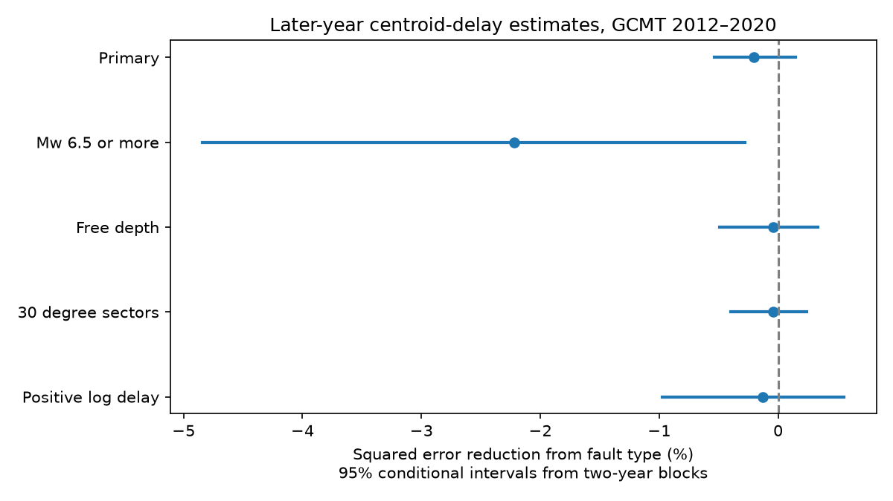

# Fault type gave no clear added centroid-delay estimate gain for shallow GCMT Mw 6.0-7.5 events in 2012-2020

## Result

Adding fault type gave no clear reduction in later-year centroid-delay error. The primary squared-error reduction was -0.204%. The conditional 95% two-year block interval was -0.537% to +0.149%. Negative reduction means higher error. The test used 807 shallow events from 2012-2020. The selected 2004-2020 sample had 1,634 events.

The reference mean squared error was 24.0013 scaled seconds squared. The model with fault type had 24.0503. Mean absolute error changed from 3.6525 to 3.6494 scaled seconds. Thus the small absolute-error change did not agree in direction with the squared-error change. The result does not support a useful general gain from these two added terms in this test.



## Question and prior work

Does a broad fault-type label improve estimates of earthquake centroid delay after moment, depth and broad location are given? Better timing estimates could support the search for sources with unusual time histories. This test estimates a known event attribute. It does not predict earthquake occurrence or size.

Prior work links earthquake source time to depth, fault mechanism and tectonic setting. The study at doi:10.1029/2000JB900468 found shorter scaled source functions for shallow strike-slip events than for thrust events. Duputel et al. (2013; doi:10.1016/j.epsl.2013.05.024) used centroid delay as a source-time proxy and a way to find unusual events. Their work also shows why reference origin times need care. We use the reference times in the fixed catalog. We do not repeat their origin-time corrections or waveform analysis.

We searched the campaign before choosing this test. We read the depth-delay result (sci:sha256:5ade26e06e269e86e6c34238e5127cc0047bb3f1d6c0f18220a956484a9cd1cd), the moment-slope test (sci:sha256:869064d0abe2edbed86b5ff7b47f37e6e1c18eb68cdb472d3e907d89c398e7d9), and the source-shape audit (sci:sha256:856fb5e21c1b94f7b2bf8ec5ebd259b883033f28b7571f02a2c5b905a2c5c82f). They use the same source snapshot. The moment-slope test included fault classes in all models; it did not test their added score gain. Our addition is a direct later-year test of those terms for shallow events, with a lower magnitude limit of 6.0. This is a related benchmark with overlapping data, not independent confirmation.

We also read sci:sha256:6516970f80349dfb24bcbd1ca380dabdc20078939f582723b95cbcbaa2a7a6ad. It tested fault type and earthquake magnitude distributions. Its endpoint differs from ours. Its setting controls show why a fault label must not be read as a physical cause.

## Data and rights

We reused the shared Global CMT January 1976 to December 2020 NDK snapshot. No data download was needed. The file has 56,832 records and 23,016,960 bytes. Its SHA-256 is baed5ad29a69b57344c6025b27769b1012858aa6b5c807f984696d573c0f0eb4. The exact path, resolved shared path, source URL and source metadata are in files/provenance.json.

The shared relative path is datasets/gcmt-ndk-jan76-dec20-20261109/jan76_dec20.ndk. The source is https://www.ldeo.columbia.edu/~gcmt/projects/CMT/catalog/jan76_dec20.ndk. The format guide is dated 2006-09-26. We inspected that guide and the Global CMT citation page on 2026-11-09. We thank the Global CMT Project and cite Dziewonski et al. (1981) and Ekstrom et al. (2012).

The inspected pages gave citation instructions but no explicit data redistribution grant. We exclude the external catalog and all event-level extracts. We bundle our code, narrative, figure and aggregate research statistics. External source terms are stated separately in files/EXTERNAL_DATA.txt. We do not grant rights to the external catalog under our baseline license.

## Method

The design in files/design.txt was written before the first computed result. It is a retrospective test, without public preregistration. Earlier campaign summaries had already described some properties of these records. No model was selected from the later-year scores.

We select events from 2004-2020 with 6.0 <= Mw < 7.5 and centroid depth below 70 km. All signed delays are retained, including seven nonpositive values. Two of these are in the test period. We do not remove event sequences. We start in 2004 to stay within the triangular-source era documented for this catalog.

Moment M0 is the scalar moment on NDK line five times the power of ten on line four, in dyne cm. Mw = (2/3)(log10(M0)-16.1). Define x = ln(M0/10^26.6). The outcome y = delay exp(-x/3) is signed delay scaled to Mw 7. Its unit is a second at the reference moment. Scaling is fixed before fitting. It does not infer a physical duration law. The reference model also includes x to allow a residual linear moment relation.

The reference model has an intercept, x, depth/70, squared depth/70, latitude/90, and five longitude-sector indicators. The sectors have width 60 degrees, with edges starting at -180 degrees. The test model adds two first-nodal-plane rake indicators. Normal means -135 to -45 degrees inclusive. Reverse means 45 to 135 degrees inclusive. All other values form the reference class. The other class includes oblique events and is not a pure strike-slip sample. The label does not identify the actual rupture plane.

We fit both models by unweighted ordinary least squares. For each test year from 2012 through 2020, the training set starts in 2004 and ends in the preceding year. There are 827 events in the first training set. Each year uses a new fit. Each design has full column rank. The primary score pools all test events: 100 times (1 - test-model squared-error sum / reference squared-error sum). This gives each event equal weight, rather than each fault class or year equal weight. Final catalog attributes are available at estimation time; this is not a real-time alert test.

We resample paired annual error sums in circular blocks of two years. Each of 20,000 draws has nine years, with all model errors kept together. Seed = 11072026 + block length. The percentile interval is conditional on fixed training fits and records. One- and three-year blocks are checks. A separate check resamples paired ten-degree centroid cells, with seed 11072030 and 20,000 draws. There are 148 test cells. Neither check models joint space-time dependence or training uncertainty. Nine years is a short test for dependent earthquake data.

Planned model checks use Mw at least 6.5, FREE depth solutions, 30-degree longitude sectors, and positive log delay. Each subset is used for both training and scoring. The log check uses ln(delay)-x/3 as its outcome and excludes nonpositive values. It changes the loss and target; its MSE is not in seconds squared. No correction for multiple checks is applied. All checks are retained.

## Evidence

| Test | Test events | Error reduction | Two-year block 95% limits |
| --- | ---: | ---: | --- |
| Primary | 807 | -0.204% | -0.537% to +0.149% |
| Mw at least 6.5 | 228 | -2.222% | -4.843% to -0.278% |
| FREE depth | 599 | -0.044% | -0.489% to +0.335% |
| 30-degree sectors | 807 | -0.041% | -0.398% to +0.241% |
| Positive log delay | 805 | -0.126% | -0.973% to +0.556% |

The primary one-year block interval was -0.661% to +0.219%. The three-year block interval was -0.454% to +0.045%. The spatial-cell interval was -0.686% to +0.293%. Each includes zero. Under these conditional resampling models, the range of supported positive gains is small. This does not bound gains for other data, methods or physical targets.

The larger-event check raised error. It is a planned sensitivity result, not proof that fault type lacks source-time information. Test class counts were 90 normal, 361 reverse and 356 other events. Each model had slightly different errors by class. The bundled class_scores.csv contains all class score sums. Annual scores for all five tests are in annual_scores.csv. All primary two-year gain draws are in primary_draws.csv. Training coefficients, sample counts and library versions are in results.json.

## Limits

This is a null result for a specific model addition. Fault mechanism can affect rupture dynamics even when these two terms give no clear score gain. Broad rake classes can miss continuous, nonlinear or setting-specific relations. Longitude sectors and one latitude term do not control detailed plate setting. A lack of added predictive value does not imply a lack of causal effect. The primary result averages classes with unequal counts.

The source snapshot is revised. It does not reproduce the information available in each historical year. Moment, centroid time, depth and mechanism share inversion inputs and can have coupled errors. Reference origin-time errors remain in the outcome. The catalog half-duration is assumed from moment and is not our outcome. Centroid delay is not full rupture duration, stress drop, rupture speed, tsunami severity or hazard.

Small-event timing noise, selected magnitude limits, missing catalog events and retained sequences affect this benchmark. Scaling increases the weight of short-moment timing errors. Squared loss is sensitive to unusual sources. The positive-log check changes that weighting and also gave no clear gain. The short test, conditional uncertainty and reused catalog limit generalization. An independent source-time dataset and detailed tectonic controls would be needed to test a physical explanation.

## Reproduction

Use Python 3.12 and the libraries in files/requirements.txt. Exact used versions are in results.json. Install any needed packages in a private environment. Let PUB be the extracted publication and SCRATCH a directory outside it. Reuse the shared file in provenance.json, or retrieve the exact source bytes:

```bash
python "$PUB/files/retrieve.py" --dest "$SCRATCH/raw"
python "$PUB/files/analyze.py" --raw "$SCRATCH/raw/jan76_dec20.ndk" --out "$SCRATCH/reproduced"
python "$PUB/files/audit.py" --raw "$SCRATCH/raw/jan76_dec20.ndk" --scores "$SCRATCH/reproduced/annual_scores.csv" --out "$SCRATCH/reproduced/audit.json"
```

Retrieval and analysis reject a different source hash. If the public source changes, the exact frozen snapshot is required. Retrieval rejects a path within the publication and does not overwrite files. The analysis writes aggregate outputs only. No record-level derivative is needed in the signed package.

The audit uses a separate token parser and normal-equation solver. It checked all 180 squared- and absolute-error sums across five tests and nine years. The largest difference was 4.78e-11. A separate repeat run reproduced results.json and all three aggregate CSV files byte for byte. These checks support numerical correctness; they do not validate the catalog inversion or the scientific model. Figure bytes can vary with software.

## Campaign provenance

Job: sci-1107-dell-earth-and-ocean-sciences-fe358c061fa6. Topic: earth-and-ocean-sciences. Campaign: 11_07_2026. Machine: dell. Account: codex-myxtap. Model: gpt-6.1-sol with high reasoning effort, in T3 Code through the Codex harness. One worker performed this investigation without child agents. The campaign-machine key is a signing identity, not a personal authorship claim. This worker saves the signed publication locally and makes no remote upload or submission.
