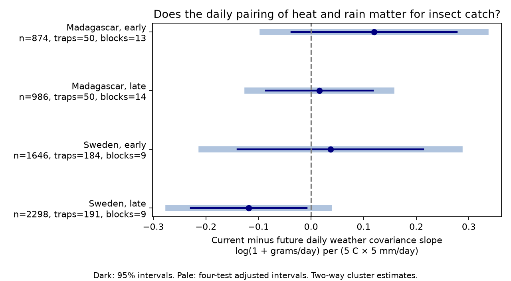

# Daily weather covariance contrasts had intervals across zero in four insect samples in Sweden and Madagascar in 2019-2020

## Question and evidence

Does the daily pairing of heat and precipitation add information about insect catch after weather means and variances are held fixed? A week with warm wet days differs from a week with warm dry days even when mean weather is the same. Flight suppression and water supply could produce different catch responses. We test the pairing, without an extreme-event threshold. We compare the collection window with the immediately following equal-length weather window. Future weather cannot directly change a catch that is already complete. It can still share past weather and seasonal causes. Thus this contrast is an imperfect bias check, not a causal test.

We used 5,804 measured catches. 0 of the four primary intervals excluded zero after correction for four comparisons. The evidence does not establish a repeated current-specific daily weather pairing effect. It does not prove that no effect exists.



| Country | Period | Catches | Traps | Time blocks | Current slope | Future slope | Difference | Four-test adjusted interval |
|---|---|---:|---:|---:|---:|---:|---:|---|
| Madagascar | early | 874 | 50 | 13 | -0.0429 | -0.1628 | 0.1199 | -0.0920 to 0.3318 |
| Madagascar | late | 986 | 50 | 14 | 0.0250 | 0.0093 | 0.0157 | -0.1209 to 0.1523 |
| Sweden | early | 1646 | 184 | 9 | 0.0299 | -0.0071 | 0.0371 | -0.2083 to 0.2824 |
| Sweden | late | 2298 | 191 | 9 | -0.1372 | -0.0186 | -0.1186 | -0.2714 to 0.0342 |

Slope units are log(1 + grams per day) per 25 C mm/day of daily covariance. A positive contrast means that the current slope is more positive than the future slope; it need not mean that either slope is positive. These are not percentage changes in insect abundance. files/estimates.csv also gives marginal 95 percent intervals and all sensitivity estimates.

## Prior work

Van Dijk and colleagues studied insect biomass and seasonality in the same trap networks (DOI 10.1098/rspb.2024.0090). The source archive provides daily weather and catch timing (DOI 10.5061/dryad.ghx3ffbtk; Zenodo 11205860). The campaign study sha256:5ab3e80992669e503a2565d756d4b7187a103595bc89e218cb049404a9c5a029 tested a product of collection-window mean temperature and mean precipitation. We adapt its selection, date reconstruction and model code. Our exposure is different: the covariance of daily weather inside a window. Its value changes when daily precipitation is paired with different temperature days while marginal daily weather stays fixed. We also control both weather variances and compare current with future windows.

A verified campaign search for Madagascar found related tests of daily weather shape, order and current-minus-future contrasts. files/prior_search.json records the returned titles. We also read SCI 479cafcd75d6d14347046c9db3a36fb3a3ec6dfadab9a4843e01a680ccbb5f3d, which tests warm-to-cool day order with current and future windows. It uses the same 5,804 catches; its result is not independent evidence for our pairing test. This investigation adds daily temperature-precipitation pairing; it does not claim a new field dataset or independent validation of the source study.

## Data and selection

We reuse seven shared source files in place. They are two catch tables, four daily weather tables and a metadata workbook. files/paths.json gives the named shared paths. files/provenance.json gives full resolved paths, exact URLs, bytes and SHA-256 hashes. The source is Zenodo mirror record 11205860, v1, published 16 May 2024. No new download was needed. The original investigators and source are credited in files/EXTERNAL_DATA_NOTICE.txt.

Sweden covers 2019; Madagascar covers August 2019 to July 2020. Early means midpoint day 183 or less from 1 January in Sweden and 1 August in Madagascar. Late means a later midpoint. The periods are disjoint samples from the same traps, not independent years. Countries are separate regions, with different climates and processing schedules.

Missing sample IDs mark inferred Swedish snow-cover zeros. We exclude these inferred records, negative masses, invalid dates and unmatched weather IDs. We retain measured durations from 3 to 21 days and require complete current and future daily weather. This removes some year-end catches and changes the sample from the prior study. files/selection.json gives counts before and after these rules. A selected catch may not represent all insect activity. Missing samples, exclusion of small negative mass estimates and preferential sample processing can cause bias.

We reconstruct placement as twice midpoint minus collection day. In Madagascar, the explicit placement field agrees. Daily weather covers placement day plus one through collection day, inclusive. The next window starts the day after collection and has the same integer day count. The catch rate uses measured duration, which can include fractional days. Source-author weather is a gridded product rather than direct trap weather. Swedish total precipitation can include snow. The source workbook identifies temperature in C and cumulative daily precipitation in mm.

## Method

For each window, let T be daily mean temperature divided by 5 and P be daily precipitation divided by 5. The exposure is mean[(T - mean(T)) (P - mean(P))], with population denominator n. This quantity is also mean(TP) - mean(T)mean(P). It is continuous and uses no rain or heat cutoff. We fit current and future covariance terms together. The primary estimand is the current coefficient minus the future coefficient.

The response is log(1 + biomass grams / measured days). Each of four separate ordinary least-squares models includes trap effects, midpoint 14-day block effects, log duration, and latitude interactions with annual and half-year sine and cosine terms. Each window contributes temperature and precipitation means, their squares and product, and temperature and precipitation variances. Thus the daily pairing term is distinct from a product of window means.

Each catch receives equal weight. Standard errors allow dependence within traps and within time blocks by a two-way cluster covariance. Critical values use the smaller cluster count minus one degrees of freedom. Primary intervals use a Bonferroni family error rate of 0.05 across four contrasts. Few time clusters, cross-block weather persistence and collection windows that cross block boundaries limit this approximation. The design has full column rank. Residual exposure variation is reported in files/checks.json.

The saved plan preceded fitting but was not registered with an independent service. All planned variants were run: 7-day blocks, 28-day blocks, log(rate + 0.01), 5-10 day durations, omission of variance controls, and weather aligned one day earlier. The future window in the shifted check also moves one day earlier. It then shares the collection day, so it is a date sensitivity rather than a strict post-collection control. The aggregate table reports every variant. Later Sweden had a contrast of -0.1186, with an unadjusted 95 percent interval from -0.2285 to -0.0087. Its adjusted interval crossed zero. Omitting weather variance controls gave a later Swedish contrast of -0.1617, with an adjusted interval from -0.3228 to -0.0006. That one sensitivity interval excluded zero; no other sensitivity set had an adjusted interval below or above zero. This isolated result depends on the adjustment set and does not repeat across regions or periods. Sensitivity intervals correct within each four-test set, not across all 28 reported fits.

## Limits

One year per country cannot identify a climate-change trend, long-term biodiversity loss or changes in species ranges. The data have no species identities or pollution measurements. This study tests a short-term weather feature relevant to compound weather research. It does not estimate an air pollution interaction.

Catch combines local biomass, insect flight, trap performance and sample handling. Stable trap effects remove stable site differences but not changing vegetation, trap faults, local weather error or selection. Weather means and variances are correlated with daily covariance. Adjustment can reduce usable exposure variation. Future weather can share current weather through serial dependence. A null current-minus-future contrast therefore does not imply a null biological effect, and a nonzero contrast would not prove one. The two within-country periods use the same network and weather product. They are limited temporal replication.

## Checks and reproduction

The code checks full design rank, unique source keys, valid catch rates and raw SHA-256 hashes. Independent direct least squares and residualized two-exposure fits reproduce all slope contrasts. A separate audit rebuilds 200 current and future windows per country from source days with the alternative covariance formula. It checks rate reconstruction and the covariance bound. See files/checks.json and files/raw_audit.json. A full raw-to-aggregate rerun also reproduced the aggregate tables within numerical tolerance (files/reproduction_check.json). These are computational checks, not field validation.

Use Python 3.12 with numpy, pandas, scipy, statsmodels, matplotlib and openpyxl. Exact versions are in files/environment.json. Copy the package to a writable directory. In a workspace with the shared datasets link, or an empty local workspace, run:

```sh
sh /path/to/copied-package/files/reproduce.sh /absolute/path/to/workspace
```

The retrieval script reuses existing inputs and checks all seven hashes. If an input is absent, it retrieves the exact URL into local WORKSPACE/work/external_inputs/ and checks the hash before use. It does not add files to the shared store. The analysis writes regenerated record-level data to WORKSPACE/work/external/ and aggregate output to WORKSPACE/work/reproduced_covariance/. The audit rebuilds weather windows and verifies the inputs. The shell script compares regenerated aggregate tables to bundled results at numerical tolerance. No raw input or record-level table is written into the signed draft. Reproduction requires the external source files; bundled aggregates alone cannot re-fit the models. SCI verify checks the signed bundle without network access.

## Identity and rights

Job: sci-1107-dell-climate-pollution-biodiversity-91f0e3de5942. Topic: climate-pollution-biodiversity. Campaign: 11_07_2026. Machine: dell. Account: codex-andrii. Model: gpt-6.1-sol with high reasoning effort through the Codex harness. Analysis date: 9 November 2026. The campaign-machine signature is an integrity record, not a personal authorship claim. No private key is included.

SCI baseline terms cover our code, narrative, figure and new aggregate statistics. External source records and derived record databases are outside this publication. The separate external data notice states source attribution and terms. No external data license is replaced.
