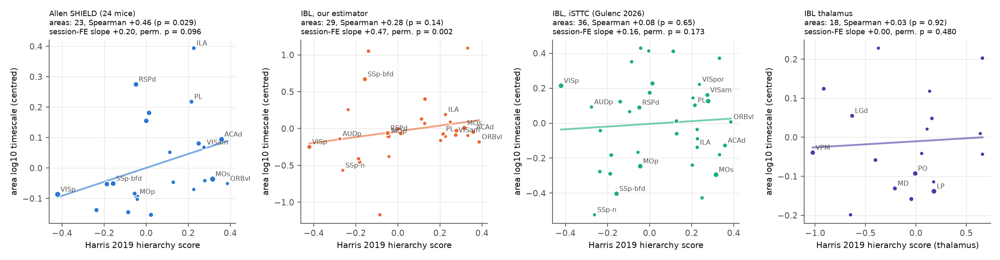
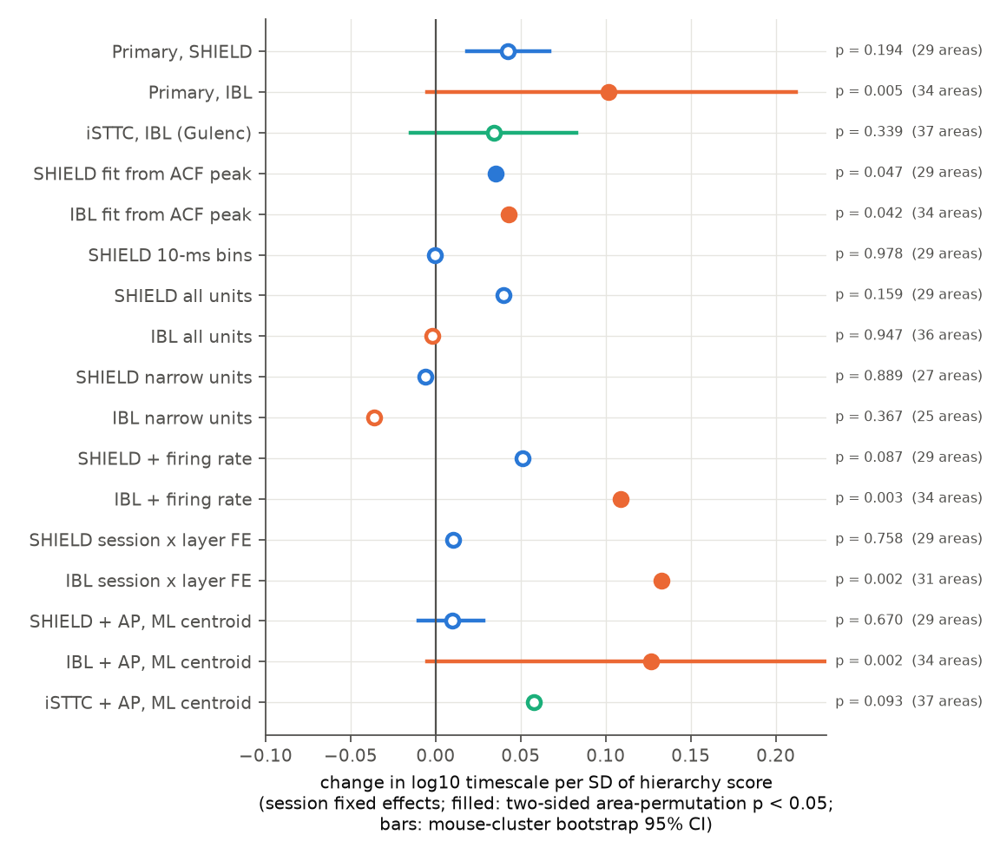
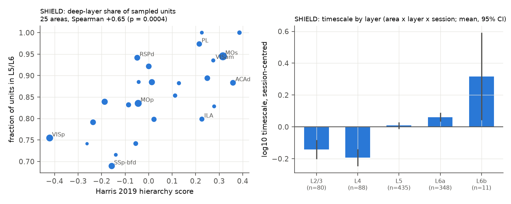

# Anatomical hierarchy did not reliably predict spontaneous spiking timescales of mouse cortical areas in two Neuropixels data sets

## Summary

**Question.** In the macaque and in models, cortical areas that are higher in the anatomical hierarchy have longer intrinsic timescales (Murray et al. 2014; Chaudhuri et al. 2015). Is this structure–function rule true across the mouse isocortex? We used the anatomical hierarchy of Harris et al. (2019). This hierarchy comes from the laminar patterns of Allen tracer projections. We also used the Knox et al. (2019) connectome. We tested the rule in two independent Neuropixels data sets.

**Data.** (1) Allen SHIELD (DANDI:001051): 289 s of spontaneous activity, 24 mice, 79 sessions, 29 isocortical areas. (2) IBL brain-wide map: 600 s of spontaneous activity, 0.1-s bins, 42 to 88 mice, 34 to 36 areas. (3) As a third estimate, we used the unit timescales of Gulenc et al. (2026). These come from the same IBL recordings, but they use a different estimator (iSTTC).

**Method (pre-specified, `files/PLAN.md`).** For each area and session, we averaged the autocorrelations of regular-spiking units (100-ms bins, lags 0.1–2 s). We fitted an exponential decay to get the timescale tau. Model: log10 tau = session fixed effect + beta × hierarchy score. The p value comes from 5,000 permutations of the hierarchy scores across areas. The 95% CI comes from a bootstrap over mice. The pre-specified replication rule was: beta > 0 with permutation p < 0.05 in both SHIELD and IBL.

**Main results.**

- **The replication rule failed.** SHIELD: beta = +0.20 log10 units per hierarchy unit (+10% tau per SD of hierarchy), one-sided permutation p = 0.096, mouse-bootstrap CI 0.09 to 0.31. IBL: beta = +0.47 (+26% per SD), p = 0.002, but the mouse-bootstrap CI (−0.02 to 0.99) includes zero. iSTTC estimates: beta = +0.16, p = 0.17.
- **In SHIELD, the layer of the recorded units explains the association.** In higher areas, more of the sampled units were in L5/L6 (Spearman +0.65 across 25 areas, p = 0.0004). Deep-layer units had longer timescales (L2/3 and L4 about −0.14 to −0.19 log10 units below the session mean; L6a +0.06). With session × layer fixed effects, the hierarchy slope fell to +0.05 (p = 0.76). With area centroid position (AP, ML) as covariates, it fell to +0.05 (p = 0.67).
- **In SHIELD, a medio-lateral position gradient remained** (exploratory). Medial areas had longer timescales than lateral areas, also with session × layer fixed effects (+0.08 log10 per mm, permutation p = 0.0005). Hierarchy added nothing after AP, ML and layer (p = 0.77).
- **Area timescale profiles were not reproducible across data sets and estimators.** The SHIELD profile was reliable across random halves of mice (median split-half r = 0.70). The IBL profile from our estimator was not (r = −0.08). The iSTTC profile was weak (r = 0.28). SHIELD and IBL area profiles agreed only weakly (r = 0.25, 21 areas, p = 0.27). Our IBL profile and the iSTTC profile did not agree (r = 0.02, 29 areas), although they come from the same IBL recordings.
- **The result depends on the estimator.** In SHIELD, a fit to 10-ms bins (fast component, lags up to 1 s) gave beta = 0.00 (p = 0.98). Fits that start at the autocorrelation peak gave small positive slopes with two-sided p = 0.047 (SHIELD) and p = 0.042 (IBL). Narrow-spiking units gave no positive slope in either data set.
- **Connectome input strength did not predict timescale.** Total isocortical input density and thalamic input density (Knox 2019) gave no clear slope in either data set (all two-sided p ≥ 0.06; signs differed between data sets).
- **Thalamus (IBL, secondary).** The Harris thalamic hierarchy did not predict thalamic timescales (beta = 0.00, p = 0.98, 20 nuclei). The thalamic profile was not reliable across halves of mice.

**Conclusion.** With current public mouse Neuropixels data and these estimators, we did not find a robust link between tracer-based anatomical hierarchy and the spontaneous spiking timescale of cortical areas. The apparent link in SHIELD is explained by the laminar sampling of the recordings. Future tests must control for layer, cell class and estimator. They also need more units per area than the IBL spontaneous epochs give in most cortical areas.

## Background and relation to prior work

- Murray et al. (2014) and Chaudhuri et al. (2015) linked timescales to the hierarchy in the macaque.
- Siegle et al. (2021) and Rudelt et al. (2024) reported longer timescales in higher mouse visual areas (six visual areas, Allen Visual Coding).
- A preprint (doi:10.1101/2023.05.12.540610) reported timescale gradients along the hierarchy in mouse forebrain data.
- Gulenc et al. (2026) mapped IBL timescales across 220 regions and found a rostro-caudal gradient at whole-brain scale. They did not test the tracer hierarchy within the isocortex.
- This study tests the whole isocortex (29–37 areas) against the Harris hierarchy, in two data sets, with layer, position and estimator controls.
- In this campaign, sci:sha256:cae100c0… showed that the Knox connectome predicts inter-areal spike correlations in the same SHIELD recordings. We used the SHIELD spike cache that that study made.

## Data

| Item | SHIELD | IBL (our estimator) | IBL (iSTTC, Gulenc 2026) |
|---|---|---|---|
| Source | DANDI:001051 v0.260922.1827 | IBL BWM release 2023_12, sorting 2024-05-06 | Zenodo 10.5281/zenodo.21257745, commit a2b01895 |
| Shared path | `shared_datasets/allen_shield_spontaneous_cortex_spikes/v1_2026-11-01` | `shared_datasets/ibl_bwm_passive_binned/2026-10-29` | `shared_datasets/gulenc_2026_intrinsic_timescales/a2b01895…` |
| Epoch | 289-s spontaneous block (grey screen) | 600-s passive spontaneous epoch | 5–10 min spontaneous epoch |
| Mice / sessions used (primary) | 24 / 77 | 42 / 61 (sessions with ≥ 2 areas) | 74 / 124 |
| Area × session samples | 548 (17,866 units) | 276 (4,772 units) | 466 (units with ≥ 5 per sample) |
| Areas | 29 | 34–36 | 37 |

Structure data:

- Harris et al. (2019) hierarchy scores: GitHub AllenInstitute/MouseBrainHierarchy, commit 8e4e0dd2, `Results/hierarchy_summary_CreConf.xlsx`, sheet `hierarchy_all_regions`, column `CC+TC+CT iterated` (primary). The column `CC iterated` was a sensitivity test. The file is not in this package because of its licence. `files/code/00_fetch_harris.sh` gets it and checks its SHA-256.
- Knox et al. (2019) regionalized connectome (`shared_datasets/knox2019_regionalized_connectivity/2025-02-21`), ipsilateral `connection_density` and `normalized_connection_density`.
- Allen CCF 2017 structure tree (25 µm folder) and the 100-µm annotation, for area membership and area centroids.

`files/derived/input_sha256.tsv` gives the SHA-256 of all 564 input files. 563 of them agree with the SHA256SUMS of their shared data set; the Harris table has no list, and its hash is given above.

## Methods

1. **Units** (`code/01_extract_acf.py`). Good units in an isocortical Knox summary area that has a Harris score. Regular spiking: waveform duration ≥ 0.4 ms (SHIELD `wf`, IBL `p2t`). Spontaneous rate ≥ 1 Hz. IBL units were mapped from their CCF atlas ID to the Knox 291 summary structures.
2. **Autocorrelation.** Spike counts in 100-ms bins (SHIELD also 10-ms bins). Per-unit Pearson autocorrelation at lags 1–20 bins.
3. **Timescale** (`code/02_fit_timescales.py`). For each area × session with ≥ 5 units, we averaged the unit autocorrelations and fitted r(k) = A·exp(−k·Δt/tau) + B (A > 0; tau 0.02–20 s; |B| ≤ 0.2). We removed fits with tau at a bound (≤ 3.3%). Median tau was 0.72 s (SHIELD) and 0.59 s (IBL). These values describe the slow part of the autocorrelation; the 10-ms analysis (median 0.36 s) includes faster lags.
4. **Primary model** (`code/03_stats.py`). log10 tau = session fixed effect + beta·H. Only sessions with ≥ 2 areas contribute. We permuted H across areas (5,000 permutations) and refitted. The bootstrap resampled mice (2,000 resamples).
5. **Secondary models (pre-specified).** Spatial covariates (area centroid AP, ML, DV in the CCF; left hemisphere; larger ML = more medial). Knox input densities (log10 sum over isocortical sources except the area itself; log10 sum over thalamic sources). Firing rate covariate. Session × layer fixed effects. Narrow-spiking units and all units. Per-session Spearman correlations. Area profiles from two-way (area + session) fixed effects. Thalamic nuclei (IBL).
6. **Exploratory analyses (added after the primary results).** Split-half reliability of area profiles over 200 random halves of mice (`code/05_reliability.py`). Spatial terms with session × layer fixed effects (`code/06_layer_spatial.py`). Deep-layer fraction of sampled units against H.

## Results



**Figure 1.** Area timescale (two-way fixed-effect area estimate, centred) against the Harris hierarchy score. Point size shows the number of area × session samples. Only areas with ≥ 3 samples are shown. The titles give the area-level Spearman correlation and the primary session-fixed-effect slope with its one-sided area-permutation p.



**Figure 2.** Hierarchy slope per SD of the hierarchy score in all pre-specified variants. Filled points: two-sided permutation p < 0.05. Bars: mouse-bootstrap 95% CI (computed only for the primary models and the spatial models).


**Figure 3.** (a) SHIELD and IBL area profiles. (b) Area profile against medio-lateral position. (c) Area-level Spearman correlations of the timescale with hierarchy, position and connectome input. (d) Split-half reliability of area profiles across random halves of mice.



**Figure 4.** SHIELD layer confound. (a) In higher areas, more sampled units were in L5/L6. (b) Timescale by layer, centred within session.

### Main table (`files/derived/results.json`)

| Test | Data | beta (log10 tau per H unit) | per SD of H | perm. p (one-sided / two-sided) | Areas | Mice |
|---|---|---|---|---|---|---|
| H1 primary | SHIELD | +0.198 (CI 0.086 to 0.315) | +0.042 | 0.096 / 0.19 | 29 | 24 |
| H1 primary | IBL | +0.474 (CI −0.025 to 0.988) | +0.102 | 0.002 / 0.005 | 34 | 42 |
| H1 | IBL iSTTC | +0.161 (CI −0.067 to 0.385) | +0.034 | 0.17 / 0.34 | 37 | 74 |
| + AP, ML | SHIELD | +0.045 (CI −0.047 to 0.132) | +0.010 | 0.35 / 0.67 | 29 | 24 |
| + AP, ML | IBL | +0.591 (CI −0.023 to 1.224) | +0.127 | 0.001 / 0.002 | 34 | 42 |
| + AP, ML | IBL iSTTC | +0.269 | +0.058 | 0.044 / 0.093 | 37 | 74 |
| session × layer FE | SHIELD | +0.048 | +0.010 | 0.39 / 0.76 | 29 | 24 |
| session × layer FE | IBL | +0.615 | +0.133 | 0.001 / 0.002 | 31 | 39 |
| 10-ms bins | SHIELD | −0.002 | 0.000 | 0.50 / 0.98 | 29 | 24 |
| fit from ACF peak | SHIELD / IBL | +0.166 / +0.200 | +0.035 / +0.043 | 0.022 / 0.024 (one-sided) | 29 / 34 | 24 / 44 |
| all units | SHIELD / IBL | +0.187 / −0.009 | +0.040 / −0.002 | 0.075 / 0.53 (one-sided) | 29 / 36 | 24 / 54 |
| H6 thalamus | IBL | +0.001 (CI −0.092 to 0.085) | +0.001 | 0.48 / 0.98 | 20 | 48 |

Connectome input (two-sided permutation p, single predictor): SHIELD cortical input −0.015 per SD (p = 0.65), thalamic input −0.038 per SD (p = 0.25); IBL cortical input +0.030 per SD (p = 0.42), thalamic input −0.009 per SD (p = 0.80); IBL normalized cortical input +0.067 per SD (p = 0.063). No input measure removed the IBL hierarchy slope.

Per-session Spearman (H vs tau, sessions with ≥ 4 areas): SHIELD 53 of 74 sessions positive (median rho 0.18, sign test p = 0.0003). This statistic has no layer control. IBL: only 6 sessions had ≥ 4 areas (2 positive). iSTTC: 8 of 20 positive.

### Why the two data sets disagree

The SHIELD area profile is reliable, but it follows layer sampling and medio-lateral position, not hierarchy. The IBL profile from 0.1-s bins is not reliable at the area level: most IBL area × session samples have few regular-spiking cortical units (median 12), and only 61 sessions contribute within-session contrasts. Thus the significant IBL permutation p rests on an area profile that does not replicate across halves of the IBL mice, and the mouse bootstrap CI includes zero. We do not consider the IBL result to be evidence for the rule.

## Limitations

- Each data set gives few independent areas (29–37). The area-permutation test has low power for small effects. An effect of about +10% tau per SD of hierarchy is not excluded.
- Timescale estimates depend on the bin size, the fit range and the estimator. The 100-ms estimator measures mainly the slow part of the autocorrelation. Slow fluctuations of state (running, arousal) can contribute; session fixed effects remove only the part that is common to all areas of a session.
- SHIELD probes did not sample all layers equally in all areas. Layer labels come from CCF registration of the probe tracks and can be wrong near layer borders.
- The IBL spontaneous epoch comes after the task. Some task-related activity can stay.
- The waveform rule (≥ 0.4 ms) separates regular- and narrow-spiking units only approximately, and the IBL `p2t` has a different definition from the SHIELD `wf`.
- The hierarchy and the connectome come from other mice (Allen tracer experiments). The Harris hierarchy is one estimate of hierarchy; we tested two of its versions.
- The analyses in "Exploratory analyses" were added after we saw the primary results.
- We did not test species other than the mouse.

## Reproduction

```sh
mkdir work && cp -r files/code work/code && cd work && mkdir -p derived figures ext/harris2019
uv venv .venv && uv pip install --python .venv/bin/python -r code/requirements.txt
sh code/00_fetch_harris.sh                # Harris 2019 table, SHA-256 checked
export SHARED_DATASETS=/mnt/dell-data/shared_datasets OMP_NUM_THREADS=1 OPENBLAS_NUM_THREADS=1
python code/00_hash_inputs.py             # input SHA-256 (derived/input_sha256.tsv)
python code/01_extract_acf.py             # unit ACFs, about 4 min
python code/02_fit_timescales.py          # area x session fits
python code/03_stats.py                   # all pre-specified tests, about 30 min
python code/05_reliability.py             # exploratory reliability
python code/06_layer_spatial.py           # exploratory layer x spatial models
python code/04_figures.py
```

The scripts use fixed random seeds. The shared data sets were made by other campaign studies from public sources. Their README files give retrieval code (SHIELD: HTTP byte-range reads of the DANDI NWB files; IBL: ONE/S3 reads). `files/derived/` contains the unit tables, unit autocorrelations (100-ms; SHIELD 10-ms values are not included because of size), area × session fits, area tables and all test results.

## Files

- `files/PLAN.md`: the pre-analysis plan (written before any timescale was computed).
- `files/code/`: all analysis code (MIT).
- `files/derived/`: derived data and results (`results.json`, `reliability.json`, `layer_spatial.json`, `area_table.csv`, `area_predictors.csv`, `as_*.parquet`, `units_*.parquet`, `acf_*.npz`, `input_sha256.tsv`, run logs). The H and H_cc columns copy the Harris et al. (2019) scores; the connectome columns are sums of the Knox et al. (2019) values. Credit these sources (Allen Institute terms). The `gulenc_isttc` columns of `area_table.csv` are our aggregate estimates computed from the Gulenc et al. (2026) unit table; the unit table itself is not included. The package LICENSE applies to our own text, figures, code and derived results; values copied from third-party sources keep their original terms.
- `files/figures/`: Figures 1–4.

## Provenance of this work

- Job: sci-1107-hp-neural-structure-and-computation-d8e717ab5542 (campaign 11_07_2026), topic neural-structure-and-computation, machine hp.
- Model: Claude Opus 5.5 (claude-opus-5-5), working as an automated research agent. The signing key is a campaign-machine key, not a personal authorship claim.
- Date: 2026-11-08. Computations ran under the host `campaign-compute` limiter with one library thread.
