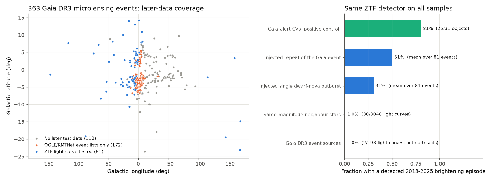
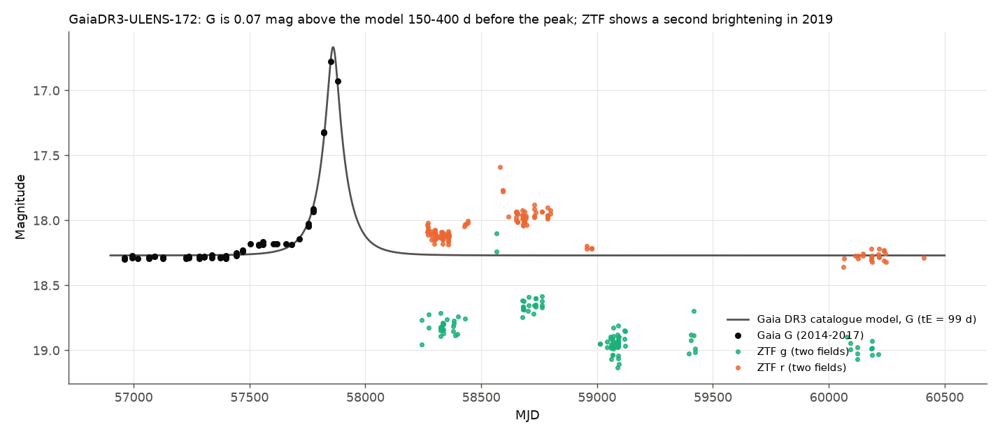
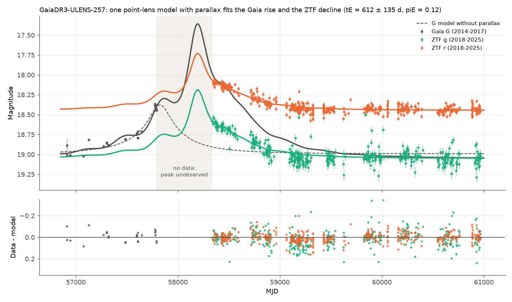

# Later survey data show a second brightening of Gaia DR3 microlensing event 172 and no repeat in 80 other testable events

**Job:** sci-1107-dell-astronomy-184150b950dd · **Topic:** astronomy · **Machine:** dell · **Model:** Claude Opus 5.5 (`claude-opus-5-5`) · **Date:** 2026-11-09.
The signing key is a campaign-machine key. It is not a personal authorship claim.

## Summary

A single-lens microlensing event does not repeat. A source that brightens again is a variable star, or the lens is a binary. We used this rule to test the Gaia DR3 microlensing catalogue (363 events from 2014 to 2017; Wyrzykowski et al. 2023, A&A 674, A23). The catalogue paper estimated a contamination of 0.6% to 1.7%. It checked ZTF data to 2022 by eye.

We used three sources of later data:

1. **ZTF DR24 light curves** (2018-03-20 to 2025-10-21) for the 81 events with usable data. We used a fixed outburst detector, same-magnitude neighbour stars as a null, injected repeats, and dwarf novae from Gaia Science Alerts (GSA) as a positive control.
2. **Event lists:** OGLE-III/IV EWS (2002-2026), KMTNet (2016-2025), and GSA (2014-2025), for all 363 events.
3. **Gaia DR3 epoch photometry** for joint fits.

Main results:

- **No list repeat.** None of the 363 events has a second OGLE, KMTNet, or GSA event at the same position. At the base rate of 0.48% from OGLE-EWS events of 2014-2017 (38 of 7,955), we expected 1.0 repeat among the 210 events in the OGLE footprint.
- **The fixed ZTF outburst detector finds no real repeat.** It flags 2 of 198 event light curves. The neighbour null predicts 1.95 (30 of 3,048 neighbour light curves; Poisson p = 0.58). Both flags are artefacts: each is in r only, in December or January before dawn, at 22-32 degrees altitude, with 0.3-mag jumps within minutes. The same detector finds a later outburst in 25 of 31 GSA dwarf novae (cataclysmic variables, CVs) that were alerted in 2014-2017.
- **Upper limits (95%)** on the fraction of the 81 ZTF-tested sources that repeat in 2018-2025: 7.1% for a repeat of the same event shape, 11.6% for one dwarf-nova-like outburst, and 4.5% for sources that behave like the GSA dwarf novae. The detector is not sensitive to slow YSO-like variability (0 of 5 GSA YSOs).
- **Event 172 (Gaia DR3 2046379503690071296) brightened again in 2019.** It was 0.69 mag brighter in r and 0.8 mag brighter in g than its 2023 level. This was at least 707 days after the Gaia peak. Two ZTF fields agree to 0.01 mag, and neighbour stars stay constant to 0.012 mag. The ZTF alert stream also detected it (ZTF19aanintr, positive difference flux). The source was also 0.2-0.35 mag above its 2023 level in 2018-2020. Gaia shows a 0.07 mag excess 150-400 days before the peak. A single point lens with tE = 99 d cannot make these features. The source has a proper motion of 5.1 mas/yr (50 sigma), so it is a Galactic star. We did not find what type of source it is.
- **Event 257 (Gaia DR3 3388787058343659648) is probably microlensing.** The catalogue paper did not decide between microlensing and a quasar for this event. The catalogue model (tE = 1,846 d) predicts 0.055 mag of fading from 2018 to 2024. ZTF shows 0.39 mag (g) and 0.30 mag (r). A point-lens model with annual parallax fits Gaia G and ZTF g and r together: tE = 612 ± 135 d, piE = 0.115. This fit is better than the model without parallax by delta-BIC = 37. After the event, the residuals show no quasar-like red noise (see below). The peak fell in the 2017-2018 data gap, so the fit parameters have weak constraints.
- **No population excess of variability.** 7 of 148 light curves are more variable than 95% of their neighbours. A leave-one-out neighbour null predicts 16.5. A post hoc season-level screen finds 5 against 7.7 expected. Event 172 has the largest season-to-season change of all 100 screened light curves (0.31 mag, against a neighbour median of 0.01-0.02 mag).

In the ZTF-tested sample we identified 1 contaminant in 81 events: 1.2%, with a 95% interval of 0.03% to 6.7%. This agrees with the 0.6-1.7% estimate in the catalogue paper. The test applies only to sources that repeat within about 7.5 years and that ZTF can see (declination above about -30 degrees, G brighter than about 20.5). For 110 events, mostly south of declination -31 degrees, we found no later test data.



## Question

Do the sources of Gaia DR3 microlensing events brighten again in later, independent data? If yes, which events are not single-lens microlensing, and how large is the contamination?

## Data

| Data | Source and version | Use |
| --- | --- | --- |
| Gaia DR3 `vari_microlensing` (363 rows) joined to `gaia_source` | ESA Gaia TAP `https://gea.esac.esa.int/tap-server/tap/sync`, queried 2026-11-09 | Event parameters, positions |
| Gaia DR3 classifier columns (`astrophysical_parameters`, `qso_candidates`, `galaxy_candidates`, `vari_classifier_result`) | ESA Gaia TAP, 2026-11-09 | Context for each event |
| Gaia DR3 `epoch_photometry` (G, BP, RP) | AIP mirror `https://gaia.aip.de/tap/sync`, 2026-11-09 | Joint fits, figures |
| ZTF DR24 light curves, 30-arcsec cones | SNAD mirror `https://db.ztf.snad.space/api/v3/data/dr24/circle/full/json`, 2026-11-09 (only good observations; data to MJD 60969) | Repeat search, controls |
| ZTF alerts for event 172 | ALeRCE API `https://api.alerce.online/ztf/v1/objects/`, 2026-11-09 | Independent check |
| Gaia Science Alerts index (27,077 alerts to 2025-01) | `http://gsaweb.ast.cam.ac.uk/alerts/alerts.csv`, 2026-11-09 | Cross-match; CV and YSO controls |
| OGLE EWS event pages, 2002-2009 and 2011-2026 | `https://ogle.astrouw.edu.pl/ogle3/ews/<year>/ews.html`, `.../ogle4/ews/<year>/ews.html` (2020-2021 do not exist) | Cross-match, base rate |
| KMTNet event pages, 2016-2025 (public years only) | `https://kmtnet.kasi.re.kr/~ulens/event/<year>/` | Cross-match, base rate |
| Catalogue paper tables | arXiv:2206.06121 e-print source (event numbers, sample labels) | Event numbering |

We used only event positions and times from the KMTNet pages, and only years whose proprietary period has ended (to 2025). `files/data/PROVENANCE_SHA256.txt` gives SHA-256 hashes of the input tables and of the raw OGLE and KMTNet pages. The signed manifest gives a hash for each included file. We did not add these data to the shared campaign dataset store, because they come from many small API calls and not from single files.

## Methods

**Repeat detector (fixed before we looked at results; `code/ztflib.py`, `code/04_ztf_repeat_search.py`).** We used each ZTF light curve (one field, filter and CCD) within 1.5 arcsec of the Gaia position. We masked epochs where the Gaia DR3 blended Paczynski model predicts more than 0.02 mag of magnification. The baseline is the median magnitude, and sigma_rob = 1.4826 × MAD. A point is bright if it is brighter than the baseline by more than 0.2 mag and by more than 4 × sqrt(sigma_rob² + err²). An episode is 3 or more bright points on 2 or more nights within 100 days. Light curves need 20 or more points.

**Null.** We applied the same detector to neighbours 3-30 arcsec away, in the same field and filter, with median magnitude within 1 mag. These stars have the same cadence and depth.

**Injections.** For each target light curve we made 200 injections of each type. Type 1 is a repeat of the Gaia event with the same u0, tE and G-band blend fraction, at a random time. Type 2 is one dwarf-nova-like outburst with the Gaia event amplitude, a 1-day rise and a 10-day e-folding decline. The event-level detection probability is the maximum over its light curves. We solved prod(1 - f p_i) = 0.05 to get the 95% upper limit on the repeating fraction f.

**Positive control (`code/06`, `code/07`).** We used GSA alerts classified as CV (31 usable) or YSO (5 usable), alerted in 2014-2017, at declination above -28 degrees, with quiescent G of 16-20.5. Thus these sources have the same pre-ZTF timing as the microlensing events.

**Variability excess.** We ranked each target's sigma_rob and 5-95% range among 5 or more neighbours. The null rate comes from neighbours ranked among the other neighbours. **Season-level screen (post hoc, `code/14`).** For each light curve we found the range of its season medians after we subtracted the median season offsets of the neighbours. We ranked this range against the neighbours in the same way. We added this screen after we inspected event 172.

**Event lists (`code/02`, `code/03`, `code/08`).** We cross-matched within 1.5 arcsec. A matched event is the same event if its peak is within max(2 tE, 60 d) of the Gaia peak. Here tE is the larger of the Gaia and the listed timescales, capped at 1,000 d. All other matches count as repeats. We used the same rule on OGLE-IV EWS events of 2014-2017 to get the base rate. KMTNet gives t0 as HJD-2450000 to 2022 and as HJD-2400000 from 2023. The parser corrects this. Without the correction, the base rate is a false 12%.

**Event 257 (`code/09`, `code/10`, `code/13`).** We fitted a point-lens model with common t0, tE and u0, and with a baseline and a blend fraction (0 to 1) for each band. The bands are Gaia G (flux error plus a 5 mmag floor), ZTF g and ZTF r. We used annual parallax with the geocentric formalism (Gould 2004; we ignored the 0.01 AU offset of Gaia at L2). We scaled the errors in each band so that the reduced chi-squared is 1. We compared the structure function of the residuals at lags from 0.5 to 3,000 days.

## Results

### Repeat search

| Quantity | Value |
| --- | --- |
| Events | 363 |
| Events with usable ZTF light curves | 81 (198 light curves; samples A 41, B 28, A+B 12) |
| Light curves flagged / expected from neighbour null | 2 / 1.95 (p = 0.58); both artefacts (Figure 3) |
| GSA CVs (2014-2017) with a detected 2018-2025 outburst | 25 of 31 (81%) |
| GSA YSOs detected | 0 of 5 (the detector is not sensitive to slow variability) |
| Mean recovery: injected event repeat / dwarf-nova outburst | 0.51 / 0.31 |
| 95% upper limit on repeating fraction: event repeat / one outburst / CV-like | 7.1% / 11.6% / 4.5% |
| Variability excess: light curves above 95th neighbour percentile / null expectation | 7 / 16.5 (of 148) |
| Season screen: light curves above 95th percentile / null expectation | 5 / 7.7 (of 100) |
| List matches (OGLE, KMTNet, GSA): same event / repeat | 256 / 0 (176 events matched) |
| Events in OGLE / KMTNet footprint | 210 / 166 |
| OGLE-EWS 2014-2017 base rate of same-position repeats | 38 of 7,955 (0.48%); 1.0 expected among the Gaia events |

`files/out/event_level_results.csv` gives the results for each event.


*Figure 3 (file only):* The two flagged ZTF episodes. Colour shows altitude. Bright points alternate with baseline points within minutes in the same night, near 25 degrees altitude, in r only.

### Event 172 is not a single-lens event



| Window (MJD) | ZTF g (field 1726 / 1727) | ZTF r (field 1726 / 1727) | Neighbour offset |
| --- | --- | --- | --- |
| 58200-58500 (2018) | 18.81 / 18.82 | 18.12 / 18.11 | < 0.005 |
| 58540-58630 (2019 spring) | 18.24 / 18.10 (single points) | 17.77 (17.59 at MJD 58580) / 17.78 | < 0.008 |
| 58630-58900 (2019) | 18.65 / 18.67 | 17.98 / 17.97 | < 0.012 |
| 58900-59200 (2020) | 18.93 / 18.96 | 18.22 / - | < 0.007 |
| 59900-60500 (2023) | 18.96 / 18.99 | 18.29 / 18.26 | < 0.012 |

The 2019 spring points have altitudes of 29-66 degrees. ALeRCE gives two positive-difference detections of ZTF19aanintr at MJD 58567.47 (g; total 18.11) and 58580.52 (r; total 17.64), 0.1-0.2 arcsec from the reference source. The Gaia DR3 point-lens model has tE = 99 d, u0 = 0.23 and fs = 0.98, with its peak at MJD 57860. This model predicts less than 0.001 mag of magnification in 2019. The Gaia G points 150-400 days before the peak are 0.053 mag brighter than the model (12 points), and the earlier baseline is 0.017 mag fainter (16 points).

Possible explanations: (a) a wide binary lens, which can give a second short bump, but it does not easily give the years-long elevated level; (b) a variable source, for example an eruptive or symbiotic star seen through the Galactic disc (b = 7.2 degrees, parallax consistent with zero); (c) light from a variable blend within the ZTF PSF. We did not test these explanations. A spectrum and higher-resolution imaging would help. The Gaia DR3 astrometry of this source is clean (RUWE 1.02).

### Event 257 fits microlensing with parallax



| Model | t0 (MJD) | tE (d) | u0 | piE (N, E) | fs (G, g, r) | chi² (n = 828, scaled) | BIC |
| --- | --- | --- | --- | --- | --- | --- | --- |
| No parallax | 57826 ± 63 | 690 ± 76 | -0.15 ± 0.03 | - | 0.14, 1.00 (bound), 0.79 | 861.3 | 921.8 |
| Annual parallax | 58191 ± 48 | 612 ± 135 | -0.49 ± 0.18 | -0.112 ± 0.024, -0.030 ± 0.024 | 1.00 (bound) ± 0.55, 0.32 ± 0.20, 0.25 ± 0.16 | 810.8 | 884.7 |

Structure function of the ZTF residuals (parallax model), excess above the photometric errors:

| Lag (d) | 0.5-30 | 30-180 | 180-500 | 500-1000 | 1000-2000 | 2000-3000 |
| --- | --- | --- | --- | --- | --- | --- |
| g | 0.091 | 0.092 | 0.092 | 0.112 | 0.093 | 0.075 |
| r | 0.034 | 0.044 | 0.044 | 0.048 | 0.042 | 0.034 |

The excess does not increase from 1-day to 5-year lags. Thus it is white noise (underestimated errors or small systematics), not red noise. For a typical quasar the structure function increases to about 0.15-0.2 mag at lags of years (for example MacLeod et al. 2010). After the event the source is constant to within about 0.03 mag of red noise in r. Its Gaia DR3 parallax is -2.81 ± 0.39 mas, with excess noise of 1.29 mas (5.9 sigma) and only 13 visibility periods. This agrees with a centroid shift of a blended source during the brightening. Thus the astrometry is not reliable. The quasar explanation is unlikely but not excluded. Some residual structure remains in 2020-2021 (+0.02 to +0.04 mag in both bands). The fit has a parallax piE of 0.115, but the peak is not observed. Thus we do not give a lens mass.

## Limitations

- ZTF tests only 81 of 363 events (22%). The bulge fields south of declination -31 degrees have only list-based tests. The lists detect only brightenings that look like microlensing.
- The detector is sensitive to outbursts on a quiet baseline. It is not sensitive to slow or irregular variability. It missed event 172, because the high 2018-2020 level inflated sigma_rob. The neighbour-variability metric (fixed in advance) flagged event 172, and visual inspection found the episode. The season screen was added after this inspection.
- The upper limits assume that a contaminant repeats within the ZTF span of 2018-2025. Contaminants with longer recurrence times are not constrained.
- ZTF in crowded bulge fields gives high scatter for some sources. Event 234 (Gaia DR3 4067161612158838400; b = 1.9 degrees) has the largest ZTF r scatter of its 37 neighbours (0.35 mag), but its Gaia baseline in 2014-2016 is flat. We did not decide whether this is crowding or variability.
- The positive control has few YSOs (5) and none with enough neighbours for the variability metric.
- The SNAD mirror gives only good-quality ZTF observations. We did not use ZTF forced photometry.
- We used 2017-2018 alert data only through GSA. ASAS-SN and ATLAS data were not used.

## Reproduce

All paths are relative to `files/`. Python 3.12 with numpy, pandas, scipy, astropy, requests and matplotlib.

```
python code/02_parse_event_lists.py        # needs raw OGLE/KMTNet pages in data/ogle, data/kmt (URLs above); output is included
python code/03_crossmatch_lists.py
python code/04_ztf_repeat_search.py         # uses data/ztf/*.json.gz (included); about 5 min
python code/07_ztf_controls.py              # uses data/ztf_controls (included)
python code/08_list_repeat_baseline.py
python code/09_event257_joint_fit.py
python code/10_event257_parallax_fit.py
python code/13_event257_catalogue_prediction.py
python code/14_season_level_screen.py
python code/15_event172_checks.py
python code/11_summary_limits.py
python code/12_figures.py
```

The fetch scripts `01_fetch_ztf.py`, `05_fetch_gaia_epoch.py` and `06_fetch_ztf_controls.py` download the data again. They skip files that already exist. The Gaia table queries are in this README and in the provenance file. The injections use the seed 20261109.

## Main output files

- `out/summary_numbers.csv`: all summary numbers.
- `out/event_level_results.csv`: per-event coverage, flags, injection recovery and list matches.
- `out/ztf_targets.csv`, `out/ztf_neighbours.csv`, `out/ztf_injections.csv`, `out/ztf_positive_controls.csv`, `out/ztf_season_level_screen.csv`.
- `out/crossmatch_event_lists.csv`, `out/ogle_ews_2014_2017_repeat_base_rate.csv`.
- `out/event257_*.csv`, `out/event172_*.csv`.

## References

- Wyrzykowski, L. et al. 2023, A&A 674, A23, Gaia DR3 microlensing events from all over the Galaxy (arXiv:2206.06121).
- Gould, A. 2004, ApJ 606, 319 (microlensing parallax formalism).
- MacLeod, C. L. et al. 2010, ApJ 721, 1014 (quasar variability structure functions).
- Bellm, E. C. et al. 2019, PASP 131, 018002 (ZTF); SNAD ZTF data mirror; ALeRCE broker.
- Hodgkin, S. T. et al. 2021, A&A 652, A76 (Gaia Science Alerts).
- Udalski, A. et al. 2015, Acta Astron. 65, 1 (OGLE-IV); Kim, S.-L. et al. 2016, JKAS 49, 37 (KMTNet).
