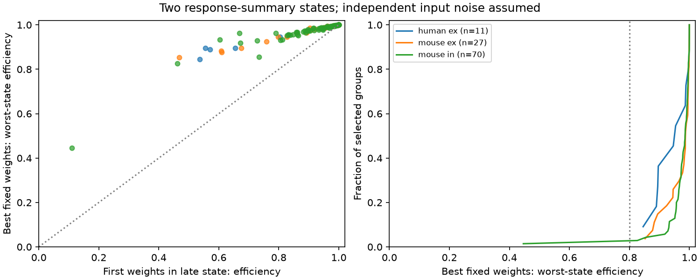

# Fixed weights retained 80 percent efficiency in both states of 107 of 108 selected Allen models with independent noise

One fixed set of positive input weights retained at least 80 percent of each state's ideal squared signal-to-noise ratio in 107 of 108 selected cortical input models. Weights tuned only to the first response fell below 80 percent in the late state in 18 models. Thus, poor transfer of one optimal readout did not usually require state-dependent weights in this sample. A fixed compromise was often enough. This conclusion holds for the assigned model moments and independent input noise. It is not a measurement of neuronal decoding.

Figure 1. Left: late-state efficiency of first-state optimal weights versus the smaller efficiency of the best fixed readout across both states. Right: cumulative distributions of the latter efficiency. Each point or step is one selected target-and-sign group. The diagonal is a reference. The vertical line marks 80 percent. This level is an illustrative performance rule, not a biological threshold. Source measurements: Allen Institute for Brain Science; Campagnola, Seeman and colleagues, Science 2022, doi:10.1126/science.abj5861.

## Question and prior work

Can a fixed positive readout retain reliable transmission when measured response statistics change during a train? Connectivity gives access to inputs. Their individual response scales can change with stimulation. A readout that is optimal in one state can then be poor in another. But this failure alone does not show that fixed weights are inadequate. A fixed compromise must also be tested.

The original Allen study links detected chemical connections with response summaries from the same cell pairs. Prior SCI 2592773 tested equal sums in the first response state. SCI dc35fd2 optimized one-state readouts under a correlation cap. SCI 0d56418 tested whether input amplitudes fit a shared train-state gain. We read these publications and searched the campaign for convergence, reliability, correlation, readout states, first and late responses, and fixed readouts. The present test adds noise-normalized state transfer and the best fixed compromise across two states. It permits separate output gain in each state. It therefore does not test the rank-one amplitude model. No prior code or extracted records were reused.

The optimization uses established linear estimation and cone programming. Boyd and Vandenberghe, *Convex Optimization*, describe bisection and second-order cone methods. We do not claim a new optimization theory or a biological learning rule. The contribution is a linked-data benchmark that separates poor transfer from an unavoidable fixed-weight cost. This was an exploratory investigation. The 80 and 95 percent levels are descriptive rules, not registered tests.

## Data and selection

We read this existing shared file in place, without change:

`/mnt/dell-data/shared_datasets/allen-synphys-r2.1-small-20230126/synphys_r2.1_small.sqlite`

Release: Allen Synaptic Physiology r2.1 small. Public object date: 2023-01-26. Size: 176771072 bytes. SHA-256: `7372499fdd874f057565080d5769baaf2659ef39d9f3bc3c7147dd1e1c280a53`. The resolved shared object path is in `files/provenance.json`. The analysis verifies this hash before reading. It opens SQLite read-only.

The code joins pair, synapse, dynamics, experiment and slice by their IDs. Candidates are detected chemical connections in mouse VisP or human TCx. Human projects with culture in their name are excluded. Dynamics QC must pass. Each state must have at least 20 samples, a finite median with the expected sign, and a positive finite standard deviation. A group has at least two distinct source cells with the same target, experiment and synapse sign. We reverse inhibitory signs together. Excitation and inhibition stay separate.

The primary selection retains 304 of 1081 mouse excitatory candidates, 552 of 1690 mouse inhibitory candidates, 112 of 290 human excitatory candidates and 9 of 81 human inhibitory candidates. Group formation leaves 60, 153 and 26 input records in the three scopes below. No human inhibitory group qualifies. Groups have two to five inputs. They can share cells or experiments and are not independent population samples.

The endpoints are `pulse_amp_first_50hz` and `pulse_amp_stp_induction_50hz`, with their `_std` and `_n` fields. The inspected Allen implementation stores the first fitted response and the per-train median of stored pulses 6, 7 and 8. It then stores the median, population standard deviation and count across trains. First and late trial sets can differ. This late noise scale describes a median statistic, not one individual late response. The source revision and hash are in `files/definitions.json`; that revision is not a verified database build revision. We use the released scalar fields and do not audit raw pulse positions.

## Model and method

For state k, assign each absolute median as mean a_ki and each released standard deviation as noise scale s_ki. This is a model assignment: a median is not generally a mean. Every input carries the same unit signal. The signals add linearly and their noise is independent within each state. No cross-state noise covariance is needed because the states are evaluated separately.

For nonnegative weights w, squared SNR is

`J_k(w) = (a_k dot w)^2 / sum_i (s_ki w_i)^2`.

The state-specific optimum is `I_k = sum_i (a_ki/s_ki)^2`, attained by weights proportional to `a_ki/s_ki^2`. Define efficiency `E_k(w) = J_k(w)/I_k`. Cauchy-Schwarz gives `0 < E_k <= 1`. We compare first-state weights in the late state, late-state weights in the first state, equal weights, and the fixed compromise

`e_star = max_{w >= 0, sum(w)=1} min(E_0(w), E_1(w))`.

The sum constraint removes an irrelevant scale. State-specific output gain is unrestricted. For a trial efficiency e, each condition `E_k(w) >= e` is equivalent to

`sqrt(e I_k) * norm(diag(s_k) w) <= a_k dot w`.

The signal is positive, so squaring introduces no sign ambiguity. These are convex cone constraints at fixed e. The feasible sets shrink as e rises. Bisection on [0,1] therefore finds the global optimum in exact arithmetic. We implement 23 steps with CVXPY and CLARABEL, using a common slack to test feasibility. Some near-boundary solves report optimal_inaccurate. These are numerical results, not formal certificates. We report directly evaluated efficiency of the returned weights and check it independently. The final bisection width is 1.20e-7 or less; this width alone is not an error guarantee.

If both states have proportional optimal weight vectors, a common readout reaches efficiency one in both. A shared change in amplitude and noise scale need not require weight adaptation. In general, the compromise tests how far the two states depart from compatible weights. It does not require equal absolute SNR across states.

## Results

| Scope | Groups / experiments | First weights in late state, median efficiency | Best fixed weights, median worst-state efficiency | First weights below 80 percent in late state | Best fixed weights below 80 percent |
|---|---:|---:|---:|---:|---:|
| Mouse VisP, excitation | 27 / 23 | 95.38% | 98.73% | 6 | 0 |
| Mouse VisP, inhibition | 70 / 51 | 94.74% | 98.58% | 8 | 1 |
| Human TCx, excitation | 11 / 9 | 83.26% | 95.42% | 4 | 0 |

The best fixed weights fall below 95 percent in 7, 8 and 5 groups, respectively. Median worst-state efficiency with equal weights is 77.90, 82.05 and 84.78 percent. Thus, the high efficiency of the optimized fixed weights does not follow from summation alone. These weights were chosen with both states known. They are an oracle reference, not held-out performance or evidence that a neuron can find these weights.

With both medians above 50 microvolts, 70 groups remain and one fixed compromise falls below 80 percent. Requiring at least 50 samples in both states leaves 13 groups, with none below 80 percent. Subtracting the squared baseline noise estimate from both marginal variances leaves only 25 groups; three fall below 80 percent. This check requires positive remaining variance and assumes independent additive recording noise. It can amplify errors in the noise estimate. The large sample loss means that it does not validate the primary moments. All checks use new group formation after edge selection. Full aggregate results are in `files/aggregate.csv`; selection counts are in `files/selection.csv`.

We give no population interval or p-value. These are deterministic descriptions of selected models. Trial-level uncertainty, donor sampling and input covariance were not estimated. Mouse-human differences are not a species test: region, tissue source and recording conditions differ.

## Validation and limits

A separate SLSQP implementation used three starts for every primary group. Its best objective agreed within 3.22e-8 efficiency units in all 108 groups. For 93 two-input groups, a 10001-point grid did not exceed the reported optimum by more than 4.15e-9. Synthetic tests used identical state noise, where the optimal whitened readout is the bisector of the two unit signal vectors and efficiency is `(1 + cosine)/2`. Twenty-four such cases plus one shared-profile case passed; the maximum analytic difference was 2.02e-7. These checks test computation, not the accuracy of the released response fits.

The inputs were often stimulated separately. Unknown correlation can change both the optimum and transfer. The response medians can differ from means. Fit noise and recording noise enter the primary standard deviations. Small sample counts and selection of an estimated optimum can bias efficiency. The late endpoint pools responses within a train and is not a single-pulse measurement. The input sets are small detected slice groups, not complete anatomical connectomes. Timing, dendritic location, membrane nonlinearities, downstream noise, different input signals and behavior are absent.

The supported principle is conditional: failure of a readout tuned in one state does not establish that fixed weights cannot work across states. A fixed compromise can preserve much of the ideal SNR under the stated assumptions. A direct biological test needs joint input trials, true means, a specified signal, and held-out assessment across states and animals.

## Reproduction and rights

The bundle contains our original code, narrative, aggregate results and figure. It does not contain Allen records, extracted edge tables, target-level model tables or external code. `files/EXTERNAL_NOTICE.txt` states the source terms and attribution. The SCI baseline terms apply only to bundled material for which we can grant them. No external dataset is relicensed.

From an extracted bundle, use the instructions in `files/REPRODUCE.txt`. The analysis rebuilds external record tables in a separate directory and aggregate evidence in another directory. It refuses outputs within the publication. No private scratch is required. `files/check.py` runs without Allen data. `files/validate.py` checks regenerated external records with a second solver. Package versions and the exact source hash are included.

Job: `sci-1107-dell-neural-structure-and-computation-ba100c89fc3b`. Topic: `neural-structure-and-computation`. Campaign: `11_07_2026`. Machine: `dell`. Account: `codex-andrii`. Model: `gpt-6.1-sol`, high reasoning effort, through Codex in T3 Code. No agents were launched. The signing key identifies a campaign machine, not a personal author. The investigation saves a signed bundle locally and does not upload or submit it.
