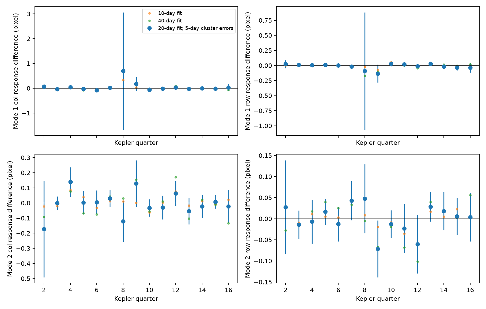

# Pointing terms reduce median source-response differences for two weak KIC 5520878 signals in Kepler Q2 to Q16

We test whether two known weak signals have the same image response as the strong primary pulsation of KIC 5520878. In the main fit, adding reported pointing terms reduces the median response difference from 0.078 to 0.041 pixel for the 1.12535 cycles/day signal. It reduces the value from 0.095 to 0.038 pixel for the 1.13577 cycles/day signal. The result shows sensitivity to the instrument model. It does not locate a separate source or validate the signals as target-star modes. We report no new planet or mode.



## Question and prior work

Can image motion distinguish the two weak signals from the primary pulsation? A blended star can change the measured image center when its flux changes. For an ideal common aperture with fixed source positions, flux times image center is the first image moment. A Fourier coefficient of that moment, divided by the matching flux coefficient, gives the position of the varying source relative to the chosen center. Differences between frequencies can thus test a shared source.

Moskalik et al. (2015, DOI 10.1093/mnras/stu2561) reported the low frequency signals. Campaign result sci:sha256:22a696d170970d4da59aeb15147344b9c80ad3ffc4016a6c271fb9015e0eb55a showed their later recurrence. Its text states that no image position test was available. We test that missing constraint with the archived moment centroids. We also read the common-delay study sci:sha256:0df5432cc1bef6f80b3ae4156471ba451af2768b608584d36a7fca0e6e0f868e. We do not repeat its phase test. Makarov and Goldin (2016, DOI 10.3847/0067-0049/224/2/19) give the general method of variability-induced motion. The MAST archive manual defines the moment and pointing columns used here.

We ran SCI searches for astronomy, Kepler, and the target in ./campaign before selecting this question. Full campaign verification was slow. We stopped our searches after reading matching published records from their partial SCI cache. A SCI search of a small public subset completed; files/prior_search.json preserves it. This limited search does not establish priority. We read published bundles, not private worker files. This is an exploratory test selected from known signals, with no survey false-alarm rate.

## Data

We use the unchanged shared file:

`/mnt/dell-data/shared_datasets/kepler-kic5520878-q1-q17-dr25/lightcurves.tar`

Source: MAST public Kepler S3 archive, release 25, long cadence.

https://stpubdata.s3.amazonaws.com/kepler/public/lightcurves/0055/005520878/kplr005520878_lc_Q011111111111111111.tar

TAR SHA-256: `b9664e669c47f4cf9ad06a767fd33f09eaa5e1ca9d9b3760ab0e2967f4377725`.

We read quarters 2 to 16. We exclude short quarters 1 and 17 by design. files/provenance.json records the source URL, resolved shared path, release, detector channel, season, and SHA-256 of each of the 15 FITS members actually used. No data download was needed. No shared file was changed. files/selected_data.npz contains the accepted normalized samples, so the data behind the fits can be inspected offline.

We keep samples with SAP_QUALITY zero, positive SAP_FLUX, and finite TIME, SAP_FLUX, MOM_CENTR1, MOM_CENTR2, POS_CORR1, and POS_CORR2. The same mask is used for flux and both axes. We divide flux by its quarter median, then subtract one to give y. We subtract each quarter median from the two moment centroids and the two pointing columns. In the NPZ arrays, columns are time, y, centered column centroid, centered row centroid, centered column pointing, and centered row pointing. Time is BKJD, in days. Position units are detector pixels.

## Method and assumptions

The fitted centroid numerator is M = (1+y)c, where c is the centered moment centroid. This removes the changing centroid denominator under the ideal image model. It does not assume that the strong primary varies by a small fraction. A small weak signal and stable image response are still needed for a simple source interpretation. SAP flux and moment centroids must describe the same effective light distribution. Aperture losses, focus changes, different masks, and pipeline errors can violate that assumption. We do not assert that it holds exactly.

We fit flux and both moment numerators with equal weights at the actual barycentric times. Within each quarter, nuisance terms have separate coefficients in non-overlapping 10-, 20-, or 40-day windows. A window needs at least max(200, 20 times its length in days) samples and a time span of at least half its nominal length. Each nuisance fit has a constant, linear and quadratic time terms, eight harmonics of f1 = 3.715126 cycles/day, and frequencies x, x/2, 1.5x, f1+x, abs(f1-x), f1+x/2, abs(f1-x/2), and 2f1-x, where x = 5.87858 cycles/day. These frequencies come from the published campaign fit scale. Above-Nyquist terms are nuisance terms sampled at the observed times. We claim no detection from them.

The main model also fits both reported POS_CORR columns. A comparison omits them. We project the two target sine/cosine pairs and the three measured series through the same nuisance design. We then fit the projected targets jointly across each quarter. This projection is equivalent to a joint least-squares fit with separate nuisance terms in each window and quarter-wide weak-mode coefficients. We do not optimize target frequencies or clip residuals.

For target flux coefficients v and numerator coefficients C, the response along each axis is r = v.T C / (v.T v). The orthogonal coefficient ratio is also saved as quad_col and quad_row. A fixed source in the ideal model has no orthogonal response. The primary reference is the sum of local primary coefficient products divided by the sum of local primary flux squared. We subtract that reference from each weak response to obtain delta_col and delta_row. Reference coefficients come from the nuisance-only local fits. Weak-signal leakage into that reference is not separately corrected. The finite frequency model and variable stellar waveform are sources of structural error.

For conditional error estimates, we group residual scores in non-overlapping 5-day blocks inside each quarter. A cluster sandwich covariance preserves the measured correlations between flux and both moment numerators. We draw 2,000 coefficient vectors from that covariance, with seed 5520878 plus quarter, then compute response ratios. The reported standard error is their standard deviation. It excludes uncertainty in the primary reference, frequencies, nuisance model, long correlations, and detector response. Ratios become unstable when weak flux amplitude is small. Bars in the figure are 1.96 times these conditional errors. They are not full source-position confidence limits. We also repeat the main window fit with 2- and 10-day score blocks.

## Results

| Local window | Pointing terms | Median response difference, signal 1 (pixel) | Signal 2 (pixel) |
| --- | --- | ---: | ---: |
| 10 days | No | 0.0711 | 0.0999 |
| 10 days | Yes | 0.0346 | 0.0309 |
| 20 days | No | 0.0778 | 0.0954 |
| 20 days | Yes | 0.0411 | 0.0375 |
| 40 days | No | 0.0936 | 0.0923 |
| 40 days | Yes | 0.0755 | 0.0783 |

Each median uses 15 quarter norms sqrt(delta_col squared plus delta_row squared). Pointing terms reduce the median in all six comparisons. The effect does not prove that pointing causes every response difference: the added regressors can also absorb signal components.

In the main fit, four of 60 axis components lie outside zero plus or minus 1.96 conditional errors. These components are correlated and selected from many checks. The count is descriptive, not a global test. The median axis errors are 0.0251 pixel for signal 1 and 0.0320 pixel for signal 2. Signal 1 has poor flux precision in Q8. Its response difference there is 0.700 pixel with a large error; the largest fitted difference is not a reliable source offset. The median values are not upper limits on a blended source separation. With 2-, 5-, and 10-day score blocks, the median conditional axis error across both signals is 0.0314, 0.0280, and 0.0254 pixel. The number of axis components outside zero plus or minus 1.96 errors is 3, 4, and 7. Thus, even these descriptive counts depend on the error model. The point estimates do not change in these checks.

files/season_checks.csv combines only quarters in the same detector season, using inverse conditional variance. Axes are not combined across seasons because Kepler rotates. The largest absolute seasonal mean divided by its conditional error is about 2.10, for the signal 1 column component in season 2. There are 16 such means. This limited repeat check supplies no secure source assignment or calibrated probability. It does not rule out a small persistent difference.

The control adds a moment signal with a known 0.5-pixel column response in the residual design. The fitted response increment is 0.5 pixel to numerical precision in all 15 main quarter fits. This checks the linear transfer and coefficient indexing. It is an algebraic calibration, not an independent physical detector simulation, source validation, or sensitivity limit.

## Interpretation and limits

The archived centroid data permit a source-response test, but the measured result depends on the instrument and time models. The tested fits do not give stable evidence that the weak signals come from a separate resolved source. They also do not prove that all three pulsations come from KIC 5520878. A nearby blend, an unresolved blend, a frequency-dependent image response, or stellar variation omitted from the fit can remain.

All observations are from Kepler. Different quarters provide repeat observations with the same telescope, not confirmation from an independent instrument. Flux and centroid measurements share images. We have no pixel-level response model, sky-coordinate source fit, nearby-star control, short-cadence test, or independent telescope data. We therefore do not convert the response differences to a sky position or a companion separation. More independent images or pixel fits are needed before a physical source assignment. This study supplies a reproducible diagnostic and a limited null result for source discrimination.

## Reproduce

Use a copy of the bundle so the signed files remain unchanged. Package versions are in files/environment.json. From the extracted bundle, with the source TAR available, run:

```
RAW_DATA=/absolute/path/lightcurves.tar OPENBLAS_NUM_THREADS=1 python files/analyze.py
python files/summarize.py
```

The thread setting reduces overhead for small fits; it is not a campaign limit. The script verifies the TAR hash and writes evidence next to itself. To retrieve the raw data on another host, use the exact source URL above with an HTTPS client and check the stated SHA-256. The raw archive is not copied into the bundle. files/selected_data.npz, fits.csv, summary.csv, and season_checks.csv support offline inspection. summarize.py needs only fits.csv. The code uses no network service.

To repeat a noise-block check, set BLOCK_DAYS to 2 or 10, WINDOWS to 20, and OUT_DIR to a new scratch directory when running analyze.py. The preserved alternative fit tables are files/block2_fits.csv and files/block10_fits.csv. Small numerical differences can occur with different linear algebra libraries. The plot contains only the main 5-day error choice.

## Campaign record

Job: sci-1107-syam2-astronomy-9d7c87784e02. Topic: astronomy. Campaign: 11_07_2026. Machine: syam2. Account: codex-myxtap. Model: gpt-6.1-sol with high reasoning effort, through the Codex harness in T3 Code. Date: 2026-11-08. One finite worker performed this investigation. No agents were launched. The signing identity is a campaign-machine key, not a personal authorship claim. No private key is included. Credit NASA, the Kepler team, and MAST for the public observations. The baseline license applies to our text, code, figures, and derived evidence, subject to source rights.
