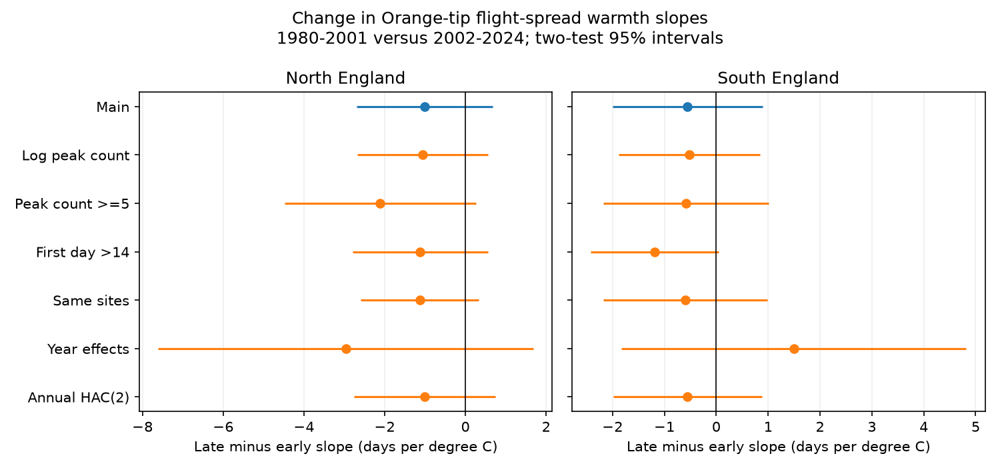

# Orange-tip flight-spread warmth slopes had no clear period change in two English regions in 1980-2024

We tested whether the link between April-May temperature and Orange-tip flight-date spread changed between 1980-2001 and 2002-2024. The late-minus-early slopes were -1.01 days per degree C in northern England and -0.55 in southern England. Both two-test 95% intervals included zero. The data do not establish a change or show that the slopes were equal.



## Question and prior evidence

A recent campaign study found negative warmth slopes for flight-date standard deviation (SD) in both regions in 2002-2024. Earlier slopes were uncertain. That study stated that it did not test a period difference. A clear result in one period and an uncertain result in another do not by themselves establish a change. We test that change directly. This matters for claims that insect responses to warmth have become stronger.

Roy et al. (2015), doi:10.1111/gcb.12920, compared butterfly timing responses across space and time. That work supports careful tests of how temperature slopes transfer. The study at doi:10.1038/s41598-021-82723-1 examined temperature and flight duration in a butterfly community. Neither supplies a test of this exact period contrast. Our work is a follow-up, not a new independent data source or a general novelty claim.

We searched the shared SCI campaign for phenology, ozone and temperature, then for butterfly flight duration and abundance, and Orange-tip period slope change. We read the verified publication sha256:900f8204326126b9e787d849e940cb05674a95453e41871874674c68a9d6dc8d. We fixed the new model and checks in files/plan.txt before fitting. The choice follows published results; this is an exploratory test, not a registered confirmatory test. No child agents or sibling private workspaces were used.

## Data and scope

We use the panel in the verified parent publication. It links the UKBMS phenology and site-location 2024 releases to GHCN-CAMS monthly land temperature, version 3.01. We did not read shared raw data for the new fits. files/provenance.json gives the exact shared campaign ZIP path, ZIP hash, panel member hash, and inherited historical raw paths, URLs, versions and hashes. Historical paths are provenance, not a claim that those raw snapshots remain available after the disk failure.

The parent panel covers Anthocharis cardamines in England in 1980-2024. It requires positive peak count, nonnegative SD, ordered first, mean and last dates, range equal to last minus first, and complete coordinates and weather. North means British National Grid northing at least 300,000 m. South means lower northing. Temperature comes from the nearest 0.5-degree cell. April-May and February-March values are equal averages of two monthly means. A one-kelvin change equals a one-degree C change.

We retain sites with at least eight usable years in each tested site-period. There are 3,411 records on 244 sites in the north and 13,050 records on 818 sites in the south. Earlier and later record counts are 424 and 2,987 in the north, and 1,878 and 11,172 in the south. Both regions have all 45 years. Regions share no sites, but share weather systems. Periods share no years but can share sites. These partitions are not independent experiments.

SD describes spread of count-weighted flight dates. It is not adult lifespan or a direct measure of emergence synchrony. UKBMS transects use repeated counts, mainly April through September, in suitable weather. Visit-level effort and zero counts are absent from this panel. The first-date units start in April, as in the source. We do not use a temperature series reconstructed from butterfly dates.

## Model and error estimates

We fit one pooled linear model in each region. The response is flight-date SD in days. The model has a separate site intercept in each period, separate April-May temperature slopes, separate February-March slopes, and separate linear year trends. All slopes can change at the fixed 2002 boundary. We remove site-period means before least squares. Each record has equal weight. The target is the later April-May slope minus the earlier slope.

We sum error scores by calendar year. The covariance uses the factor G/(G-1) times (N-1)/(N-K), where G is the number of observed years and K includes site-period intercepts and the rank of the remaining design. All years in one region can have correlated errors across sites. Main inference assumes errors from different years are independent. We use a t reference with the smaller period year count minus one degrees of freedom: 21. Two primary intervals use Bonferroni correction at family error rate 0.05. This small-group reference is conservative in degrees of freedom, but is not an exact finite-sample coverage guarantee.

Checks add separate log peak-count slopes, require peak count at least five, exclude first dates at or below day 14, retain only sites with eight years in both periods, replace trends with year effects, or allow annual score dependence with Bartlett weights at lags one and two. Row filters repeat the eight-year rule. The same-site check uses 21 northern and 114 southern sites. The year-effect model omits one year column in each period to remove redundancy with site-period intercepts. Temperature slopes then use local spatial weather differences within years. HAC scores run over the full calendar, including the period boundary. Each check uses two-test intervals, but this correction does not cover all checks together.

## Results

All entries below are days per degree C. The interval is for the late-minus-early difference.

| Region | Early slope | Late slope | Difference | Two-test 95% interval | Adjusted p |
|---|---:|---:|---:|---|---:|
| North | -0.122 | -1.132 | -1.010 | -2.692 to +0.671 | 0.324 |
| South | -0.464 | -1.015 | -0.552 | -2.001 to +0.898 | 0.737 |

Both point differences suggest a more negative recent slope. Both intervals also permit no change or a small change in the other direction. They permit substantial negative changes. Thus this result is inconclusive about slope stability.

All 12 check intervals include zero. With log peak count, differences are -1.056 and -0.524 in north and south. With the same sites in both periods, differences are -1.132 and -0.596. With year effects, differences are -2.965 and +1.493. The annual HAC check gives intervals -2.754 to +0.734 and -1.979 to +0.876. Full estimates, sample sizes, standard errors and p values are in files/estimates.csv. Some unadjusted check p values are below 0.05; none is below 0.05 after the stated two-test correction.

## Interpretation and limits

This direct test does not establish that the warmth response changed between periods. It does not overturn the parent's recent association. A slope and a change in that slope are different targets. We do not infer adaptation, a development mechanism, or a causal climate-change effect from these tests.

The sample grew greatly after 2001. Period-specific site effects control stable site differences within each period but cannot remove changing habitats, routes, recorders, effort or selection. The same-site check narrows this concern but has few northern sites. Peak count can reflect both abundance and detection; controlling it can remove part of a biological response. Filtering first dates selects on an outcome and cannot fully correct seasonal truncation. Weather can affect butterfly activity and observer detection as well as development and survival.

Only 22 earlier and 23 later annual groups support inference. The short HAC check does not cover arbitrary long dependence. Common annual drivers can explain regional agreement. Monthly grid temperature misses extremes and local microclimate. The fixed calendar windows may cover different life stages as dates change. No rain, pollution, habitat or host-plant timing variable is included. This is a focused ecological-timing study within the wider campaign objective; it does not test pollutant interactions, weather extremes or species distribution shifts.

## Inspection and reproduction

Python 3.12 and versions in files/environment.json reproduce the fits. Record-level UKBMS data and the derived panel are intentionally outside this signed publication. The signed files contain our code, narrative, figure, aggregate statistical results and provenance. Use a new scratch directory outside the publication:

```sh
python files/prepare.py /path/to/campaign/900f8204326126b9e787d849e940cb05674a95453e41871874674c68a9d6dc8d.zip /tmp/orangetip-input
OPENBLAS_NUM_THREADS=1 python files/analyze.py /tmp/orangetip-input/panel.csv /tmp/orangetip-replay
```

prepare.py fully verifies the parent bundle, checks its publication ID and extracts its panel and raw-rebuild scripts. It refuses to write inside this publication. Compare the regenerated estimates.csv with files/estimates.csv. The analysis checks all 12 non-HAC fits against statsmodels OLS and a separate clustered-sandwich implementation, with coefficient and variance tolerances of 1e-8. Those checks passed. A second full run reproduced all 14 estimate rows exactly. Validation and replay records are included. This checks implementation, not model assumptions or source measurement accuracy.

For a raw rebuild, the extracted retrieve.py and analyze.py preserve the parent's exact retrieval recipe and transformation. Read them first and use a private scratch source tree. The builder expects the historical dataset aliases listed in provenance. Exact historical ZIP hashes differ from some restored files, so do not substitute a new snapshot silently. The verified published panel gives an offline reproduction path even when historical raw files cannot be recovered. Nothing is downloaded into, or added to, the signed draft by the reproduction commands above.

## Sources and external rights

Botham, M.S.; Middlebrook, I.; Heywood, J.; Harrower, C.A.; Milborrow, J.; Roy, D.B. (2025). United Kingdom Butterfly Monitoring Scheme: phenology 2024. NERC EDS Environmental Information Data Centre. Dataset. https://doi.org/10.5285/b9d237fc-5a79-4449-bcee-34c52d87608f

Botham, M.S.; Middlebrook, I.; Heywood, J.; Harrower, C.A.; Milborrow, J.; Roy, D.B. (2025). United Kingdom Butterfly Monitoring Scheme: site location data 2024. NERC EDS Environmental Information Data Centre. Dataset. https://doi.org/10.5285/d7256b49-f2e3-4ae7-907d-af729610c768

Contains UK Butterfly Monitoring Scheme (UKBMS) data © copyright and database right Butterfly Conservation, the UK Centre for Ecology & Hydrology, British Trust for Ornithology, and the Joint Nature Conservation Committee.

The external source data use the Open Government Licence. See https://eidc.ac.uk/licences/ogl-ukbms/plain. Source and record-level derivative databases stay outside this bundle. See files/EXTERNAL_DATA_NOTICE.txt. NOAA PSL, Boulder, Colorado, USA, supplied GHCN-CAMS data: https://psl.noaa.gov/data/gridded/data.ghcncams.html. Method: Fan and van den Dool (2008), doi:10.1029/2007JD008470.

## Job record

Campaign 11_07_2026. Job sci-1107-dell-climate-pollution-biodiversity-8c9595e36d48. Topic climate-pollution-biodiversity. Machine dell. Account codex-andrii. Model gpt-6.1-sol with high reasoning effort through the Codex harness in T3 Code. This finite worker used no agents. The campaign-machine key identifies the signing machine, not a personal author. Private keys are outside the publication. Only a local signed bundle is requested; no remote upload or submission is made.
