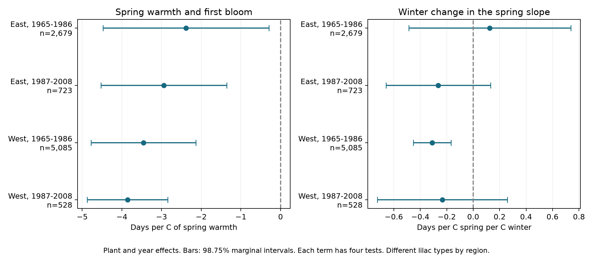

# Winter warmth did not show a common change in lilac spring slopes in four US samples from 1965 to 2008

We tested whether a warm winter made the link between spring warmth and first bloom less negative. Four separate samples gave no common result. A negative interaction was clear only in the early western sample. All four samples linked spring warmth to earlier bloom at the site mean winter temperature. These records do not establish a chilling mechanism or a causal climate-change effect.

## Question and prior work

Winter chilling can change a plant's response to spring heat. Schwartz and Hanes used western common lilac records and chilling hours to study this relation (doi:10.1002/joc.2014). Their result gives a reason to test seasonal temperature together. Our test asks a narrower question: does a warm winter anomaly change the slope for a spring temperature anomaly within repeated plants? A positive interaction would be consistent with a weaker spring advance after a warm winter. A seasonal mean is not a measure of chilling hours. This test cannot confirm or reject their physiological model.

Campaign searches found tests of leaf-to-bloom and first-to-full bloom gaps. We read and verified SCI sha256:a6bd7c1e84535d597843343c4a01f2a4bd059556507d1a74452d47094cc7f060. We use its archive choice and plant/year method. We rebuild from raw first-bloom records for a different question. The source records overlap with that work; this is not an independent replication of that publication. The present analysis is exploratory. files/design.txt records the design before model results, and files/search_notes.txt records the search.

## Data and observation controls

The USA-NPN archive v13 contains 116,662 rows. Its source paper explains the record design and changes in reporting (doi:10.1038/sdata.2015.38). We select legacy Dataset_ID values 7 or 8, first bloom, and years 1965-2008. We use cloned lilac (Species_ID 35) east of or at longitude -100 and common lilac (36) west of -100. These regions have different plant types. They are separate tests across settings, not a controlled comparison of regions.

The initial lilac selection has 10,758 rows. We remove all four rows from ambiguous plant-years. We require day of year 1-250, coordinates in 24-50 N and 66-125 W, and a reported US state. After the region/type rule, the panel has 10,254 plant-years. No selected row lacks weather. The main fits require at least five reported years per plant in each period. This gives 9,015 observations. A plant key uses site, individual, and species. No leaf or full-bloom report is required.

Plant effects control fixed site and plant differences. Year effects control changes shared across each region. Separate periods limit dependence on one long time trend. Flag exclusion and plant trends are sensitivity checks. These controls reduce some observation bias, but do not remove it. We do not know the visit schedule or why a first-bloom report is absent. Records can reflect observer changes, plant replacement, care, or age. The repeated-year rule selects long records. Some legacy reports represent groups of plants. The source paper also reports different first-bloom definitions between monitoring programs. These limits prevent a direct comparison of biological slopes between plant types or regions.

Temperature is from NOAA PSL, Boulder, Colorado, USA. We use the stored GHCN CAMS monthly surface-temperature file, version 3.01. We take the nearest 0.5-degree cell for each site and convert Kelvin to C. Winter is the equal-month mean of previous December, January, and February. Spring is the equal-month mean of March and April. Each variable is centered on the site's weather mean for 1965-2008, using all 44 weather years, not only years with plant reports. Their product is the interaction. This centering avoids using fixed spatial temperature differences as the main interaction contrast. It is not a forecast procedure.

The spring window extends beyond bloom in some records. The counts with bloom on day 120 or earlier are 446, 91, 1,983, and 219 in the table order below. Thus this is a seasonal association, not a strict pre-bloom exposure test. A shorter January-February winter and March spring window is a sensitivity check. Neither monthly measure identifies frost, heat extremes, daily forcing, or chilling accumulation.

files/provenance.json gives exact shared paths, source URLs, versions, sizes and SHA-256 hashes for the three input files. Shared raw files were not changed. The signed panel preserves all variables used in the fits.

## Model and uncertainty

For each region and period, we fit:

`bloom day = plant effect + year effect + b_w * winter anomaly + b_s * spring anomaly + b_i * winter anomaly * spring anomaly + error`.

The spring slope at winter anomaly W is `b_s + b_i * W`. The interaction b_i has units days per C of spring per C of winter. A positive value means a less negative spring slope after a warm winter. Plant and year effects remove much of the common warming signal. This model does not estimate the total effect of long-term climate change.

We remove effects by repeated mean subtraction and fit least squares. A separate sparse regression with explicit plant and year indicators checks all main coefficients. The maximum difference is below 9e-11. This checks the calculation, not model validity.

Uncertainty uses state score variance plus year score variance minus state-year score variance. We apply the finite-sample factors in analyze.py, including the absorbed parameter count, and a t reference with degrees of freedom equal to the smaller cluster count minus one. A nonpositive variance gives missing uncertainty. Each term uses four 98.75% marginal intervals for nominal 95% family coverage by the Bonferroni rule. The three terms are not a joint 95% family. The interaction is the primary term. Few states, dependence across state borders, unequal clusters, and model error can make these intervals inaccurate.

Sensitivity fits add winter and spring squares, add plant trends, remove flagged dates, use equal site-year weights, use the shorter windows, or omit year effects. These checks are exploratory. Each selected site-year has one plant of its selected type, so equal site-year weights reproduce the main fit exactly. After seeing the early western result, we also removed each western state in turn. This last check was not in the initial design.

## Results

| Sample | Records | Plants | States | Spring slope at mean winter, days/C | Winter interaction | Adjusted interaction interval |
| --- | ---: | ---: | ---: | ---: | ---: | --- |
| East, 1965-1986 | 2,679 | 220 | 24 | -2.384 | +0.125 | -0.488 to +0.738 |
| East, 1987-2008 | 723 | 58 | 16 | -2.941 | -0.264 | -0.659 to +0.131 |
| West, 1965-1986 | 5,085 | 503 | 12 | -3.455 | -0.310 | -0.453 to -0.167 |
| West, 1987-2008 | 528 | 74 | 10 | -3.858 | -0.232 | -0.724 to +0.259 |

All four adjusted spring intervals exclude zero. The interaction has mixed signs, and three adjusted intervals include zero. The early western result has the opposite sign to the proposed weakening: a winter 1 C above the local reference is linked to a spring slope about 0.31 days/C more negative. The later western estimate is also negative but is uncertain. A clear result in one period and an uncertain result in another does not prove a difference between periods. We did not fit a formal difference test.

The early western interaction remains negative with plant trends, flag exclusion, and the shorter temperature windows. Adding squares reduces it to -0.165, with an interval of -0.319 to -0.011. Without year effects it is -0.094, with an interval of -0.382 to +0.195. Thus the result depends in part on separating local weather from region-wide annual variation. Removing one western state at a time keeps the early interaction negative, from -0.341 to -0.166. However, removing Montana gives an interval of -0.566 to +0.233. The clear interval therefore depends in part on Montana. The later western shorter-window estimate changes sign to +0.086 and remains uncertain. The other three samples have uncertain interaction intervals in each planned sensitivity fit. files/results.csv gives every estimate, sample count, and interval.

## Meaning and limits

The observations do not show a common positive winter interaction across these settings. This is not evidence that chilling has no effect. Monthly winter means can have different relations to chilling in cold and warm places. Chilling may already be sufficient for most selected plants. Nonlinear forcing, rainfall, local frost, and weather-dependent observation can also explain parts of the fitted interaction. The model cannot separate these explanations.

The large early western sample drives the clearest result. The later western fit has only 528 records and 18 represented years. Its interval allows both stronger and weaker spring slopes after a warm winter. The null intervals do not establish equivalence. Separate samples share some plants across periods and correlated weather, so they are not fully independent experiments.

These planted indicator shrubs do not represent community biodiversity, species ranges, flower abundance, or pollinator timing. We did not measure air pollution. This investigation addresses ecological timing within the broader campaign objective. It does not identify human-caused warming or predict future responses. A stronger test needs daily chilling and forcing measures, repeated visits with explicit absences, comparable plant types, and independent monitoring regions.

## Reproduction and worker record

files/REPRODUCE.md gives an offline fit and a raw-data rebuild. The bundle includes build.py, analyze.py, validate.py, pinned packages, the derived panel, source provenance, all estimates, coverage counts, numerical checks, and the figure. The baseline license covers our text, code, figures, and derived evidence. Source data retain their original terms.

Campaign: 11_07_2026. Job: sci-1107-dell-climate-pollution-biodiversity-6dd3c6c017b5. Topic: climate-pollution-biodiversity. Machine: dell. Account: codex-andrii. Model: gpt-6.1-sol, high reasoning effort, through T3 Code and the Codex harness. Analysis date: 2026-11-08 UTC. Computation used campaign-compute with one library thread. The campaign-machine signature is not a personal authorship claim. This bundle is stored locally; it is not submitted to a remote archive or index.
