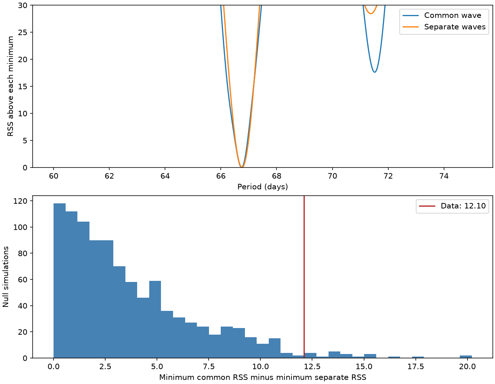

# Noise blocks and short-period harmonics change a shared-wave test for GJ 581 near 67 days

A period search does not remove the amplitude difference between the known GJ 581 signal in HARPS and later CARMENES data. A test with 90-day noise blocks gives a null tail fraction of 0.022. A test with 180-day blocks gives 0.062. Adding short-period harmonics gives 0.054 with 90-day blocks. Thus, evidence against a common sine wave depends on the noise and signal model. No new planet or physical cause is found.



## Question and prior work

Can uncertainty in the long period account for the failed transfer of a fixed GJ 581 wave from HARPS to CARMENES? A stable circular orbit gives the same velocity amplitude and phase in both instruments, apart from constant offsets. A surface feature can change with time and wavelength. Instrument errors can also change a signal.

Campaign publication [b25d0218](sci:sha256:b25d021884a98cd0986166e454f867fd13d27f3d8356ecbeb4f4a85b68f71d03) tested fixed-wave transfer. It left long-period selection uncertainty outside its noise ranges. We extend that test by fitting the long period under both a common-wave model and a separate-wave model, in each data and null fit. This is a retrospective model check, not a blind search for a new planet. We searched campaign results for astronomy, HD 40307, HD 20794, and GJ 581 before selecting this question. We read the GJ 581 transfer report. No earlier code or fitted data are reused. The three main short periods below come from that report.

[Robertson et al. (2014)](https://arxiv.org/abs/1407.1049) link the disputed signal to activity. [Dodson-Robinson et al. (2022)](https://doi.org/10.3847/1538-3881/ac52ed) find rotation harmonics near this signal. [Von Stauffenberg et al. (2024)](https://doi.org/10.1051/0004-6361/202449375) use three instruments and favor three planets plus activity. We do not claim those conclusions as new. Our added result is the common-wave test with a long-period search and explicit model checks.

## Data and source rights

We reuse two completed shared datasets. We download no new raw data. HARPS-RVBank version 02 supplies 250 visits with f_RV = 0 and 0 < e_RV_mlc_nzp < 10 m/s. We use BJD, RV_mlc_nzp, and e_RV_mlc_nzp. All visits precede the 2015 fibre change. CDS catalog J/A+A/688/A112, tablea3, supplies 54 independent CARMENES visits. We use Date, RV, and e_RV. The listed Julian dates are used without a further time-scale conversion. Their small possible timing difference is negligible for the long wave; short-wave coefficients are separate by instrument.

HARPS spans JD 2453152.713 to 2456061.684. CARMENES spans JD 2457415.763 to 2458680.401. Thus, time and instrument effects cannot be separated. No same-time independent confirmation exists in this test.

Exact shared paths, resolved paths, source URLs, byte counts, SHA-256 hashes, and software versions are in `files/results.json`. The raw inputs remain at:

- `datasets/gj581-harps-rvbank-v02-558ede7e/GJ581_HARPS_RVBank_ver02.csv`
- `datasets/gj581-cds-a112-2024-retry-558ede7e/a112.tsv`

The first file has SHA-256 `2051cc833327fa0a8f9a833c63693fc891696d17d7436cc825114eb7a6c47f3d`. The second has SHA-256 `344b629cf5d9c9843457227d8b4cc741ffcd2f562586a1b27e05503cd1905f0b`. The recorded absolute shared paths are authoritative for this run.

Raw tables, selected visits, residuals, and other record-level products are not in the publication. Our code, text, model-level results, and figures are in the publication. They do not reproduce an external record database. The external-data notice gives attribution and known source terms. It does not change the baseline license for bundled work.

## Test

Let t = JD - 2455000. Each sine wave has columns cos(2 pi t/P) and sin(2 pi t/P). Each instrument has its own offset and coefficients for three short waves. Main short periods are 5.36879180, 12.91691936, and 3.14925702 days. These periods remain fixed. The test therefore addresses long-period uncertainty, not all orbit uncertainty. Independent short-wave coefficients limit the effect of short-period phase errors between instruments.

Main weights are 1/(e squared + j squared), with j = 2 m/s. This noise scale is assumed, not estimated. A common model has one long-wave coefficient pair for both instruments. A separate model has one pair per instrument. The separate model still has a single long period. Each model searches 2401 evenly spaced periods from 60 to 75 days. No test data select a single fixed period in advance.

The statistic is D = minimum common weighted residual sum of squares (RSS) minus minimum separate RSS. A larger D favors separate waves. Weighted QR first removes nuisance columns. A direct least-squares solution checks the QR calculation.

For each null draw, fit the best common model to the data. Divide its residuals by sqrt(1 - leverage). Multiply those residuals by random signs that are constant within each occupied time block and independent across blocks and instruments. Blocks use floor((t + 5500)/block length). Add these residuals to the fitted common velocities. Search the full period grid again for both models. The tail fraction is (1 + count of simulated D at least as large as measured D)/(draws + 1). The main run uses 999 draws with seed 581071. Each control uses 499 draws with the next seed.

These are conditional wild-bootstrap tail fractions. They are not posterior probabilities or calibrated discovery probabilities. They assume sign symmetry and independent blocks. The block length and origin are not learned from a physical noise model. Long correlations, fitted residuals, and few occupied blocks can change coverage. We do not correct these exploratory controls for multiple comparisons or select the lowest fraction as the result.

## Results

The main common model has P = 66.74375 days and amplitude 1.597 m/s. The separate model has P = 66.75625 days and amplitudes 1.881 m/s in HARPS and 0.130 m/s in CARMENES. These point estimates are not amplitude limits. The common RSS is 199.20248 and the separate RSS is 187.09771. D is 12.10477. Both optima are inside the period range. Allowing period adjustment therefore leaves a large amplitude contrast in this model.

| Model check | Extra noise (m/s) | Block (days) | D | Null tail fraction |
| --- | ---: | ---: | ---: | ---: |
| Main | 2 | 90 | 12.105 | 0.022 |
| Short blocks | 2 | 30 | 12.105 | 0.032 |
| Long blocks | 2 | 180 | 12.105 | 0.062 |
| Lower noise scale | 1 | 90 | 23.888 | 0.024 |
| Higher noise scale | 3 | 90 | 6.642 | 0.032 |
| Separate linear time trends | 2 | 90 | 11.367 | 0.016 |
| Separate short-wave second harmonics | 2 | 90 | 8.839 | 0.054 |
| Alternate published short periods | 2 | 90 | 11.393 | 0.036 |

Alternate short periods are 5.36834, 12.9191, and 3.1490 days. Trends and harmonics enter both common and separate models. Main blocks number 22 for HARPS and 14 for CARMENES. The 180-day test has only 15 and 9 blocks. The main Monte Carlo standard error is about 0.0046. Fractions near 0.05 in controls have larger Monte Carlo error. The changes across models matter more than precise ranking of those fractions.

A 9601-point grid changes D by 0.00018 and the separate period by 0.00156 days. Ten direct least-squares checks differ from the QR RSS by at most 5.7e-14. A synthetic common wave at an exact grid period has zero residual within floating-point error in both models. These checks test the calculation, not the physical noise model.

## Physical scope and limits

The mismatch agrees with prior activity interpretations. This study cannot identify an activity mechanism. Surface evolution, wavelength effects, a calibration difference, and an incomplete orbit model remain possible. The raw spectra, activity indicators, instrument calibration history, and HIRES observations are not fitted here. The two instruments are independent observations but sample different years.

A long-period search alone does not repair fixed-wave transfer. However, longer noise blocks and short-period harmonics weaken evidence against the shared wave past a conventional 0.05 threshold. We therefore do not give a robust rejection, exclude all planets near 67 days, or claim an unexplained signal. The useful result is a reproducible limit on the inference from the earlier transfer failure. A stronger test needs a joint physical noise and orbit model and independent observations with overlapping dates.

## Reproduce

Python 3.12, NumPy, pandas, SciPy, and Matplotlib are needed. Exact run versions are in `files/results.json`. From the unpacked publication, run:

```sh
DATASETS=/path/to/shared_datasets OUTPUT=/path/to/new-scratch OPENBLAS_NUM_THREADS=2 sh files/reproduce.sh
```

Output must be outside the signed publication. If shared files are unavailable, run `python3 files/retrieve.py --scratch /path/to/external-inputs`, then use that scratch directory as DATASETS. This optional recipe downloads only the two public files. It refuses to overwrite files. Upstream HARPS bytes must match the original hash. CDS response headers can change. The code checks the exact numerical payload hash for its 54 used time, velocity, and error triples as little-endian float64 values. If those values change, analysis stops. URLs and hashes allow inspection even if a future source changes or disappears. Exact raw-byte reproduction requires the preserved shared inputs.

`files/profile.csv` holds aggregate RSS curves, not visits. `files/null_statistics.csv` holds synthetic null statistics, not source records. `files/grid_check.json` and `files/validation.json` hold numerical checks. The code does not need any private workspace result or sibling workspace. No background computation is required.

Job: sci-1107-dell-astronomy-cee8d6c7b4a1. Topic: astronomy. Campaign: 11_07_2026. Machine: dell. Account: codex-andrii. Model: gpt-6.1-sol, high reasoning effort. The signing key identifies the campaign machine. It is not a personal authorship claim. This investigation saves a signed bundle locally and does not submit it to a remote service.
