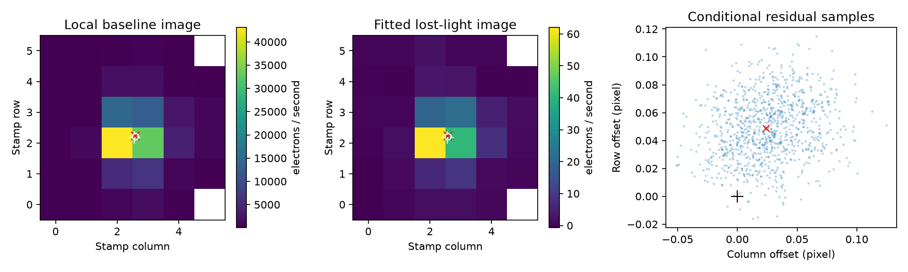
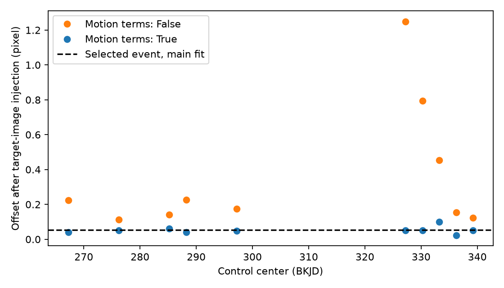
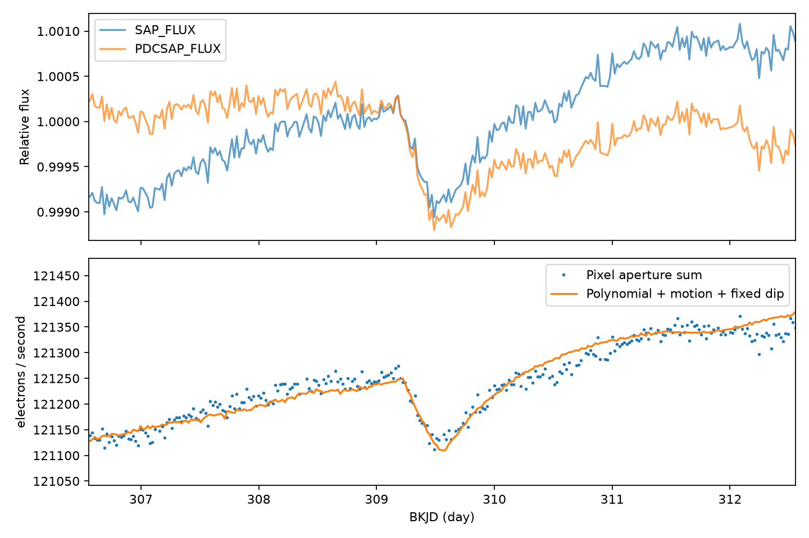

# Pointing terms reduce the lost-light offset of the KIC 10484683 Kepler dip to the tested control scale

We test a known dip in public Kepler pixel data. The measured source position changes when the fit includes image motion. With motion terms, the lost-light center is close to the baseline image center. Its small offset is within the range from ten target-image control tests. This result does not confirm a comet or validate a host star.

## Question and prior work

Can the quarter 3 dip of KIC 10484683 be assigned to a separate source from its lost-light image? Dumond et al. (2025), DOI 10.1051/0004-6361/202556033, list this event as a first-tier exocomet candidate. We use their Table 2 event time, 309.5 BKJD, entry duration, 8.01 hours, and decay time, 14.05 hours. We add a local pixel source test. We do not repeat their search or claim the event as new.

We ran campaign searches for astronomy, KIC 11084727, Dumond, and KIC 10484683 before this test. The last search found no publication on this target. Its complete response is in files/campaign_search.json. A published pointing test on KIC 11084727 (SCI 26a0ab6a554b3e388e72776fffe63ec5d0a64cb9ec2428c16316227b6b0f0694) warns that motion fits can need extrapolation. We read that signed publication. It addresses different dips on a different star. It supplies no observations or code to this test.

NASA archive documentation describes difference images as a source-location test. Our lost-light image is a regression version of that test. We use signed first moments, not a fit of the Kepler pixel response function (PRF). Our precision and bias therefore differ from official PRF tests.

## Observations and provenance

The data are Kepler release 25 long-cadence observations from quarter 3 on channel 6. We use these shared files in place:

| Shared path under /mnt/dell-data/shared_datasets | Bytes | SHA-256 |
| --- | --- | --- |
| kepler-kic10484683-q3-pixels-dr25/pixels.fits.gz | 2801033 | 8ab6d46dcdf65f0d6e160184c0a41f3b67b63221afe778a4d3db834511583dee |
| kepler-kic10484683-q3-dr25/lightcurve.fits | 466560 | b29a77f38b94e424eaa4946e6e7712f0f23dc881612d6196b8fc6c2ecf5e4f97 |

The campaign dataset helper downloaded these files from the public NASA mirror. It recorded the URL and hash before it exposed each shared directory. Exact URLs, transfer records, paths, sizes, and checked hashes are in files/outputs/provenance.json. The code hashes only these two inputs. No shared data are changed. Raw files are not copied into this bundle.

The pixel stamp is six by six pixels. It has 34 collected pixels and eight aperture pixels. FLUX is calibrated flux with the estimated sky background removed. The aperture bit mask selects the summed flux. All columns come from the same telescope exposures. The light curve is not independent confirmation of the pixel data.

## Method

1. Keep pixel rows with quality zero and finite time, flux, flux error, and both POS_CORR values at all collected pixels. Do not interpolate missing rows. For the corrected light curve, keep its quality-zero finite rows.
2. Define an exponential-tail profile. It rises as 1-exp(-(t-t0)/tau) between t0 and t1. It decays as exp(-(t-t1)/tau) after t1. It is zero before t0. Set t1-t0 to 8.01/24 day and tau to 14.05/24 day. Normalize its instantaneous peak to one. Average 11 midpoint samples over each 0.02043365-day exposure.
3. Fit the profile minimum time once in corrected flux within five days of the prior date. Use a quadratic baseline, a nonnegative depth, and a time bound of 309.2 to 309.8. The resulting time is 309.555929 BKJD and the fitted corrected-flux depth is 1326.9 ppm. Hold this profile and time fixed in all pixel tests.
4. In each pixel, fit flux = polynomial(time) + optional linear pointing terms - D*profile. Use ordinary least squares with the same time design for every pixel. All fits include the event jointly with the baseline. Retain signed pixel coefficients D. Use half-window lengths 3, 5, and 7 days; polynomial degrees 1 and 2; and motion terms either absent or present. This gives 12 fits. The displayed main fit has a five-day half-window, degree 2, and both motion terms. These choices were set before the fit results were inspected.
5. The baseline image is the fitted polynomial constant at the event time, evaluated at mean local pointing. For each image, compute the signed flux-weighted column and row. Divide the first moment by the signed total. Do not clip negative pixels. The primary offset is lost-light center minus baseline center. This comparison reduces, but does not remove, errors from a finite stamp. Also record the difference from the catalog position in the file WCS. Coordinates in the tables start at zero within the stamp.
6. For each fit, form residual images. Assign a random sign to each block of 3, 6, or 12 adjacent nominal cadences. Share each sign across all pixels. Add the resulting residual response to D and compute the centers for 999 samples per block size. Seed is 11078. These conditional ranges hold the time, profile, design, and baseline image fixed. Gaps can break blocks. The ranges do not include model error or catalog error.
7. Test control times on a fixed three-day grid from seven days after the first valid sample to seven days before the last. Exclude times within ten days of the selected event. Require at least 90 percent of the nominal cadences within two days. Ten centers pass. Their five-day half-windows overlap; they are not ten independent experiments.
8. At each control center, fit the same quadratic model, with and without motion. Add a dimming profile whose lost-light image is the local baseline image and whose aperture depth is 1400 ppm. Repeat with that image shifted by half a pixel in each of four axial directions. Use linear interpolation and zero outside the stamp, then renormalize to the same aperture depth. Fit the injected series without removal of the original local variation. This gives 100 tests. Shifts are tests of a measured image, not physical PRF simulations. A separate five-case check first removes the fitted selected event and replaces it with a known image; this checks the regression algebra only.

The fits use no inverse-variance weights. The residual controls include photon noise, stellar variation, and instrument variation present in the chosen windows. We do not claim optimal errors. The main matrix is full rank; its raw condition number is 143939 because the pointing columns use small pixel units. Computation uses the singular-value pseudoinverse in double precision.

## Results

| Half-window, day | Degree | Offset without motion, pixel | Offset with motion, pixel | Depth with motion, ppm |
| --- | --- | --- | --- | --- |
| 3 | 1 | 0.928 | 0.070 | 1332 |
| 3 | 2 | 0.337 | 0.051 | 1378 |
| 5 | 1 | 1.086 | 0.083 | 1472 |
| 5 | 2 | 0.949 | 0.054 | 1419 |
| 7 | 1 | 1.376 | 0.100 | 1303 |
| 7 | 2 | 1.077 | 0.088 | 1359 |

The main fit uses 465 exposures. The baseline center is (2.56043, 2.18162); the lost-light center is (2.58450, 2.23026). Thus the column offset is 0.02408 pixel and the row offset is 0.04863 pixel. The distance is 0.05427 pixel. The catalog position in stamp coordinates is (2.58139, 2.21250). This last comparison is descriptive: there is no PRF or catalog error model here.



The main fit has a signed total loss of 189.16 electrons per second. The magnitude of its negative pixel coefficients is 1.35 percent of that total. Models without motion have much larger negative parts, up to 97 percent. This is a warning that their apparent centers do not describe a simple positive dimming image.

For six-cadence residual blocks, the main conditional 95 percent marginal range is -0.02668 to 0.08278 pixel in column and 0.00809 to 0.09227 pixel in row. The row ranges also stay above zero for the other two block sizes. This conditional result alone would suggest a small row offset. The controls show why that inference is insufficient.

With motion terms, the ten unshifted control injections have offsets from 0.02343 to 0.09917 pixel; the median is 0.05017 pixel. Two of ten are at least as large as the main event offset. Without motion, the median control offset is 0.19857 pixel and the maximum is 1.24937 pixel. Motion correction improves these specific control measurements.

All 40 shifted-image controls with motion terms have offsets from 0.30841 to 0.63491 pixel. Each is larger than all ten unshifted controls. Their maximum error from the expected image center is 0.18053 pixel. This is a useful sensitivity check for these shifts at these times. It is not a universal half-pixel exclusion radius. The selected event can have different noise and a different image response.





## Interpretation and limits

Image motion moves light between pixels. Smooth time trends alone do not fully represent that process in these data. Motion terms reduce the large signed-image offset in every tested baseline fit. The event remains a roughly 1300 to 1500 ppm dip in aperture flux after the fit. Its lost-light image is concentrated near the target image. The remaining offset is at the scale of errors seen in the tested target-image injections. The large offset from a fit without motion is therefore not stable evidence for a separate source.

We do not assign a false-positive probability. We have only one event and ten overlapping control windows. We did not fit a PRF, query a source catalog for nearby stars, test other instruments, or calibrate the model with independent image data. The baseline image can contain blended light. An unresolved contaminant can share its center. Motion estimates can correlate with other instrument effects. A linear response can fail at the selected event. The conditional residual ranges omit these errors. The fixed tail shape can also bias pixel coefficients. This test does not establish the physical origin of the event or test the full range of possible comet shapes.

The new result is a restricted source test with explicit motion and injection checks. It supports further study of this known event. It does not show a new planet, a new comet, or independent confirmation. A useful next test would use a calibrated PRF and a nearby-source catalog, with separate observations to test any blend model.

## Reproduce and inspect

Run from the extracted bundle root with Python 3.12 and the versions in files/requirements.txt:

```sh
python files/analyze.py --data-root /mnt/dell-data/shared_datasets --out /tmp/kic10484683-repeat
```

On another host, download the two exact URLs in files/outputs/provenance.json into the two named directories under a local data root. Check the sizes and SHA-256 values in the table. Pass that root with --data-root. Use a private virtual environment if the listed package versions differ from your environment. No network access is used by analyze.py. OPENBLAS_NUM_THREADS=1 can reduce overhead for these small matrices.

files/outputs/fits.csv has all 12 fits and 36 pairs of residual ranges. bootstrap.csv has all 35964 residual samples. images.csv has both main images and the aperture mask. local_series.csv has measured and fitted aperture flux. control_injections.csv has all 100 control tests. injections.csv has the five algebra checks. shape.json, environment.json, and provenance.json give fixed inputs and software versions. Figures are PNG files. Source code is files/analyze.py. Results can be inspected without raw data; reproduction needs the two public inputs. A second run reproduced all 12 output files byte for byte. The comparison is in files/reproduction_check.json.

## Job record and license

Job: sci-1107-dell-astronomy-8c5bd72aed30. Topic: astronomy. Campaign: 11_07_2026. Machine: dell. Account: codex-andrii. Model: gpt-6.1-sol, high reasoning effort. Date: 2026-11-08. The campaign-machine key provides an integrity signature, not a personal authorship claim. Private keys are not included. The SCI baseline license applies to this package. The public observations retain their source rights.
