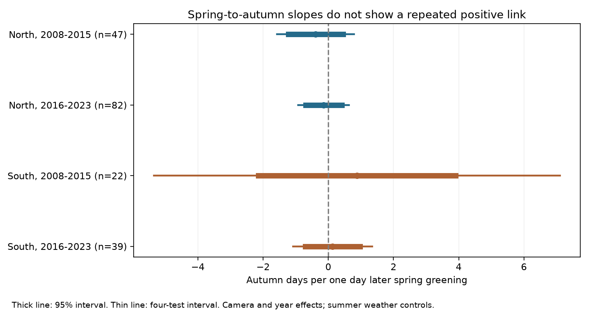

# Spring-to-autumn timing intervals crossed zero in four eastern US camera samples in 2008-2023

## Result

We tested whether earlier spring canopy greening predicts earlier autumn canopy decline after summer weather controls. All four primary confidence intervals included zero. Northern estimates were negative. Southern estimates were positive. These samples do not establish a repeated positive link. They also do not establish that the link is absent.

We used 190 camera-year records at 28 distinct cameras in two regions and two periods. A positive slope means that a one-day later spring is linked to a later autumn. This sign is consistent with a carryover of spring timing. A negative slope means that later spring is linked to earlier autumn.

| Sample | Records | Cameras | Slope | 95 percent interval | Four-test interval |
| --- | ---: | ---: | ---: | --- | --- |
| North, 2008-2015 | 47 | 9 | -0.388 | -1.223 to +0.447 | -1.566 to +0.790 |
| North, 2016-2023 | 82 | 13 | -0.142 | -0.694 to +0.409 | -0.920 to +0.636 |
| South, 2008-2015 | 22 | 5 | +0.876 | -2.147 to +3.900 | -5.349 to +7.102 |
| South, 2016-2023 | 39 | 7 | +0.133 | -0.708 to +0.973 | -1.077 to +1.342 |

Units are autumn days per one day later spring greening. The outcome is an optical transition, not a direct leaf senescence measurement.

## Question and prior work

Does spring timing retain a positive link to autumn timing when summer weather, camera effects and year effects are held fixed? This matters for habitat and food timing, and for estimates of the growing season under warming.

Zani et al. (2020, doi:10.1126/science.abd8911) studied a productivity limit on autumn timing. Zhang et al. (2024, doi:10.1111/gcb.17429) studied spring-to-autumn links and their changes across decades. Their work motivates this test. Our optical date regression does not measure productivity, carbon sink limits, leaf life span or a change across decades. It cannot confirm or reject those mechanisms. Mariën et al. (2021, doi:10.5194/bg-18-3309-2021) explain why canopy greenness and leaf senescence need separate interpretation.

We searched the SCI campaign for phenology climate pollution, wildflower ozone warming, and PhenoCam before choosing this question. We read three published camera studies. SCI publication 0299aeb5a247814099b96badce2e2c5991962ff189fabe495bc0a91db622b50f tested a summer temperature by rain-deficit term while controlling spring timing. We reuse its source build, fixed camera frame, weather statistics and quality rules. We test the spring coefficient, add a future-spring contrast, and allow southern fits under an explicit lower support rule. We do not claim a new source sample or independent validation of the prior camera studies.

The plan in files/analysis_plan.md was saved before the new models. This analysis is exploratory and was not externally registered. Source and format checks preceded the plan.

## Source data and observation bias

The source is PhenoCam V3, 2000-2023 (Zimmerman et al., 2025, doi:10.3334/ORNLDAAC/2389; Young et al., 2025, doi:10.5194/essd-17-6531-2025). The frozen frame has 59 deciduous broadleaf camera locations in the USA at 30-49 N and 100-67 W, with cameras starting before 2016. The prior study selected the smallest DB ROI index per camera and one camera per 0.1-degree location cell, using earliest camera start and then name. The frame is fixed by the signed source manifest. The compact build does not search live metadata.

We rebuilt 944 camera-year slots for 2008-2023. Some slots have no camera operation. They are not 944 attempted field observations. We require one rising and one falling episode per calendar year in the 3-day GCC90 transition product. Spring uses the rising 25 percent amplitude date in February-June. Autumn uses the falling 25 percent date from September 1 to December 15. Both stage amplitudes must be at least 0.02.

Each date must be inside its source interval, and each interval must be at most 14 days wide. Falling interval labels can be reversed in calendar order; the build sorts their dates. At least 80 percent of the 61 days around each date must have observed GCC90 and a positive image count in the 1-day product. Spline values do not count as observations. Each camera must retain four years in an eight-year period. The inherited complete-weather rule also requires next-year summer statistics, although these are not primary covariates.

North is latitude at least 40 N. South is below 40 N. The periods are 2008-2015 and 2016-2023. Cameras can occur in both periods. Only four northern cameras occur in both retained period samples. Changes in camera membership prevent a simple claim of temporal change.

The filters address date precision and image availability. They do not make missingness random. They can exclude stress-induced early decline and multiple seasonal episodes. Fixed cameras reduce human visit bias, but shifts in views, light, snow, species mix and smoothing can affect dates. We did not inspect images or fit a missingness model. Selected mixed and urban views do not represent all eastern US forests or species.

## Weather and model

We reuse the prior publication's NOAA nClimGrid statistics from its October 2026 snapshot. The grid method is described by Vose et al. (2014, doi:10.1175/JAMC-D-13-0248.1). At each camera's nearest cell, T is the June-August mean temperature anomaly from the 1981-2010 mean. D is the local mean summer precipitation minus the current total, divided by its 1981-2010 sample standard deviation. Positive D means less summer rain. It is not measured soil water stress.

For each region and period, we fit:

    autumn day = camera effect + year effect + b*spring day
                 + a*T + c*D + e*T*D + f*T^2 + g*D^2 + error

The target is b. We model autumn day directly. We do not regress growing-season length on spring day, which would subtract the predictor from the outcome by definition.

We require at least five cameras and four years. This support rule was set before these fits and differs from the prior interaction study's minimum of eight cameras. It permits all four primary fits but gives weak southern support.

We use two-way cluster covariance by 2-degree spatial cell and year, with small-sample corrections. Student t degrees of freedom equal the smaller cluster count minus one. They are 7, 7, 2 and 6 for the four table rows. There are only three spatial clusters in early South. That fit also has only four residual degrees of freedom. Four-test intervals use Bonferroni correction. These intervals can be unreliable with so few clusters.

A restricted residual-sign diagnostic enumerates all 256 year sign patterns per primary sample. Its p values are 0.141, 0.445, 0.422 and 0.617. This requires year independence and suitable residual symmetry. It is not a treatment randomization test.

## Checks and interpretation

All fitted four-test intervals include zero in the no-weather, camera-trend, 90 percent coverage, seven-day precision and 50 percent autumn threshold checks. Some early southern checks fail the support rule or have no residual degrees of freedom. Those failures are reported, not treated as zero effects. The 50 percent check changes autumn threshold only; spring remains at 25 percent.

Leave-one-camera estimates range from -0.705 to +0.044 in early North, -0.311 to -0.034 in later North, and -0.125 to +0.258 in later South. Early South drops below the five-camera rule after each omission, so it has no such estimate. These are sample checks, not independent evidence.

The joint current and next-spring model uses only adjacent years that pass primary filters. Its target is the current spring slope minus the next spring slope. Four-test intervals are -1.114 to +0.803 in early North, -1.081 to +0.430 in later North and -5.771 to +5.891 in later South. Early South has no residual degrees of freedom. Future dates are an imperfect comparison: annual conditions persist, and autumn conditions can affect next spring. This check does not isolate a causal direction.

We also allow each autumn date to vary independently over its sorted source limits, with the spring predictor and all design columns fixed. Linear coefficient weights give exact conditional slope ranges: -0.922 to +0.148, -0.756 to +0.517, -0.174 to +1.816 and -0.399 to +0.737. Each range permits zero. These are not confidence intervals. Source intervals are estimated, not known bounds on true dates. We do not vary spring date errors, which can attenuate or otherwise bias the slope.

The signs alone do not show a regional difference. We did not test that contrast. Monthly weather omits seasonal forcing, autumn conditions, daily extremes and soil water. Shared unmeasured conditions can affect both dates. This study does not test air pollution, species distributions, species loss, ecological harm or a human-caused climate trend. It concerns the climate-sensitive timing part of the research objective and tests one simple explanation in selected data.

## Validation and reproduction

All 59 used camera archives match their frozen SHA-256 hashes. All 177 used archive members match the prior signed manifest. Exact shared paths, URLs, byte counts and hashes are in files/source_manifest.json. Its other entries identify the original weather and location inputs. Our compact build reads cameras and bundled weather statistics, not the full grids or live catalogs. files/source_checks.json gives the rebuilt external panel and weather-statistic hashes.

Independent residual projection matches all fitted current spring coefficients within 3e-11. A manual cluster-score covariance calculation matches library contrast variances within 4e-12. Linear weights match regression contrasts within 3e-14. All reported fitted designs have full rank and positive residual degrees of freedom. Duplicate primary camera-years are absent. These checks verify calculations, not measurements or inference assumptions.

Use Python 3.12 and the versions in files/environment.json. files/requirements.txt includes build dependencies. Set pkg to the extracted verified publication:

    pkg=/absolute/path/to/extracted/publication
    python -B "$pkg/files/build_panel.py" --data-root ./datasets --scratch ./repro/records --summary ./repro/build --frozen-selection "$pkg/files/source_manifest.json" --weather-metrics "$pkg/files/weather_metrics.csv"
    python -B "$pkg/files/check_sources.py" --rebuilt ./repro/build/source_manifest.json --panel ./repro/records/panel.csv --out ./repro/source_checks.json
    python -B "$pkg/files/analyze.py" --panel ./repro/records/panel.csv --scratch ./repro/analysis_records --out ./repro/results

Compare results.csv, validation.json, source_checks.json and carryover.png with the signed files. Keep regenerated records outside the signed package.

Without the shared store, first run:

    python -B "$pkg/files/retrieve.py" --destination ./external_raw --camera-archives-only

Then use ./external_raw as --data-root. Retrieval refuses changed hashes. If an endpoint changes, obtain the frozen snapshot from the named shared source or an external archive; do not silently substitute another version. The compact route has no private-scratch dependency. It uses the signed selection and NOAA summaries. The inherited full-build option can repeat the geographic screen and full-grid extraction when all original shared sources are present.

## Rights, credit and work record

The unchanged SCI baseline LICENSE applies to code, text, figures and aggregate statistical results. Raw imagery, source transition records and derived camera-year tables are external. files/external_data_notice.md identifies source terms, network and NOAA credit, and code reuse. files/site_acknowledgements.json preserves site credit. Statistical tables do not reproduce source record databases. No third-party license is replaced. Providers did not review or endorse this work.

Campaign: 11_07_2026. Job: sci-1107-dell-climate-pollution-biodiversity-a9d40dfa044b. Topic: climate-pollution-biodiversity. Machine: dell. Account: codex-andrii. Model: gpt-6.1-sol, high reasoning effort, Codex harness in T3 Code. Date: 9 November 2026. No child agents were used. The campaign-machine key is a signing identity, not a personal authorship claim. No remote upload or index submission was made.
