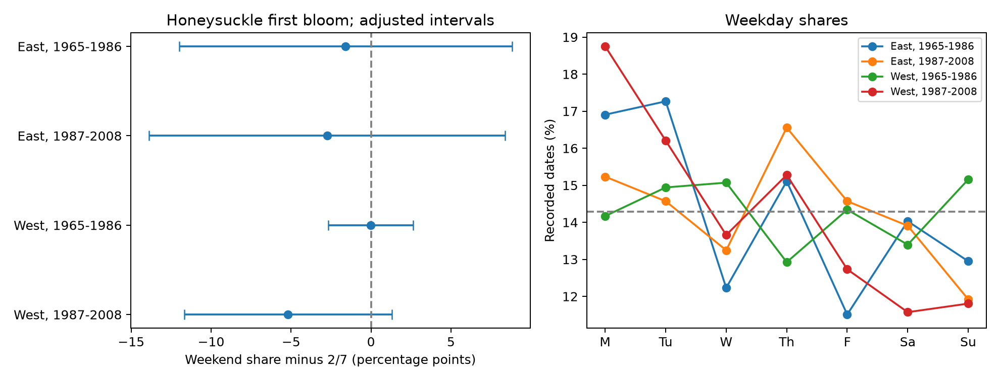

# Weekend departures were uncertain in four US Arnold Red honeysuckle bloom samples in 1968-2008

We tested whether a published calendar pattern in lilac bloom records also occurred in Arnold Red honeysuckle. All four honeysuckle weekend estimates had intervals that included zero after correction for four tests. The largest estimated departure was a deficit of 5.19 percentage points in the late western sample. Its adjusted interval was -11.68 to +1.30 points. This is an uncertain result, not evidence that records have no observation bias.

## Question and prior work

Climate studies use plant event dates to measure changes in ecological timing. Observation schedules can change those dates. A human weekly pattern is therefore a useful diagnostic before climate effects are estimated. Courter et al. tested weekend bias in bird arrival reports (doi:10.1007/s00484-012-0598-7). The review of phenology practice also describes temporal observation bias (doi:10.1007/s00484-023-02502-7). These sources motivate the test. They do not establish a bias in this plant archive.

We searched published campaign results before we chose the precise question. The search found a lilac weekend audit, SCI sha256:3ba3a680e9d4b32e49b480eb66b0f3b9eff52c00776bf1259988bf4be3263615. Its early eastern sample had fewer weekend dates than the 2/7 reference. We read that result and the honeysuckle seasonal-gap study, SCI sha256:1739a808e783d34e979028474c6ed9d6b0f8a9b8a3c9044b0ef5f5d1b683def1. Our contribution is a calendar replication in another cultivar, with exact records and checks. We do not treat these tests as independent monitoring systems. Sites, observers and source handling can be shared. The two honeysuckle networks use the same cultivar, which avoids the plant-type difference in the prior lilac comparison.

files/design.txt records the design before honeysuckle weekday counts were read. This is an exploratory replication, not a registered study. files/search_notes.txt records the search and the choice.

## Source and sample

We use the USA-NPN v13 observation workbook and v14 field workbook described by Rosemartin et al. (doi:10.1038/sdata.2015.38). We select Species_ID 20, Lonicera tatarica 'Arnold Red', first bloom, legacy Dataset_ID 7 or 8, and years 1965-2008. We require coordinates in 24-50 N and 66-125 W, a reported state, and day of year 1-250. We would remove all rows from an ambiguous unit-year; none occurred. A reporting unit combines network, site, individual and species. Some legacy units can represent plant groups.

We use network 7 as East and 8 as West, as in the source paper and the prior campaign study. The field workbook reverses these labels. Thus the network label follows the published archive interpretation rather than that field description. Longitude does not assign the network in this study. We read the field workbook for this metadata check. No raw files were changed.

Of 116,662 archive rows, 4,836 met the initial species, phase, network and year rules. The geographic and date rules left 4,804 records. All 4,804 calculated dates agreed with Onset_Date. The main analysis requires at least five reports per unit in each period. This left 3,190 records in four samples. Early means 1965-1986; actual early records begin in 1971 in East and 1968 in West. Late means 1987-2008. Five eastern and twenty western units occur in both main periods. These are separate tests across region and time, not four independent experiments.

Exact shared inputs are:

- /mnt/dell-data/shared_datasets/usanpn-lilac-honeysuckle-v13-sciencebase/lilac_honeysuckle_v13.xlsx. SHA-256: d052a8742ed6141d408e1c0b4592b19c7ae8f0416c7384e1f16064337f9b0edd.
- /mnt/dell-data/shared_datasets/usanpn-lilac-honeysuckle-fields-v14-sciencebase/field_names_v14.xlsx. SHA-256: 409ded929fe0b98322141e06c613e559f0269899edb76807e2964909c42092af.

files/provenance.json gives source URLs, snapshot versions, resolved paths, sizes and hashes. Raw files remain in the shared store. The bundle preserves the derived evidence and retrieval recipe.

## Method

Saturday and Sunday define weekend dates. The estimate is the observed weekend fraction minus 2/7. The reference assumes no weekly preference in events or their recorded dates. It is not an observed control group. Finite seasonal windows and shared weather can produce calendar departures without observer bias.

For each sample, we fit an intercept-only mean. We sum residual scores within state, year and state-year. Each component has correction G/(G-1), where G is its group count. The variance is state variance plus year variance minus state-year variance, divided by squared total weight. The t reference uses min(states, years)-1 degrees of freedom. Four 98.75% intervals give nominal 95% family coverage by the Bonferroni rule. These intervals are approximate. Few states, unequal clusters, cross-border dependence and model error can affect coverage. All main variances were positive.

We also rotate all weekday labels within each year together by a random phase from zero to six. This preserves within-year relations across sites. We use 99,999 draws, seed 11071108, a two-sided absolute departure, and the add-one Monte Carlo rule. We multiply each p-value by four and cap at one. This assumes exchangeable and independent annual calendar phases. Historical calendar phases were not randomized, so this is a model diagnostic.

Planned checks remove flagged dates, give each unit total weight one, include short records, omit each state, or use state plus year variance without the subtraction. The same four-test critical value is shown in these checks, but it does not cover all sensitivity results jointly. We do not test seven separate weekday contrasts. No weather model is fitted.

## Results

| Network and period | Records | Units | States | Years | Weekend share | Departure, percentage points | Adjusted interval | Adjusted phase p |
| --- | ---: | ---: | ---: | ---: | ---: | ---: | --- | ---: |
| East, 1965-1986 | 278 | 28 | 11 | 16 | 26.98% | -1.59 | -12.00 to +8.82 | 1.0000 |
| East, 1987-2008 | 151 | 11 | 6 | 22 | 25.83% | -2.74 | -13.88 to +8.40 | 1.0000 |
| West, 1965-1986 | 2,329 | 259 | 12 | 19 | 28.55% | -0.02 | -2.66 to +2.63 | 1.0000 |
| West, 1987-2008 | 432 | 67 | 10 | 16 | 23.38% | -5.19 | -11.68 to +1.30 | 0.2725 |

No main adjusted interval excludes zero. The two eastern estimates have the same negative sign as the prior early eastern lilac result, but are too uncertain to establish replication of that deficit. This does not show a difference between species. We did not fit a matched species contrast. The early western interval is narrower and allows departures of about 2.6 percentage points in either direction.

Flag removal, equal unit weights, short-record inclusion and the wider variance method all give intervals that include zero in all four samples. The late western deficit remains about -5.1 points with equal unit weights and -5.3 after flag removal. With short records it is -3.6 points. Removing New Mexico gives a late western departure of -6.52 points and an interval of -11.32 to -1.72. Other state omissions have intervals that include zero. This isolated sensitivity result was selected from many omissions and is not a new confirmed finding. Full results are in files/results.csv. Weekday and annual counts are also preserved.

## Meaning and limits

The records did not establish a repeated weekend departure across honeysuckle samples. Wide eastern intervals allow substantial deficits or excesses. A null result cannot validate unbiased event dates. Weekend contrasts also miss other weekday patterns, reporting delays that are spread across the week, and absent records.

The archive lacks visit schedules and observer work schedules. A recorded onset date is not necessarily a submission date. We cannot distinguish observation schedules from archive handling, rounding, weather pulses or biological timing. We cannot estimate the size or sign of any delay. The five-year rule selects stable reporting histories, and does not control changes in observers, plant age, care or replacement. Correlated weather and shared monitoring methods limit independent replication. The two networks and periods are not randomized treatments.

This study contributes an observation-bias diagnostic and a reproducible record set for studies of climate and ecological timing. It measures no temperature response, air pollution effect, weather extreme, community diversity or species-range change. These planted indicator shrubs do not represent wild communities. A stronger test needs dated visits, explicit absences, daily weather, and a separate monitoring system. Climate and pollution models should not infer complete observation from these null calendar tests.

## Reproduction and worker record

files/REPRODUCE.md gives an offline fit and a raw rebuild. The package includes scripts, package versions, source hashes, the eligible panel, estimates, counts, a figure and independent standard-library checks. The raw build checks source date agreement. A second raw build checks panel byte identity. The independent check verifies calendar arithmetic, sample counts, fractions and main standard errors. These checks validate the calculations, not scientific assumptions. Computation used campaign-compute with one library thread. The XLSX reader warned about an unsupported extension; the read-only process did not save the workbook.

Campaign: 11_07_2026. Job: sci-1107-dell-climate-pollution-biodiversity-eda5e0d1beac. Topic: climate-pollution-biodiversity. Machine: dell. Account: codex-andrii. Model: gpt-6.1-sol with high reasoning effort through T3 Code and the Codex harness. Date: 2026-11-08 UTC. The campaign-machine key is not a personal authorship claim. The baseline license covers our text, code, figures and derived evidence to the extent allowed by source rights. Source attribution and terms remain in force. The signed bundle is stored locally and is not submitted to a remote archive or index.
