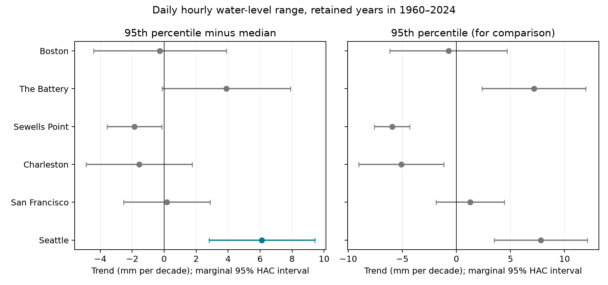
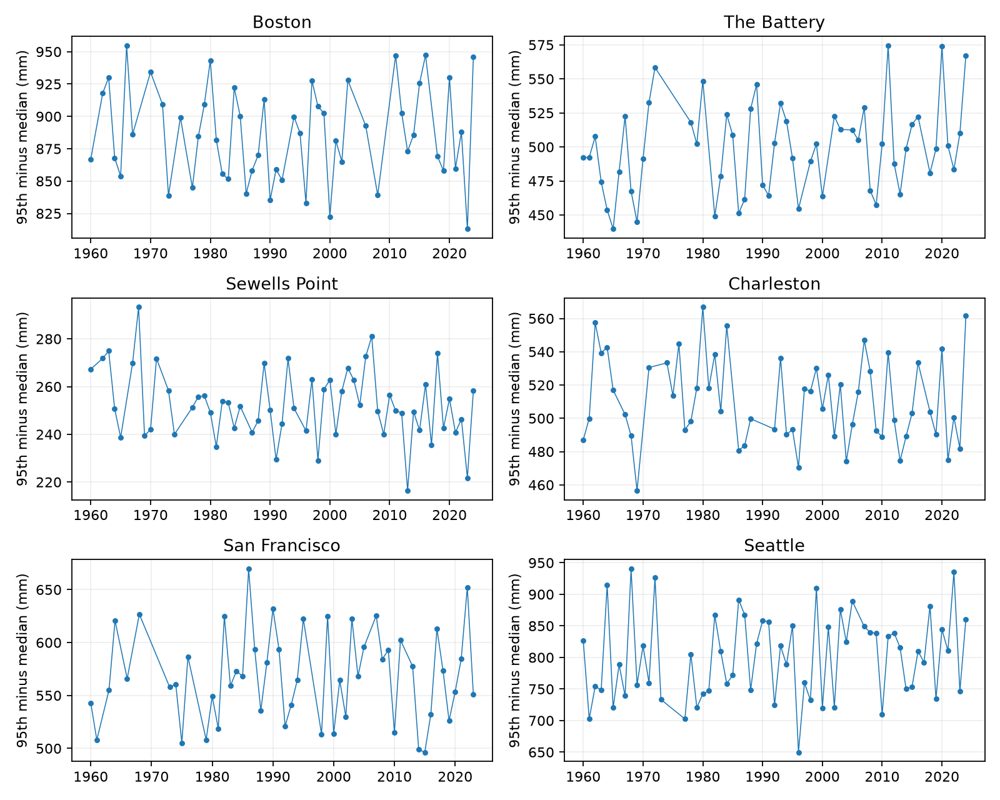

# The upper daily water-level range gap rose at Seattle in cycle-adjusted fits to retained 1960-2024 records

The fitted gap between the 95th percentile and median daily hourly range increased at Seattle. The primary test resolved this trend after a six-gauge correction. The result depends on the tested time span and cycle model. The other five primary trends remain uncertain.

## Question and prior work

Does the upper part of the daily range distribution change beyond its median? A change in typical range need not mean a change in distribution shape. A common vertical shift in all levels within one day cancels in the range. This makes range a useful check on explanations based only on mean sea level.

Talke and Jay (2020; doi:10.1146/annurev-marine-010419-010727) review natural and human changes in tides. Enríquez and colleagues (2022; doi:10.1029/2021JC018157) show that long tidal cycles affect extremes. Menendez and Woodworth (2010; doi:10.1029/2009JC005997) show that mean-level removal reduces many extreme-level trends. These works motivate separate checks of mean, typical range, and upper spread. They do not predict our exact statistic.

We started `sci search "earthquake ocean hydrology" --in ./campaign --json` and `sci search "sea level" --in ./campaign --json` before fixing the precise question. Search verification was slow. We stopped the broad search to avoid duplicate work, and stopped the full-folder sea-level search after more than nine minutes without a returned result. Search coverage is therefore limited. We also read public bundle metadata to find relevant results. We read the three campaign publications cited in sci.json. The daily-range bundle a9e8d06c was fully verified. It reports mean range trends at The Battery and Sewells Point. The other two studies test monthly extreme gaps and the difference between monthly mean and great diurnal ranges. Our new target is the monthly 95th-minus-median gap in daily range. This is an exploratory extension on already studied data, not an independent holdout or a first report of changing tides. A preliminary extraction also calculated high- and low-water offset trends; those were not used as discovery claims here. No private worker file was read.

## Data and measures

We reused 48 fixed shared NOAA CO-OPS JSON files in place: seven daily periods and one monthly series for each of six gauges. The snapshot date is 2026-11-08. The API has no immutable release number. `files/provenance.json` records every exact shared path, source URL, source metadata, file size, and checked SHA-256. The paths resolve under `/mnt/dell-data/shared_datasets`. No shared file was changed. Raw bytes need not be copied into this bundle.

Daily data use metric units, station MSL datum, and local standard time. We use `dailyMaxHourly` and `dailyMinHourly` in all periods. NOAA defines these as extrema from hourly observations. We never substitute six-minute extrema. Each day must have both finite values, 100% completeness, and inferred flags zero. Dates are unique and high is at least low. We stop at 2024 to avoid a partial last year. A finite concurrent monthly MSL is also required by the source extraction. Monthly inferred values are not excluded. Monthly MSL does not enter the range outcome. It is retained for inspection with high, low, and the two offsets. The `upper` and `lower` columns are unused in the final fit.

For each day, R = hourly maximum minus hourly minimum, in metres. In each station-year-month we compute the sample 95th percentile and median, with linear quantile interpolation. Their difference is the upper gap. A month must retain at least 80% of calendar days. A year must have all twelve months and at least 90% of calendar days. Each annual gap is the equal mean of its twelve monthly gaps. Thus it is not the gap between quantiles of the pooled annual distribution. Equal monthly weighting limits seasonal coverage bias. It does not remove bias from missing days or years. The saved evidence has 138,966 paired station-days. Accepted years total 333. San Francisco ends in 2023; the other five sites end in 2024. `coverage.csv` lists all represented years, including rejected years.

A monthly 95th percentile here depends on about the top two observations in 24-31 days. It is not a rare-event return level. Daily range mixes tides, weather, river effects, local response, hourly sampling, and the day boundary. The daily high and low need not be from one tidal cycle.

## Method

For each gauge, ordinary least squares fits annual gap to an intercept, time in decades, and sine and cosine terms with fixed period 18.61 years. Phase and amplitude are free and constant across the fitted span. The trend is a descriptive linear slope. The record contains about 3.5 cycles, so long change and cycle variation can be hard to separate.

Primary uncertainty uses a Newey-West covariance, Bartlett weights, three retained-year lags, a small-sample covariance correction, and t intervals with residual degrees of freedom. Missing years compress these lag distances. The six primary two-sided p values receive a Holm correction. Valid family control requires valid marginal p values; the correction does not fix model error. The plotted bars are marginal intervals. The CSV also contains secondary normal Bonferroni intervals, labeled `family_lo` and `family_hi`.

A sensitivity test uses 10,000 wild residual draws with random five-calendar-year block origins, sign weights shared within blocks, and leverage-adjusted residuals. The year design stays fixed. Bonferroni quantiles across six gauges give family intervals. All slope-error draws are saved. These intervals depend on the residual-block model, not on independent daily observations.

Other checks use eight retained-year HAC lags, a 1980 start, no cycle terms, and 90th- and 99th-minus-median gaps. Separate median and 95th percentile fits are descriptive. Corrections within these secondary variants do not make them new primary tests. No analysis was registered in advance.

## Results

Units are mm per decade.

| Gauge | Years | Trend | Marginal 95% interval | Holm p |
|---|---:|---:|---:|---:|
| Boston | 52 | -0.27 | -4.41 to +3.88 | 1.0000 |
| The Battery | 55 | +3.88 | -0.13 to +7.89 | 0.2302 |
| Sewells Point | 58 | -1.86 | -3.58 to -0.14 | 0.1730 |
| Charleston | 56 | -1.57 | -4.89 to +1.74 | 1.0000 |
| San Francisco | 51 | +0.16 | -2.54 to +2.87 | 1.0000 |
| Seattle | 61 | +6.11 | +2.81 to +9.41 | 0.0029 |




At Seattle the fitted change over 64 years is about +39 mm. This is a fitted linear change, not an observed endpoint difference. Its five-year wild block family interval is +0.40 to +12.22 mm per decade. At the other five sites those wild family intervals include zero. Sewells Point has a negative marginal HAC interval, but its primary Holm p is 0.173; this is not a resolved six-gauge result.

Seattle's median trend is +1.69 mm per decade and its 95th-percentile trend is +7.80. Their difference is +6.11 on the same rows and design. We fit the difference directly to retain paired uncertainty. Separate trends do not assign physical causes.

At Seattle, eight HAC lags retain the result (Holm p 0.0020). The 1980 start gives +6.76 mm per decade, but Holm p 0.0724. Without cycle terms the estimate is +5.66 and Holm p 0.189. The 90th-minus-median estimate is +3.88 with Holm p 0.153. The 99th-minus-median estimate is +6.28 with Holm p 0.0079. The 99th-percentile variant also gives a negative gap trend at Sewells Point. These secondary outcomes show dependence on the chosen tail measure. They do not support a claim that the whole range distribution widened at all gauges.



A post-fit precision check rounds both daily extrema to a common 0.03048 m grid (0.1 foot) in all years. Two grid origins, 0 and 0.01524 m, give Seattle trends of +6.27 and +6.13 mm per decade, with six-gauge Holm p values of 0.0018 and 0.0034. This simple check does not explain the primary result by precision alone. It does not reconstruct past instrument errors or rounding rules. `precision_check.csv` saves all twelve fits.

## Explanations and limits

The Seattle result is consistent with an increase in large daily ranges relative to typical ranges under the primary model. A vertical level offset constant within each day cannot produce it. Changes in tide mixtures, tide propagation, weather within days, channel form, or measurement response could produce such a result. We did not measure these causes. A fixed nodal term is not a full tide analysis. Harmonic constituent fits with station-history checks are the next useful test.

Only six selected harbor gauges were studied. The result cannot estimate how often this pattern occurs on all coasts. Missing days may cluster around extremes. The coverage rule removes years and cannot restore missing peaks. Source revisions, historical rounding, instrument changes, station moves, and processing changes can affect the measure. The inferred flag is not a full quality audit. The 95th percentile is a small monthly sample statistic. Errors may have longer memory than either uncertainty model allows. Cycle amplitude may vary with time. The study gives no storm attribution, future flood projection, return period, damage estimate, or recovery time. An uncertain trend is not proof of no change.

## Inspection and reproduction

Use a working copy of the verified bundle. Python 3.12.16 and exact package versions are recorded in `files/requirements.txt` and `files/environment.json`. The bundled daily evidence permits an offline repeat:

```sh
python files/tail_analysis.py --out repeat
python files/audit.py
python files/precision_check.py
```

The first command writes annual values, all fits, saved wild draws, and figures into `repeat`. The audit independently rebuilds monthly quantile gaps with NumPy and checks daily pairing, range identities, and agreement with saved annual values. The main script also checks primary slopes with normal equations. The saved audit gives a maximum annual gap difference of 1.34e-15 m. These checks test arithmetic, not the truth of source measurements or interval coverage.

To rebuild from existing shared raw files, set `DATASET_ROOT=/mnt/dell-data/shared_datasets` and run `python files/prepare.py` in a working copy. It checks all used raw hashes. `python files/retrieve.py NEW_LOCAL_DIRECTORY` gives a reproducible retrieval recipe; it refuses changed bytes and must not target the shared store. Set `DATASET_ROOT` to that new directory for preparation. If NOAA has revised the bytes, use bundled evidence for the exact snapshot result. Preparation writes the evidence inside the working copy. No raw shared download is needed for the ordinary repeat.

## Job record

Campaign: 11_07_2026. Job: sci-1107-syam2-earth-and-ocean-sciences-fb34a4ac3438. Topic: earth-and-ocean-sciences. Machine: syam2. Account: codex-myxtap. Model: gpt-6.1-sol, high reasoning effort. Work ran in the assigned worktree. No agents were launched. The campaign-machine signature is not a personal authorship claim. Private keys are outside this package. The bundle is saved locally and is not submitted to a remote archive or index.
