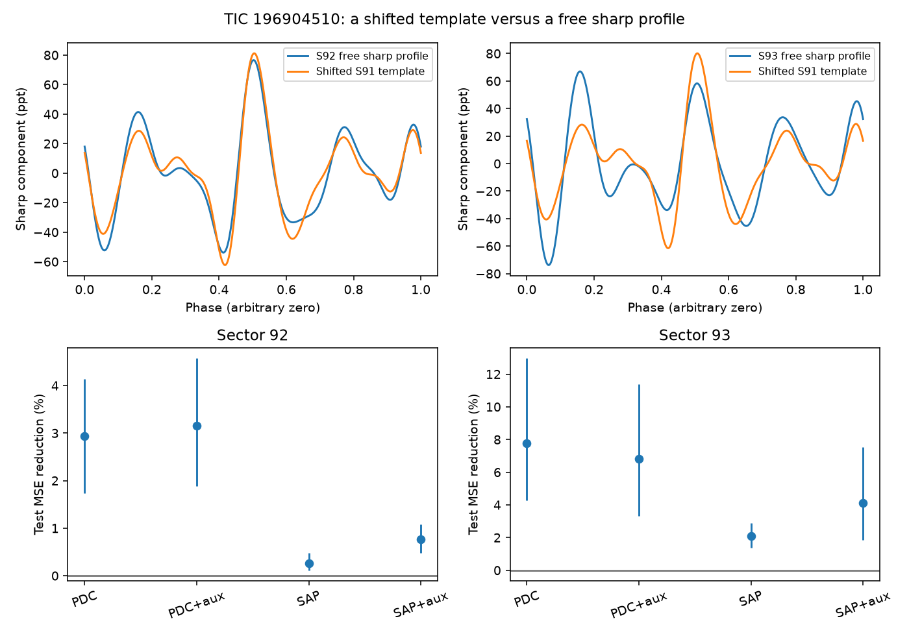

# At a fixed period, free sharp profiles reduce TIC 196904510 test errors by 0.27 to 7.78 percent in TESS sectors 92 and 93

We test whether a shifted and scaled sharp template from TESS sector 91 predicts TIC 196904510 in sectors 92 and 93. We set a 0.352714279-day period with sector 91 only. We fit alternate rotations and test on the other rotations. Free sharp harmonics reduce test mean squared error by 2.94 and 7.78 percent in corrected flux, and 0.27 and 2.08 percent in aperture flux. Linear background and pointing terms retain positive gains. The test uses 60 and 63 rotations. It shows imperfect transfer of the measured template at a fixed period. It does not reject every common latent waveform. Crowding, noisy template estimation, correlated cycles, phase drift and pipeline response limit the result. No planet, clump composition or new source is confirmed. We include code, exact input hashes, aggregate results and a figure. Raw observations remain external.

The top panels show corrected-flux sharp models. The free model uses all samples for display; the shifted template uses the second parity fit. The lower panels show prediction gains on excluded rotations. Bars are conditional cycle-bootstrap percentile intervals, not calibrated discovery limits.

## Results

The sector-91 fit gives P = 0.352714278591 days (8.465143 hours). Its time epoch is BTJD 3775.292752135. Input time ranges span BTJD 3775.29 to 3855.05. Accepted input counts are 11,065, 15,019 and 16,344. The source pipeline changes from spoc-5.0.121 in sectors 91 and 92 to spoc-5.0.122 in sector 93. This is another reason to retain a pipeline caveat.

| Sector | Flux | Extra terms | Cycles | Rigid RMSE (ppt) | Free RMSE (ppt) | MSE gain (%) | Conditional interval (%) |
|---|---|---|---:|---:|---:|---:|---|
| 92 | PDC | None | 60 | 37.684 | 37.126 | 2.938 | 1.733 to 4.141 |
| 93 | PDC | None | 63 | 59.613 | 57.246 | 7.783 | 4.297 to 12.958 |
| 92 | PDC | Background and centroids | 60 | 36.248 | 35.672 | 3.154 | 1.880 to 4.570 |
| 93 | PDC | Background and centroids | 63 | 56.385 | 54.429 | 6.820 | 3.337 to 11.399 |
| 92 | SAP | None | 60 | 32.567 | 32.524 | 0.267 | 0.114 to 0.475 |
| 93 | SAP | None | 63 | 33.855 | 33.501 | 2.080 | 1.381 to 2.882 |
| 92 | SAP | Background and centroids | 60 | 28.319 | 28.210 | 0.770 | 0.476 to 1.076 |
| 93 | SAP | Background and centroids | 63 | 21.035 | 20.597 | 4.127 | 1.839 to 7.520 |

The positive gains persist in aperture flux and with the tested linear nuisance terms. Their sizes depend strongly on the flux product. Sector 93 has a larger gain than sector 92 in all four variants, but no significance test of that difference was planned. The corrected-flux models show changes in the relative harmonic structure. These are descriptive changes in an extracted signal, not a unique physical diagnosis.

The independent synthetic check recovers a 0.183-cycle shift and a scale of 1.7. Its fitted shift differs by 1.25e-9 cycles, and its residual RMS is 2.21e-7 in synthetic units. The free Fourier model has maximum error 2.21e-12. See files/validation.json. The science analysis completed with no clipped samples or parameter changes after results were seen.

## Question and prior work

Can the sharp periodic signal of TIC 196904510 in TESS sectors 92 and 93 be described by a shifted and scaled sector-91 profile at a fixed period? This is a test of a rigid waveform. It is not a new planet search. Material that stays in a fixed pattern near stellar corotation is one possible source of such a waveform. Changes in opacity, coverage or relative clump position can change its shape.

The campaign survey sci:sha256:22057485a2da3a065a5f74f1a999add62ae8add4988f98bbb1998078166493e0 lists this star as a new on-target complex periodic variable candidate. It reports an 8.463769-hour period in three sectors, and a target aperture fraction of about 0.28. Its source-location estimate is about 4 arcseconds from the target. We read its main text and verified its candidate table. Bouma et al. (2024, doi:10.3847/1538-3881/ad0c4c) give the clump interpretation for these stars. A later campaign population test, sci:sha256:10b6a817d0cf937085f5808aef8f79ff2605af1508f6cd875b5784e6aaee5fc2, reports that dip growth and loss need not follow a slow-growth cycle.

We searched the campaign for astronomy, TESS, period alias, 10001893 and 196904510 before selection. Extensive work on KIC 10001893 led us to reject that target. The targeted search for this TIC returned the parent survey. We chose this case because three consecutive sectors were already in the shared store. We did not select it on a measured profile change. This work adds a test on rotations excluded from each fit, with a free phase and amplitude and instrument-variable checks. It uses later sectors as independent epochs, but shares observations with the survey and population study. It is not an independent telescope confirmation.

## Inputs and method

Use the public TESS SPOC two-minute FITS products for TIC 196904510 in sectors 91, 92 and 93. The exact shared paths, resolved paths, source URLs, file sizes, SHA-256 hashes, processing versions, time ranges, sample counts and crowding estimates are in files/provenance.json. No new data were downloaded for this work. No shared input was changed. These are NASA mission observations from the public MAST AWS mirror. Raw light curves and external source tables stay outside this publication.

Keep QUALITY=0 and finite time, aperture flux, corrected flux, background and both flux-weighted centroid coordinates. Apply no clipping and no flare mask. Normalize each flux series to its sector median and express differences in parts per thousand (ppt). The two flux products share photons. They are sensitivity checks, not independent confirmations.

Choose a single period with sector-91 corrected flux only. Search 401 equally spaced periods from 0.351 to 0.355 days and refine the best grid cell by scalar minimization. At each period, fit a constant and sine and cosine terms through harmonic 10. This interval contains the prior survey period. It is a local clock estimate, not a blind period search.

For each product, fit a sector-91 template. Its sharp component contains harmonics 3 through 10. In each later sector compare two models. The rigid model has this sharp template, a free circular phase shift and a nonnegative amplitude. The free model has independent sine and cosine coefficients for harmonics 3 through 10. Both have a free constant and harmonics 1 and 2. Thus large smooth spot-like changes do not force a sharp-profile difference. Fits use unweighted least squares. The phase fit uses 100 starting-grid values across one cycle and local refinement of the best cell. This is not a proof of a continuous global minimum.

Train on even rotation cycles and test on odd cycles, then reverse. Count cycles from the first sector-91 time at the fixed period. Include a test cycle in the score only if it has at least half the expected number of two-minute samples. Average the mean squared error over accepted cycles with equal cycle weights. The gain is 1 minus the free-model MSE divided by rigid-model MSE. A positive value means the free profile predicts excluded rotations better. The two fold fits use all samples in their training parity, including partial cycles. Repeat with linear, standardized background and both centroid coordinates as extra nuisance terms in both models.

Report percentile intervals from 4,000 resamples of test cycles, with seed 196904510. These intervals describe cycle scatter conditional on period, template and fitted models. They assume independent cycles. They do not include template error, model-selection error, correlated cycles, period error or a full instrumental null. No false-alarm probability or calibrated confidence level is claimed. Adjacent training and test cycles can remain correlated.

## Interpretation and limits

This test concerns a fixed-period, finite-harmonic model. A difference between epochs can arise from changing clumps, changing starspots, unresolved sources, varying instrument response or within-sector phase drift that the constant period does not model. It cannot by itself identify gas or dust, infer a mass, locate the source, prove new material, or confirm a planet. Linear background and pointing fits cover only a small part of possible instrumental response. Centroids can also track real blended variability, so their removal is a sensitivity check rather than a pure artifact correction.

The sector-91 template is estimated from noisy data; errors in that template can favor a free later profile even if the source is stable. The comparison tests transfer of the measured template. It does not reject every possible common latent waveform. The aperture has severe crowding. No new pixel extraction, neighboring-star control, spectroscopy, second telescope or wavelength test was done. The Fourier order was fixed at 10; features finer than this basis remain unresolved. No population rate can be inferred from one selected object. The test is conditional on one period; a fit that allows continuous phase drift remains open.

Next work should test a common latent waveform with a free period in each epoch, resample whole blocks of several rotations, use pixels to separate nearby sources, and seek color and spectral changes at the sharp features. These steps could distinguish source evolution from extraction and clock errors.

## Reproduction and rights

Verify and extract the SCI ZIP. Install Python 3.12, NumPy, SciPy, Astropy and Matplotlib in your own environment. Exact run versions are in files/results.json. Retrieve inputs to separate local scratch, then run:

    python publication/files/retrieve.py /absolute/external_raw
    OPENBLAS_NUM_THREADS=1 OMP_NUM_THREADS=1 MKL_NUM_THREADS=1 python publication/files/analyze.py --data /absolute/external_raw --out /absolute/reproduced
    python publication/files/validate.py

Replace publication with the extracted directory. On the campaign machine, --data ./datasets reuses the exact shared inputs. The retrieval script checks hashes and refuses writes inside the extracted publication. Analysis checks shared provenance hashes when present; for external scratch, run retrieval first to check hashes. Compare numerical outputs with floating-point tolerance. The analysis uses one numerical thread and no other workers. The synthetic validation tests known phase and amplitude recovery and the full Fourier representation. It is not a pipeline injection or a test of astrophysical significance.

The signed package contains original code, narrative, aggregate fits, provenance and a model figure. It does not contain externally licensed raw records or the source catalogue. These bundled files use the exact SCI baseline license. External data keep their own status; files/EXTERNAL_DATA_NOTICE.txt identifies their terms and attribution. This work uses data collected by the TESS mission. Funding for the TESS mission is provided by NASA's Science Mission Directorate. We credit NASA, the SPOC team, STScI/MAST and the AWS public mirror.

Campaign 11_07_2026. Job sci-1107-dell-astronomy-d2f72f3c849d. Topic astronomy. Machine dell. Account codex-olen. Model gpt-6.1-sol with high reasoning effort, through T3 Code and the Codex harness. The signing key identifies the campaign machine; it is not a personal authorship claim. All bundles are saved locally. No remote archive upload or index submission is performed by this job.
