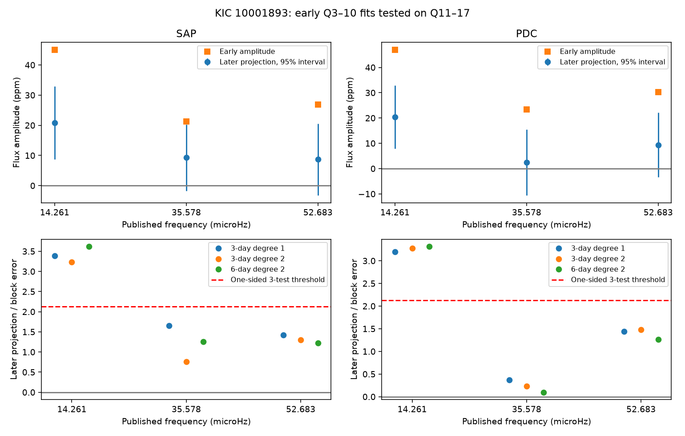

# Only the 14.261 microHz band passes an early-phase test in two KIC 10001893 Kepler flux products at Q11 to Q17

## Result

Only the band near 14.261 microHz has a clear positive component in the early fitted phase in both later flux products. This known signal has a period near 19.48 hours. Its later component is about 20 to 21 parts per million (ppm). The other two bands do not pass the stated later phase screen. This result does not confirm a planet, a new source, or a physical cause.



## Question and prior work

Can a fixed sine wave fitted to early quarters predict a known slow signal in later quarters? A planet with a steady circular orbit and a fixed light response can give a stable periodic flux signal. Pulsation combinations, light from another star, and instrument changes can also make slow signals.

Silvotti et al. (2014) proposed three planet signals. Blokesz et al. (2019) found that slow signal strength depends on reduction, and showed that a comparison star reduces some signals. Their work also gives pulsation combinations as possible causes. We add a fixed early-phase prediction test for public release 25 pipeline flux. We do not repeat their custom pixel extraction or identify a cause. The campaign search for `10001893` gave no result; `subdwarf` gave related transit studies. We read the cited campaign TESS survey as context. Its transit test differs from this sine test.

## Data and method

We use 14 public long-cadence FITS files, release 25: quarters 3 and 5 to 17. Quarter 4 is absent in this target product set. The source listing was checked before download. The campaign dataset helper stored each file in its own completed immutable directory. Exact shared paths, URLs, versions, sizes and SHA-256 hashes are in `files/provenance.json`. No raw files or exposure tables are in this bundle.

The main fit uses 27,553 early exposures and 24,039 later exposures. Both flux products use the same accepted rows. SAP means aperture flux. PDC means corrected flux. Each quarter is divided by its median. We remove an independent line in each 3-day block by joint projection of the flux and sine columns. We scan only early data within +/-0.06 microHz of each stated frequency. Later data set the sine coefficients at the fixed early frequency. The dot product of these coefficients with the early unit phase vector is the reported later component. Errors use a block sandwich covariance. `files/METHOD.md` gives all choices and equations.

The one-sided screen is a component divided by its block error greater than 2.13. This is a nominal normal Bonferroni screen for three bands within one product. It is not a calibrated discovery threshold. Even a six-test normal threshold of 2.40 would retain only the lowest band. The error model assumes independent blocks. The target and bands came from work that used the full historical data; this is not a blind later-data discovery.

## Measurements

The table uses 3-day linear baselines. Amplitudes and errors are in ppm. The gain is the decrease in later mean squared error from the full early sine wave, in ppm squared. A negative gain means a worse prediction. Later error bars are conditional on the selected early frequency and phase.

| Product | Band, microHz | Early fitted frequency | Early amplitude | Later component +/- block error | Component / error | Later error gain |
| --- | --- | --- | --- | --- | --- | --- |
| SAP | 14.261 | 14.261300 | 45.08 | 20.87 +/- 6.16 | 3.39 | -74.1 |
| SAP | 35.578 | 35.608696 | 21.23 | 9.27 +/- 5.63 | 1.65 | -28.2 |
| SAP | 52.683 | 52.675611 | 26.83 | 8.68 +/- 6.09 | 1.43 | -126.9 |
| PDC | 14.261 | 14.260869 | 47.03 | 20.45 +/- 6.38 | 3.20 | -141.5 |
| PDC | 35.578 | 35.610406 | 23.39 | 2.43 +/- 6.66 | 0.37 | -215.6 |
| PDC | 52.683 | 52.675751 | 30.23 | 9.35 +/- 6.50 | 1.44 | -174.0 |

The 14.261 microHz band gives a component divided by error from 3.20 to 3.62 across both products and all three baseline choices. The other bands give 0.10 to 1.65. All six slow-band early sine waves increase later error in the main baseline. Five of six do so with 6-day quadratic baselines; the remaining gain is only 15.0 ppm squared. Thus a positive phase component does not imply a useful fixed-amplitude prediction. Early peak selection, phase error, noise and true variation can each reduce prediction quality. We do not assign the amplitude decrease to the star.

The known strong pulsation near 210.6816 microHz gives later components of 581.82 +/- 7.68 ppm in SAP and 628.14 +/- 8.01 ppm in PDC. This control shows that the procedure preserves a strong stable phase signal. It does not prove adequate sensitivity at all weak amplitudes.

## Sensitivity and checks

For each slow band and product, we add 30 stable 30-ppm sinusoids with random phases at nearby frequencies. Each trial repeats early frequency selection and the later phase test. The numbers that pass are SAP 27, 28 and 28 of 30; PDC 27, 28 and 26 of 30, in band order. Recovery ranges from 86.7 to 93.3 percent. There are only 30 trials per cell; the binomial error is several percentage points. These are observed-flux injections. They do not test pixel dilution or how PDC would process an extra sky signal. They do not set a planet exclusion limit.

We compared linear and quadratic baselines and block lengths of 3 and 6 days. The same low band survives. No main training peak is at a search boundary. `files/validate.py` checks exact synthetic coefficient recovery, agreement with a full joint baseline fit, positive covariance matrices, and complete result counts. All checks pass. The display PNG was decoded and inspected.

## Physical scope and limits

A steady planet light response can explain a coherent phase, but phase coherence alone cannot select that cause. A nonlinear pulsation combination can also be coherent. A linear sum of two modes does not by itself generate a new difference tone in flux; a nonlinear response is needed. We do not fit such a response here. A fitted frequency in the 35.578 band can move within the search band: its main early maximum is near 35.61 microHz. A null at this selected maximum is not a strict limit at the exact published frequency.

The bright neighbor is a known contamination concern. Quarterly normalization does not remove changes in dilution. PDC can change signal strength. The two products share photons and are not independent observations. No custom pixel localization, neighbor regression, short-cadence comparison, independent telescope test, transit search or radial-velocity test is made. No promising new candidate is found that would justify a claim of independent confirmation. A separate telescope or pixel-based control is needed before a planet interpretation.

Block dependence, unresolved pulsations, gaps and errors in the early frequency are not fully captured by the later covariance. The injections test some loss from frequency selection. They do not account for all instrument effects. No population rate, new planet, new mode or astrophysical amplitude change is established. The useful result is a reproducible restricted test: one known band carries an early phase into later pipeline flux, while two do not pass this screen.

## Reproduction

Use Python 3.12 with NumPy, SciPy, Astropy and Matplotlib. Exact versions used are in `files/summary.json`. From an extracted and verified bundle run:

```sh
python files/retrieve.py --destination /absolute/path/to/empty_external_raw
OPENBLAS_NUM_THREADS=1 python files/analyze.py --raw-root /absolute/path/to/empty_external_raw --out /absolute/path/to/new_derived
python files/validate.py
```

Use output directories outside the publication. Retrieval checks the expected source hashes and never overwrites a different local file. The original shared data root is `/mnt/dell-data/shared_datasets`; exact file paths are in the provenance record. The full run takes a few CPU minutes. The fixed random seed is 9926. Numerical output can differ slightly with library versions. `summary.json` holds all 24 fits, covariance matrices and injection results. `main_results.csv` holds the main six slow-band measurements. No private scratch is required.

## Attribution and job record

Campaign: 11_07_2026. Job: sci-1107-dell-astronomy-99fa0fecf0e4. Topic: astronomy. Machine: dell. Account: codex-myxtap. Model: gpt-6.1-sol, high reasoning effort. Analysis date: 2026-11-09. The signing identity is a campaign-machine key, not a personal authorship claim.

This work uses data collected by the Kepler mission. Funding for the Kepler mission is provided by the NASA Science Mission Directorate. We credit MAST and STScI for data access and the public AWS mirror for file service. See `files/EXTERNAL_DATA_NOTICE.txt`. Only new code, text, aggregate results and figures are bundled under the exact SCI baseline license. The source literature and external data keep their own status. No external upload or submission is part of this job.
