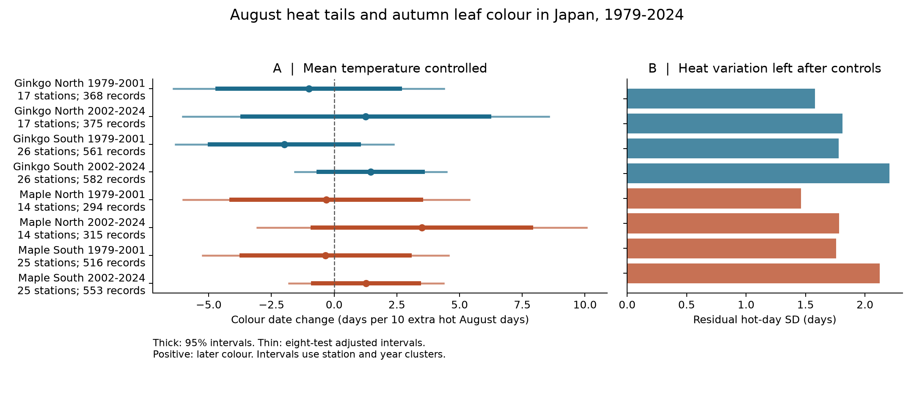

# August hot-day counts gave no clear link to autumn leaf colour beyond mean temperature in eight Japan samples in 1979-2024

We tested whether the number of unusually hot August days had a link to autumn leaf colour beyond mean temperature. We used 3,564 tree-year records at 43 Japan stations. All eight main estimates had intervals that included zero. The test did not find a common earlier or later response. This result does not show that heat has no effect.

## Question and prior work

Mean warmth and short heat events can have different relations with autumn timing. Water stress can also change these relations. A study of European trees found different roles for day and night warming in autumn. It reported an earlier response linked to daytime warming and water stress in warm autumns. [European tree study, 2020](https://doi.org/10.1038/s41558-020-0820-2). An experiment found that long compound heat and drought treatments delayed leaf senescence in some tree species. [Tree Physiology study](https://doi.org/10.1093/treephys/tpaf134). These studies do not give a single expected sign for a daily heat measure in Japan.

Doi and Takahashi studied latitude and autumn timing in Japan. They found that higher autumn temperatures could delay leaf colour and fall. [Doi and Takahashi, 2008](https://doi.org/10.1111/j.1466-8238.2008.00398.x). Our test asks a narrower question. At fixed August mean maximum temperature and autumn mean air temperature, do more hot August days have a link to the colour date? It is a test of the warm tail of daily weather. It is not a test of the total effect of a warmer summer.

We searched the signed campaign with SCI for climate, pollution, biodiversity, phenology, and August heat in autumn. The completed searches found prior work on autumn intervals, including [summer mean warmth](sci:sha256:d59fde6e0c843a2c2e75a136205153ac98ac013995d48c5c9857ef5121ad53ed), [long-term interval trends](sci:sha256:1b0fc41d45694fe93f6d4faef6081afc0916b4f9f8d428d439989acc087c087c), and [ginkgo autumn warmth](sci:sha256:a760f4dbf8854d509208c7a8cf9893d7e3f64848ea08a03cee2804c1eaa6678d). We read these publications. We then chose the daily August heat test. We rebuilt all data from public raw sources. This is new analysis of a shared observation archive. It is not an independent biological dataset or a claim of first discovery in the full literature. The final plan is in files/analysis_plan.md. It was written before the heat estimates. This was not an external registration.

## Data and selection

The JMA cumulative archive supplies ginkgo yellowing (item 013) and regular Japanese maple colouring (item 015). We use 1979-2024. The archive gives calendar dates and a reporting remark. JMA defines the colour date as the first day when most leaves have the autumn colour and almost no green remains. This is a late visible stage. It is not the first coloured leaf or a direct measure of photosynthesis. [JMA observation guide](https://www.data.jma.go.jp/sakura/data/shishin.pdf).

We parsed 9,384 source item-station-years at all 102 listed stations. We used only regular-species remarks 8 and 9 and colour dates in September-December. Remark 8 means the station grounds; 9 means nearby. Remarks 6 and 7 mark substitute species. We excluded those species. JMA warns that some nearby observations before 1988 also have remark 8. A remark does not identify a permanent tree or observer. [JMA file format](https://www.data.jma.go.jp/sakura/data/ruinenchi/format_ruinenchi.pdf).

We matched WMO station code 47xxx to ISD USAF code 47xxx0. A match needed one unique finite coordinate pair. This matched 101 stations. The unmatched station, 47918, had no ginkgo or maple colour record in the study years. Current ISD positions are a proxy for tree positions. We did not reconstruct historical station moves.

Daily maximum temperature comes from NOAA CPC Global Temperature V1.0, on a 0.5 degree grid. We used 46 annual files, 1979-2024, already in the shared store. The nearest grid cell supplies all August dates. The CPC daily window is 06:00 UTC to 06:00 UTC. It is not a local Japanese calendar day. All 31 daily values are required for a station-year. We made no weather imputations. [NOAA daily temperature documentation](https://psl.noaa.gov/data/gridded/data.cpc.globaltemp.html).

For each station, the reference threshold is the 90th percentile of available August daily maximum temperatures in 1981-2010. We use a linear quantile. A hot day is strictly above that fixed threshold. Each selected station has 929 reference values. The missing value is 10 August 1985. All 43 selected stations lack that daily value. Thus no 1985 row enters the main model. The missing value is not counted as a cool day. Thresholds for selected stations range from 28.64 to 35.59 C. These are local relative thresholds, not known thresholds for leaf damage.

Monthly air temperature comes from GHCN-CAMS version 3.01. We changed K to C and selected the nearest 0.5 degree cell. Autumn mean temperature gives equal weight to September and October. [Fan and van den Dool, 2008](https://doi.org/10.1029/2007JD008470), [NOAA monthly temperature](https://psl.noaa.gov/data/gridded/data.ghcncams.html). The final sample uses 40 distinct CPC cells at 43 stations. The station-to-cell centre distance is 3.67-29.30 km. The two NOAA products can share station inputs. They are not independent weather measurements at a tree.

We required at least 15 eligible records for a station and species in each of 1979-2001 and 2002-2024. The same station panel then enters both periods. Ginkgo has 1,886 records at 43 stations. Maple has 1,678 at 39 stations. There are 43 distinct stations in total, from 31.55 to 43.07 N. North means at or above 36 N. South means below 36 N. The source rows, all matches, all exclusions, daily heat, monthly weather and final row flags are saved. Selection counts are in files/selection_counts.csv. The final sample has 2,166 on-site and 1,398 nearby records.

## Model and uncertainty

We fit eight separate models: two tree types, two regions and two periods. The response is colour day of year. The main predictor is the hot-day count divided by ten. Controls are August mean maximum temperature, September-October mean air temperature, station-by-reporting-setting intercepts and year intercepts. Each row has equal weight.

The station terms remove fixed site and reporting-setting differences. Year terms remove the component shared by the region in each year. The heat estimate thus uses local heat departures after other controls. It does not measure the overall long-term warming effect. A larger hot-day count at fixed mean temperature also implies a different distribution of daily temperatures. This comparison cannot identify a simple treatment of adding ten heat days while all other daily conditions stay the same.

We use a two-way station and year cluster covariance. It is the station component plus the year component minus the station-year component. Each component has its G/(G-1) correction. We then multiply by (N-1)/(N-K). K includes the independent absorbed effects and weather terms. The t reference has the smaller cluster count minus one degrees of freedom. The main samples have 14-26 stations and 22-23 years. All main variance estimates are positive.

We report marginal 95% intervals and eight-test Bonferroni intervals. Each adjusted interval has nominal coverage of 99.375%. Joint coverage is approximately 95% if the cluster approximation holds. Few clusters and spatial dependence can reduce accuracy. These are not exact bounds. The test for a common sign required all eight adjusted intervals on the same side of zero. We did not select models by their p values.

## Results

Positive estimates mean later leaf colour. Units are days per ten additional hot August days. The table gives adjusted intervals.

| Tree | Region | Period | Records | Stations | Days per 10 hot days | Adjusted interval |
|---|---|---|---:|---:|---:|---|
| Ginkgo | North | 1979-2001 | 368 | 17 | -1.01 | -6.40 to +4.38 |
| Ginkgo | North | 2002-2024 | 375 | 17 | +1.26 | -6.03 to +8.55 |
| Ginkgo | South | 1979-2001 | 561 | 26 | -1.98 | -6.32 to +2.36 |
| Ginkgo | South | 2002-2024 | 582 | 26 | +1.46 | -1.56 to +4.47 |
| Maple | North | 1979-2001 | 294 | 14 | -0.31 | -6.01 to +5.38 |
| Maple | North | 2002-2024 | 315 | 14 | +3.50 | -3.06 to +10.07 |
| Maple | South | 1979-2001 | 516 | 25 | -0.34 | -5.24 to +4.56 |
| Maple | South | 2002-2024 | 553 | 25 | +1.27 | -1.80 to +4.35 |

All eight marginal 95% intervals also include zero. The estimates are negative in each early sample and positive in each late sample. These signs alone do not establish a time change. We did not plan a formal test of a period difference, and we make no such claim.

The controls leave only 1.46-2.21 hot days of residual standard deviation. Thus the ten-day reporting scale is large relative to the available local contrast. This weak support helps explain the wide intervals. The estimates do not establish small or equal effects. The interval for later northern maple, for example, extends from -3.06 to +10.07 days per ten hot days.

## Checks for method and observation bias

The planned checks used only remark 8, added station trends, added squared August mean temperature, used a 95th-percentile threshold, used the longest hot run, used September-only air temperature, or used consecutive-year first differences. First differences require the same reporting setting in both years. We also omitted each station in turn. No check gave a common sign with clear intervals in all eight samples.

Two sensitivity estimates have marginal 95% intervals on one side of zero. Early northern ginkgo has a first-difference estimate of -2.55 days per ten hot days, with an interval of -5.03 to -0.07. Later southern ginkgo has a 95th-percentile count estimate of +2.70, with an interval of +0.18 to +5.21. These isolated results differ in sign and sample. They do not give a common heat response. All results, including these, are in files/model_results.csv. Sensitivity intervals do not have joint coverage across all checks.

For the fixed station panels, we also tested whether an eligible colour record was present in each year with complete weather. The model used station and year terms and the same weather predictors. All eight marginal intervals include zero. Estimates range from -8.89 to +2.80 percentage points of recording per ten extra hot days. The wide intervals do not establish that missing records are random. Coverage selection used the outcome record itself. This check cannot find bias in excluded short series or distinguish failed visits from specimen problems.

Station-setting controls, a fixed station panel and repeat checks reduce some observation changes. They cannot measure visit frequency, actual reporting delay, tree replacement, pruning or irrigation. JMA guidance also treats highly damaged trees as unsuitable observation targets. Its management and replacement rules can limit the use of these records to study heat injury. The modern guide does not prove that historical practice was constant. [JMA guide](https://www.data.jma.go.jp/sakura/data/shishin.pdf).

We rebuilt every selected date from the raw JMA ZIP. We rebuilt every heat count and temperature mean from saved evidence. Four raw weather spot checks, one for each region-period combination, match the daily extracts exactly. Monthly rounding differences are at most 0.0000062 C. Independent explicit-indicator regressions and grouped-score calculations agree with main coefficients within 0.000000000001 and with covariance elements within 0.00000000005. Details are in files/validation.json. A fresh offline run reproduced all five result CSV tables and the PNG exactly. See files/reproduction_check.json.

## Scope and limits

This is an observational test of relative hot days and one visible tree stage. It does not identify leaf damage, the full senescence period, total habitat use, wild population change or biodiversity loss. We did not measure pollution, soil moisture, rainfall, night heat or leaf temperature. Hot-day counts can stand for changes in clouds or water stress. Selected managed reference trees are not a random forest sample.

The August heat measure ends before all selected colour dates. The autumn temperature control ends after 3.54% of those dates. It is a retrospective control and can follow the response. The September-only check reduces this timing issue. Neither model is an operational forecast.

The regions have disjoint stations and the periods have disjoint observations. Stations recur across periods. The tree types share stations, weather and observation rules. Weather is spatially correlated, so these are internal transfer checks. They are not eight independent data replications. Current coordinates, coarse cells and the small cluster counts add uncertainty. Interpolation can smooth short heat events. The intervals treat the weather values and estimated heat thresholds as fixed. They do not include exposure or threshold uncertainty. A lack of clear estimates in this sample does not rule out a heat response in damaged trees or in other species and regions.

The useful outputs are a daily-heat and colour-date panel with exact source hashes, a transparent test of an extreme-weather measure beyond monthly means, and a measured limit to precision. Better tests need tree identity, visit records, local daily weather and water-stress data.

## Provenance, license and reproduction

Job: sci-1107-hp-climate-pollution-biodiversity-165e715e600e. Topic: climate-pollution-biodiversity. Campaign: 11_07_2026. Machine: hp. Assigned account: codex-myxtap. Model: gpt-6.1-sol, high reasoning effort, through the Codex harness in T3 Code. No agents were launched. The signature uses the configured campaign-machine key. It is not a personal authorship claim. Machine-readable details are in files/job.json.

files/provenance.json records the exact shared path, resolved object path, source URL, source metadata, byte count and SHA-256 hash of all 49 raw input files. We checked the actual hashes. They total 4,093,013,799 bytes. We reused them in place and changed no shared dataset. No new raw download was needed.

The source paths are under /mnt/dell-data/shared_datasets. Dataset names are jma-phenology-ruinenchi-all-20261108, noaa-isd-history-20261108, noaa-psl-ghcncams-air-mon-mean-20261105, and noaa-psl-cpc-global-tmax-daily-YYYY-20261108 for every year from 1979 through 2024. The full global files are not copied into this bundle. The daily spatial extracts, monthly extracts, source event table and model panel are included. They permit inspection and model reproduction without network access.

The SCI baseline license applies to our text, code, figures and derived evidence. Original source terms still apply to raw data. NOAA data and JMA data are credited above and in the provenance file. No private key is in the package.

From the extracted publication directory, use the recorded Python environment or install files/requirements.txt in a private environment. Do not change a shared base environment. Package versions are in files/environment.json. Run:

~~~bash
python files/analyze.py --input files --output reproduced
python files/validate.py --input files --output reproduced
~~~

This rebuilds all model tables and the PNG from the included panel and checks the saved daily and monthly evidence. To rebuild from the immutable shared raw files, run:

~~~bash
python files/build.py --datasets /mnt/dell-data/shared_datasets --output raw_rebuild
python files/analyze.py --input raw_rebuild --output raw_rebuild
python files/validate.py --input raw_rebuild --datasets /mnt/dell-data/shared_datasets --raw-spot-checks --output raw_rebuild
~~~

The build verifies every used raw file hash. It reads about 4.1 GB and uses four hash workers by default. NetCDF reads are sequential. Use --workers 1 if required. No campaign compute queue is needed.

If the shared store is absent, files/retrieve.py can fetch the listed source URLs into a private local directory. Use python files/retrieve.py --output raw_sources, then use raw_sources as the dataset path. This can transfer about 4.1 GB. URLs are mutable; the script stops if the bytes differ from the recorded hash. Exact future retrieval is not guaranteed. The included derived evidence remains sufficient for the model results.

Inspect files/data_dictionary.md for all fields. files/heat_colour.png is the main figure. files/results.html is a standalone interactive view of the same main estimates. The bundle was saved locally and was not submitted to a remote archive or index.
