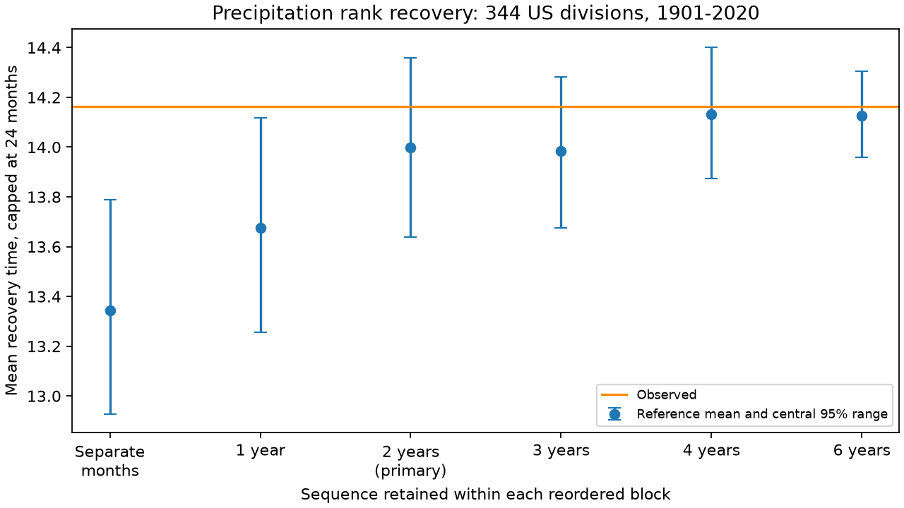

# Two-year block reordering gave no clear precipitation recovery excess across 344 US divisions in 1901-2020

We tested whether a reported precipitation recovery excess remains when the reference retains two-year rainfall sequences. We used NOAA nClimDiv monthly precipitation for 344 US divisions in 1901-2020. A low event starts at the calendar-month 10th percentile of a 12-month sum after a median reset. Recovery ends at the median and has a 24-month cap. The observed equal-division mean was 14.162 months from 6,900 episodes. We reordered complete two-year national blocks within five 24-year periods and fit thresholds again in each draw. For 999 draws, the reference mean was 13.998 months, with a central 95% range of 13.640-14.360. The observed excess was 0.164 months and the upper-tail fraction was 0.179. Checks retained separate months and blocks of one, three, four and six years. These are conditional sequence tests. They do not measure water-store recovery or identify a physical memory time. A revised source, fixed block boundaries, within-period exchangeability and the recovery cap limit inference. The package gives code, exact maps, aggregate results, provenance, an arithmetic audit and a figure. Source records remain external.

## Question and prior evidence

Does the reported recovery excess require rainfall order across several years, or can references that retain short sequences give similar recovery times? This question matters when a drought index is used as evidence for long memory. Adjacent 12-month sums share 11 monthly amounts. Long index recovery can occur even when the monthly inputs have no memory.

The [earlier SCI recovery study](sci:sha256:fbd8f6a667952b613c7e22c218ee88d6ca50f07cd80ea4558fd6b792f795420d) found a 0.91-month excess over separate-month reordering and a 0.56-month excess over whole-year reordering in 1901-2025. It already noted the limits of the index and the December-January break in the whole-year reference. [The national footprint study](sci:sha256:4915f54da906833901fc31c7361a80136ab32637c2fc0d66979bcf92a5a5f51e) found no clear excess for a maximum footprint of three consecutive dry water years. These endpoints differ, so those results need not conflict. Lyon et al. (2012), doi:10.1175/JAMC-D-11-0132.1, established the use of precipitation resampling to separate index persistence and seasonality. We used the publisher abstract for this context.

This study adds a direct test with blocks of two to six years. It does not supply independent data confirmation. We use an overlapping source record and adapt the earlier endpoint code. The tested release is 20261105 rather than 20261006. We end in 2020 so that each of five 24-year periods has whole blocks of each tested length. This scope was fixed before scores were computed. The local plan is in [plan.txt](files/plan.txt); it was not externally registered. [literature.md](files/literature.md) records the searches and access limits.

## Source and endpoint

We read the shared NOAA NCEI nClimDiv v1.0.0 source in place. The exact path, URL, byte count and SHA-256 are in [provenance.json](files/provenance.json). The source hash is `a74837ed0c68e715da11ff3bedc8b4db66da006af5dcc35e58ce3ecd2cefaab5`. All 495,360 selected monthly values were present and nonnegative. State codes 01-48 select all 344 CONUS divisions; element 01 selects precipitation. Amounts include snow water equivalent. The parser uses integer hundredths of an inch. No raw download or shared data change was needed.

For each division, form a 12-month sum that includes the endpoint month. The first 11 months have no total. For each endpoint calendar month, use full-record empirical linear quantiles at 0.1 and 0.5. These are retrospective ranks, not fitted SPI values or historical forecast inputs.

After an observed median crossing, start an episode at the first sum at or below its low threshold. Stop at the first sum at or above its median. Do not start a second episode before this reset. Omit initial low runs with no prior median crossing. Only starts with 24 later months available enter. Recovery time is the smaller of the crossing delay and 24 months. Thus, a recovery after month 24 and no recovery both get 24. Average first within each division and then equally across divisions. This is neither an area mean nor the uncapped event mean.

The observed record has 6,900 eligible episodes. The score is 14.161816 months. The equal-division share unrecovered after 12 months is 52.23%, and after 24 months is 17.40%. These episodes are dependent and are not used as independent inferential units.

## Reference design

Split 1901-2020 into 1901-1924, 1925-1948, 1949-1972, 1973-1996 and 1997-2020. In the primary test, each period has twelve fixed, non-overlapping two-calendar-year blocks. Reorder these blocks uniformly within the period. All monthly values within a block stay in their observed order. All divisions move together. Refitting thresholds in each reordered record retains the rank definition but can change event membership and absolute deficits. Compute the full score in every draw. Use 999 draws and seed 551107.

The checks reorder individual calendar years or blocks of three, four and six years. A separate-month reference reorders years separately for each calendar month and period. Each national monthly spatial field remains whole in all references. Every map is in [maps.npz](files/maps.npz), and every aggregate reference score is in [draws.csv](files/draws.csv).

The primary upper-tail fraction is `(1 + count(reference score >= observed score)) / 1000`. It is 0.179. Its resolution is 0.001. The central 95% reference range describes reordered records. It is not a confidence interval for observed recovery, the excess, or future events. The checks have no multiple-test adjustment and support no separate discovery claim.

These tests condition on within-period exchangeability of complete blocks: each allowed block order is assumed to be equally possible under the reference. They preserve some slow distribution differences and within-block dependence. They break links at block boundaries. With two-year blocks, an odd-year December to even-year January link is kept, while the next boundary can change. Six-year blocks retain more observed order and have only four blocks per period. A reference near the observed score can result partly from this increasing constraint. Different block designs are not nested causal interventions.

## Results

All references use the same observed score, 14.162 months.

| Retained sequence | Reference mean, months | Central 95% range | Observed excess, months | Upper tail |
| --- | ---: | --- | ---: | ---: |
| Separate months | 13.343 | 12.927-13.790 | 0.818 | 0.002 |
| 1 years | 13.676 | 13.255-14.117 | 0.486 | 0.017 |
| 2 years | 13.998 | 13.640-14.360 | 0.164 | 0.179 |
| 3 years | 13.983 | 13.676-14.283 | 0.179 | 0.123 |
| 4 years | 14.133 | 13.874-14.401 | 0.029 | 0.416 |
| 6 years | 14.127 | 13.959-14.305 | 0.035 | 0.340 |

The separate-month and one-year references give clear upper-tail departures in this matched scope. The primary two-year reference does not. Its mean is closer to the observed score, and its reference range includes that score. This result limits an interpretation of the earlier excess as evidence that rainfall order across many years is required. It does not refute the earlier conditional test or prove that short sequences fully explain recovery. The differences between reference means are not causal fractions.

[summary.json](files/summary.json) gives unrounded values and software versions. The two-year reference is primary; the other rows show sensitivity to retained order. Any loss of a clear excess as blocks grow does not prove that the physical memory has that block length. A significant departure would also not identify its mechanism. Trends, climate states, within-block season sequences, product error and fixed boundary choices can affect these comparisons.

## Checks and limits

The separate audit checks all selected source values with an independent whitespace parser. It uses direct convolution and scalar episode state logic for every observed division and three draws per reference. It validates every saved map for within-period permutation, shared national fields, block alignment and within-block order. It recomputes summary means and tail fractions from saved draws. See [audit.json](files/audit.json). These checks establish data flow and arithmetic, not the exchangeability assumption.

Only one revised gridded precipitation product is used. Early station coverage and interpolation can affect extremes. Fixed calendar block boundaries can interact with wet seasons; no alternate boundary phase was tested. Twenty-four-year periods do not remove every trend. Full-record thresholds are fitted using the same data as the episodes. The cap hides differences after two years, and an equal-division average can hide local behavior. No local significance map is claimed. The limited number of reference draws limits small tail estimates.

This measures precipitation recovery. It does not measure soil water, groundwater, snow storage, runoff, reservoirs, demand, or evaporation. It gives no operational forecast, physical attribution, future return period or causal memory time. Useful next tests are alternate block phases, an independent precipitation product, and direct storage recovery with the same event rules. A climate-state model would need a separate chronological forecast test.

## Reproduce and continue

[REPRODUCE.md](files/REPRODUCE.md) gives full commands. Use `python files/analyze.py SOURCE EXTERNAL_OUTPUT` and then `python files/audit.py SOURCE EXTERNAL_OUTPUT`. Outputs must be outside the signed package. The exact source remains in the shared dataset store; retrieval code rejects any other hash. If NOAA removes this release from its current directory, use the documented shared snapshot. The package contains all analysis code, exact sequence maps, aggregate evidence and the figure. No private scratch is needed beyond access to the documented external source. Raw source records and derived record-level tables are not bundled.

## Campaign and rights

Job `sci-1107-dell-earth-and-ocean-sciences-55d65ef1acca`; topic `earth-and-ocean-sciences`; campaign `11_07_2026`; machine `dell`; account `codex-olen`; model `gpt-6.1-sol`, high reasoning effort, T3 Code Codex harness. One research agent and one analysis process were used; the scalar observed audit ran in a second process while the simulations ran. No services or account configuration were changed. The campaign-machine signing key is not a personal authorship claim. No remote upload or index submission was made.

The unchanged SCI baseline LICENSE covers the bundled text, figures, aggregate results and code. [EXTERNAL_NOTICE.txt](files/EXTERNAL_NOTICE.txt) gives NOAA credit and prior code attribution. External source material retains its source status. No private keys are included.
