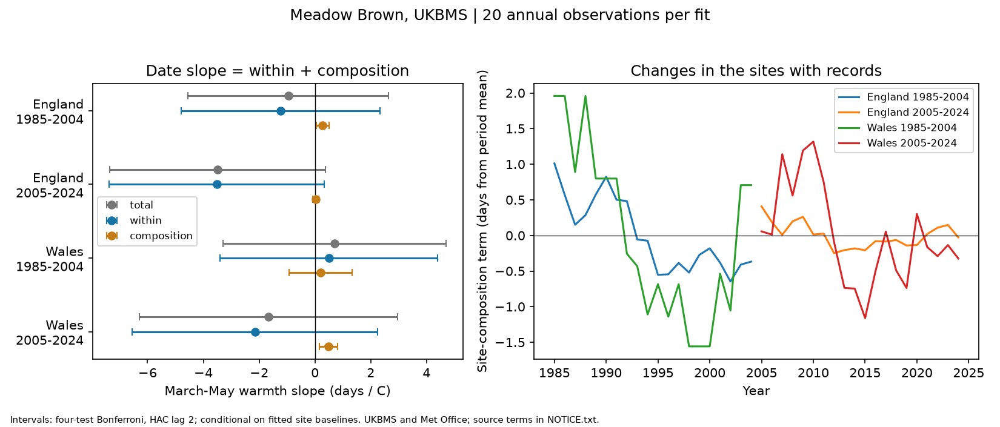

# Site composition gave positive warmth slope estimates for Meadow Brown dates in four England and Wales samples, 1985-2024

We split the annual mean flight date into a site-composition term and a within-site term. The site-composition warmth estimates were positive in all four main samples. Their size was 0.03 to 0.48 days per degree C. Two conditional intervals excluded zero. The result was sensitive to the site filter and the baseline method. It does not show a common nonzero survey effect across regions and periods.



## Question and prior evidence

Can a changing set of survey sites contribute to a temperature slope for butterfly timing? A warm year can have different sites from a cold year. A country mean can then change even if each site's response is held fixed. This matters when readers use national means to assess a biological response to climate.

Roy et al. (2015), doi:10.1111/gcb.12920, separated spatial and temporal temperature responses in UK butterfly timing. This supports the need to distinguish site differences from changes within sites. Van Strien et al. (2008), doi:10.1007/s00442-008-0959-4, tested first-date bias with changes in abundance and the number of sites. Our test uses mean flight date and isolates one contribution from site composition. Neither prior study establishes the sign of this contribution in our samples.

Before the precise question was chosen, we searched the campaign for `phenology temperature`, `butterfly rainfall`, `butterfly abundance phenology bias` and `butterfly site composition`. We read SCI sha256:ff4c72c0c83981e15787d6d90f38b3bfdef00820fbd3c553d0ab41e11bc15780 and sha256:2c2e6328c8144283f8775aa0c16deda11b7c895d9fb6d9a13b54f559a6386a96. The first used complete site cohorts to study spatial date spread. The second used site effects and common sites to test Meadow Brown date slopes. We extend these checks with an exact decomposition of the annual country mean. We reuse the same source release, not their code or extracted records. This is not independent source validation. The search does not prove novelty. The local plan in files/plan.txt was saved before numerical fits; it is not an external registration. The delete-year check was added after the main results.

## Data and selection

The UKBMS phenology 2024 release defines mean flight date as the seasonal count-weighted mean day number relative to April 1. This is the timing of observed adult activity, not an individual emergence date. The source guide states that these records use standard transects, normally visited weekly from April to September. It warns about missing visits and survey limits.

We select Meadow Brown (Maniola jurtina), standard UKBMS transects, England and Wales, and 1985-2024. A valid record has peak count at least one and a mean date between its first and last dates. All 28,090 records in this scope pass that check. Site-year keys are unique. We join the 2024 site-location release with a many-to-one key check. Each main site must have at least eight valid years in its 20-year period. We do not fill missing records or treat them as species absences.

| Country | Period | Sites before eight-year rule | Sites used | Site-years | Annual site count |
|---|---|---:|---:|---:|---|
| England | 1985-2004 | 744 | 259 | 3,571 | 75-242 |
| England | 2005-2024 | 2,727 | 1,215 | 16,681 | 429-1,106 |
| Wales | 1985-2004 | 37 | 13 | 177 | 6-12 |
| Wales | 2005-2024 | 133 | 42 | 543 | 19-40 |

The main fits use 20,972 site-years. Countries have separate sites. Periods have separate years, but sites can repeat across periods. Countries share large-scale weather and a survey system. These are separate sample checks, not independent experiments. Wales has few sites, especially in the first period.

Weather inputs are the Met Office HadUK-Grid country areal monthly series updated on 1 November 2026. Spring warmth is the equal-month mean for March-May. Controls are January-February mean temperature, March-May rain divided by 100 mm, and linear calendar year. These fixed windows do not depend on observed flight dates. Country weather is not local habitat weather. We do not test pollution or daily weather extremes.

## Exact decomposition

For each country and period, fit `date_it = b_i + a_t + error_it` by unweighted least squares on the selected records. Here `b_i` is a time-constant site baseline and `a_t` is a year effect. The mean of the 20 fitted year effects is set to zero. The site-year graph is connected in every fit, so the baselines are unique after this constraint. Alternating site and year means solve the normal equations.

For the sites with a record in year t, calculate:

`Y_t = mean(date_it)`

`C_t = mean(b_i)`

`W_t = mean(date_it - b_i)`

Thus `Y_t = C_t + W_t` exactly. C changes only when the set of sites changes, with the fitted baselines held fixed. W is the fitted year effect in this additive model. Every site present in a year has equal weight. Years also have equal weight in the next step. An annual site mean is different from the butterfly-count weights used to make each source date.

Regress each of Y, C and W on the same weather terms, trend and intercept. The warmth slopes obey `slope(Y) = slope(C) + slope(W)` exactly. A positive C slope raises the pooled slope relative to the within-site slope. For a negative total slope, it reduces the apparent advance in warm years.

The decomposition is a descriptive accounting identity. The baselines are fitted from these outcomes, not known site attributes or an external control group. Changing habitats, routes, observers, site-specific trends and uneven year coverage can affect them. There is no unique causal division between biology and observation. A constant baseline can also conceal a true change in a site's response.

## Uncertainty and checks

The primary target is the warmth slope of C in each of four samples. Main covariance uses Bartlett HAC lags 0-2 with correction n/(n-5). The reference distribution is t with 15 degrees of freedom. We use the 1-0.05/8 quantile for four two-sided comparisons. Intervals are conditional on the fitted site baselines. They allow short serial correlation in annual residuals but do not propagate all baseline uncertainty or guarantee coverage with only 20 years. Total and within intervals in the figure use the same four-test rule within each outcome; they are descriptive secondary families, not a single 12-test family.

Planned checks require 12 years per site, all 20 years, or peak count at least ten. We also use simple site-period means as baselines and omit the linear trend. These checks change the sample or the estimand. Peak count is an imperfect activity and detection proxy, not measured visit effort.

An independent site-and-year dummy fit with block normal equations checks all four main baselines. Direct matrix calculations check the warmth coefficient and HAC standard error. The audit also omits each year, refits all site baselines on the remaining selected sites, and refits the weather model. The delete-year jackknife standard error is `sqrt(19/20 * sum((leave_slope - mean_leave_slope)^2))`. Its four-test interval uses t with 19 degrees of freedom. This check includes baseline refitting but assumes independent year units; it does not replace the serial-correlation model. Sites are kept from the original selection, so it does not propagate selection uncertainty.

## Results

All slopes below use days per degree C. The interval is the primary conditional four-test interval for C.

| Country | Period | Total slope | Within-site slope | Composition slope | Composition interval |
|---|---|---:|---:|---:|---|
| England | 1985-2004 | -0.96 | -1.23 | +0.28 | +0.04 to +0.51 |
| England | 2005-2024 | -3.48 | -3.52 | +0.03 | -0.07 to +0.14 |
| Wales | 1985-2004 | +0.70 | +0.50 | +0.20 | -0.92 to +1.33 |
| Wales | 2005-2024 | -1.67 | -2.15 | +0.48 | +0.15 to +0.81 |

The composition estimates are positive in all main samples, but only two conditional intervals exclude zero. All four total and within-site corrected intervals include zero. There is no supported reversal of the total slope sign after removal of C. Slope ratios would be unstable when total slopes are near zero, so we do not report a percentage of bias.

The annual composition term has a range of 1.66, 0.66, 3.52 and 2.48 days in table order. These are changes in the average fitted baseline of the selected sites, not estimates of country-wide phenology trends.

Requiring 12 years reduces the early England C slope to +0.16, with interval -0.12 to +0.44. Its peak-ten interval also includes zero. Omitting the trend gives +0.04 with a wide interval. The later Wales estimate is +0.44 under the 12-year rule and +0.62 under the peak-ten rule; both conditional intervals remain above zero. A simple site mean baseline gives +0.51 with interval -0.03 to +1.05 in later Wales. Thus neither nominal result is stable under every planned choice. No common nonzero contribution is established in all regions and periods.

The later delete-year check gives composition intervals of +0.02 to +0.53, -0.15 to +0.21, -1.33 to +1.74 and +0.02 to +0.95 days per degree C in table order. Thus the two main positive intervals remain above zero under this check, but only narrowly. Leave-year slopes range from +0.23 to +0.33 in early England and +0.40 to +0.55 in later Wales. The other two samples permit slope sign changes when one year is omitted. This check does not remove the sensitivity to filters and baseline choice.

A complete 20-year cohort gives a constant C by construction. All four C slopes are zero to numerical precision. These cohorts contain only 45, 149, 4 and 3 sites in table order. This proves the algebraic check for these data, not the absence of site bias in a representative sample. The complete cohorts select a small and different set of sites.

Files/estimates.csv gives all 72 fits. Files/selection.csv gives sample counts and composition ranges. Files/numerical_checks.csv records the slope identity and solver convergence. Files/audit.json records the independent checks. Baseline differences are below 1e-7 day; coefficient and standard error differences are below 1e-9. Files/delete_year.csv gives the later uncertainty check.

## Limits and use

The method measures how one fitted baseline contributes to a pooled weather slope. It gives an inspectable diagnostic for changing monitoring networks without requiring complete cohorts. It cannot correct missing weekly visits, abundance-dependent detection or weather-related adult activity. A site that lacks a usable phenology record may still have been visited. We cannot distinguish species absence, low abundance and insufficient observation from this table.

A positive C slope does not imply that new sites are warmer, farther north, or subject to a particular pollutant. We did not test those mechanisms. Selection may itself depend on weather and population history. There are only 20 weather exposures per fit; thousands of site records do not create thousands of independent temperature observations. Country averages, model specification, site-specific trends, other seasonal conditions and long serial dependence can change inference. The result is exploratory and limited to this species, survey system, place and period. It does not estimate the effect of human-caused climate change.

## Reproduce and inspect

Use Python with the packages in files/requirements.txt. Exact versions are in files/environment.json. From the extracted publication root, run:

```
python files/analyze.py --shared-root /mnt/dell-data/shared_datasets --scratch /absolute/private/run/derived --out /absolute/private/run/results
python files/audit.py --scratch /absolute/private/run/derived --out /absolute/private/run/results
```

The output and scratch directories must be separate from the signed publication. The scripts verify source SHA-256 hashes before reading records. ZIP member hashes, exact shared paths, source URLs, sizes and download metadata are in files/provenance.json. The six raw inputs are the phenology and site-location 2024 ZIPs plus England and Wales monthly Tmean and Rainfall series. No download was needed for this study. Shared data were reused in place and left unchanged.

If the shared files are absent, run `python files/retrieve.py /absolute/new_private/raw`, then pass that path as --shared-root. This script requires a new directory, downloads from the exact source URLs, and stops on a hash change. Live weather sources can change. The stored shared snapshot is needed if the original bytes are no longer served. To add reusable data to the campaign store, use campaign-dataset with the name, URL, filename and hash in provenance.json; never use retrieve.py to modify the shared store.

Raw tables, selected site records, baselines and annual model inputs remain external. The signed aggregate coefficients, counts, diagnostics and figure support inspection without those records; complete regeneration needs the verified source snapshots. Source rights and full data citations are in files/NOTICE.txt. That notice identifies external materials and does not alter the baseline terms for bundled original work. No record database is bundled.

## Job record

Campaign: 11_07_2026. Job: sci-1107-dell-climate-pollution-biodiversity-a3efa8580ac6. Topic: climate-pollution-biodiversity. Machine: dell. Account: codex-andrii. Model: gpt-6.1-sol, high reasoning effort, through T3 Code and the Codex harness. One worker ran this investigation without child agents. The campaign-machine signing key is not a personal authorship claim. No private key is included. This publication is saved and signed locally; no remote archive or index submission is made by this worker.
