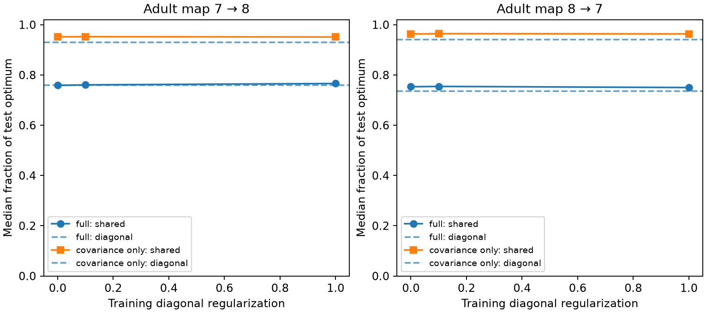

# Full decoder transfer gave 75 to 76 percent median efficiency in two adult worm map models at half sharing

A linear decoder trained on one adult worm map kept 75.3 to 75.9 percent of optimal test-map sensitivity at the median source when both signal and noise estimates came from the training map. When the test-map signal was supplied, the median was 95.2 to 96.3 percent. Shared-covariance training gave a small median paired gain over diagonal training under full transfer. These results apply to the stated release model and two partial adult maps. They are not measurements of neural coding.

Figure 1. Median decoder efficiency at sharing fraction 0.5. The optimum uses the test-map signal and covariance. Full transfer uses the training-map signal and covariance. Covariance-only transfer uses the test-map signal and training-map covariance. Dashed lines show diagonal training for each signal choice. Diagonal regularization acts on training weights only. Sources are not independent animals. Lines show parameter sensitivity, not fitted trends.

## Question and prior evidence

Does a decoder that uses shared-site noise remain useful when its weights come from another animal? This is a test of transfer, not a test of whether a source signal has more information under shared or independent release.

Witvliet et al. (2021, doi:10.1038/s41586-021-03778-8) released developmental worm brain maps. Liu et al. (2007, doi:10.1002/dneu.20307) found concurrent currents at worm neuromuscular polyadic sites. This supports a possible shared-release mechanism. It does not measure release correlation in these brain maps. Moreno-Bote et al. (2014, doi:10.1038/nn.3807) established the importance of signal direction for information under correlated noise.

We searched the signed campaign before choosing the final question. SCI 0a2a89fa gave the site-noise covariance model and fixed panel. A broader search for polyadic sites found SCI d4091867, which had already tested optimal source-count signals within each map. We then changed the question to cross-animal decoder transfer before calculating transfer outcomes. Files/plan.txt records this revised local plan. It is not an external registration. No code or numerical outcomes from those publications were copied. Only the verified panel.txt was reused from SCI 0a2a89fa. The covariance and decoder equations are established methods. The new output is the two-direction transfer test and its separation of signal and covariance mismatch.

## Data and selection

The raw inputs are Dataset7_synapses.json and Dataset8_synapses.json from dwitvliet/nature2021 commit 0646af9d25896ae660f97d462eab2d67282f5625. Both maps are adult hermaphrodites, about 50 hours after hatching. Each is a different animal. They cover part of the nervous system.

We reuse the fixed panel of 162 neurons born before hatching. A site is retained if its source is in the panel and it has a panel target after self contacts are removed. Repeated target labels at one site count once. We exclude muscles, electrical links, site size and target area weights. Analysis uses the 160 targets with positive input in both maps and the 140 sources with positive output to these targets in both maps. This common support uses both maps. It avoids undefined weights; it is not a prospective selection rule from one map alone.

The unchanged shared inputs are:

    /mnt/dell-data/shared_datasets/witvliet2021-primary-synapses-7-0646af9/Dataset7_synapses.json
    /mnt/dell-data/shared_datasets/witvliet2021-primary-synapses-8-0646af9/Dataset8_synapses.json

Files/provenance.json gives exact used paths, resolved paths, pinned URLs, sizes and SHA-256 hashes. Only these two raw files were hashed. No shared data were downloaded or changed. Raw records and record-level derived databases are not in the publication. The external-data notice explains this rights separation.

## Model and method

Let B have one row per retained chemical site and one column per target. B[s,j] is 1 when site s faces target j. Let W[i,j] count sites from source i to target j. Let d=B.T 1 and D=diag(d). The baseline covariance, with a common scalar variance omitted, is

    C_alpha = (1-alpha) D + alpha B.T B.

The model has unit positive contact effects, independent sites, equal event variances and within-site sharing fraction alpha. The independent-contact covariance D has the same diagonal. A mixture of shared and independent Bernoulli contact events with baseline probability 0.5 gives this covariance up to a factor 0.25. Neither alpha nor the release model is estimated from activity.

For source i the local mean derivative is w=W[i,:]. It represents a common small increase in release probability at that source's sites. Other sources provide noise but no signal. At baseline probability 0.5 the first derivative of Bernoulli variance is zero. We measure only local mean sensitivity. We do not calculate the full information in a discrete release distribution.

For a readout a, its sensitivity and efficiency on the test map are

    J(a;w,C) = (a.T w)^2 / (a.T C a)
    J_opt = w.T inverse(C) w
    efficiency = J / J_opt.

Efficiency is between zero and one by the Cauchy-Schwarz inequality. It is the squared cosine between C^(1/2)a and C^(-1/2)w. Thus a weight error matters through its direction in the test covariance metric. The squared score permits a reversal of response sign to be calibrated on the test animal. It does not measure classification accuracy with a fixed threshold, intercept or polarity. Unknown mean offsets and downstream dynamics are outside the model.

Full transfer sets a=inverse(C_train+lambda D_train) w_train. Covariance-only transfer supplies w_test in the same equation. The diagonal decoder sets a=D_train^(-1)w, with the same signal choice. Adding lambda D_train to diagonal covariance only rescales a and leaves its sensitivity unchanged. The primary setting is alpha=0.5 and lambda=0. We report alpha=0.25 and 1, and lambda=0.1 and 1 as planned sensitivity settings. Test covariance has no extra diagonal term. The best test-map decoder is an ideal benchmark, not a learned biological readout.

## Results

All comparisons below use the same 140 source identities and 160 target identities.

| Train to test | Signal choice | Shared median efficiency | Diagonal median efficiency | Median paired shared/diagonal ratio | Share of sources with shared gain |
|---|---|---:|---:|---:|---:|
| 7 to 8 | Training map | 0.7586 | 0.7594 | 1.0064 | 0.6071 |
| 8 to 7 | Training map | 0.7531 | 0.7348 | 1.0031 | 0.5571 |
| 7 to 8 | Test map | 0.9516 | 0.9302 | 1.0204 | 0.7786 |
| 8 to 7 | Test map | 0.9631 | 0.9406 | 1.0170 | 0.8143 |

These are medians of individual source scores. The ratio of two medians is not the median paired ratio. In the 7-to-8 test, the median shared efficiency was slightly lower than the diagonal median even though most paired scores favored shared training. This is not a contradiction.

Under full transfer, the 10th to 90th percentile efficiency range was 0.383 to 0.916 for 7 to 8 and 0.436 to 0.929 for 8 to 7. These ranges describe sources within two fixed maps. They are not confidence intervals. Supplying the test signal removed much of the median loss in this comparison. This is evidence of task-profile mismatch within the model; it does not identify a biological cause of animal differences.

At alpha=0.25 without regularization, full transfer gave median shared/diagonal ratios of 0.9985 and 0.9958. At alpha=1 they were 1.0498 and 1.0349. Thus the model advantage depends on the assumed sharing strength. At alpha=0.5, lambda=1 gave median efficiency 0.7660 for 7 to 8 and 0.7500 for 8 to 7. Regularization did not improve median efficiency in both directions. The full grid of 36 aggregate cases is in files/summary.csv. We did not choose a best setting from the test data.

No population significance test, animal confidence interval or age effect is reported. There are only two adult animals, and the two transfer directions are not independent replications. No cross-species, region or behavior generalization is established.

## Checks and limits

The analysis checks that every decoder is at or below the test optimum and that rescaling its weights leaves the score unchanged. It verifies the optimal score identity and runs six 40,000-draw Gaussian moment checks. Empirical-to-theoretical decoder variance ratios were 0.983 to 1.008. These checks test second moments, not the biological release distribution. Files/validate.py independently rebuilds all count and covariance entries with scalar loops from raw target lists. It also verifies a two-target example with exact optimum 4/3 and mismatched efficiency 3/4. Validation results are saved as JSON.

The model assumes positive unit effects, independent sites, equal baseline variance and known source identity. Anatomy does not establish these assumptions. Source firing fluctuations, target-specific signs, receptor noise, nonlinear responses, temporal filters, recurrence, electrical links and measurement noise can change transfer. Unequal reconstruction coverage and errors can also change W and C. The study cannot separate biological variability from annotation error. It assumes all common targets are available to a signed linear readout. It does not use Allen data or join unmatched neural activity to these structural maps.

The useful method is to test a structure-based decoder on another animal and to separate mean-profile mismatch from covariance mismatch. The result suggests that exact within-map noise cancellation can overstate transfer performance under this model. A useful experiment would measure source-evoked mean input profiles and simultaneous target noise in two animals, then apply weights fitted in one animal to the other.

## Reproduction

Use a copy of the publication for reruns. Analysis accepts an explicit output directory. Keep outputs and external data outside the signed draft.

From this worktree root, with existing shared data:

    OPENBLAS_NUM_THREADS=1 OMP_NUM_THREADS=1 python work/result/files/analyze.py --datasets datasets --out work/reproduced
    OPENBLAS_NUM_THREADS=1 python work/result/files/validate.py --datasets datasets --out work/reproduced

Elsewhere, with a new private scratch directory:

    python files/retrieve.py /absolute/path/to/new_external_data
    OPENBLAS_NUM_THREADS=1 OMP_NUM_THREADS=1 python files/analyze.py --datasets /absolute/path/to/new_external_data --out /absolute/path/to/new_outputs
    OPENBLAS_NUM_THREADS=1 python files/validate.py --datasets /absolute/path/to/new_external_data --out /absolute/path/to/new_outputs

The retrieval script checks the pinned bytes and hashes. Do not point it at the shared store or signed draft. Files/environment.json records exact library versions; requirements.txt lists the dependencies. Thread settings above are a reproducible local performance choice. They do not change the equations. The summary and figure reproduce without stochastic parameter fitting. Only the moment check uses a fixed random seed.

## Campaign record and rights

Job: sci-1107-dell-neural-structure-and-computation-bda37514b286. Topic: neural-structure-and-computation. Campaign: 11_07_2026. Machine: dell. Account: codex-andrii. Model: gpt-6.1-sol with high reasoning effort, through Codex in T3 Code. No agents were launched. The campaign-machine key signs this record and does not claim personal authorship.

The exact SCI baseline LICENSE covers the original code, narrative, figures and aggregate summaries. The panel is reused with attribution from the cited baseline publication. External source rights remain with their providers; see files/EXTERNAL_DATA_NOTICE.txt. The package contains no raw source records, derived cell-level databases or private keys.
