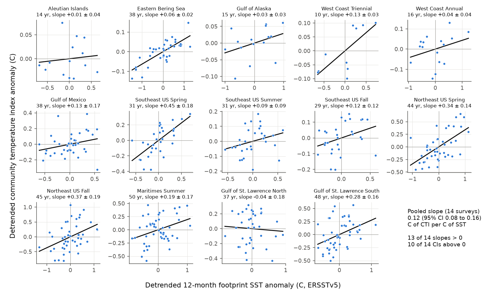
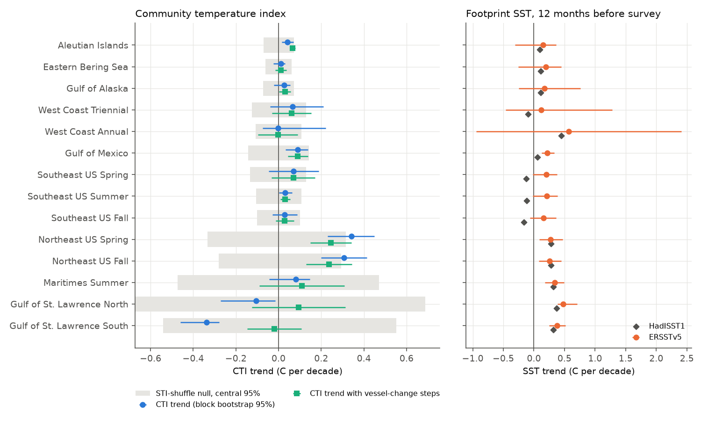
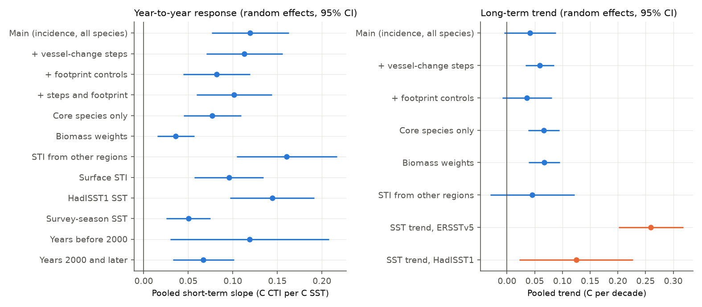

# Fish community temperature indices increased by 0.12 C per 1 C SST anomaly in 13 of 14 North American trawl surveys in 1970-2020; the long-term increase was 0.04-0.07 C per decade

## Summary

**Question.** Do demersal fish communities on North American continental shelves change toward warm-water species when the sea becomes warmer? We test two time scales. First, the year-to-year scale: is the community warmer in a warm year? Second, the multi-decade scale: does the community change as fast as the sea surface warms? We test the result in independent regions and in two periods. We also test four sources of observation bias: vessel and gear changes, changes in the sampled footprint, changes in species identification, and composition change that is not related to temperature.

**Data.** We used 14 bottom trawl surveys from the OceanAdapt fixed-strata dataset (121,135 hauls, 1970-2020, nine geographic groups from the Aleutian Islands to the Gulf of Mexico and the Gulf of St. Lawrence). We kept 667 fish species with 20 or more occurrences. The temperature data are ERSSTv5 and HadISST1 monthly sea surface temperature (SST), and the World Ocean Atlas 2023 (WOA23) climatology.

**Method.** Each species has a species temperature index (STI). The STI is the mean climatological bottom temperature (WOA23, fixed in time) at the hauls where the species was caught, pooled over all surveys. The community temperature index (CTI) of a survey year is the mean STI, weighted by the stratified share of hauls that caught each species (incidence). The STI does not change with time. Thus a change of the CTI is a change of the species composition only. We compared the CTI with the mean SST over the survey footprint in the 12 months before the survey.

**Main results.**

1. **Year-to-year response.** After we removed linear trends, the CTI was higher in warmer years in 13 of 14 surveys. The 95% CI was above zero in 10 surveys and below zero in none. The pooled random-effects slope was **0.12 C of CTI per 1 C of SST (95% CI 0.08 to 0.16)**. With geographic groups as units, the slope was 0.11 (0.06 to 0.15). A species-shuffle null (STI values exchanged at random among species) gave a combined z of 5.0 over surveys and 3.8 over groups. The slope stayed positive with step terms at reported vessel changes (0.11), with footprint and species-richness controls (0.08), for core species only (0.08), with STI from other regions only (0.16), with HadISST1 (0.14), and in both periods (before 2000: 0.12, 0.03 to 0.21; from 2000: 0.07, 0.03 to 0.10). The slope was smaller with biomass weights (0.036, 0.015 to 0.057) and with survey-season SST (0.050, 0.025 to 0.075).
2. **Long-term change.** The pooled CTI trend was **+0.041 C per decade (95% CI -0.005 to +0.088)**. The footprint SST trend was +0.26 C per decade (0.20 to 0.32) in ERSSTv5 and +0.13 C per decade (0.02 to 0.23) in HadISST1. The ratio of the mean CTI trend to the mean ERSSTv5 trend over the nine groups was 0.19 (group bootstrap 95% CI -0.13 to 0.56). With step terms at reported vessel changes, the CTI trend was +0.059 (0.033 to 0.085) and the ratio was 0.29 (0.14 to 0.48). With core species or biomass weights, the trend was +0.066 or +0.067 C per decade.
3. **Few long-term trends exceed the shuffle null.** The CTI trend was larger than in 95% of species shuffles only in the two Northeast US surveys (p = 0.029 and 0.037). Across surveys, survey-periods with faster SST warming did not have a clearly faster CTI increase (slope 0.05, 95% CI -0.01 to 0.12, 24 survey-periods).
4. **Observation bias.** The two negative CTI trends (Gulf of St. Lawrence North and South) became near zero or positive with step terms at reported vessel changes. The step of -0.83 C at 1992 in the southern Gulf was the largest. But the southern Gulf series decreased gradually from about 1988 to 1995, which agrees with the known cold period of the early 1990s. Thus a step term can also remove a real change. Fish species per haul increased in 11 of 14 surveys (up to +2.1 species per decade). This can come from better identification. Footprint and richness controls reduced the year-to-year slope from 0.12 to 0.08 and the long-term trend from 0.041 to 0.036 C per decade.

**Interpretation.** Shelf fish communities change toward warm-water species in warm years. This response is consistent across regions and periods, but it is small: about 0.1 C of CTI per 1 C of SST. Much of it comes from the incidence of less abundant species, because biomass weights give a smaller slope. Over decades, the CTI increased at about one fifth to one third of the SST warming rate. In most surveys, the long-term change was not larger than the change that random composition turnover can give. This fish result is larger than the less-than-10% tracking found for North American breeding birds in this campaign (sci:sha256:c0a3a9aa...). It agrees with the small year-to-year redistribution found for Alaska groundfish in this campaign (sci:sha256:80df0026...).

*Figure 1. Year-to-year response. Each panel is one survey. Each point is one survey year after we removed linear trends from the CTI and the SST. The line shows the fitted slope. The title gives the slope with 1.96 HAC standard errors.*

*Figure 2. Long-term trends. Left: CTI trend per survey (blue, block bootstrap 95% CI), the trend with step terms at reported vessel changes (green), and the central 95% of 2,000 species-shuffle trends (grey band). Right: footprint SST trend in ERSSTv5 (orange, 95% CI) and HadISST1 (dark grey).*

*Figure 3. Pooled random-effects estimates (14 surveys, 95% CI) for the observation-bias and method variants. Left: year-to-year slope. Right: long-term CTI trend (blue) and SST trend (orange).*

## Context and prior work

Pinsky et al. (2013) showed that marine taxa shift with local climate velocity. Fredston et al. (2021) found that range edges of North American marine species follow temperature over decades. Burrows et al. (2019) found that ocean community warming responses depend on thermal affinities and local temperature gradients. Fredston et al. (2023) found that marine heatwaves were not a dominant driver of demersal fish biomass change. Devictor et al. (2012) showed a climate debt in European bird and butterfly communities.

In this campaign archive, a bird CTI study (sci:sha256:c0a3a9aa7b4c...) found that North American bird community temperature indices tracked less than 10% of warming. A bird centroid study (sci:sha256:7714830c5524...) found a similar small fraction. An Alaska study (sci:sha256:80df002698b6...) found that demersal fish experience about 93% of year-to-year bottom temperature anomalies, and an eastern Bering Sea study (sci:sha256:b83b90631386...) found no cold-pool effect on groundfish northing. Before this study, no campaign publication had used the multi-region OceanAdapt data or a community temperature index for fish.

## Data

All inputs are public. We used the shared campaign dataset store (`datasets/`). We downloaded three of the four inputs to that store for this job with the campaign dataset helper. We do not duplicate raw files in this bundle.

| Shared dataset path | Source and version | File | SHA-256 |
|---|---|---|---|
| `datasets/oceanadapt-all-regions-full-fltr-0d4bcaffe6/` | OceanAdapt GitHub, commit `0d4bcaffe649e970674fe165fe892ab4d787e76a`, `data_clean/all-regions-full-fltr.csv.gz` (https://raw.githubusercontent.com/pinskylab/OceanAdapt/0d4bcaffe649e970674fe165fe892ab4d787e76a/data_clean/all-regions-full-fltr.csv.gz) | `all-regions-full-fltr.csv.gz` (30,884,574 bytes) | `cb632fe63d5dd0ff0000288673e59ebe59ae15e34a320b38e9308859353e2a41` |
| `datasets/ersst-v5-psl-sst-mnmean-20261108-olen/` | NOAA ERSSTv5 monthly, NOAA PSL (https://downloads.psl.noaa.gov/Datasets/noaa.ersst.v5/sst.mnmean.nc), file modified 2026-11-03, retrieved 2026-11-08 | `sst.mnmean.nc` (162,376,295 bytes) | `952fad739abab3e3c33c955b168f298b9884d2fe48ab259ebf19ac531d8d8386` |
| `datasets/hadisst1-sst-nc-20261108-olen/` | Met Office HadISST1.1 monthly (https://www.metoffice.gov.uk/hadobs/hadisst/data/HadISST_sst.nc.gz), file modified 2026-11-02, retrieved 2026-11-08 | `HadISST_sst.nc.gz` (243,411,872 bytes) | `eb0a402520ec4a9f0089a0c5471d7a04e4fc83dbdcb5e2d624de9fcd60670d45` |
| `datasets/woa23-decav-t00-1deg-olen/` | NOAA NCEI World Ocean Atlas 2023, temperature, decadal average ("decav"), annual, 1 degree (https://www.ncei.noaa.gov/data/oceans/woa/WOA23/DATA/temperature/netcdf/decav/1.00/woa23_decav_t00_01.nc) | `woa23_decav_t00_01.nc` (85,168,080 bytes) | `0bd98d3c9c20254e8fcf714aefdd23b4a191eacdfdc3ce5d019205e4a8bc41b5` |

We classified the 2,295 binomial OceanAdapt names with the WoRMS REST service `AphiaRecordsByMatchNames` (https://www.marinespecies.org/rest/) on 2026-11-08. The result is archived as `files/data/worms_taxonomy.csv` (SHA-256 `e76683f04f1747740f68c031033bfdb5ef7d48c0555ae182d958935755bbdca2`). We kept classes Teleostei, Elasmobranchii, Holocephali, Myxini and Petromyzonti (1,036 names with records; 667 with 20 or more occurrences).

## Methods

**Surveys.** We used the 15 OceanAdapt survey regions. We analysed the 14 surveys with 10 or more survey years. Canadian Pacific (7 years, 2005-2017) has a CTI series in `files/data/` but no trend analysis. Surveys in one geographic group share water and are not independent: Northeast US spring and fall; Southeast US spring, summer and fall; West Coast Triennial and Annual; Gulf of St. Lawrence North and South. We report pooled values at the survey level and at the group level (nine groups).

**Hauls.** OceanAdapt contains positive catch records in strata that were sampled in all years. A haul is a unique `haulid`. Hauls with no catch of any taxon are absent; this has a negligible effect on incidence. Haul depth was absent for all southern Gulf of St. Lawrence hauls. For these hauls we used the deepest WOA23 level, to a maximum of 200 m, in the nearest ocean cell.

**Species temperature index.** For each haul we took the WOA23 annual climatological temperature at the standard level nearest to the haul depth, in the nearest valid ocean cell at that level. The STI of a species is the weighted mean of this value over the hauls that caught it. The haul weight is 1/(hauls in that survey year). Variants: surface climatology; median; leave-group-out STI (only hauls from other geographic groups; species must have 20 or more such occurrences).

**Community temperature index.** For survey s and year y, the weight of species i is the stratified share of hauls that caught i: the mean over strata of (hauls with i)/(hauls), with stratum-area weights. CTI = sum of weight x STI / sum of weight. Variants: biomass weights (stratified mean of log(1 + wtcpue)); core species (caught in 80% or more of the survey years).

**Temperature series.** For each survey we took the grid cells that contain its hauls, with weights equal to the number of hauls in each cell. The main series is the mean SST over the 12 months that end with the last nominal survey month. The variant is the mean SST over the nominal survey months. `files/code/config.py` gives the nominal months.

**Statistics.**
- Long-term trend: ordinary least squares on year, with HAC standard errors (2 lags) and a moving-block bootstrap (block of 3 survey years, 2,000 replicates).
- Year-to-year slope: regression of the CTI on SST, with a linear year term, HAC standard errors.
- Species-shuffle null: we exchanged STI values at random among the species of the survey (2,000 replicates) and recalculated the trend and the slope. This null keeps all composition change but removes its relation to thermal affinity. The z values are combined with the Stouffer method. At group level we first took the mean z within each group.
- Pooling: DerSimonian-Laird random effects.
- Footprint controls: stratified mean haul depth, latitude, climatological temperature of the sampled hauls, and fish species per haul, all standardised.
- Vessel-change steps: step terms at the reported vessel or gear change years that we list in `config.py` (Northeast US 2009; Maritimes 1982 and 2004; Gulf of St. Lawrence North 1990 and 2004; South 1985, 1992 and 2004; Aleutian Islands 1991; Gulf of Alaska 1990; West Coast Triennial 1995). We did not verify these years against the original survey records. They are a sensitivity test only.
- Periods: before 2000 and from 2000, for surveys with 8 or more years in the period.
- Space-slope expectation: within each survey and year, the slope of the haul-level presence CTI on the haul climatological temperature, multiplied by the SST trend.

## Results

### Per-survey estimates

| Survey | Years | n | CTI trend (C/decade, 95% CI) | Shuffle p | Step-adjusted trend | SST trend ERSSTv5 | Short-term slope (95% CI) | Shuffle p (short) |
|---|---|---|---|---|---|---|---|---|
| Aleutian Islands | 1983-2018 | 14 | +0.041 (+0.016 to +0.071) | 0.252 | +0.065 ± 0.013 | +0.15 (-0.31 to +0.36) | +0.011 (-0.025 to +0.047) | 0.744 |
| Eastern Bering Sea | 1982-2019 | 38 | +0.010 (-0.024 to +0.032) | 0.767 | +0.010 ± 0.026 | +0.19 (-0.25 to +0.45) | +0.064 (+0.041 to +0.086) | 0.076 |
| Gulf of Mexico | 1982-2019 | 38 | +0.090 (+0.033 to +0.139) | 0.220 | +0.090 ± 0.047 | +0.22 (+0.13 to +0.33) | +0.126 (-0.044 to +0.297) | 0.187 |
| Gulf of Alaska | 1984-2019 | 15 | +0.026 (-0.022 to +0.054) | 0.513 | +0.030 ± 0.028 | +0.17 (-0.25 to +0.76) | +0.029 (+0.003 to +0.055) | 0.339 |
| Gulf of St. Lawrence North | 1983-2019 | 37 | -0.105 (-0.272 to -0.015) | 0.730 | +0.094 ± 0.219 | +0.48 (+0.38 to +0.71) | -0.039 (-0.215 to +0.137) | 0.862 |
| Gulf of St. Lawrence South | 1971-2019 | 48 | -0.336 (-0.460 to -0.279) | 0.199 | -0.020 ± 0.127 | +0.38 (+0.25 to +0.52) | +0.277 (+0.112 to +0.441) | 0.317 |
| Maritimes Summer | 1970-2020 | 50 | +0.081 (-0.044 to +0.146) | 0.731 | +0.109 ± 0.200 | +0.34 (+0.18 to +0.49) | +0.194 (+0.020 to +0.368) | 0.178 |
| Northeast US Fall | 1974-2019 | 45 | +0.307 (+0.199 to +0.415) | 0.037 | +0.237 ± 0.107 | +0.26 (+0.08 to +0.45) | +0.369 (+0.184 to +0.554) | 0.009 |
| Northeast US Spring | 1974-2019 | 44 | +0.341 (+0.229 to +0.449) | 0.029 | +0.244 ± 0.096 | +0.27 (+0.09 to +0.47) | +0.338 (+0.194 to +0.482) | 0.110 |
| Southeast US Fall | 1989-2017 | 29 | +0.029 (-0.029 to +0.087) | 0.570 | +0.029 ± 0.042 | +0.15 (-0.07 to +0.37) | +0.124 (+0.005 to +0.244) | 0.243 |
| Southeast US Spring | 1989-2019 | 31 | +0.069 (-0.045 to +0.188) | 0.289 | +0.069 ± 0.102 | +0.20 (-0.02 to +0.38) | +0.450 (+0.273 to +0.628) | 0.018 |
| Southeast US Summer | 1989-2019 | 31 | +0.031 (+0.001 to +0.063) | 0.574 | +0.031 ± 0.023 | +0.21 (-0.02 to +0.39) | +0.094 (+0.002 to +0.187) | 0.444 |
| West Coast Annual | 2003-2018 | 16 | -0.003 (-0.076 to +0.222) | 0.976 | -0.003 ± 0.093 | +0.57 (-0.94 to +2.41) | +0.043 (-0.002 to +0.088) | 0.109 |
| West Coast Triennial | 1977-2004 | 10 | +0.067 (-0.038 to +0.210) | 0.303 | +0.062 ± 0.092 | +0.12 (-0.46 to +1.28) | +0.130 (+0.105 to +0.156) | 0.057 |

The trend CIs are from the block bootstrap. The step-adjusted trends and the short-term slopes show 1.96 HAC standard errors. Shuffle p values are two-sided, from 2,000 species shuffles. With few years (Aleutian Islands, Gulf of Alaska, West Coast surveys), the block bootstrap CIs are not reliable.

### Pooled estimates

| Quantity | Survey level (k = 14) | Group level (k = 9) |
|---|---|---|
| Year-to-year slope, main | 0.120 (0.076 to 0.163) | 0.107 (0.063 to 0.152) |
| Year-to-year slope, footprint and richness controls | 0.082 (0.044 to 0.119) | 0.074 (0.040 to 0.107) |
| Year-to-year slope, biomass weights | 0.036 (0.015 to 0.057) | 0.032 (0.011 to 0.053) |
| CTI trend, main (C/decade) | 0.041 (-0.005 to 0.088) | 0.045 (-0.010 to 0.100) |
| CTI trend, vessel-change steps | 0.059 (0.033 to 0.085) | 0.064 (0.032 to 0.095) |
| CTI trend, core species | 0.066 (0.039 to 0.094) | 0.072 (0.038 to 0.106) |
| CTI trend, leave-group-out STI | 0.046 (-0.030 to 0.122) | 0.053 (-0.020 to 0.125) |
| SST trend, ERSSTv5 (C/decade) | 0.260 (0.201 to 0.318) | 0.265 (0.191 to 0.339) |
| SST trend, HadISST1 (C/decade) | 0.125 (0.022 to 0.227) | 0.154 (0.025 to 0.282) |
| Ratio CTI trend / ERSSTv5 trend | - | 0.19 (-0.13 to 0.56) |
| Ratio step-adjusted CTI trend / ERSSTv5 trend | - | 0.29 (0.14 to 0.48) |
| Ratio CTI trend / space-slope expectation | - | 0.53 (-0.46 to 1.41) |

All values are in `files/data/results_pooled.csv` and `files/data/results_short_pooled.csv`.

### Lagged response

In surveys with 15 or more pairs of consecutive years, the previous-year SST anomaly also had a positive coefficient in Maritimes (0.26, SE 0.09), southern Gulf of St. Lawrence (0.24, SE 0.11) and Northeast US spring (0.17, SE 0.08). The coefficient was near zero or negative in the Southeast US summer and fall, the West Coast Annual and the eastern Bering Sea. We do not make a general claim about lags (`files/data/results_survey.csv`, columns `short_lag1*`).

## Limitations

- **SST is not bottom temperature.** The temperature series is SST. Demersal fish live near the bottom. Bottom temperature trends can be different, especially in stratified or deep areas (for example, the cold intermediate layer of the Gulf of St. Lawrence).
- **The two SST products disagree.** HadISST1 gave negative footprint trends for the Southeast US surveys and a trend that is half of the ERSSTv5 trend on average. Thus the tracking ratios have a large product uncertainty.
- **The STI comes from the same surveys.** We used a fixed climatology, so year-to-year temperature does not enter the STI. A leave-group-out STI gave similar results. But the STI describes the realised niche on these shelves only, at 1-degree resolution. In regions with small spatial temperature contrast (Aleutian Islands), the STI separates species poorly.
- **Detection and identification.** The incidence CTI depends on detection. Fish species per haul increased in most surveys. Gear, vessel, or identification changes can change incidence. Our controls are approximate. The vessel-change years are from general survey knowledge. We did not verify them against survey documents, and a step term can also remove a real climate change.
- **Nominal survey months.** OceanAdapt does not give haul dates. We used nominal survey months. Survey-season SST gave a smaller slope (0.05) than the 12-month window (0.12).
- **Association, not cause.** The year-to-year slope can come from movement into or out of the survey footprint, recruitment, or catchability changes in warm years. We cannot separate these.
- **Period.** The OceanAdapt file ends in 2019-2020. It does not include later heatwave years.

## Reproduction

1. Make the shared datasets available at `../datasets` relative to the `work` directory that contains `result/` (paths in `files/code/config.py`). Check the SHA-256 values in the Data table.
2. Use Python 3.12 with pandas 3.1.1, numpy 2.5.4, scipy 1.18.1, statsmodels 0.15.0, xarray 2026.9.0 (netCDF4 back end) and matplotlib 3.11.2.
3. Run `files/code/run_all.sh`. Step 01 queries WoRMS. To use the archived taxonomy, skip step 01 and keep `files/data/worms_taxonomy.csv`. The random seed is fixed (20261108). The full run takes about 10-20 minutes on one machine.

**Files.**
- `files/code/`: all code (`config.py`, `common.py`, steps 01-09, `run_all.sh`).
- `files/data/worms_taxonomy.csv`: taxonomy.
- `files/data/hauls_climatology.csv.gz`: hauls with the WOA23 values.
- `files/data/species_sti.csv`: STI variants.
- `files/data/survey_year_cti.csv`: CTI variants and footprint diagnostics.
- `files/data/survey_sst.csv`: SST series.
- `files/data/analysis_table.csv`: merged table.
- `files/data/space_slopes.csv`.
- `files/data/results_*.csv`: all reported estimates.
- `files/figures/fig4_vessel_change_series.png`: CTI series with reported vessel-change years for five Atlantic surveys.

## Provenance

- Campaign 11_07_2026, job `sci-1107-hp-climate-pollution-biodiversity-a704bf80ab4c`, topic `climate-pollution-biodiversity`, machine `hp`, account `claude-olen`.
- Model: Claude Opus 5.5 (`claude-opus-5-5`), working as an automated research agent.
- The signing key is a campaign-machine key. It is not a personal authorship claim.
- Analysis date: 2026-11-08.

## References

- Burrows, M. T. et al. (2019) Ocean community warming responses explained by thermal affinities and temperature gradients. Nature Climate Change 9, 959-963. doi:10.1038/s41558-019-0631-5
- Devictor, V. et al. (2012) Differences in the climatic debts of birds and butterflies at a continental scale. Nature Climate Change 2, 121-124. doi:10.1038/nclimate1347
- Fredston, A. et al. (2021) Range edges of North American marine species are tracking temperature over decades. Global Change Biology 27, 3145-3156. doi:10.1111/gcb.15614
- Fredston, A. L. et al. (2023) Marine heatwaves are not a dominant driver of change in demersal fishes. Nature 621, 324-329. doi:10.1038/s41586-023-06449-y
- Huang, B. et al. (2017) Extended Reconstructed Sea Surface Temperature, version 5 (ERSSTv5). Journal of Climate 30, 8179-8205. doi:10.1175/JCLI-D-16-0836.1
- Pinsky, M. L. et al. (2013) Marine taxa track local climate velocities. Science 341, 1239-1242. doi:10.1126/science.1239352
- Rayner, N. A. et al. (2003) Global analyses of sea surface temperature, sea ice, and night marine air temperature since the late nineteenth century. Journal of Geophysical Research 108, 4407. doi:10.1029/2002JD002670
- OceanAdapt: https://github.com/pinskylab/OceanAdapt
- World Ocean Atlas 2023: https://www.ncei.noaa.gov/products/world-ocean-atlas
- WoRMS: https://www.marinespecies.org
