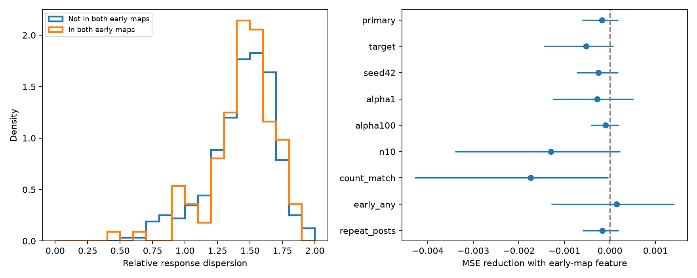

# Early chemical edge presence gave no clear relative response dispersion prediction gain in 429 selected worm pairs

## Question and result

Does early chemical wiring help predict how much repeated adult response values differ, after adult wiring and response scale controls? This selected sample gave no clear added prediction value. Mean squared error (MSE) changed from 0.06154027 to 0.06171443. The reduction was -0.00017416, with a conditional 95% interval from -0.00060674 to 0.00018549. Positive reductions mean better prediction. Small gains remain possible under this test.

This is an analysis of pooled response values. It does not measure reliability within one animal or stable coding during behavior. It does not show equal physiology for early and later connections.

## Prior evidence and contribution

[Witvliet et al.](https://doi.org/10.1038/s41586-021-03778-8) mapped chemical connections across worm development. [Randi et al.](https://doi.org/10.1038/s41586-023-06683-4) measured signal propagation after single-cell stimulation. Their response atlas includes effects from indirect and extrasynaptic paths. We use four anatomy samples and one response export from these studies. We do not infer that a response is a direct synaptic effect.

Campaign searches and published reports were read before analysis. The early-edge report cb7b5d8e tested response detection. The adult-map report 6797c850 tested repeated response sign agreement. The detection report 7764c3fd gave related sample and model context. The full SCI IDs are in sci.json. The contribution here is a separate endpoint: scale-normalized dispersion of signed response amplitudes, with response-scale controls and family holdouts. No prior code or derived table was reused. The search list is in files/search_record.json. These searches are not a systematic novelty review.

## Data and link rules

All raw files were reused in place under /mnt/dell-data/shared_datasets through the workspace datasets/ link. No raw file was changed or downloaded. files/provenance.json gives exact logical and resolved shared paths, source URLs, byte counts and SHA-256 hashes. It covers eight files: four primary chemical-site files, two adult wiring exports, the activity HDF5 file and the dataset timing metadata.

The primary sites and timing metadata use dwitvliet/nature2021 commit 0646af9d25896ae660f97d462eab2d67282f5625. Dataset1 and Dataset2 are L1 at 0 and 5 hours after hatching. Dataset7 and Dataset8 are adult at 50 hours. The activity file and adult electrical exports use francescorandi/wormneuroatlas commit b2e13d88b670efcb3438aeacba2ad4bd6c383933. The response compilation record is b'2023-06-28_19-52-14'.

Each site gives one chemical count to each distinct postsynaptic cell in its post list. This is a cell-site count, not area or physiological strength. Some lists repeat cell labels. A sensitivity test counts every listed target and changes both direct and reverse adult chemical counts. Early presence is unchanged by such repeats. Electrical rows are summed in each listed direction. The larger count is assigned to both directions, then the two adults are averaged. Electrical coverage is incomplete.

HDF5 rows are responding cells and columns are stimulated cells. We use exact names and normalize AWCOF to AWCOFF. We do not equate AWC left/right with AWC ON/OFF. Both endpoints must be in all four primary chemical endpoint sets and in the functional label set. There are 159 common labels. Endpoint presence is a coverage proxy, not proof that every possible edge was examined.

We keep nonself pairs with a chemical site in either adult map and at least five finite WT dFF_all values with positive mean absolute value. There is no q threshold or sign selection. The sample has 429 pairs, 79 source cells, 101 target cells, 49 source families, 58 target families and 3819 observations. There were 0 nonfinite candidate response values. List length differs from occ1 in 270 selected pairs. The loader describes occ1 as list length, so this mismatch is unresolved. We use actual list length and report a count-match check.

The early feature is one if both Dataset1 and Dataset2 have a chemical site for the directed pair. Otherwise it is zero. It is not the authors' developmental stability class or the age of a synapse within an animal. There are 112 early-positive pairs and 317 other pairs. Their mean relative dispersions are 1.45115 and 1.43965. Median adult chemical counts are 6.5 and 1.0. Median list length is 7 in each group. The raw group means are confounded and do not measure an early-wiring effect.

## Outcome and prediction method

For response values x1 through xn, let A be their mean absolute value. The outcome D is the mean of |xi-xj| over unordered observation pairs, divided by A. D lies in [0,2], by the triangle inequality. It is zero for equal nonzero values and is unchanged by a common nonzero amplitude multiplier. Opposite signs increase D. Thus this is signed amplitude dispersion, not amplitude dispersion with sign removed. A near-zero mean absolute response can make noise dominate the measure. It is not a direct measure of neural information or coding reliability. This finite-sample ratio is not an unbiased population dispersion estimate.

The analysis plan is in files/PLAN.md. Before response summaries, a more specific campaign search found the prior early-edge detection study. The plan records the change to dispersion and the use of family splits. No model was chosen from outcome comparisons.

The base ridge regression has penalty alpha=10. It includes separate first, second and third powers of five variables: log(1+adult mean chemical count), log(1+reverse adult chemical count), log(1+adult mean electrical count), log(1+actual response count), and log10(mean absolute response). It also includes adult presence in both maps and separate source and target cell indicators. It has no interaction terms. The added model includes the early binary feature. Numeric columns are standardized on training data only. Indicators are unscaled. Predictions are clipped to [0,2]. Label encoding uses public identities without outcomes. A held-out identity has no fitted identity effect.

Five folds hold out source families, seed 1107. A family removes the final L or R only if the counterpart is in the functional label set. No other classes are merged. All pairs from a held-out family are excluded from training. Targets can appear in training. These are tests on held-out named cells, not held-out animals. The response scale control is measured in test responses as well as training responses. Thus this is a conditional feature-information test, not a prospective prediction of unmeasured responses. Scale control may remove a useful biological path through response strength.

Every pair has equal score weight. For uncertainty, 4000 draws independently resample source-family and target-family multiplicities, then multiply their pair weights. Predictions stay fixed. The seed is 5335. Percentile limits condition on these fits and omit refitting, animal variation, shared experiments, dependence between source and target roles, and anatomy uncertainty. They are not full sampling confidence intervals.

## Results and checks

| Test | Pairs | MSE reduction | Conditional 95% interval |
|---|---:|---:|---|
| primary | 429 | -0.00017416 | -0.00060674 to 0.00018549 |
| target | 429 | -0.00052006 | -0.00145658 to 0.00007865 |
| seed42 | 429 | -0.00025459 | -0.00072834 to 0.00018504 |
| alpha1 | 429 | -0.00028128 | -0.00125479 to 0.00052243 |
| alpha100 | 429 | -0.00009284 | -0.00041600 to 0.00019905 |
| n10 | 127 | -0.00130025 | -0.00339943 to 0.00022254 |
| count_match | 159 | -0.00173937 | -0.00428329 to -0.00003553 |
| early_any | 429 | 0.00014597 | -0.00128473 to 0.00141765 |
| repeat_posts | 429 | -0.00017060 | -0.00060414 to 0.00019115 |
| positive_control | 429 | 0.05204768 | 0.03344494 to 0.07220253 |

No sensitivity check gives a clear positive gain. The count-match sample gives a negative interval, which describes poorer added prediction in that selected subset. It does not show a biological harm from early wiring. The tests use overlapping data and are not independent replications. early_any uses presence in either early map. repeat_posts changes the adult site count convention. The simulated positive control adds a large early effect to independent noise; it checks that the implementation can recover a strong effect, not power for a small biological effect.

The primary training-fold mean reference has MSE 0.06310824. The base model is only slightly better. There is limited predictive information under this model. Much of the response variation may reflect noise or unmeasured animal and state effects. Early-positive edges also have higher adult counts, so polynomial adjustment works over unequal count ranges. We did not make an exact-count matched claim.

files/validate.py independently computes each dispersion with a sorted Gini identity. It checks outcome bounds, scale invariance, source-family separation, early and adult presence, error reductions and saved bootstrap limits. With raw data supplied, it also checks chemical counts, reverse counts, response values and matrix direction for all selected pairs. Results are in files/validation.json.

## Limits and scientific use

The result gives no clear support for a rule that early chemical presence improves predictions of relative adult response dispersion after these controls. It does not exclude other developmental features, smaller effects, nonlinear models or better measurements. Two early and two adult anatomy samples cannot separate developmental change from individual variation or reconstruction limits. Different animals supply anatomy and activity. A zero count need not prove a true absence. The sample selects adult edges, cells with observed responses and sufficient repeats.

Pooled response lists lack animal, session and behavioral state labels. They cannot separate within-animal noise, between-animal differences and changes in state. Count mismatches may reflect selection not captured by the model. Family resampling does not fix this. Responses include indirect paths and measurement noise. We did not use Allen data because the available worm data supply identified repeated stimulation responses and developmental wiring. We do not test generalization across regions, conditions or species.

The useful product is a negative conditional test, a bounded dispersion endpoint, and an inspectable linked observation table. A stronger test needs animal-resolved repeated responses and more anatomy samples with common coverage.

## Reproduction and record

Run `python files/validate.py` from the publication root to inspect the saved evidence. Add the shared dataset root to check raw links: `python files/validate.py /mnt/dell-data/shared_datasets`. Recompute with `python files/analyze.py --data /mnt/dell-data/shared_datasets --out rerun`. This writes only to the requested output folder. files/REPRODUCE.md gives a hash-checked retrieval recipe and environment versions. New random draws use fixed seeds. Small numeric differences across linear algebra implementations are possible.

Job: sci-1107-dell-neural-structure-and-computation-5335477c61b5. Topic: neural-structure-and-computation. Campaign: 11_07_2026. Machine: dell. Account: codex-andrii. Model: gpt-6.1-sol, high reasoning effort, T3 Code. No agents were launched. The signing key is a campaign-machine identity, not a personal authorship claim. The baseline license applies to new text, figures, code and the derived evidence compilation. Upstream materials retain their source terms; the Worm Neuro Atlas repository states GPL-3.0. No upstream software or private keys are included.
