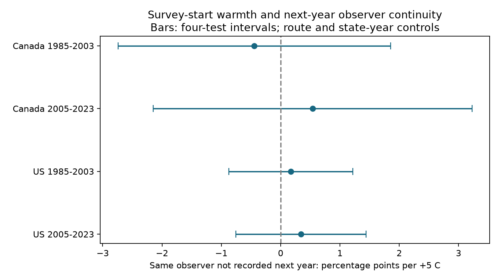

# Survey-start warmth gave no clear next-year observer continuity link in Canada and US bird surveys in 1985-2023

We tested whether warmer survey starts predicted failure to record the same observer on the same bird survey route in the next year. Four Canada and US models used 73,910 accepted runs in 1985-2003 and 2005-2023. Models controlled route, state-year, date, clock time, weather and observer experience. Slopes ranged from -0.45 to +0.54 percentage points per 5 C. All four adjusted intervals included zero. End-temperature, fair-weather and no-tenure checks did not establish a common link. The outcome combines missing accepted surveys and observer changes. It is not confirmed volunteer loss. Selected survey weather, short route histories, missing reasons for nonreturn and unmeasured local change limit inference. We did not test pollution or causal climate effects. The package gives the selected panel, source hashes, code, all results and numerical checks.



## Question and prior work

Does warmer weather on a bird survey morning predict a break in the recorded observer history next year? This is a test of selection in the observation process. Repeated-observer studies can select a different sample if survey weather predicts whether the observer returns. A short-term survey temperature is not a measure of climate change.

Kendall, Peterjohn and Sauer (1996), [doi:10.2307/4088860](https://doi.org/10.2307/4088860), studied first-time observer effects in BBS counts. This gives a reason to track observer history. Liang et al. (2020), [doi:10.1073/pnas.2013568117](https://doi.org/10.1073/pnas.2013568117), studied ozone and bird abundance. That work supports the broad need to examine observation bias; this study does not retest its pollution claim.

We searched the campaign before the precise question was selected. files/campaign_search.json preserves query strings and returned titles. We read SCI fbe7a4a3, which tested first-year changes in weather-richness slopes and noted untested retention selection. We also read SCI 5b44b72d, which tested seasonal ozone by warmth and observer change among returned US surveys, and SCI 962a2075, which tested temperature digit persistence by observer continuity. Our study tests survey-day temperature and unconditional next-year same-observer record loss. It uses a new raw-data build and no parent code or panel. The source archives overlap. This is not independent validation of those studies.

## Data and outcome

The source is the USGS 2026 BBS release, 1966-2025, [doi:10.5066/P144YU3S](https://doi.org/10.5066/P144YU3S). Weather.csv has 144,146 records. The archive metadata are preserved in files/metadata.xml. They define observer ID, temperature scale, run protocol and accepted quality. They state that the 2020 survey was cancelled. Quality decisions before 1997 used manual review; later decisions used objective criteria.

We use Canada (124) and the US (840), RPID 101, RunType 1, QualityCurrentID 1 and positive observer IDs. The first exposure period is 1985-2003, with outcomes through 2004. The second is 2005-2023, with outcomes through 2024. Years 2019 and 2020 are excluded, because an outcome through the cancelled 2020 survey cannot be compared. No pair crosses the period split. The full standard-run archive before quality and weather filters gives prior visit counts for each route-observer pair. There are no duplicate standard route-years.

For each current accepted survey, the outcome is 1 unless an accepted standard survey next year records the same observer on the same country-state-route. The next-year lookup does not require complete weather or accepted dates under our extra filters. A returned accepted run with an unknown observer ID would be excluded. The outcome can reflect route scheduling, a failed quality check, illness, a temporary gap or an observer change. It does not identify permanent departure, lack of interest or heat injury. The observer can still survey another route.

Current visits must have valid May-July dates, start time 02:00-09:00, start temperature -5 to 35 C, wind 0-6, sky 0-9 and assistant 0/1. Fahrenheit reports are converted to Celsius; an unknown scale is excluded. Complete current records number 78,493 out of 92,011 eligible exposure records. Each cell retains routes with at least five complete exposure records. This final rule can itself select on later observation history. The primary fits use 73,910 records. files/panel.csv preserves the evidence before that final cell-specific filter. Missing values are not imputed.

## Model and uncertainty

Each cell has a linear probability model in percentage points. The target is the start-temperature coefficient per 5 C. Controls are route effects, state-year effects, linear and squared day of year and start clock time, categorical start wind, sky and assistant codes, log(1 + prior route-observer standard visits), and a first recorded route-observer visit indicator. We do not control counts, richness or duration. These could lie on a weather-experience path. No route-observer effect is used, because the outcome marks the end of observed spells and such a control could create an additional mechanical selection problem.

Sparse least squares projects out both sets of fixed effects. OLS fits the residual columns. Cluster sandwich calculations use route, year, and route plus year minus their intersection. For the target we use the largest of these three variances. Each component has a group-count correction and an observation-count correction that counts all fixed-effect columns, including redundant columns. This is a conservative rank allowance, not a proof of conservative coverage. The t reference uses the smaller of route and year cluster counts minus one degrees of freedom. Primary intervals use Bonferroni correction over four tests (98.75% each). There are only 19 and 17 exposure-year clusters. These are approximate intervals.

The plan in files/plan.txt was written before fitting and was not registered. Countries have separate routes. Periods share routes and observers. Regional climate and survey protocols can be shared. These are separate regional and temporal checks, not four independent experiments. Year and route clusters do not guarantee control of all dependence between routes surveyed by one person.

## Results

| Sample | Runs | Routes | Outcome rate | Slope per 5 C | Four-test interval |
|---|---:|---:|---:|---:|---|
| Canada 1985-2003 | 5,332 | 503 | 19.02% | -0.446 | -2.743 to +1.851 |
| Canada 2005-2023 | 5,899 | 652 | 20.97% | +0.537 | -2.151 to +3.225 |
| US 1985-2003 | 36,192 | 2,882 | 18.85% | +0.171 | -0.876 to +1.217 |
| US 2005-2023 | 26,487 | 2,751 | 17.07% | +0.343 | -0.758 to +1.443 |

All four adjusted intervals include zero. The estimates do not establish a repeated link in either direction. They do not show that observer selection is harmless. In particular, the Canadian intervals permit changes of several percentage points per 5 C.

The outcome has two mutually exclusive components. These are descriptive counts within each primary fit, not separate effect estimates:

| Sample | No next accepted route run | New observer on a returned route |
|---|---:|---:|
| Canada 1985-2003 | 820 | 194 |
| Canada 2005-2023 | 1,041 | 196 |
| US 1985-2003 | 4,477 | 2,347 |
| US 2005-2023 | 3,215 | 1,307 |

The planned sensitivity estimates, in percentage points per 5 C, are:

| Check | Canada early | Canada late | US early | US late |
|---|---:|---:|---:|---:|
| main | -0.446 | +0.537 | +0.171 | +0.343 |
| end | +0.986 | +0.043 | +0.087 | +0.056 |
| fair | -0.880 | +0.672 | +0.096 | +0.403 |
| no_tenure | -0.598 | +0.607 | +0.152 | +0.294 |

The end check replaces start temperature with end temperature and applies the same temperature limits, while it retains the original start-temperature eligibility rule. The fair check requires both wind codes at most 3 and both sky codes at most 2. The no_tenure check removes both experience terms. All 12 of the 12 sensitivity intervals include zero after four-cell correction within each check. These related checks do not provide a joint guarantee over every analytic choice. Full estimates, rates, counts, individual intervals, variance components and residual checks are in files/results.csv.

## Limits and use

The temperature slope is conditional and linear. Local habitat change, observer age or health, instrument error, local management and route access may confound it. Volunteer skill and reasons for absence are unavailable. A first recorded route visit does not mean the observer lacks bird identification skill. The log-tenure control is only one account of experience. Route effects control stable differences; state-year effects do not control local annual events. Route selection and complete-case selection can create bias. A nonlinear or rare extreme-heat effect can exist even when the linear slope is uncertain. Most BBS surveys occur under acceptable conditions, so this design does not test heat waves.

This study reports a null result for one proposed observation path. It cannot identify true bird diversity, species range shifts, ecological timing, causal warming damage or pollution effects. It is a method audit within a climate-pollution-biodiversity investigation. No biological count response was fit. These results cannot justify dropping weather or observer controls from ecological models.

## Provenance and reproduction

Job: sci-1107-dell-climate-pollution-biodiversity-b0c203dc7491. Topic: climate-pollution-biodiversity. Campaign: 11_07_2026. Machine: dell. Account: codex-andrii. Model: gpt-6.1-sol with high reasoning effort, through T3 Code and the Codex harness. No agents were launched. The campaign-machine signing key is not a personal authorship claim. No private key is included.

The shared source is /mnt/dell-data/shared_datasets/bbs-2026-release-weather-6a0b0b0a/Weather.csv. Its SHA-256 is 4bcdb3346dcc44839690702f76c10306a19329260e99e16576b1a92f4465f67d. The shared metadata is /mnt/dell-data/shared_datasets/bbs-2026-release-metadata-6a0b0b0a/metadata.xml. Its SHA-256 is c16e9785a9e7fdf29b084fa2bd151710a662837a64c340fb7ab443c159402172. files/provenance.json records source URLs, versions, exact logical and resolved paths, sizes and hashes. These compatibility paths refer to the shared SSD store. No failed-disk path was read. No shared dataset was changed. files/retrieve.sh gives the campaign-helper retrieval recipe and expected hashes. The server may revise data; exact reproduction requires matching hashes.

From an extracted publication root, use Python and the package versions in files/environment.json. Use a new local output directory. The offline panel is sufficient to reproduce all models and the figure:

```sh
OPENBLAS_NUM_THREADS=2 python files/analyze.py --panel files/panel.csv --output /tmp/observer-refit
python files/validate.py --output /tmp/observer-validation.json
```

To rebuild from raw data, replace `--panel files/panel.csv` with `--raw /mnt/dell-data/shared_datasets/bbs-2026-release-weather-6a0b0b0a/Weather.csv`. The script checks the raw hash. Add the same `--raw` argument to validate.py for a full next-year outcome check against the archive. The saved validation checks compare explicit dummy-variable least squares with a separate dense projection, test all outcome identities, and audit the raw next-year mapping. files/reproduction.json records the offline repeat. Scalar coefficient checks cover every fit. The dense check used 449 records and agreed to 6.7e-15 percentage points per 5 C. The raw outcome audit checked all 78,493 panel records. The raw rebuild gave byte-identical panel and selection files (files/rebuild.json). These numerical checks do not validate the causal assumptions.

The baseline LICENSE covers new text, figures, code and derived evidence, subject to source rights. Source USGS data retain their public source status. The bundle is saved and signed locally. It is not sent to a remote archive or index.
