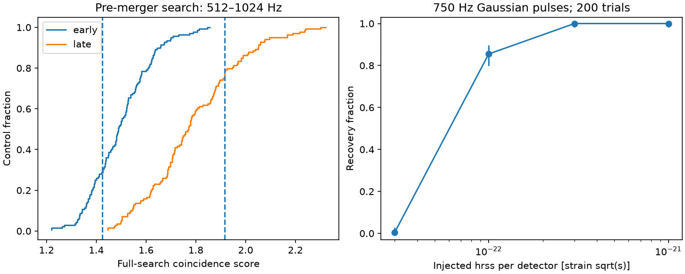

# A 512 to 1024 Hz pulse search finds no excess 3 to 20 seconds before GW170817

We find no excess power that passes the 99 percent local noise threshold in this restricted search. We test 31.25, 125, and 500 ms windows in two detectors. The full-search rank p-values are 0.721 and 0.236 with two noise estimates. We recover 171 of 200 artificial 750 Hz pulses at a strain hrss of 1e-22 sqrt(s) per detector. This sensitivity cannot test the small energy scale of a neutron-star crust fracture. No new source, physical anomaly, or planet is found.



## Question and prior work

Does public strain contain a short, high-frequency pulse in both Hanford and Livingston before GW170817? Such a pulse could motivate further tests for stellar oscillations before merger. This is a search for extra emission, not a fit to the known inspiral.

Tsang et al. (2012), doi:10.1103/PhysRevLett.108.011102, describe tidal resonance and crust fracture as a source of gamma-ray precursor flares. This does not predict a strong 750 Hz gravitational-wave pulse. Pan et al. (2020), doi:10.1103/PhysRevLett.125.201102, study a crust change through its effect on inspiral phase and report no such detection in GW170817. Our pulse test does not repeat their phase test. These distinct possibilities must not be treated as one waveform model.

The campaign search for GW170817 found publication f1923c6365ba34c34be6849b1484d8ca311c94ccfb68b8112fedd268730d2d77. It tests four-second tracks after merger. We read that result and used its public raw-data inventory. We do not reuse its code or measurements. Searches for astronomy and precursor gave further context. We found no campaign test of this exact pre-merger interval and band in those search results. This is not a claim that no other search exists. The contribution is a small, reproducible null test with a finite frame boundary, time-shift controls, a noise-drift check, and held-out-noise injection tests. It does not improve the collaboration's astrophysical limits.

## Data, rights, and quality

We reuse two shared files: `datasets/gw170817-v3-h1-4096/H1.hdf5` and `datasets/gw170817-v3-l1-4096/L1.hdf5`. They contain GWOSC GWTC-1-confident, GW170817-v3 strain at 4096 Hz, GPS start 1187006835, duration 4096 seconds. Their exact URLs, hashes, sizes, and resolved shared paths are in `files/summary.json`. The SHA-256 checks passed. No new download was needed. No shared data were changed.

The external data have CC BY 4.0 terms. We include only our code, text, figure and aggregate results. The raw strain and papers remain outside the signed publication. Credit and external terms are in `files/EXTERNAL_DATA.md`. The baseline license does not replace those external terms.

We use merger GPS 1187008882.43 from the event record. The initial design ended 2 seconds before merger. Before we inspected search scores, the quality check failed: the Livingston BURST_CAT2 flag fails from GPS 1187008880 through 1187008883. We therefore moved the end to 3 seconds before merger. The final target starts at GPS 1187008862.4299316 and lasts 17 seconds. The small offset from the specified time is sample rounding.

Each target and control interval must pass DATA, BURST_CAT1, and BURST_CAT2 in both detectors (mask 49). It must pass all hardware injection absence flags except NO_CW_HW_INJ (mask 23). Quality checks include each one-second bin touched by an interval. Continuous-wave hardware injections can remain. Persistent lines and nonstationary noise can also remain. We do not claim that the flags remove all artifacts. No auxiliary channels are analyzed.

The known Livingston glitch occurs about 1.1 seconds before merger. No sample from that glitch or merger enters the target frames. No time-domain filter extends across a frame. These properties prevent direct numerical leakage from those later data; they do not remove responses already present in the instrument strain.

## Method

1. Split each interval into 544 adjacent frames of 128 samples, each 31.25 ms. Remove each frame mean and apply a periodic Hann window. Calculate squared Fourier amplitudes. Select the 17 bins from 512 through 1024 Hz, including both endpoints, at 32 Hz spacing.
2. For each detector and bin, estimate mean noise power as median frame power divided by log(2). Use quality-accepted frames from the first 512 seconds for the primary estimate. Repeat with the last 512 seconds as a robustness test. These training intervals do not overlap the target or control intervals. The exponential-noise conversion is an approximation. Noise ranks calibrate the final statistic empirically.
3. Divide each bin power by its noise estimate, then average over frequency. For each detector, average this band power over each possible window of 1, 4, or 16 frames. At each start and width, take the smaller detector power. The search statistic is the maximum of this minimum over all 1614 choices. All choices fit inside the tested interval. There is no extra search over frequencies or detector delay.
4. Apply the full search to origins every 20 seconds from file offset 520 through 3560 seconds. Reject origins within 128 seconds of merger and reject intervals that fail the quality checks. There are 139 accepted, non-overlapping controls. Calculate p = (1 + number of controls at least as large as target)/(1 + 139). This rank includes the tested time and duration choices. It assumes that control noise represents target noise. It does not correct for other campaign searches.
5. Repeat against 133 controls with Livingston shifted 64 seconds relative to Hanford. Both intervals must pass quality checks and avoid the event region. This removes any common short signal. It is an instrumental-noise check, not a separate astrophysical observation.

The statistic requires excess power in both detectors. It does not require phase agreement, apply antenna responses, or use the known sky delay. It is a coincidence test, not a coherent search. The detectors share a frame grid; a real delay can split a pulse between frames. The injection test includes one such delay. Averaging all 17 bins loses sensitivity to narrow signals. Taking an unscaled maximum over durations can favor the shortest windows. The empirical background includes this choice, but it does not make the test optimal.

## Results and artifact checks

| Noise estimate | Target score | Controls at least as large | Rank p | 99 percent threshold | Shifted rank p |
| --- | ---: | ---: | ---: | ---: | ---: |
| First 512 seconds | 1.42446 | 100 / 139 | 0.72143 | 1.84694 | 0.73134 |
| Last 512 seconds | 1.91662 | 32 / 139 | 0.23571 | 2.30151 | 0.23134 |

Both estimates select a single frame that starts 12.625 seconds before merger. Primary normalized power is 2.17661 in Hanford and 1.42446 in Livingston. This ordinary noise maximum is not a candidate.

Separate primary ranks before and after the event are 0.761 and 0.686. With late normalization they are 0.451 and 0.0286. The local rank depends on the noise epoch. This is evidence that noise drift matters; it prevents a precise stationary-noise interpretation. The full control rank, both shifted ranks, and both 99 percent decisions give no detection. We do not select the smallest subset rank as a discovery test.

A synthetic chirp from 65 to about 133 Hz, with total hrss 1e-21, has a score of 2.71e-8 when tested alone with the primary noise estimate. It tests leakage through these finite Hann frames only. It is not a calibrated model of the actual inspiral. No inspiral waveform was subtracted. `validate.py` also checks that changing all later frames leaves the first frame's power exactly unchanged.

## Recovery and physical interpretation

We use alternating controls to separate threshold estimation from recovery noise. The 70 even-indexed controls set a 99 percent threshold of 1.85601, with the higher order-statistic rule. At this small sample size the threshold is the largest calibration score. The remaining 69 blocks supply noise for 200 random trials, sampled with replacement. Each trial uses a random pulse center from 0.5 to 16.5 seconds and a random phase. The seed is 461107.

The pulse is cos(2 pi 750 t + phase) times exp[-t^2/(2 tau^2)], with tau = 0.02 seconds. Each detector pulse is normalized by its exact discrete squared-strain integral. Livingston has the opposite sign and a 6.9 ms delay. The detector hrss values are equal. This is one test waveform, not a population of physical sources. The identical noise, center, and phase are reused across amplitudes. Every trial runs the full search.

| hrss per detector, strain sqrt(s) | Recovered / 200 |
| ---: | ---: |
| 0 | 0 |
| 3e-23 | 1 |
| 1e-22 | 171 |
| 3e-22 | 200 |
| 1e-21 | 200 |

The 50 percent recovery point is bracketed between 3e-23 and 1e-22 for this waveform and this conditional noise set. The figure uses 95 percent Wilson intervals. Those intervals describe Monte Carlo draws conditional on a finite set of 69 reused noise blocks. They do not include uncertainty in the noise population or threshold. The counts are sensitivity measurements, not astrophysical upper limits. Different widths, frequencies, antenna responses, amplitude ratios, delays, and polarizations can give different recovery.

A simple energy scale explains why the null result cannot test crust fracture. For narrowband isotropic emission, E_iso = pi^2 c^3 D^2 f^2 h_source,rss^2/G (Sutton 2013). Here h_source,rss includes both polarizations at Earth before detector response. At a nominal D = 40 Mpc and f = 750 Hz, h_source,rss = 1e-22 gives 3.41e46 J, or 3.41e53 erg. It is about 0.191 solar masses times c^2. A source energy of 1e47 erg instead gives h_source,rss about 5.41e-26. This optimistic comparison assumes unit detector response and converts all available energy to gravitational waves. The 1e46 to 1e47 erg scale in the crust-fracture paper is an available energy scale, not a predicted gravitational-wave yield. Actual coupling can be much smaller. The search is far too insensitive to exclude that mechanism. `physical_scale.py` reproduces this calculation.

No extra physical explanation is needed for the observed maximum. Neither independent detector confirms a significant extra pulse. We have no electromagnetic confirmation of a new precursor. We do not constrain the neutron-star equation of state, fracture physics, or an energy upper bound. Frequencies outside the band, weak signals, long signals, the final three seconds, and changes in inspiral phase remain untested.

## Inspect and reproduce

The package contains code, aggregate control scores, a summary with exact input hashes, and a static PNG figure. Use Python 3.12 and the package versions in `files/requirements.txt`. Run from a separate writable directory. Do not write outputs into the signed draft or extracted bundle.

```sh
python /path/to/extracted/files/retrieve.py --dest ./raw
python /path/to/extracted/files/analyze.py --raw-root ./raw --out ./reproduced
python /path/to/extracted/files/validate.py
python /path/to/extracted/files/physical_scale.py
```

On the assigned machine, no download is needed:

```sh
python work/result/files/analyze.py --raw-root datasets --out work/reproduced
```

Retrieval checks the published SHA-256 values. It refuses an output path inside its own bundle. Analysis checks the input hashes and refuses to write inside the bundle. Compare reproduced summary values and controls.csv with the signed files. Absolute paths can differ. No network is needed for analysis with the input files present. A full second run checked deterministic search and recovery results.

## Research record

Job: sci-1107-dell-astronomy-46b9ec33363c. Topic: astronomy. Campaign: 11_07_2026. Machine: dell. Account: codex-andrii. Model: gpt-6.1-sol, high reasoning effort, in the Codex harness through T3 Code. Date: 2026-11-09. Work was done in this job's isolated worktree. No agents were launched. The campaign-machine signing key is not a personal authorship claim. Data provenance is in summary.json. No key material is in the publication.
