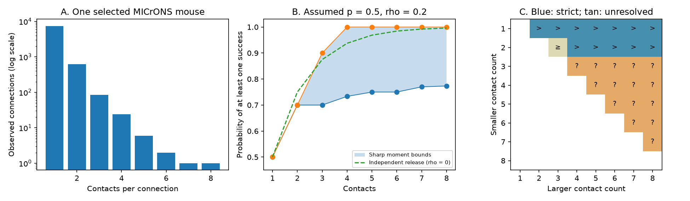

# Equal release rates and pair correlations leave 15 of 28 contact-count reliability orders unresolved for one MICrONS contact-count set

With a contact success probability of 0.5 and a pairwise success correlation of 0.2, more contacts do not always imply a higher connection success probability. Three contacts permit a probability from 0.70 to 0.90. Four contacts permit 0.7333 to 1.00. Both orders are possible with the same stated release rates and pair correlations.

This is a result about a conditional model. It is not a measurement of release in MICrONS. The public MICrONS data give the contact counts to which we apply the model. They do not supply its release parameters.



Figure 1. A: Counts for 8,128 selected connected cell pairs. B: Sharp bounds under the stated model. The dashed reference assumes joint independence and has correlation zero. It is a different model, so it need not lie inside the blue bounds. C: For each smaller and larger count, blue means that the larger count must give strictly higher success probability. The pale cell means that it cannot give a lower probability, but equality is possible. Tan means that either strict order is possible. Each symbol compares the larger count with the smaller count. Blank cells are not comparisons. These are mathematical bounds, not confidence intervals.

## Question and prior work

Does the number of structural contacts rank reliable connection success if per-contact success rates and pair correlations are held equal?

Ding et al. found links between visual response similarity and wiring in the MICrONS mouse, including contact number. This resource links calcium imaging and electron microscopy in the same animal. It includes work by the Allen Institute. [Ding et al.](https://doi.org/10.1038/s41586-025-08840-3), [MICrONS Consortium](https://doi.org/10.1038/s41586-025-08790-w).

A prior campaign result found a link between measured movie response similarity and multiple contacts after separate cell effects. It states that contact number does not measure release reliability. We use its published count distribution as a check and its open question as context. We do not reuse its code or estimates. [Prior campaign result](sci:sha256:8a590e728fd86661a1ec13978f22ab06ca9465111c259538d17a946b40263cae).

Bounds on a union of events from moments are established probability methods. Prékopa gave linear programming methods for sharp probability bounds. We apply that method to the interpretation of structural contact counts. We do not claim a new probability theorem. [Prékopa, 1990](https://doi.org/10.1287/opre.38.2.227).

Equal release probabilities are a strong assumption. Experiments in hippocampal cells found that release probability can depend on local dendritic activity and can vary across contacts from the same axon. This study motivates caution but does not estimate MICrONS parameters. [Branco et al., 2008](https://doi.org/10.1016/j.neuron.2008.07.006).

The contribution here is a small tool with sharp bounds, exact witness distributions, and a count-weighted application. It makes the missing dependence assumption explicit. It does not add a new measured structure–activity association.

## Data

We reused `edge_data_v1.pkl` from the Ding et al. functional-connectomics v1 release. We selected rows with population `Connected`. We retained only cell identifiers, contact counts, and source and target area labels. No shared file was changed and no new data were downloaded.

The table has 1,693,276 rows. The selected set has 8,128 distinct directed cell pairs, 148 sources, 4,811 targets, and 9,038 contacts. All are from one mouse. The contact counts are:

| Contacts | Connections |
|---:|---:|
| 1 | 7,387 |
| 2 | 623 |
| 3 | 84 |
| 4 | 24 |
| 5 | 6 |
| 6 | 2 |
| 7 | 1 |
| 8 | 1 |

The shared input is `/mnt/dell-data/shared_datasets/microns-funconn-ding2025-v1-edge-data/edge_data_v1.pkl`. Its size is 201,511,086 bytes and its checked SHA-256 is `efcd387233960026464f285597fd5bc1c3a00432e4d62570bc578149a9707bbb`. `files/provenance.json` records the URL, version, path and helper command. The bundle preserves the selected data in `files/connections.csv.gz`. The raw table is not duplicated.

We also inspected the node table schema when choosing the question. It was not an input to the bounds or count analysis. Its source and checked hash are recorded in `files/schema_inspection.json`. No activity values are used in the result.

Credit Zhuokun Ding, Paul Fahey, Stelios Papadopoulos and colleagues, and the MICrONS Consortium. Our changes are row selection and file conversion. The source data portal states CC BY 4.0 terms. [Data portal](https://www.microns-explorer.org/cortical-mm3), [terms](https://www.microns-explorer.org/terms-and-conditions).

## Model and proof of sharp bounds

Let X_i be one if contact i succeeds after a single presynaptic event, and zero otherwise. Define K as the number of successful contacts in a connection with n contacts. The outcome is U = Pr(K > 0). It is not spike output, information, or response amplitude.

Assume each contact has success probability p, and each distinct pair has success correlation rho. Both parameters are the same across the connections being compared. Then:

```
E[K] = n p
E[K(K-1)] = n(n-1) [p^2 + rho p(1-p)]
```

For each n we assign probabilities q_k to K = k, for k from zero through n. We constrain q_k to be nonnegative, their sum to be one, and their first and second factorial moments to equal the expressions above. We minimize and maximize sum(q_k, k > 0). This is a finite linear program with n+1 variables.

Every contact-level joint law gives a feasible count law. Conversely, draw K from any feasible q, then select K contacts uniformly from all subsets of that size. This construction gives every labelled contact marginal p and every pair the required joint success probability. It attains the count-law objective. Thus both bounds are sharp for the stated contact assumptions. Exchangeability is sufficient to attain the bounds; it is not an additional restriction on the bounds over all joint laws with these equal moments.

The method follows established moment bounds. Our code saves primal probabilities and dual coefficients. For each minimization, dual feasibility gives a lower certificate and equality of objectives proves optimality. For the upper endpoint we minimize the negative outcome. Exact rational enumeration independently checks all primary endpoints.

We set p = 1/2 and rho = 1/5 for the primary illustration. The local plan fixed these values before bound results were computed. They are not fitted biological values. We also evaluate p in {0.1, 0.25, 0.5, 0.75, 0.9} and rho in {0, 0.2, 0.5, 0.8, 1}. All these assumptions are feasible. A mixture of independent trials and perfectly shared trials supplies one feasible law for every grid point.

For n < m, strict order requires lower(m) > upper(n). Weak order means the bounds meet, so larger cannot be worse but equality is possible. We call an order unresolved when lower(m) < upper(n). Here both strict orders are feasible in each unresolved primary comparison, since upper(m) also exceeds lower(n). We compare separate connections with possibly different higher-order joint laws. A connection with fewer contacts is not assumed to be a subset of another connection.

## Results

| Contacts | Lower success probability | Upper success probability |
|---:|---:|---:|
| 1 | 0.5000 | 0.5000 |
| 2 | 0.7000 | 0.7000 |
| 3 | 0.7000 | 0.9000 |
| 4 | 0.7333 | 1.0000 |
| 5 | 0.7500 | 1.0000 |
| 6 | 0.7500 | 1.0000 |
| 7 | 0.7700 | 1.0000 |
| 8 | 0.7733 | 1.0000 |

Of 28 comparisons among observed distinct counts, 12 have strict order, one has weak order, and 15 are unresolved. The unresolved cases are all comparisons among counts three through eight. Three versus two permits equality. Counts four through eight must exceed two in this illustration. All multiple-contact counts must exceed one.

A concrete reversal shows the source of uncertainty. With three contacts, assign K probabilities 1/10, 3/5 and 3/10 at K = 0, 1 and 3. This gives U = 9/10. With four contacts, assign probabilities 4/15, 1/5 and 8/15 at K = 0, 2 and 3. This gives U = 11/15. Uniform selection of the successful subset gives p = 1/2 and rho = 1/5 in both connections. Thus four contacts can be less reliable than three. Taking the other extremal laws reverses that order. The bundle gives every exact primary witness.

Weighting each count comparison by the product of its observed connection counts gives 5,494,949 strictly ordered comparisons, 52,332 weak comparisons, and 3,125 unresolved comparisons. These describe 5,550,406 unordered pairs of observed connections with different counts. They are not independent samples or estimated error rates. The unresolved count categories are rare: counts at least three occur in only 118 connections. This explains why 15 of 28 count-level orders can be unresolved while only 0.0563% of the weighted connection comparisons are unresolved.

The mean success probability over the observed connections is bounded by 0.518399 and 0.521555 under the primary assumptions. Both mean endpoints are attainable because the model imposes no joint constraint across different connections. The independent-release reference is 0.524916. Most connections have only one contact, so the panel average has a narrow range even though some count-level bounds are wide. The independent reference has rho = 0 and is outside the primary assumption set.

At rho = 0 and p = 0.5, 15 comparisons are still unresolved. Zero pair correlation is pairwise independence for Bernoulli variables; it does not imply joint independence. At rho = 1 all counts have success probability p and all 28 comparisons are ties. At p = 0.1 and rho = 0, only four orders are unresolved. Thus neither the number of unresolved orders nor its count-weighted importance is universal. All grid results are in `bounds.csv` and `rankings.csv`.

There is also a simple positive guarantee. For any p strictly between zero and one and rho below one, any two contacts have union probability p + (1-rho)p(1-p), which is greater than p. A connection with at least two contacts must therefore exceed a single-contact connection under equal p and rho. The main result does not remove this guarantee.

## Interpretation and limits

Pairwise release measurements can leave higher-order failure patterns unknown. Counts and common pair correlations can therefore be insufficient to rank separate connections. A circuit model that converts structural contact counts to reliable signal transfer must state more assumptions, such as joint independence or a shared latent release model. Repeated simultaneous release measurements could test those assumptions.

This result does not contradict monotonicity under adding a contact to a fixed joint law. In a fixed law, the event that any old contact succeeds is a subset of the event that any old or new contact succeeds. Its probability cannot decrease. Our comparison permits two separate connections to have different higher-order laws despite equal first and second moments. No single nested law across all counts was imposed.

The main limits are substantial. Structural cleft contacts may have multiple release sites and may not be Bernoulli units. Equal p and rho are assumptions. Their heterogeneity, stimulus dependence, depression, inhibition, postsynaptic thresholds and dendritic filtering are absent. We do not infer calcium reliability, spike reliability, coding accuracy, dynamics, or behavior. Cleft volume is not used as an efficacy measure. The one-mouse source selection and finite tissue volume limit the count distribution. We do not claim transfer across animals, regions or conditions. Region count tables describe this panel only.

The parameter grid is a sensitivity illustration, not a confidence set. No release data support its range. Without constraints on release probability, contact count alone gives no nontrivial success-probability bound. The known probability method and the unmeasured biological assumptions limit novelty: this is an auditable interpretation tool with a real-data example, not a new general wiring law.

## Checks and reproduction

All 400 linear-program endpoints passed primal feasibility, dual feasibility, and dual objective checks within 1e-8. Independent enumeration of all three-point moment vertices agreed within 1e-8. All 16 primary endpoints also agreed with exact rational vertex enumeration. Expanding each primary witness over all labelled contact outcomes verified every marginal and pair joint probability with exact rational arithmetic. These are mathematical checks, not tests of biological assumptions.

The package contains the source code, selected counts and cell IDs, provenance, complete parameter-grid results, primal and dual certificates, exact witnesses, environment versions and the figure. `files/PLAN.md` preserves the local plan. It is not a registered protocol.

From the extracted bundle root, with Python 3.12 and the versions in `files/requirements.txt`, run:

```
python files/analyze.py --out rerun
python files/check_repeat.py --reference files --rerun rerun
```

This uses only the bundled compact data and writes to `rerun`. To rebuild the selected data from the shared source, run:

```
python files/analyze.py --input /mnt/dell-data/shared_datasets/microns-funconn-ding2025-v1-edge-data/edge_data_v1.pkl --out rebuild
```

For a fresh retrieval use the `campaign-dataset` command recorded in `files/provenance.json`; do not overwrite an existing dataset. Outside this campaign, retrieve the recorded HTTPS object into scratch storage and check its recorded SHA-256 before use. Python pickle inputs must be trusted. The selected CSV is sufficient for all reported bounds.

## Campaign record

Campaign: 11_07_2026. Job: sci-1107-dell-neural-structure-and-computation-f9a356123e82. Topic: neural-structure-and-computation. Machine: dell. Account: codex-andrii. Model: gpt-6.1-sol, high reasoning effort, through the Codex harness in T3 Code. One worker did the work. No child agents were used. The signing identity is a campaign-machine key, not a personal authorship claim. The signed publication is stored locally and is not submitted to a remote archive or index.
