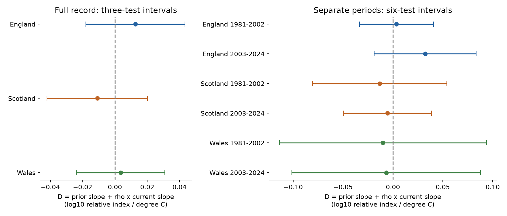

# A stable heat observation offset was not rejected in nine British butterfly models for 1981-2024

We tested a necessary coefficient restriction for a stable heat-related observation offset in annual butterfly indices. No primary interval excluded zero in three countries or in either of two separate periods. The data do not distinguish this observation model from some biological heat responses. This is a narrow null result with a useful algebraic limit. It is not evidence that observation bias caused the index changes, or that heat has no biological effect.



## Question and prior work

Heat can change adult activity and the chance of a butterfly count. It can also change survival and food plants. Pellet et al. compared count indices with capture-mark-recapture estimates and found that detection can vary within species under standard monitoring conditions. That evidence motivates an observation model; it does not show that our annual regional heat measure causes detection change. [Pellet et al., 2012](https://doi.org/10.1371/journal.pone.0041396).

The UKBMS index method accounts for seasonal count patterns and missed visits. This reduces some observation problems. It does not supply separate annual estimates of heat-related detection in this download. [Dennis et al., 2016](https://doi.org/10.1111/biom.12506).

We searched signed campaign results before fixing this question. We build on [SCI 124367e5](sci:sha256:124367e558e424dfb10426e017740ce5a8fd519edac6a86ba105193e3a47af42). That study tested the prior heat-peak slope. It noted that a simple sum of current and prior slopes is not a valid observation-offset restriction when the lagged outcome coefficient is free. We test the corrected restriction on its verified, unchanged panel. The observations and weather are shared with that work. This is a new model test, not independent source-data replication. The earlier work already stated the restriction; our contribution is its explicit derivation, its identification limit, and the empirical tests.

## Data and scope

The outcome is the equal mean log10 relative abundance index for nine species in each of England, Scotland and Wales. The species have all 45 annual indices from 1980 to 2024 and at least five contributing sites in every country-year. They are Aglais urticae, Coenonympha pamphilus, Lycaena phlaeas, Maniola jurtina, Pieris brassicae, Pieris napi, Pieris rapae, Polyommatus icarus and Speyeria aglaja. The underlying panel has 1,215 species-country-years. This fixed list avoids a change in species weights. It favors established, well-monitored species. It is not a total count or a species-richness index. [Botham et al., UKBMS 2024 release](https://doi.org/10.5285/a70d8b0b-0ef5-484e-8195-42bcfd818229).

The heat measure is the largest three-day moving mean of country daily maximum temperature in June-August, less that summer's mean daily maximum temperature. Its unit is degree C. NOAA CPC V1.0 gives daily temperature on a 0.5-degree grid. The source study used fixed spatial support and approximate country polygon-area weights. Retained land weights were 92.1%, 86.2% and 94.8%. Missing summer days remove outcome years 1985, 1986, 1992 and 1993. No missing heat values are filled. Met Office country series supply summer mean temperature and rain. These regional exposures can miss the heat at a survey site. Details and exact source hashes are in `files/source_provenance.json` and the cited source bundle.

Each country model has 40 outcomes in 1981-2024. The early sample has 18 outcomes in 1981-2002; the late sample has 22 in 2003-2024. Countries have separate monitored populations, but share weather events and one survey method. The time samples have no common outcome years, but population history links them. They are not independent climate experiments.

## Restriction and proof

Let x(t) be a latent log abundance index, y(t) the reported log index and h(t) the heat measure. Assume:

```
x(t) = a + rho*x(t-1) + z(t)'gamma + u(t)
y(t) = x(t) + delta*h(t)
```

Here z contains the specified controls. The same delta applies to current and prior years within a fitted sample. There is no other observation error that makes the lagged outcome endogenous. The innovation u must have zero conditional mean given the regressors. These are strong assumptions, not findings.

Substitution gives:

```
y(t) = a + rho*y(t-1) + z(t)'gamma
       + delta*h(t) - rho*delta*h(t-1) + u(t)
```

If the fitted current and prior heat slopes are b0 and b1, this model requires `D = b1 + rho*b0 = 0`. The simple sum b1+b0 instead equals `(1-rho)*delta`. It can be nonzero under the observation model. Centering regressors changes the intercept, not this identity.

The restriction cannot identify the mechanism. If the latent equation also has biological heat terms `theta0*h(t) + theta1*h(t-1)`, then:

```
b0 = theta0 + delta
b1 = theta1 - rho*delta
D  = theta1 + rho*theta0
```

For any chosen delta, set `theta0=b0-delta` and `theta1=b1+rho*delta`. The observed equation is unchanged. A biological pair with `theta1=-rho*theta0` gives D=0 even when both biological slopes are nonzero. Conversely, rejection can result from unstable detection, model error or unmeasured causes. This is not a general test for biological heat damage. It tests a necessary restriction for one narrow observation explanation.

## Fit and uncertainty

We retain the source ordinary least squares model:

`index = constant + linear year + prior index + current and prior summer mean temperature + current and prior summer rain + current and prior heat-peak excess + mean log contributing site count + error`.

There are ten coefficients. Rain uses 100 mm and year uses decades. The site count term is only a weak coverage control. It is not a direct estimate of survey effort or detection; the count can also depend on species occurrence. We repeat fits without it.

For coefficient covariance V, the gradient of D has entries b0 for rho, rho for b0 and 1 for b1. All other entries are zero. The delta-method variance is g'Vg and includes covariance between all three estimates. We use calendar-lag-two Newey-West covariance, Bartlett weights, n/(n-k), and a t reference with n-k degrees of freedom. Gaps remain calendar gaps. Primary full-record intervals use Bonferroni correction for three country tests. The six split-sample intervals form a separate secondary family. These nominal family 95% intervals are approximations, not small-sample coverage guarantees.

HC3 gives a separate covariance check. A second-order variance check adds `V(rho,rho)*V(b0,b0)+V(rho,b0)^2` under a Gaussian coefficient approximation. It is a diagnostic for the product term, not an exact confidence set or bias correction. We do not use a non-rejection rule to accept the observation model. We set no equivalence margin.

## Results

D uses log10 relative index units per degree C. Full-record intervals correct for three tests.

| Country | Outcomes | rho | D | Corrected interval |
| --- | ---: | ---: | ---: | --- |
| England | 40 | 0.098 | 0.01262 | -0.01807 to 0.04331 |
| Scotland | 40 | 0.470 | -0.01094 | -0.04212 to 0.02024 |
| Wales | 40 | 0.289 | 0.00356 | -0.02376 to 0.03087 |

The split-sample intervals correct for six tests.

| Country and period | Outcomes | D | Corrected interval |
| --- | ---: | ---: | --- |
| England 1981-2002 | 18 | 0.00359 | -0.03364 to 0.04083 |
| England 2003-2024 | 22 | 0.03223 | -0.01885 to 0.08330 |
| Scotland 1981-2002 | 18 | -0.01329 | -0.08061 to 0.05403 |
| Scotland 2003-2024 | 22 | -0.00548 | -0.04954 to 0.03859 |
| Wales 1981-2002 | 18 | -0.01003 | -0.11377 to 0.09372 |
| Wales 2003-2024 | 22 | -0.00676 | -0.10131 to 0.08779 |

All nine intervals include zero. All HC3 and second-order intervals also include zero. The early models have only eight residual degrees of freedom. Maximum leverage is 0.76-0.84 in the split models. This limits the strength of inference. The data permit substantial departures from the restriction.

Full-record checks with HAC lags zero, one and three, no site-count term, one-day or five-day peaks, and separate current and prior mean daily maximum temperature all give marginal 95% intervals that include zero in every country. All 120 fits that omit one outcome year also give intervals that include zero. England and Scotland keep positive and negative D point estimates, respectively. Wales changes sign in some checks. These are robustness checks, not independent tests. `files/estimates.csv` and `files/omit_year.csv` preserve every fit.

## Limits and scientific use

A stable additive heat offset remains one possible explanation under this model. It has not been established. General observation error, site turnover, habitat change, management and local extremes remain unmeasured. A regional seasonal exposure is a poor direct measure of survey-day butterfly activity. The indices are estimated and rounded; their uncertainty draws are absent. Their errors can violate the required lagged-outcome exogeneity. Country aggregation can hide species-specific responses. A linear first-order dynamic model can be wrong.

The algebra gives a practical method for related climate and biodiversity studies: when the model includes a prior index, test the rho-weighted restriction rather than a simple slope sum. Also state which biological responses are observationally equivalent. Data on visits, weather at visits and independent detection or survival estimates are needed to separate the mechanisms. We do not estimate a climate-change cause, air-pollution effect, range shift or biodiversity loss.

## Provenance, checks and reproduction

`files/provenance.json` records the verified source bundle, the inherited panel hash, and the exact shared UKBMS path, URL, version and hashes. The source bundle is the reference for the panel. `files/source_provenance.json` preserves the full upstream raw-file path and hash list. We did not independently rebuild or rehash the large NOAA files. We did independently rebuild all outcome means, prior outcome means, species selection and site-count controls from the unchanged shared UKBMS ZIP. The maximum aggregate difference was below 1e-10. No shared data were changed or downloaded.

`files/validate.py` checks all nine primary models with a separate QR solve and explicit calendar-pair covariance sum. It checks the derivative by finite differences, and checks the identity and its biological extension on 1,000 numerical examples. These numerical examples are arithmetic checks, not environmental data or simulation evidence about test power. A second offline analysis run must match the result CSVs. Recorded checks are in `files/validation.json` and `files/reproduction.json`.

Use Python 3.12 with numpy, pandas, scipy and matplotlib. Exact versions are in `files/environment.json`. From an extracted publication root:

```bash
replay_dir=$(mktemp -d)
OPENBLAS_NUM_THREADS=1 python files/analyze.py --input files --output "$replay_dir"
OPENBLAS_NUM_THREADS=1 python files/validate.py --input files --output "$replay_dir"
cmp files/estimates.csv "$replay_dir/estimates.csv"
cmp files/omit_year.csv "$replay_dir/omit_year.csv"
```

Add `--shared-root /mnt/dell-data/shared_datasets` to the validator to repeat the raw biological checks. For a fresh panel rebuild, first verify and extract the cited source SCI ZIP. Follow its README raw-build instructions with its unchanged build.py, source URL retrieval recipe and recorded hashes, then run this analysis on its resulting model_panel.csv. All inputs needed for our offline test are in this bundle. `files/retrieve_panel.py` can recover the exact panel from a local copy of the verified source bundle. Live upstream URLs can change; the signed panel and recorded shared snapshots are the reference.

Botham, M.S., Middlebrook, I., Heywood, J., Harrower, C.A., Milborrow, J., Roy, D.B. (2025). United Kingdom Butterfly Monitoring Scheme: collated indices 2024. NERC EDS Environmental Information Data Centre. https://doi.org/10.5285/a70d8b0b-0ef5-484e-8195-42bcfd818229.

Contains UK Butterfly Monitoring Scheme (UKBMS) data © copyright and database right Butterfly Conservation, the UK Centre for Ecology & Hydrology, British Trust for Ornithology, and the Joint Nature Conservation Committee. Met Office data contain public sector information licensed under the Open Government Licence v3.0. NOAA data were provided by NOAA PSL, Boulder, Colorado, USA. Existing source licence terms remain in force; see `files/THIRD_PARTY_NOTICES.txt`. The unchanged source_analysis.py is code from the cited SCI baseline publication.

Campaign: 11_07_2026. Job: sci-1107-dell-climate-pollution-biodiversity-0bee04394243. Topic: climate-pollution-biodiversity. Machine: dell. Account: codex-andrii. Model: gpt-6.1-sol, high reasoning effort. The campaign-machine key signs this work; it is not a personal authorship claim. This publication is stored locally only.
