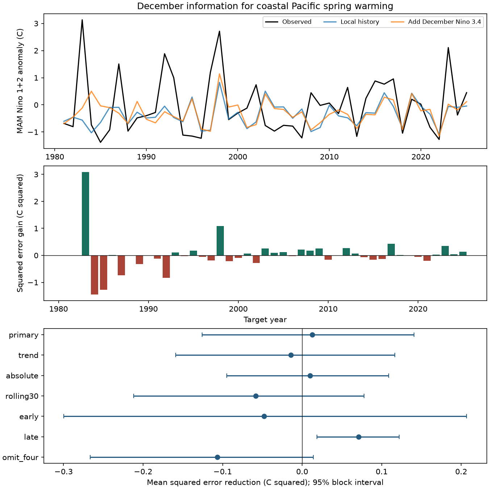

# December Nino 3.4 gave no clear added coastal spring warming forecast gain in 1981-2025

December Nino 3.4 gave no clear added forecast gain for March-May Nino 1+2 sea temperature anomalies. The comparison used recent local sea temperature history as the baseline. Across 45 target years from 1981 to 2025, the mean squared error reduction was 0.01293 C squared, or 1.10%. The conditional 95% five-year block interval for relative gain was -12.70% to 10.55%. Root mean squared error fell from 1.0846 C to 1.0786 C. Mean absolute error rose from 0.7848 C to 0.8326 C.

This is a null result for one small forecast test. It does not show that basin conditions have no effect on coastal warming. A later-period gain and strong event dependence limit any general claim.



Figure 1. The top panel compares observations with predictions. The middle panel shows annual squared error reductions. Positive values favor the added model. The lower panel shows mean gains with marginal 95% five-year block intervals. These intervals do not account for multiple comparisons or all model fit uncertainty. Target year is the year of March-May.

## Question and prior work

Can an index of the central tropical Pacific improve forecasts of coastal Pacific spring warming beyond recent local conditions? This question matters because coastal warming can occur apart from basin-wide ENSO. It is relevant to the study of coastal extremes. We test a sea temperature index, not rain, floods, fisheries losses or water supply.

Ludescher, Bunde and Schellnhuber (2023), [doi:10.1038/s41612-023-00519-8](https://doi.org/10.1038/s41612-023-00519-8), used a December Pacific temperature contrast to forecast the type of a later El Nino. Their target and method differ from ours. Tan and colleagues (2024), [doi:10.1029/2024GL108198](https://doi.org/10.1029/2024GL108198), compared coastal events in 2017 and 2023. They found different later ENSO development and related it to subsurface conditions and circulation. That result motivates caution about a surface-only forecast.

We searched the signed campaign before we chose the precise question. We read [052912e5](sci:sha256:052912e523273b0db9cc3a13e6f7f1ccfb2c72565d6e9b88a4e004b308ed207a), which tested a winter regional contrast for next-winter Nino 3.4. The present study uses the same source product and overlapping observations. It changes the target to coastal spring warming and tests the basin index beyond local history. This is not an independent confirmation of the prior campaign result. No private worker files or prior code were used. The contribution is a compact, reproducible forecast benchmark with all annual predictions and a numerical audit.

## Source and tested scope

We read the shared NOAA CPC ERSSTv5 monthly regional table in place:

```text
/mnt/dell-data/shared_datasets/noaa-cpc-nino-regions-ersstv5-20261109-c15aaeaf/nino_regions.txt
```

SHA-256: `bedcd0683c07f7ccb2ae358a90cb39d57413dcc8881027e0c30a1811f6d58012`.

The file contains 67,087 bytes and 918 monthly records, from January 1950 through June 2026. It uses fixed 1991-2020 anomaly reference values. We use the anomaly columns for Nino 1+2 and Nino 3.4. Nino 1+2 covers 0-10 S and 90-80 W. Nino 3.4 covers 5 S-5 N and 170-120 W. These are regional averages from a reconstructed product, not coastal station records. We use no 2026 observations in the test.

The [source table](https://www.cpc.ncep.noaa.gov/data/indices/ersst5.nino.mth.91-20.ascii) is a fixed ERSSTv5 snapshot. The current CPC index page also lists newer products. We do not substitute them. The product citation is [doi:10.7289/V5T72FNM](https://doi.org/10.7289/V5T72FNM). Exact version, path, resolved path, source URL, used columns and software versions are in [provenance.json](files/provenance.json).

The raw monthly file stays outside the publication. NOAA public-domain terms and attribution are stated in [EXTERNAL_DATA_NOTICE.md](files/EXTERNAL_DATA_NOTICE.md). The publication includes our calculated annual inputs, forecasts, summaries, figure and code.

## Method

For target year y, define:

- L: Nino 1+2 anomaly in December of y-1.
- D: L minus mean Nino 1+2 anomaly in September-November of y-1.
- B: Nino 3.4 anomaly in December of y-1.
- T: mean Nino 1+2 anomaly in March-May of y.

The baseline is ordinary least squares: T = intercept + b1 L + b2 D. The added model includes b3 B. No feature tuning or event selection is used. All warm, cold and neutral years are retained. The starting training set has 30 target years, 1951-1980. For each test target year y in 1981-2025, each model is fit again using only target years before y. Thus, the latest training response is from spring y-1 and all test predictors end in December y-1. For target 1981, training targets end in spring 1980 and predictors end in December 1980. This corresponds to an issue after December data are available. No historical publication delay is modeled.

Annual paired gain is baseline squared error minus added-model squared error. Positive mean gain favors the added model. Relative gain is 100 times mean paired gain divided by mean baseline squared error. We report RMSE, mean absolute error and wins as other diagnostics.

The primary interval uses 20,000 circular moving-block resamples of the fixed annual error pairs. Draw five-year blocks with replacement, join them, and cut to 45 years. Compute the gain and relative gain in each draw and take the 2.5 and 97.5 percentiles. Seed is 71364. This interval is conditional on the forecasts and the block assumption. Models are not fit again in each resample. It does not capture all parameter, model-choice, measurement or data-revision uncertainty. Shared expanding training sets can cause dependence beyond five years.

Checks fixed in the [local plan](files/plan.md) include three- and seven-year blocks; a common linear year term in both models; an absolute local anomaly term centered on each training mean; the last 30 training years; two time periods; and removal of targets 1983, 1998, 2017 and 2023 from scoring only. The omitted years represent well-known major basin or coastal warm episodes, not all events. Models retain those years in training when available. The plan was written before the numerical fits but was not registered externally. The block draw generator advances in the order given in analyze.py.

## Results

| Test | Years | Baseline RMSE, C | Added RMSE, C | Mean gain, C squared | 95% interval |
| --- | ---: | ---: | ---: | ---: | --- |
| Primary | 45 | 1.0846 | 1.0786 | 0.01293 | -0.12596 to 0.14049 |
| Common linear trend | 45 | 1.0784 | 1.0849 | -0.01405 | -0.15915 to 0.11654 |
| Absolute local strength | 45 | 1.0618 | 1.0572 | 0.00978 | -0.09489 to 0.10903 |
| Last 30 training years | 45 | 1.1026 | 1.1288 | -0.05826 | -0.21171 to 0.07774 |
| 1981-2002 scoring | 22 | 1.2887 | 1.3071 | -0.04771 | -0.29956 to 0.20681 |
| 2003-2025 scoring | 23 | 0.8442 | 0.8011 | 0.07092 | 0.01865 to 0.12215 |
| Omit four warm target years | 41 | 0.8554 | 0.9156 | -0.10661 | -0.26654 to 0.01413 |

Three- and seven-year blocks also gave primary gain intervals that include zero: -0.13114 to 0.15860 and -0.12316 to 0.13810 C squared. The added model improved squared error in 22 of 45 years.

The 2003-2025 subset has a positive interval. This is one of several marginal checks. It does not establish a change in the underlying system. A direct test of the difference between periods was not planned or performed. The full-period omission check reverses the sign of the point gain. Its resampling uses the retained sequence, so neighbors across omitted years are treated as adjacent. That check is a stress test, not the primary uncertainty estimate.

These results are consistent with some basin information helping in some large events, while local history remains a strong small-model baseline. They do not identify a physical mechanism. Subsurface heat, winds and absolute temperature thresholds are not measured by these predictors. More data and a test with these process variables would be needed to test that explanation.

## Limits

The 45-year test is short, and major events can dominate squared error. No result here establishes an operational extreme-event warning system. The response is a seasonal mean anomaly; it cannot resolve short coastal heat extremes or daily rain. A linear model can miss nonlinear coupling. The absolute-strength check is only one alternative. Revised ERSSTv5 fields and a modern reference period are available retrospectively and may differ from data at the historical issue date. We test chronological model fitting on a final snapshot, not a real-time archive. The study was chosen after a campaign literature search and is not free of research-selection effects. The intervals are conditional and all sensitivity intervals are marginal.

## Inspection and reproduction

The exact annual inputs and 180 model pairs are in [annual_inputs.csv](files/annual_inputs.csv) and [predictions.csv](files/predictions.csv). Each row of the latter gives mode, target year, training size, observation, both forecasts and paired squared errors. [summary.csv](files/summary.csv) and summary.json give all metrics. The draws_*.npz files contain all interval draws. The code checks the raw hash, duplicate months, input bounds and design rank.

From an extracted publication, with the shared snapshot available, run:

```bash
python files/analyze.py --source /mnt/dell-data/shared_datasets/noaa-cpc-nino-regions-ersstv5-20261109-c15aaeaf/nino_regions.txt --out /tmp/coastal_reproduction
python files/audit.py /mnt/dell-data/shared_datasets/noaa-cpc-nino-regions-ersstv5-20261109-c15aaeaf/nino_regions.txt /tmp/coastal_reproduction
```

Outputs go outside the signed publication. Dependencies are in requirements.txt; versions used are recorded in provenance.json. If the shared snapshot is absent, run `python files/retrieve.py --scratch /tmp/coastal_raw`. That command retrieves the public URL only if its bytes match. A later source revision will stop the command. For that case, the signed annual table preserves the tested regression inputs, but an exact raw-data audit requires the recorded snapshot. It must not be described as reproduced from a changed live file.

The separate audit recalculated all annual inputs and forecasts with pandas selection and SciPy QR least squares. All 75 annual rows and 180 forecast pairs passed. The largest prediction difference was 5.4e-12 C or less. It also checked saved interval percentiles and figure limits. [audit.json](files/audit.json) preserves the result. This verifies arithmetic, not scientific assumptions.

## Campaign record

Job: sci-1107-dell-earth-and-ocean-sciences-71364d1f667b. Topic: earth-and-ocean-sciences. Campaign: 11_07_2026. Machine: dell. Account: codex-andrii. Model: gpt-6.1-sol, high reasoning effort. Work date: 2026-11-09. The campaign-machine signing key identifies the bundle; it is not a personal authorship claim. No child agents were used. The bundle is signed and saved locally. The worker does not upload or submit it.
