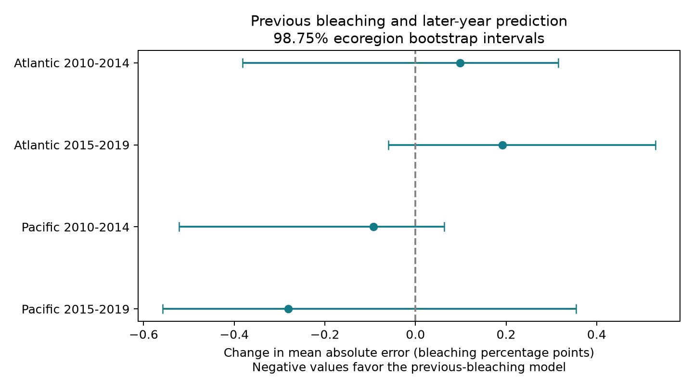

# Previous bleaching gave no clear gain in later-year coral estimates in four Atlantic and Pacific samples, 2010-2019

We tested whether the previous year's bleaching value improved estimates of current coral bleaching. We used Reef Check surveys at the same site and in the same calendar month, one year apart. Models trained on earlier years only. Adding previous bleaching gave lower mean absolute error in two Pacific samples and higher error in two Atlantic samples. All four adjusted regional intervals included zero. These records do not show a clear prediction gain that repeats across regions and periods.

A later check found that an estimate of zero bleaching had lower mean absolute error than either fitted model in all four samples. This does not make zero a safe estimate for a heat event. It shows the limits of an average error score in a sample with many zeros. We do not recommend these fitted models for operational use.



## Question and prior work

Hughes et al. found that the effects of the 2017 Great Barrier Reef heat event depended on the 2016 event (doi:10.1038/s41558-018-0351-2). Sully et al. studied heat and bleaching across global surveys (doi:10.1038/s41467-019-09238-2). These studies motivate a test of whether a past bleaching record adds information beyond measured heat and site identity. Our test concerns prediction in selected archive records. It does not identify ecological memory, adaptation, or a causal effect of prior bleaching.

Two campaign reports tested later archive records (SCI 9544c6e9) and later coral cover (SCI 534925f3). Neither tested this later-year bleaching prediction comparison. They show why selective follow-up matters. We read and verified these reports. Our data overlap with their source archive; this is not a new field replication. We searched the campaign before choosing the precise question. Full-folder SCI searches were slow and were stopped without results. A public metadata screen and a completed SCI search over two selected published reports informed this question. Search limits and output are in files/search_notes.txt and files/prior_search.json. We do not claim an exhaustive novelty search.

## Source and record controls

We used BCO-DMO 773466 version 2, dated 2022-10-14 (doi:10.26008/1912/bco-dmo.773466.2). Van Woesik and Kratochwill describe the compilation (doi:10.1038/s41597-022-01121-y). The raw CSV has 41,361 rows. Reef Check contributes 14,475 distinct Sample_ID values. Substrate rows can repeat survey-level bleaching. We checked agreement of every used field within Sample_ID and kept one record per sample. No conflicts were found.

We retained Atlantic and Pacific samples in 2003-2019 with depth from 0 to 40 m, bleaching from 0 to 100%, and complete site, calendar, region, and heat fields. There were 9,623 samples and 7,820 site-year-month means. Each mean gives equal weight to its sample records. Exact matching to the previous calendar year at the same site, month, ocean and ecoregion produced 1,287 pairs. Tests in 2010-2019 retained 581 pairs whose sites had appeared in an earlier training pair. The saved panel, pairs and predictions permit inspection of this selection. Averaging depths does not hold coral taxa or colony identity fixed.

The heat fields are supplied CoRTAD version 6 surface estimates (doi:10.25921/ffw7-cs39). TSA_DHW sums heat stress over the previous 12 weeks relative to maximum weekly climatology, with the source anomaly threshold. It is not annual maximum exposure, bottom temperature, or a direct record of a specific heatwave. SSTA_DHW uses another seasonal reference and is a sensitivity measure. We exclude 2020 because the heat product ends in 2019. Earlier campaign audits also found few recorded bleaching percentages before 2003.

The exact unchanged shared source path is `/mnt/dell-data/shared_datasets/bcodmo-773466-global-bleaching-environmental-20261108/global_bleaching_environmental.csv`. Its SHA-256 is `78cc014b1e7887f26f4c44a40d4d9213212f3c6217541c6a1b69e723b61bfacb` and size is 16,772,400 bytes. files/provenance.json records the source URL, version and credit. Raw data are CC BY 4.0. We reused the file in place and did not change shared data.

## Prediction method

The design in files/design.txt was fixed after prior reading and before score computation. This is an exploratory study, not an external registration. For each ocean and test year from 2010 to 2019, we train on paired records with target years strictly before the test year. Training requires at least three distinct target years and 30 records. We retain only test sites seen in training. The models estimate bleaching percentage, not species richness or mortality.

Both models use current and previous heat dose divided by four and their squares; current and previous depth divided by ten; sine and cosine of calendar month; a linear calendar-year term; and site indicators. The added model also uses previous bleaching divided by ten. Numeric features are standardized using training means and standard deviations only. Ridge regression has fixed penalty 10, an unpenalized intercept, and unscaled site indicators. Predictions are clipped to 0-100 in both models. No parameter was tuned to test scores. Survey-date heat must be known, so this is retrospective estimation rather than a forecast made before the survey.

We compare paired absolute errors. Negative change favors the added model. Four disjoint test sets cross ocean with periods 2010-2014 and 2015-2019. The periods can share sites, and training sets overlap; these are not fully independent experiments. The main intervals resample ecoregions with replacement 2,000 times, retaining all scores within a sampled region. We use percentile bounds at 0.625% and 99.375% as a Bonferroni adjustment for four comparisons. This adjustment gives nominal joint 95% coverage only if each bootstrap interval is valid. Four Atlantic clusters and 10-12 Pacific clusters give weak calibration. The bootstrap holds fitted predictions fixed; it does not refit models or include all training uncertainty. Regions can share heat events.

We also report intervals from year-group score sums with Student t limits and the same four-test adjustment. Each period has only five year groups. These are separate sensitivity checks, not a full spatial and temporal error model. All include zero.

## Results

Errors and interval limits are bleaching percentage points.

| Test sample | Records | Sites | Regions | Base MAE | Added MAE | Change | Adjusted interval |
|---|---:|---:|---:|---:|---:|---:|---|
| Atlantic 2010-2014 | 46 | 21 | 4 | 3.931 | 4.029 | +0.098 | -0.381 to +0.315 |
| Atlantic 2015-2019 | 33 | 23 | 4 | 4.253 | 4.445 | +0.192 | -0.059 to +0.530 |
| Pacific 2010-2014 | 148 | 80 | 12 | 3.413 | 3.320 | -0.093 | -0.522 to +0.063 |
| Pacific 2015-2019 | 354 | 156 | 10 | 3.163 | 2.882 | -0.281 | -0.558 to +0.355 |

The added model had lower root mean squared error only in the late Pacific sample: 5.399 versus 5.432 points. It had higher RMSE in the other three samples. A lower MAE does not imply better estimates for the largest bleaching values. Only 131 test records had nonzero previous bleaching.

Planned sensitivity checks used penalties 1 and 100, SSTA heat in place of TSA heat, and a model without site indicators. All 16 regional sensitivity intervals included zero. Pacific MAE changes stayed negative; Atlantic changes stayed positive except the early SSTA estimate of -0.006. Full scores are in files/scores.csv. No tested setting established a benefit across all four samples.

After we saw the primary results, we added simple context benchmarks. Always estimating zero had MAE of 1.927, 3.765, 2.448 and 1.379 points in the table order. Using the previous value without a fitted model had MAE of 3.668, 5.549, 3.014 and 2.203. The zero estimate had lower observed MAE than either fitted model in every cell. These are descriptive scores without a separate uncertainty test. Current bleaching was nonzero in only 155 of 581 predictions. The archive and loss function therefore give substantial weight to low-bleaching conditions. A useful heat-event warning tool needs a different, explicit decision target and validation during severe events.

## Limits and useful output

Same-month matching reduces seasonal shifts. One program and sample deduplication reduce method and weighting differences. Earlier-year training prevents test-year outcomes from entering model fits. Site indicators address some persistent location differences. These steps do not make return visits or recorded percentages random. Only sites with consecutive usable records and earlier training pairs enter testing. Missing records, observer effort, coral taxa, mortality, changes in depth composition and heat measurement error remain unresolved. No observation probability is available for inverse-probability correction. A null recording association in prior work is not proof of unbiased follow-up.

The result is limited to this archive, these dates, known sites, these covariates and this fixed ridge design. It does not rule out a different model, a nonlinear history effect, or biological memory under repeated severe heat. It does not measure air pollution, species distributions, taxon loss or community recovery. Bleaching is a biological stress measure relevant to reef risk, not a direct biodiversity count. The useful outputs are a checked chronological prediction benchmark and the evidence that this simple history feature has no clear repeated gain under the tested design.

## Inspect and reproduce

Use Python 3.12 and the package versions in files/requirements.txt and files/environment.json. Run commands in an extracted copy, because the scripts replace derived outputs beside the code:

```sh
python files/analyze.py
python files/validate.py
python files/benchmarks.py
```

The first command uses the included derived pairs. To rebuild from raw data, use:

```sh
python files/analyze.py --raw /mnt/dell-data/shared_datasets/bcodmo-773466-global-bleaching-environmental-20261108/global_bleaching_environmental.csv
python files/validate.py
python files/benchmarks.py
```

If the raw file is absent, `python files/retrieve.py local_raw.csv` retrieves the fixed source into a new local file and checks its hash. It refuses a changed snapshot or an existing destination. No shared download is needed here. The source is not duplicated in this bundle.

Validation checks all 1,287 previous-year links against the panel, checks unique test records and bounded predictions, and recomputes all main score differences. A dense ridge normal-equation calculation for the Atlantic 2010 fold agrees with the sparse fitted predictions within 1.51e-9 points. It shares the feature function but uses a separate matrix solution. files/validation.json stores the checks and year-group intervals. These checks verify implementation; they cannot validate the sampling assumptions.

## Campaign record

Job: sci-1107-syam2-climate-pollution-biodiversity-e176cea12777. Topic: climate-pollution-biodiversity. Campaign: 11_07_2026. Machine: syam2. Account: codex-myxtap. Model: gpt-6.1-sol with high reasoning effort. Date: 2026-11-08. The campaign-machine signing key is not a personal authorship claim. No private key is included. The signed bundle is saved locally and is not uploaded to an archive or index.
