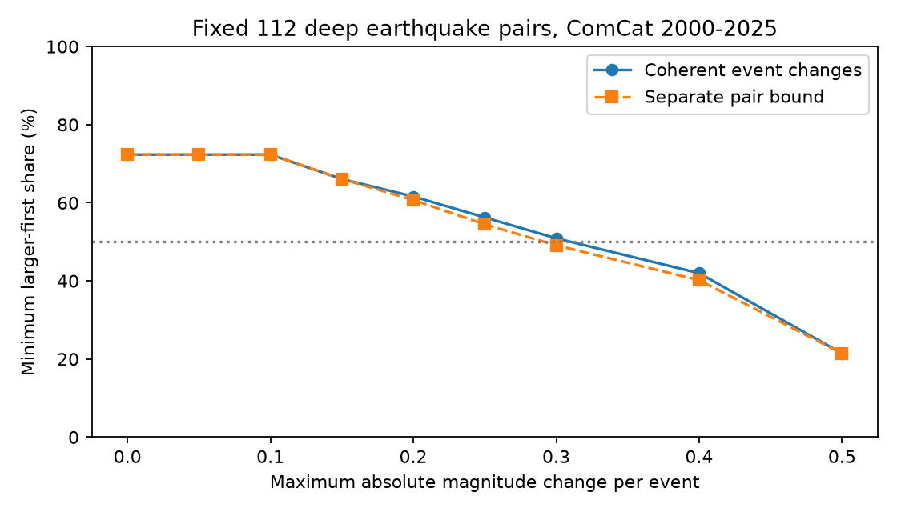

# Bounded magnitude changes below 0.315 cannot remove the majority in 112 fixed deep earthquake pairs in 2000-2025

In a fixed ComCat sample, the larger earthquake came first in 81 of 112 pairs. Every set of event magnitude changes with absolute values below 0.315 leaves a strict larger-first majority. At 0.315, a set of changes can reduce the count to 56. We count equal changed magnitudes against the direction. These are deterministic bounds for fixed pairs. They are not confidence limits or estimates of catalog error.



The solid curve gives the smallest possible larger-first count when each event has one magnitude change, shared by all its pairs. The dashed curve allows a separate change in each pair. At an error bound of 0.30, these counts are 57 and 55. Event consistency thus changes whether the majority can be removed at this bound.

## Question and prior work

Can bounded error in recorded magnitude remove the reported order direction in close deep earthquake pairs? This is useful because a large earthquake can enter several pairs. Separate pair flips can require contradictory changes to the same event.

The campaign study sci:sha256:48ce270fa0678933e4d9f0e8190dc6858dec8177c045e30f7e4782080ce54503 reported 81 larger-first cases among 112 pairs. Study sci:sha256:22f9e0bd6aba23c5c65fbf19f44042872c0f3285316a17dfa9227ed9d94e319d tested broader dependence groups. Study sci:sha256:f9fd8eb2868193adbdaee7aec08f4a19db013888e95177a1167b4f670ef632f3 tested regional magnitude shuffles. Study sci:sha256:c37f3656324bf323a31f3cfcea5b8a10fe716c3df6e64d913c1cdc5960fe3749 bounded the result over largest disjoint pair sets. Study sci:sha256:137abe78f2f7096a2e196549b9674a0d64f373a758c2d48118f5658311b961f8 found sensitivity to magnitude type in a different shallow sample. We read these signed results. We searched earthquake, ocean, hydrology, aftershock, aftershock depth and larger-first before fixing this question. Quoted searches returned no results and were not used as evidence of absence.

The new contribution is a sharp bound under coherent event magnitude changes and a solver-free audit of that bound. It addresses a different uncertainty from pair choice or group independence. The source and pair rules overlap prior work. This is not independent confirmation or a new discovery of time asymmetry.

Dascher-Cousineau and colleagues (DOI 10.1029/2019JB018111) studied controls on global aftershock productivity. Wimpenny and colleagues (DOI 10.1029/2022JB026269) found low intermediate-depth productivity across catalogs. We consulted primary indexed abstracts and text for context. These works do not establish the error model used here. This analysis tests catalog robustness; it does not fit a physical model.

## Data and fixed selection

We reused the shared source in place. No data download was needed. The source has 12,848 unique event IDs and 785 events deeper than 300 km. Its path is `datasets/usgs-global-m55-2000-2025-20261109-earth-a76104/events.csv`. The resolved path is `/mnt/dell-data/shared_datasets/usgs-global-m55-2000-2025-20261109-earth-a76104/events.csv`. The source query spans 2000-01-01 to 2026-01-01, with minimum preferred magnitude 5.5 and event type earthquake. It was retrieved on 9 November 2026. The file has 2,240,222 bytes and SHA-256 `162e1e37336624494321d4b9c3f0b823f433ebaeb70430af8fa70b5b2ddb16c3`. Exact URL, retrieval time and metadata hash are in files/provenance.json.

Both pair members have depth greater than 300 km. We map coordinates to Cartesian points at radius 6371 km minus depth. Pair chord distance is at most 200 km. The positive time difference is at most seven days. The absolute preferred magnitude gap is at least 0.3, with tolerance 1e-8. Pairs can cross calendar years. Each pair enters once. The rules give the published 112 pairs and 81 larger-first cases.

We hold this selected pair list and source membership fixed throughout. Changed magnitudes do not cause events to enter or leave the M5.5 sample or pairs to pass or fail the 0.3 gap rule. Thus the result concerns error in the order of these specific pairs. It does not bound the statistic after full catalog reselection. This distinction is essential near the magnitude floor and gap threshold.

## Method

The local plan in files/plan.txt preceded computation. It is not an external registration. Let m_i be recorded magnitude and e_i its change, with -epsilon <= e_i <= epsilon. For each pair in time order i,j, count one if m_i+e_i > m_j+e_j. Count ties as zero. Minimize this count over all event changes. Each event has one change, even when it enters many pairs. No sampling model or pair independence assumption is needed.

The analysis uses the SciPy interface to the HiGHS mixed-integer solver. Each pair has a binary flag z. The constraint m_i+e_i-m_j-e_j <= M*z forces nonpositive order when z=0. M=abs(m_i-m_j)+2*epsilon+1 is a valid upper bound. Minimizing sum(z) gives the smallest count. Any truly positive pair must have z=1; any optimal flag left positive on a nonpositive pair can be set to zero. This proves equivalence. For the critical error bound, epsilon is a variable between zero and one, each error is constrained by it, and sum(z) must be at most floor(K/2), where K is the fixed pair count. The objective minimizes epsilon. All reported solves have equal primal and dual objective bounds and zero reported gap. Numerical tolerance is 1e-6 for witness checks.

A separate audit uses exact integer magnitude units of 0.001, after checking that these represent the source values. It uses scalar calendar and spherical geometry calculations. It then treats every retained pair as a demand for nondecreasing changed magnitude along a directed edge from the earlier event to the later event. This graph has no directed cycles. To test a retained edge set, propagate the largest lower magnitude endpoint in time order. The constraints are feasible if and only if no propagated value exceeds an upper endpoint. A violation gives a path on which at least one edge must be removed. Branch on each edge in that path and keep the smallest deletion count. Cache solved edge sets. The minimum deletions equal the minimum strict larger-first count. The 48 separate graph components can be added without any statistical independence assumption.

The audit tests every reported error bound and finds the critical threshold by searching the finite set of half-differences between magnitudes in each component. Feasibility can change only at these interval-overlap values. The preceding candidate is 0.30, with minimum count 57. At 0.315 the minimum is 56. This proves the threshold for the fixed decimal inputs without relying on solver tolerance. The audit has no optimization library dependency.

The primary planned error bound was 0.10. The other bounds and subset checks were also planned. The 0.10 count must remain unchanged because every selected magnitude gap is at least 0.3 and two errors can close at most 0.2. We do not present that basic consequence of selection as a new physical finding. The critical bound and the comparison with independent pair changes are the useful added results. The direct threshold optimization replaced planned bisection; the audit also searches the exact finite candidate set.

## Results

| Maximum absolute event change | Minimum larger-first count | Share of 112 pairs |
| --- | ---: | ---: |
| 0.00 | 81 | 72.3% |
| 0.05 | 81 | 72.3% |
| 0.10 | 81 | 72.3% |
| 0.15 | 74 | 66.1% |
| 0.20 | 69 | 61.6% |
| 0.25 | 63 | 56.3% |
| 0.30 | 57 | 50.9% |
| 0.315 | 56 | 50.0% |
| 0.40 | 47 | 42.0% |
| 0.50 | 24 | 21.4% |

The separate-pair relaxation retains only pairs with recorded positive gap greater than twice the error bound. At 0.30 it gives 55, while coherent changes give 57. The coherent constraint prevents some simultaneous pair flips. The difference is small but changes the majority conclusion at 0.30.

A planned subset requires both the exact preferred magnitude type and magnitude source to match within each pair. It has 33 larger-first cases among 47 pairs. Its critical bound is 0.30. A planned exclusion of the first day leaves 25 among 36 pairs and also has critical bound 0.30. At that bound the audit gives minimum counts of 20 and 17. These are subset sensitivity checks, not independent replications. A shared type and source do not ensure the same measurement quality.

## Checks and limits

files/summary.json preserves all solver objective bounds and aggregate results. files/audit.json gives the independent scalar selection, exact curve and critical-candidate checks. All counts match. The analysis regenerates an event-level feasible critical witness into external scratch. It checks that the errors obey the bound and produce at most 56 positive pairs. This witness is not bundled. A first run stopped at the pair-count assertion because pandas integer times had microsecond units. The final code converts explicitly to nanoseconds and checks the calendar span. The independent datetime audit confirms the final pair list counts. No result from that stopped run is used.

The number 0.315 is not a standard error, a likely bias, a safety margin, or a confidence level. It is the smallest worst-case uniform bound in the specified model. The changes can depend adversarially on event order and the full observed graph. Actual errors may have a different structure. Reported magnitude uncertainty is incomplete and need not include scale or model bias; we do not calibrate this bound from those fields. Mixed magnitude scales, wave overlap and preferred-parameter revisions remain possible causes of order differences.

Ties count against the direction, so the result concerns loss of a strict majority rather than creation of a strict opposite majority. Pair selection is frozen. Missing events, altered depth or location, and reapplication of the gap or magnitude floor can change the answer outside these bounds. No independent waveform magnitudes, alternative catalog, detection model or physical triggering model is tested. The result does not establish dependence of one earthquake magnitude on another. It gives no forecast or estimate of an Earth-system coupling. The campaign has tested this source many times; we assign no new significance probability.

A next study should use consistent waveform magnitude estimates, propagate location and depth uncertainty, and allow catalog membership and pair selection to change. The directed-path audit can be reused for other fixed event-order graphs. It is fast for these small components; its worst-case cost can grow exponentially for large components.

## Reproduction and rights

Verify the signed ZIP, then extract it. From the extracted root, use fresh output paths outside the publication:

```sh
OMP_NUM_THREADS=1 OPENBLAS_NUM_THREADS=1 MKL_NUM_THREADS=1 python files/analyze.py --source /path/to/frozen/events.csv --out /path/to/new-external-output
python files/audit.py --source /path/to/frozen/events.csv --out /path/to/new-audit.json
```

Compare summary.json, sensitivity.csv and audit.json with the bundled results. The code, plot and environment versions are included. The audit needs only Python. The analysis needs numpy, pandas, scipy and matplotlib. Plot bytes can vary by environment. The solver receives a one-thread option. No packages were installed into the shared environment.

For live retrieval use `python files/retrieve.py --scratch /path/to/new-external-data`. It refuses a path inside the publication and checks the exact source hash. ComCat is revised; a future response can differ. Exact reproduction then needs the preserved shared snapshot at the stated hash. No private scratch is needed: the code regenerates all derived evidence from that external source.

Credit goes to USGS and contributing seismic networks. External records and record-level derivative tables are excluded. files/EXTERNAL_DATA.md identifies external source terms. The unchanged SCI baseline applies to our original code, narrative, figures and aggregate results. No source license was replaced.

## Campaign record

Campaign 11_07_2026. Job sci-1107-dell-earth-and-ocean-sciences-0b96cf5966cb. Topic earth-and-ocean-sciences. Machine dell. Account codex-olen. Model gpt-6.1-sol with high reasoning effort, through the Codex harness in T3 Code. Date 11 November 2026, America/Los_Angeles. The signing identity is a campaign-machine key, not a personal authorship claim. No child agents were used. Private keys are excluded. This worker signs locally and makes no remote archive upload or index submission.
