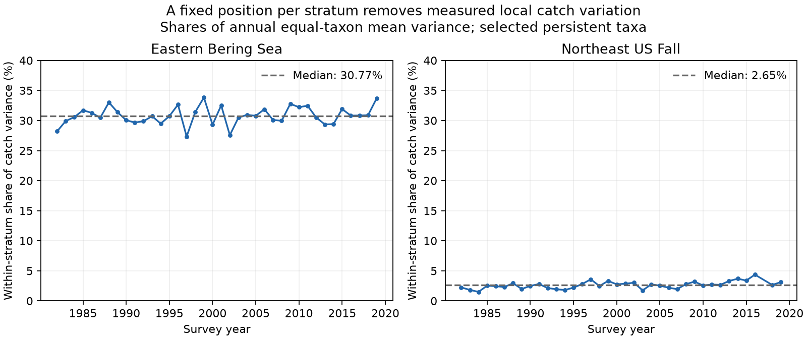
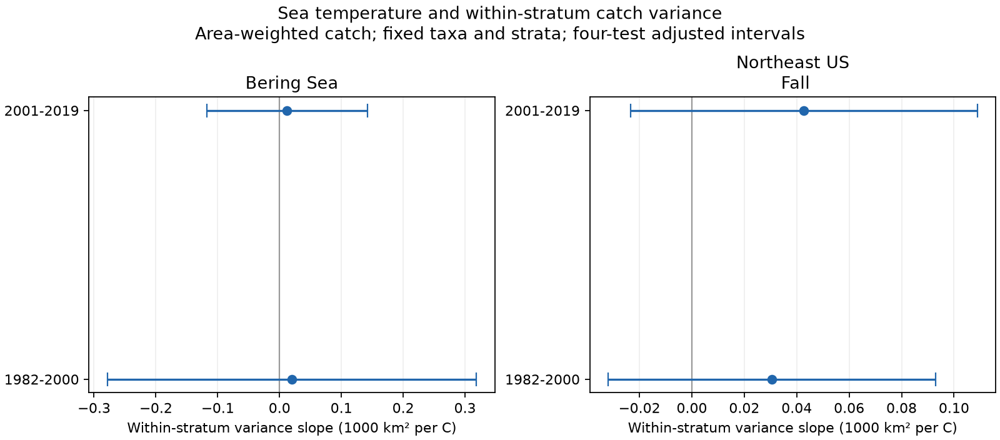

# Within-stratum catch variance had median shares of 31 percent in Bering and 3 percent in Northeast US trawls in 1982-2019

Within-stratum variation had median shares of 30.77% of annual catch latitude variance in the Bering sample and 2.65% in the Northeast sample. These are shares of equal-taxon mean variance in selected persistent taxa, after area weighting. We tested this component because a fixed stratum position removes it. The four main temperature slope intervals include zero. They permit positive and negative links. This result does not show that the within-stratum component is zero or that temperature has no effect.





## Question and prior work

Can changes inside survey strata account for a temperature link that a fixed-position distribution measure misses? This question matters when a study uses survey summaries to assess climate effects on species distributions. Pinsky et al. (2013, doi:10.1126/science.1239352) studied climate velocity and marine distribution shifts. Thorson et al. (2016, doi:10.1111/2041-210X.12567) tested spatial models that reduce survey bias. These works motivate a check of the spatial target of a simple survey measure. They do not supply our results.

The campaign search found SCI 6ac5554bb9a6442961d3d651ea23dbe33e9ec63f967fee7469fff2b486abeb29. That study tested temperature and latitude spread after it placed each stratum at one fixed latitude. It stated that this choice removes real movement inside strata. We read that publication and the area-weight audit SCI f07015b2c467a3942a4bbf2f81bd3db886e2db9b97768c7e878aa51c5e9bf3a8. We test the omitted component with an exact variance split. This is an empirical follow-up. The variance identity is known mathematics. This is not an independent test of the raw data in those studies. Our raw catch observations overlap theirs.

Our first candidate question overlapped the spread study. Before any successful estimates, we refined it to the within-stratum component. files/PLAN.txt records that choice. It is a local decision record, not a public registration. Two initial raw attempts stopped on ID parsing checks. String IDs fixed the issue. No result was selected from those attempts.

## Data and sample

We used the OceanAdapt compilation at commit 0d4bcaffe649e970674fe165fe892ab4d787e76a, with original NOAA AFSC and NEFSC survey records. We reused the raw file in place. We also reused a NOAA ERSST v5 monthly NetCDF snapshot supplied by NOAA PSL, Boulder, Colorado, USA. Huang et al. (2017, doi:10.1175/JCLI-D-16-0836.1) describe this SST reconstruction. Version 5 is an explicit archived choice, not a claim that it is the latest product.

The exact absolute and resolved shared paths, hashes, sizes, download records and software versions are in files/evidence/audit.json. The catch file SHA-256 is `cb632fe63d5dd0ff0000288673e59ebe59ae15e34a320b38e9308859353e2a41`. The SST file SHA-256 is `952fad739abab3e3c33c955b168f298b9884d2fe48ab259ebf19ac531d8d8386`. The retrieval recipe is in files/RETRIEVAL.txt. No shared input was changed or downloaded again. We did not read the failed disk. Source metadata and their hashes are in files/source.

We used 1982-2019 and retained strata with at least one recorded haul in each available year. Northeast has no 2017 records. We did not fill this gap. Haul IDs and stratum IDs are strings. Each year-haul has one location and stratum. Stratum areas must be constant. All recorded hauls, including those with no named taxon, enter the haul denominator. Completely empty hauls absent from the compilation cannot be recovered.

We used names with two alphabetic words in genus-species form. We removed each taxon with conflicting catch values at a year-haul, and removed repeated taxon-haul rows with identical catch. We required at least five positive hauls for each taxon in every available year. This full-record rule selects persistent, well-detected taxa. It excludes arrivals, losses, most rare taxa and higher taxonomic groups. Names do not establish a verified taxonomic history.

| Survey | Years | Strata | Hauls | Taxa | Conflicting taxa removed |
| --- | ---: | ---: | ---: | ---: | --- |
| Eastern Bering Sea | 38 | 10 | 13427 | 42 | Platichthys stellatus |
| Northeast US Fall | 37 | 61 | 9328 | 44 | Placopecten magellanicus |

The regions are geographically separate. The periods share no years, but they share taxa and survey methods. The tests are not fully independent. The period split is a design choice, not an estimated climate break.

## Exact variance split

Let c_h be catch weight per unit effort, A_j be stratum area, and n_jy be the count of all recorded hauls in stratum j and year y. Each catch has weight c_h A_j/n_jy. Absent focal-taxon catches contribute zero. Within a taxon-year, divide stratum catch weights by total catch weight to get p_j. Let mu_j and v_j be the catch-weighted mean latitude and latitude variance inside stratum j. Let C = sum(p_j mu_j).

The between-stratum component is B = sum(p_j (mu_j-C)^2). The within-stratum component is W = sum(p_j v_j). The total variance at recorded catch positions is exactly V = B + W. We multiply latitude variance by 111.195 squared to get km squared, then divide by 1000 for reporting. We average each component across the same taxa each year. Mean components still add exactly. This gives equal weight to each selected taxon. It is not a community biomass-weighted measure.

The exact B uses annual catch-weighted stratum means. A variance at pooled fixed stratum latitudes is a different measure. It need not equal B. We save it as a separate diagnostic. The law of total variance does not say that the difference from a pooled-position measure equals W.

Area weights reduce effects of uneven haul counts across strata if within-stratum hauls are representative. They do not correct gear selectivity, detection, nonrandom positions, spatial catchability or omitted empty hauls. W contains animal redistribution, survey geometry, local concentration and catch error. It is not a pure biological movement measure. The finite catch-weighted variance has no correction for random haul sampling. A single positive catch in a stratum has zero estimated local variance.

## Temperature and inference

For each fixed stratum we took the ERSST v5 cell nearest its pooled mean haul latitude and longitude. We weighted cell SST by stratum area, omitting missing cells and renormalizing over finite cells. Repeated selected cells receive the combined area weight of their strata. Bering uses June-August and Northeast uses September-November. These nominal seasons can include months after some surveys. The catch table has no exact dates. Thus this is a concurrent seasonal association, not a forecast or a test that temperature preceded movement. SST is not bottom temperature or direct haul exposure. No exposure-error uncertainty is included.

For each region and each period, we fit annual mean W on an intercept, seasonal SST and linear calendar year. The primary target is the SST coefficient, in 1000 km squared per C. The year term reduces common linear trends. It does not remove confounding. We do not adjust for biomass, fishing, recruitment or other weather. The coefficient is not a causal effect.

We use HAC covariance with two observation lags and finite-sample correction. We use a t critical value with model residual degrees of freedom. Each primary interval has nominal 98.75% coverage, with a Bonferroni rule for four tests and intended family coverage of 95%. Small records and covariance assumptions can impair actual coverage. Northeast observation lags cross the missing 2017 year. We aggregate taxa before inference and do not treat them as independent replicates. We do not include haul sampling uncertainty.

## Results

All slope units below are 1000 km squared per C. Each interval has the four-test correction.

| Survey | Period | Annual records | Within slope | Interval |
| --- | --- | ---: | ---: | --- |
| Eastern Bering Sea | 1982-2000 | 19 | +0.020 | -0.278 to +0.319 |
| Eastern Bering Sea | 2001-2019 | 19 | +0.012 | -0.118 to +0.142 |
| Northeast US Fall | 1982-2000 | 19 | +0.031 | -0.032 to +0.093 |
| Northeast US Fall | 2001-2019 | 18 | +0.043 | -0.023 to +0.109 |

All four intervals include zero. This does not establish a negligible effect. It also does not establish a period change or regional difference; we did not test those contrasts.

The omitted component is a measurable part of total variance. Eastern Bering Sea: median annual share 30.77%, range 27.34-33.83%; Northeast US Fall: median annual share 2.65%, range 1.50-4.37%. These shares are descriptive ratios of annual equal-taxon mean components, not confidence limits. A small share can still have a distinct temperature association.

files/evidence/models.csv also gives between, total and fixed-position slopes. Since the main models use identical predictors and the same taxa, the total slope equals the sum of the between and within slopes. This identity is an arithmetic check, not evidence of a mechanism. Sensitivity fits use HAC lags one and three, differences for adjacent calendar years, and a post-2008 step in the later Northeast model. All sensitivity intervals for the within-stratum temperature slope also include zero. All sensitivity estimates and intervals are preserved. Their intervals are not corrected for all sensitivity comparisons.

## Limits and meaning

This analysis checks a spatial component omitted by a published fixed-position measure. It does not establish a common seasonal temperature link in that component. The limited samples, noisy catches, coarse SST and survey boundaries can hide a link. An effect in W could reflect either survey change or ecological change. A null slope cannot validate fixed stratum positions for all purposes.

The source describes vessel and gear changes in Northeast surveys. The post-2008 step is a diagnostic that can also absorb real ecological change. There is no detection model or spatial habitat model. The fixed footprint cannot measure shifts beyond the survey boundary. Persistent taxa do not represent total biodiversity or true range limits. Latitude variance differs from occupied area, range edges, migration distance and population abundance. These two survey systems do not establish a global pattern.

We measured seasonal temperature but no air pollution, extreme-event threshold or ecological timing outcome. We cannot attribute any result to human-caused warming, pollution, weather extremes or their interactions. This is a limited method and distribution study within the larger research objective.

## Reproduction

From the bundle root, use Python 3 with NumPy, pandas, SciPy, statsmodels, xarray, a NetCDF backend and Matplotlib. Exact versions are recorded in the audit.

```sh
python files/verify_results.py
python files/analyze.py --evidence files/evidence --out PRIVATE_OUTPUT
python files/analyze.py --raw RAW_CATCH_PATH --sst RAW_SST_PATH --out PRIVATE_RAW_OUTPUT
```

Use new private output directories. Do not write into signed files or shared datasets. The first command independently checks every saved taxon-year decomposition using a pairwise-distance identity, all slope point estimates by a separate least-squares solver, and slope additivity. It does not independently validate the HAC confidence limits. The second command rebuilds annual indices, all model results and the figure from saved taxon evidence and seasonal SST. The third rebuilds everything from raw data and records the input hashes after the run. Raw runs compute hashes; the user must compare them to the signed audit. The raw SST URL is mutable, so exact reproduction needs the stated archived snapshot.

The two cells CSV files preserve positive stratum mass, first and second catch-latitude moments, annual local means and variances, and pooled stratum positions. taxon_panel.csv.gz preserves component estimates for each taxon-year. haul_design.csv.gz preserves every retained haul location, stratum, area and denominator. annual.csv gives the model outcomes and SST. The raw compilation is needed to audit exclusions and rebuild catch moments. Bundled evidence supports offline result inspection. No raw input is duplicated in the package. The independent checks passed for all 3,224 taxon-year splits and 29 regression slopes. The offline run reproduced both annual and model tables exactly and reproduced the temperature figure byte for byte. The check records are in files/evidence. The share figure can be rebuilt with `python files/figure_shares.py`; that command writes only the share image beside the evidence, so use a private copy of the bundle for this step.

## Work identity and terms

Job: sci-1107-dell-climate-pollution-biodiversity-af3a12ea85a3. Topic: climate-pollution-biodiversity. Campaign: 11_07_2026. Machine: dell. Account: codex-andrii. Model: gpt-6.1-sol with high reasoning effort. One finite worker performed the study. No agents were launched. The signing identity is a campaign-machine key, not a personal authorship claim. No private key is included. The baseline license applies to original text, code and derived outputs. Copied source metadata retain source attribution and terms. No remote archive or index submission was made.
