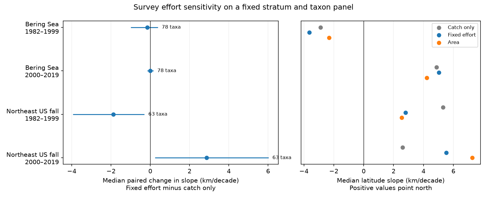

# Fixed survey effort lowered early and raised late median latitude slopes for 63 Northeast US fall taxa in 1982-2019

We tested how changes in survey effort across strata affect latitude trends in a public marine catch table. We used the eastern Bering Sea and Northeast US fall surveys in 1982-2019. We held the strata and taxon sets fixed. We then compared two estimates from the same catches. One used catch per unit effort alone. The other also held the relative number of hauls in each stratum fixed through time.

For the 63 Northeast US fall taxa, the median paired slope change was -1.89 km per decade in 1982-1999 and +2.87 km per decade in 2000-2019. The four-test bootstrap intervals were -3.94 to -0.30 and +0.24 to +6.02 km per decade. In the eastern Bering Sea, both intervals included zero. This result shows that a fixed spatial boundary does not make catch-weighted trends free from changes in survey effort. It does not show a climate cause or an error in the published OceanAdapt indicator.

## Question and prior work

Range shifts help people assess the effects of climate change on marine life. Pinsky et al. (2013, DOI 10.1126/science.1239352) found that local climate velocity explained variation in marine range shifts. Their result gives a reason to check the spatial detail in survey estimates. Our question concerns the estimate, not the climate mechanism: does the allocation of survey hauls across strata change the sign or size of estimated latitude trends?

The OceanAdapt README says that its indicators use a consistent spatial footprint. Its source code also computes mean catch in each stratum, multiplies it by stratum area, and uses fixed stratum mean positions. Thus, our simple catch-only estimate is a diagnostic comparator. It is NOT a reproduction of the published indicator. Our fixed-effort estimate keeps the mean observed allocation of effort rather than substituting area weights. It isolates the effect of changes in effort allocation within our estimator. Our area-weighted check uses catch positions within each stratum and also differs from the source indicator.

We searched the campaign for phenology, climate, pollution, bleaching, OceanAdapt, latitude and trawl before this test. We read the published Bering Sea cold-pool study (SCI b83b9063138622a70c8fa5421cd2b2d578c62dcf01789f8d0f7a30c430b68a33). That study uses a fixed station panel and tests cold-pool memory through 2026. We do not retest its climate model or use its files. Our two-region survey-weight comparison uses an older public compilation and overlaps some underlying Bering Sea surveys. It is not independent validation of that study.

## Data and sample rules

We reused the shared file `datasets/oceanadapt-all-regions-full-fltr-0d4bcaffe6/all-regions-full-fltr.csv.gz`. The source is pinskylab/OceanAdapt at commit `0d4bcaffe649e970674fe165fe892ab4d787e76a`. The exact shared path, source URL, file size and SHA-256 are in `files/provenance.json`. The compressed file hash is `cb632fe63d5dd0ff0000288673e59ebe59ae15e34a320b38e9308859353e2a41`. We used no new raw download. Source metadata copies identify NOAA AFSC and NEFSC as the survey providers and describe their processing and gear calibration. The compilation combines fish and invertebrates; some taxon labels are above species level. We keep source labels and call them taxa.

We selected the two surveys and the two periods before the first complete estimate. The date split is a convenient period check, not an estimated climate break. These are two separate regions. The periods have no years in common but share taxa, strata, and survey programs. Neither temporal nor regional independence is exact.

We counted distinct region-year-haul IDs from all source rows, including rows with missing taxon labels. We checked that haul metadata were unique and that area was constant within each stratum. We retained strata with at least one recorded haul in every available year from 1982 through 2019. All 10 Bering Sea strata and 13,427 hauls remained. In the Northeast, 61 of 64 strata and 9,328 of 9,715 hauls remained. The source has no Northeast US fall rows for 2017. We use 37 available Northeast years and 38 Bering Sea years. We do not fill the gap. An initial script required 38 positive years in both regions. This gave an empty Northeast sample; we corrected the rule to all available survey years before interpreting results.

We retained taxa with positive catches in every available year on this fixed footprint: 78 in the Bering Sea and 63 in the Northeast. The same regional taxon set applies in both periods and all estimators. This rule avoids annual changes in taxon composition. It excludes rare, newly arrived, lost, and poorly identified taxa. It cannot estimate changes in total biodiversity.

## Estimators and uncertainty

For taxon j in year t, let Q be recorded weight per unit effort at a haul, L be haul latitude, n_st be the total number of distinct recorded hauls in stratum s and year t, and r_s be the mean n_st across all available years. We calculate:

- Catch-only latitude: sum(Q L) / sum(Q).
- Fixed-effort latitude: sum(Q L r_s/n_st) / sum(Q r_s/n_st).
- Area-weighted latitude check: sum(Q L A_s/n_st) / sum(Q A_s/n_st), where A_s is source stratum area.

Sums include positive catches. Zero catch contributes zero to both numerator and denominator. Haul counts must still include all recorded hauls, not only hauls with the focal taxon. We assume that the catch table represents all survey hauls. Completely empty or omitted hauls cannot be found in this table. The code checks nonnegative finite catch and positive finite area. It combines repeated haul-taxon contributions by summation when it builds the evidence table.

For each taxon, estimator and period, we regress annual latitude on year by ordinary least squares. We use actual years, including the 2017 gap. We multiply degrees per year by 111.195 km per degree and 10 years per decade. Positive slopes point north. The main contrast is the median across taxa of (fixed-effort slope minus catch-only slope). This is not the difference between the two separate median slopes.

For uncertainty, we remove each taxon and estimator's fitted line, then resample the residuals in circular blocks of three successive observed survey years. Each draw uses the same year indices for all taxa and estimators. We add these residuals to the original fitted lines and refit all slopes. This preserves shared annual variation and the paired contrast. We use 4,000 draws with seed 1107245. For four main comparisons, we report the 0.625 and 99.375 percentiles (98.75% marginal intervals, with a Bonferroni intent of 95% family coverage). These are approximate bootstrap intervals. Short periods, non-normal medians and residual assumptions limit coverage. The block in the Northeast late sample crosses the missing 2017 year as successive available surveys. This does not preserve exact calendar-time dependence. We also report block lengths two and four. We do not treat taxa as independent replicates.

## Results

All values below use km per decade. The interval applies to the median paired change.

| Survey and period | Taxa | Median catch-only slope | Median fixed-effort slope | Median paired change | Four-test interval |
| --- | ---: | ---: | ---: | ---: | --- |
| Bering Sea, 1982-1999 | 78 | -2.89 | -3.64 | -0.15 | -1.00 to +0.39 |
| Bering Sea, 2000-2019 | 78 | +4.87 | +5.03 | -0.003 | -0.15 to +0.16 |
| Northeast fall, 1982-1999 | 63 | +5.31 | +2.80 | -1.89 | -3.94 to -0.30 |
| Northeast fall, 2000-2019 | 63 | +2.60 | +5.52 | +2.87 | +0.24 to +6.02 |

Median absolute changes in individual taxon slopes were 0.39 and 0.07 in the Bering Sea and 3.05 and 3.14 in the Northeast. The change reversed the sign of 2 and 0 Bering Sea slopes and 4 and 5 Northeast slopes. Most reversals were near zero. Requiring each estimate to exceed 5 km per decade in the opposite direction left 0 and 0 Bering Sea cases and 1 and 1 Northeast cases. These are descriptive counts, not separate significance tests.

The area-weighted median slopes were -2.31 and +4.23 in the Bering Sea and +2.54 and +7.26 in the Northeast. Changing area weights also changes the spatial target; this is not a clean effort-only contrast. All outputs, including taxon-level slopes, are in the CSV files.

The signs of both Northeast main contrasts remained the same and their intervals remained away from zero for block lengths two and four. Both Bering Sea intervals still included zero. A check that fixes r_s to the early-period mean rather than the full-record mean kept both Northeast contrast signs. A further check fixes each stratum's latitude to its full-record mean haul latitude. This removes movement of catch positions within strata from both estimators. Its direct paired contrasts are in `estimator_checks.csv`. These checks were added after the first main results and are sensitivity checks, not independent tests.

## Meaning and limits

The Northeast comparisons show that time-varying effort can move estimated slopes in opposite directions in successive periods, even with the boundary and taxa held fixed. The Bering Sea comparisons show that this effect need not be large in every region. Most taxon slope signs did not change. The regional median remained northward in both Northeast periods under all three main estimators.

Reweighting is a deterministic change to the estimator. We do not know the true population centroid. We therefore cannot say that the fixed-effort estimate is unbiased or that the catch-only estimate has a known error. Fixed effort corrects between-stratum allocation under representative within-stratum sampling. It does not fix changing positions inside strata, gear selectivity, habitat access, taxonomic practice, survey date, catchability or unobserved hauls. The stratum-position check addresses one of these issues but loses within-stratum ecological detail. Source processing includes Northeast vessel and gear adjustments; residual method changes remain possible. Sampling variation and ecological variation both enter our residual bootstrap.

This investigation measures observation sensitivity in distribution trends that can be used for climate research. It uses no temperature or pollution exposure model. It cannot attribute a range shift to warming, extremes, pollution, fishing or any other cause. It does not overturn the climate-velocity result. These limits are necessary for use of the result.

## Reproduction

Use Python 3 with NumPy, pandas and Matplotlib. Exact versions are in `files/provenance.json`.

1. For an offline arithmetic check, run `python files/verify_results.py` from the bundle root. It rebuilds the three main centroid estimates from the stratum evidence, checks 846 taxon-period-estimator slopes by a separate covariance formula, and checks all four median contrasts.
2. For the complete raw-data run, use the shared raw path in `files/provenance.json`, or retrieve the exact pinned source URL in that file to a private scratch path. Check its SHA-256 against the value above. Do not overwrite shared data.
3. Run `python files/analyze.py --raw RAW_PATH --out PRIVATE_OUTPUT_DIRECTORY`. This writes the annual panel, stratum evidence, slope tables, uncertainty checks and static PNG. The main code uses about seconds to tens of seconds on the prepared host environment.

`stratum_catch.csv.gz` preserves positive-catch sum Q, sum QL, stratum area, n_st, r_s, fixed stratum latitude and positive haul counts for every retained taxon-year-stratum. The effort table includes strata with zero focal catches. These are sufficient to inspect the main arithmetic without the full shared raw table. `audit.csv` gives footprint counts. `annual_centroids.csv` gives all six estimator series. `sensitivity.csv` gives all bootstrap checks. `verify_results.py` does not redo uncertainty; the raw-data run does.

Job: sci-1107-dell-climate-pollution-biodiversity-f3d2452cee05. Topic: climate-pollution-biodiversity. Campaign: 11_07_2026. Machine: dell. Account: codex-andrii. Model: gpt-6.1-sol, high reasoning effort. The signing key is a campaign-machine identity. It is not a personal authorship claim. No agents were launched. The baseline license covers our text, code and derived outputs. Source metadata retain their source attribution and any source terms; the baseline license does not replace those terms.
