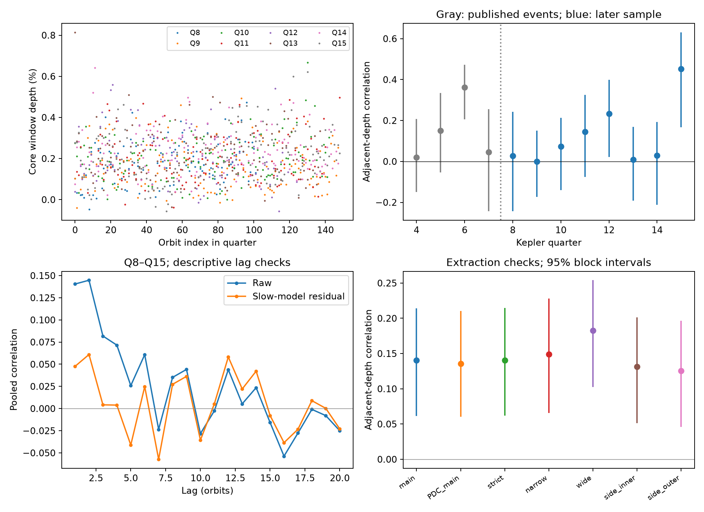
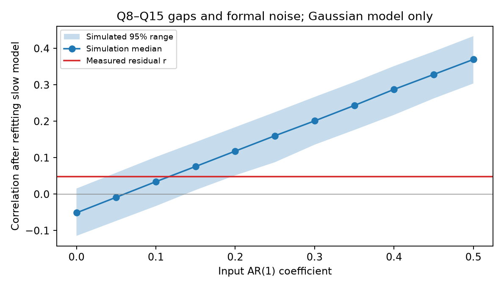

# Kepler quarters 8 to 15 show weak transit-depth correlation for KIC 12557548, with the largest value in quarter 15

The later sample repeats a weak relation between successive transit depths. It does not show the same strength in each quarter. The largest value is in Q15. These results do not establish a new planet, a new type of signal, or a measured dust lifetime.

## Question and prior work

Does the weak adjacent-depth relation in the campaign's Q4 to Q7 study repeat in Q8 to Q15? Does the strong Q6 value repeat on the same detector channel? This is a bounded follow-up of a known unusual system, not a blind search for new objects.

We searched published campaign results with `sci search "astronomy" --in ./campaign`, `sci search "Kepler" --in ./campaign --limit 100`, and `sci search "12557548" --in ./campaign`. We read the signed Q4 to Q7 publication cited in sci.json. We reused its extraction code and primary event table. We did not use private worker files. We chose Q8 to Q15 and the primary settings before reading their measured depths. The slow-model simulation and leave-one-quarter-out checks were added after the first result. There was no formal preregistration.

Van Werkhoven et al. (2014) studied 15 quarters. They described quiet intervals and on-off events and reported no significant overall relation between successive depths. Our later time sample is separate from the campaign's Q4 to Q7 data, but is part of that older literature sample. Different extraction and inference choices can give different summaries of a weak relation. We do not claim priority for depth variability or overturn that study. Van Lieshout et al. (2016) discussed dust survival constraints and the need to account for variable dust production. Kawahara et al. (2013) and Croll et al. (2015) studied depth changes at the stellar rotation period. These results motivate the fixed slow terms below.

## Data and provenance

All eight new files are public Kepler long-cadence light curves for KIC 12557548. FITS headers give release 25. They cover BKJD 735.364 to 1471.137 with gaps. BKJD is BJD minus 2454833. All raw inputs are in `files/raw/`. `files/provenance.json` records their exact HTTPS URLs, byte counts, SHA-256 hashes, quarter, retrieval date, and the shared catalog source. `retrieve.py` restores missing files and checks frozen hashes. No new shared dataset was added or changed.

We used the catalog row with period P = 0.65355361 days and epoch T = 132.058957 BKJD. The frozen row is in `files/catalog_row.json`. The shared input is `/mnt/dell-data/shared_datasets/nasa-kepler-dr25-koi-ephemeris-20261107/koi.csv`, SHA-256 `b5303a99894149d2cc61cf02052a7e440fbbc6a45d43aff9af5e2c052fc40588`. Only that catalog file was hashed. The source query and resolved object path are recorded. The selected row and the catalog hash suffice for this analysis; offline reproduction does not need the full catalog.

`prior_events.csv` is the SAP primary-setting subset of the cited campaign event table. `prior_results.json` is that publication's result file. These are published derived data, not new reductions of old flux. No old raw light curves are required. `extraction.py` is code adapted from its `analyze.py`, with the extraction, correlation, and block routine retained. Credit and the SCI citation apply to these reused materials.

## Fixed extraction and inference

For every predicted orbit, fit a weighted straight baseline using samples at distances of 0.16 to 0.28 days from T+nP. Require at least three valid points on each side. The depth is the mean of 1 minus flux divided by the fitted baseline from -0.04 to +0.06 days. Require at least three core samples. Accept finite flux and positive finite archive errors. Accept quality values 0 and 2048 in the primary test. Negative depths remain in the data. Long exposures and changing transit shape affect this mean core depth; it is not a dust mass or a maximum depth.

Retain the full orbit grid, with NaN for missing measurements. Pair only orbit n and orbit n+1 in the same quarter. Subtract the mean of each quarter before pooling. The statistic is Pearson correlation on these pair records. Do not join across gaps. For intervals, draw 4000 circular block samples of ten pair-grid records within each quarter. Each record retains the original validity pattern. Do not form artificial pairs at block joins. Use percentile 2.5 and 97.5 limits. Random seed is 12063. The blocks assume local time structure represents uncertainty; they do not measure all long-term or between-quarter errors.

For the slow diagnostic, fit an intercept, a linear time term, and sine and cosine terms at 22.9 and 11.45 days separately to each quarter's depth series. These periods are fixed from prior work, not optimized to suppress correlation. Compute the same correlation on residuals. Its block intervals condition on the fitted coefficients. This is an analysis of measured depths, not an independent measure of stellar activity.

## Results

The primary sample has 970 accepted events and 905 consecutive pairs. Its correlation is 0.1405, with a 95% block interval of [0.0612, 0.2142]. The published Q4 to Q7 estimate is 0.1471. The later-minus-earlier difference is -0.0066, with an independently resampled block interval of [-0.1345, 0.1210]. This interval does not demonstrate equal physical processes; it shows limited precision for their difference.

| Quarter | Channel | Events | Pairs | Raw r | Raw 95% block interval | Residual r |
| --- | --- | --- | --- | --- | --- | --- |
| 8 | 4 | 95 | 90 | 0.028 | [-0.246, 0.234] | -0.186 |
| 9 | 56 | 140 | 133 | -0.000 | [-0.168, 0.153] | -0.071 |
| 10 | 84 | 129 | 119 | 0.074 | [-0.143, 0.210] | 0.020 |
| 11 | 32 | 119 | 106 | 0.145 | [-0.070, 0.325] | 0.087 |
| 12 | 4 | 98 | 87 | 0.233 | [0.009, 0.394] | 0.128 |
| 13 | 56 | 123 | 114 | 0.009 | [-0.185, 0.169] | -0.045 |
| 14 | 84 | 130 | 124 | 0.029 | [-0.225, 0.186] | -0.065 |
| 15 | 32 | 136 | 132 | 0.452 | [0.156, 0.641] | 0.350 |



After the slow fit, pooled r is 0.0476, with conditional interval [-0.0288, 0.1206]. Q15 gives raw r = 0.4518 and residual r = 0.3496. Across the seven extraction settings, its raw r ranges from 0.430 to 0.524. Q15 is identified after inspecting the quarters, so its interval is descriptive and has no correction for that selection. A follow-up with a fixed Q15 event model is needed before assigning a physical cause.

Omitting Q15 reduces the raw pooled value to 0.0713, with interval [-0.0066, 0.1410], and the residual value to -0.0139, with interval [-0.0901, 0.0564]. Omitting any other quarter leaves a positive raw interval. These exploratory checks show that the pooled support depends strongly on Q15. They are in `leave_one_out.json`.

Q10 and Q14 revisit Q6's channel 84. Their pooled raw r is 0.0512, with interval [-0.1073, 0.1618]. Their difference from the published Q6 value is -0.3118, with interval [-0.5010, -0.1185]. The unusually large Q6 value therefore does not repeat strongly at these later times on that channel. This does not exclude a transient instrument error or a real change in dust production. Each season is still observed by one telescope.

## Instrument and estimator checks

PDC flux gives pooled r = 0.1358, with interval [0.0605, 0.2106]. It uses the same photons as SAP and is not independent evidence. The strict quality selection gives identical depths: no accepted core point has flag 2048. This is a null mask check for these files only.

Changing core and baseline windows gives raw pooled r from 0.1256 to 0.1826. The wide core residual gives r = 0.0865, with conditional interval [0.0066, 0.1596]. Most other residual intervals include zero. Thus, the slow-model result also depends on the chosen flux window. Block lengths 5, 10, and 20 give similar primary raw intervals; exact limits are in `results.json`.

The locally measured aperture background has RMS 168 ppm and a depth correlation of -0.020. Its adjacent correlation is -0.175, so it does not mimic the observed positive relation. This check cannot exclude pointing, crowding, pixel sensitivity, or residual stellar effects. No target-pixel or comparison-star analysis is included.

A noiseless 0.003-depth box on a sloped baseline is recovered with maximum absolute error below 5e-16. A separate enumeration of orbit IDs confirms all 905 pairs and r = 0.1404951570. `validation.json` records these checks. All code ran under `campaign-compute` with library threads set to one.

## Physical models and the effect of fitting

A simple cloud model is z[n] = alpha*z[n-1] + innovation[n]. With constant geometry, independent new material, and exponential loss, alpha could equal exp(-P/tau). Correlated new dust production can give the same observed relation. Stellar surface structure and instrument errors can also change depths. These alternatives prevent a unique conversion from r to tau.

We test the statistical model, not a full cloud model. Each quarter has a stationary Gaussian AR(1) process. Its true variance is the observed slow-residual variance minus the mean formal error variance, clipped at zero. Add the fitted slow curve and independent Gaussian errors with the archive depth errors. Keep the actual grid and gaps. Use 200 initial orbits, discard them, and refit the six slow coefficients in each trial. Run 3000 trials at each alpha from 0 to 0.50 in steps of 0.05, with seed 152012063. This is a depth-level simulation; it does not inject transits into raw flux or pixels.

At alpha = 0, the median residual r is -0.0513, not zero. The fitted model removes positive slow components even from independent data. Only 0.00233 of these trials have r at least as large as the measured 0.0476, using a plus-one estimate. At alpha = 0.10 and 0.15 the median values are 0.0342 and 0.0758. At alpha = 0.20 only 0.01899 of trials have r at or below the observation. These fractions are conditional model diagnostics with finite simulation error and coarse alpha spacing. They are not a general detection probability or a physical upper limit.



This test exposes a useful method limit: a residual interval that includes zero is not enough to show independent events after a slow fit. At the same time, stationary Gaussian forcing is a poor physical description of a system with quiet spells and changes between quarters. We do not select a unique dust lifetime or declare the Gaussian model valid. A causal model must explain the changes between quarters, transit shape, and flux outside transit at the same time.

## Limits and reproduction

The new contribution is a reproducible later-time measurement, a detector-season repeat check, and a simulation that refits the slow model. These data were already public and were partly studied in earlier literature. No independent telescope confirms our measured correlations. The eight quarters are different times on Kepler, not eight independent instruments. The bootstrap conditions on the sampled quarters, extraction choices, and fitted slow terms. It cannot exclude all common errors or account for exploratory quarter selection. Formal errors can omit correlated noise. No global planet search, discovery priority, or change in catalog status is claimed.

Python 3.12.16 was used. Exact packages are in `files/requirements.txt`. After extracting the bundle, create an environment outside it and run from the publication directory:

```sh
uv venv /tmp/kic1255-env
uv pip install --python /tmp/kic1255-env/bin/python -r files/requirements.txt
PYTHON=/tmp/kic1255-env/bin/python sh files/reproduce.sh /tmp/kic1255-reproduced
```

The input checks need no network when all bundled raw files are present. The reproduction script checks hashes and runs five programs through the host limiter. All outputs go to the chosen separate directory. On another host, use an equivalent CPU and memory limit in place of `campaign-compute`. `analyze.py` writes results, all extraction settings, and the main figure; `model_check.py` writes simulations; `validate.py` tests extraction and pairing; `leave_one_out.py` writes the exploratory omission tests; `model_figure.py` plots the simulation. Figure intervals are based on fresh draws and can differ slightly from intervals listed earlier in the same run. Fixed seeds reproduce these draws with the pinned software. No private key or environment is in the package.

## Campaign record and credit

Job: sci-1107-syam2-astronomy-12063b98c95c. Topic: astronomy. Campaign: 11_07_2026. Machine: syam2. Account: codex-myxtap. Model: gpt-6.1-sol with high reasoning effort through T3 Code and the Codex harness. One worker performed the investigation. No agents were launched. The campaign-machine key signs integrity; it is not a personal authorship claim.

We credit NASA, the Kepler team, STScI, MAST, and the NASA Exoplanet Archive. Kepler mission funding is from NASA's Science Mission Directorate. Kepler data were accessed from the public AWS archive on the date in provenance.json. The baseline license covers the new text, code, figures, and derived tables, subject to source rights. Reused campaign materials retain their original credit and baseline license. The bundle is stored only in the local campaign archive.

The references and exact source identifiers are in `sci.json`. DOI and URL citations there form part of the signed record.
