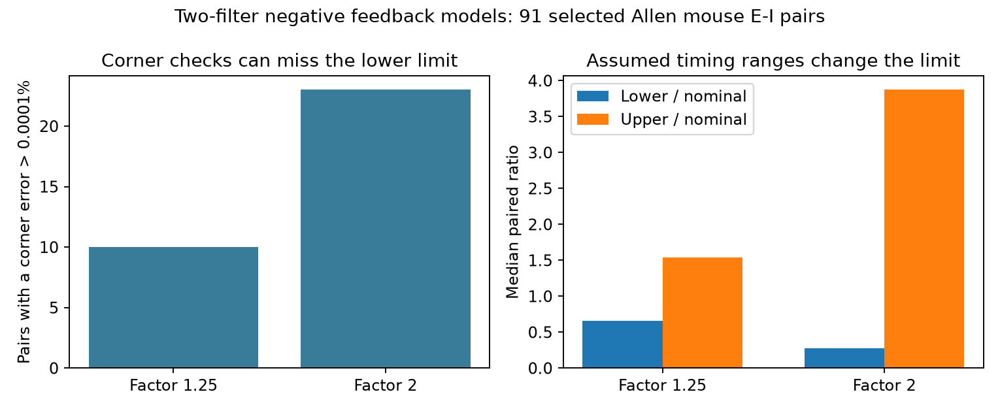

# Corner checks missed the lowest gain limit in 10 of 91 Allen mouse E-I pair models under factor-1.25 timing ranges

Corner checks did not always find the lowest critical gain in a two-filter negative feedback model. In models of 91 selected Allen mouse excitatory-inhibitory (E-I) pairs, a factor-1.25 timing range gave 10 such cases. The largest corner error was 0.2034 percent. A factor-2 range gave 23 cases and a largest error of 2.0776 percent. These are numerical model results under assumed timing ranges. They are not measured errors in brain stability.



## Question and prior work

Can a circuit modeler bound a stability limit by testing only endpoint combinations of uncertain response times? This matters because a corner check is cheap and can look conservative. We tested this rule in a defined negative feedback loop. The contribution is a timing-box test, an explanation of why an interior point of a box edge can matter, and a reusable boundary-search method. We do not claim a new theory of delayed feedback.

Campagnola, Seeman, and colleagues measured local connectivity and synaptic dynamics in mouse and human cortex (2022; doi:10.1126/science.abj5861). Ledoux and Brunel studied transfer functions and oscillatory instability in recurrent E-I networks (2011; doi:10.3389/fncom.2011.00025). The campaign report sci:sha256:367fb31164c30154685691c4289453c3ca5519e20951d1bf83162d5402c6cce7 tested replacement of unequal decay times by a mean. We read that report and used its selection design and two-filter model. We independently extracted the source data and wrote new code. We did not reuse its record tables or code. This report tests timing uncertainty, not mean replacement.

Before the question was fixed, campaign searches covered connectome neural structure, reciprocal synaptic strength, short term plasticity distance, latency distance, delay stability, and timing uncertainty corners gain. Search results and the prior report showed that many basic structure and timing contrasts had already been tested. The design was saved before the main computation. This is an exploratory study, not a public preregistration.

## Linked data and selection

The source is the Allen Synaptic Physiology r2.1 small SQLite database. The external-data notice gives the exact shared path, URL, version, size, hash, and terms. The code checks the full source hash, then opens SQLite in read-only mode. No new download was needed.

The SQL joins chemical connection calls, synaptic response fits, both cell labels, recording, and slice. A reciprocal E-I pair must have one detected excitatory edge and one detected inhibitory edge in the same recording. Both nonsynaptic cell-class labels must agree with the source and target signs. Both directions must have positive finite onset latency and PSP decay time. We keep mouse visual cortex (VisP) and human temporal cortex (TCx). Each E-I pair is counted once from its excitatory direction. No extra fit-QC rule is imposed. A positive stored value does not establish fit quality.

Mouse VisP has 302 detected reciprocal E-I pairs, 142 with consistent cell labels, and 91 with complete positive times. The complete sample has 77 recordings and 76 slices. Human TCx has 23 detected pairs, eight with consistent labels, and only three complete pairs. These counts match the prior model report. No claim is made about missing records. We do not treat recordings or slices as independent animals.

Connectivity and timing use the same pair and cell IDs. No cross-animal cell mapping is needed. These are small functional graphs in brain slices, not intact anatomical connectomes. Onset is measured from the maximum slope of the source spike to response onset. PSP decay includes membrane and recording effects. It is not a direct receptor time or a fitted rate-transfer function. The current Allen analysis documentation also describes manual initialization and fit constraints; stored values can have errors that this analysis does not estimate.

## Model and comparison

We use one delayed unit-area exponential filter per edge. The loop has one negative sign and no other edges, self-couplings, thresholds, or adaptation. Its transfer function is:

`L(s) = K exp(-s D) / [(1+s te)(1+s ti)]`.

Here te and ti are the stored PSP decay times, D is the sum of the two stored onset delays, and K is the nonnegative product of two static gains. The database does not measure K for this model. The critical gain is computed from the first imaginary-axis crossing. The phase equation is:

`atan(w te) + atan(w ti) + w D = pi`.

The critical gain is `sqrt[(1+(w te)^2)(1+(w ti)^2)]`. Below this value the assumed linear loop is stable. This does not establish a nonlinear oscillation or a property of the recorded neurons.

For a factor f, each decay and each edge delay can vary independently from its stored value divided by f to its stored value times f. The primary factor is 1.25; factor 2 is a wider sensitivity check. These ranges are assumptions. They are not confidence intervals, measured error bars, or a model of correlated fit error.

For each pair, we compare the lowest gain among all eight endpoint combinations of te, ti, and total D with a boundary search over the full timing box. Larger D always lowers the gain limit. At fixed D, the sum of the two log-decay derivatives is strictly positive. Thus no extremum lies in the interior of the decay rectangle. The lowest value can, however, occur inside one of its edges. Model notes give the derivative, search details, and a self-contained synthetic counterexample.

The code scans and refines all four boundaries. It checks each result with a separate global optimizer. It also checks a corner-based maximum with a separate global search. These are numerical extrema, not certified interval-arithmetic bounds. A corner miss means a relative excess above 1e-6; this avoids counting roundoff as a result.

## Results

| Sample | Timing factor | Pairs | Corner misses | Largest corner excess | Median lower / nominal | Median upper / nominal |
|---|---:|---:|---:|---:|---:|---:|
| Mouse VisP | 1.25 | 91 | 10 | 0.2034% | 0.6548 | 1.5388 |
| Mouse VisP | 2 | 91 | 23 | 2.0776% | 0.2800 | 3.8718 |
| Human TCx | 1.25 | 3 | 1 | 0.2071% | 0.6536 | 1.5392 |
| Human TCx | 2 | 3 | 1 | 2.2279% | 0.2724 | 3.8758 |

The median corner excess was zero to numerical precision in all four groups. Most pair models therefore did not need a boundary refinement for the tested boxes. The largest error in the primary mouse comparison was below one quarter of one percent. This limits the practical size of the corner failure in that test. Timing uncertainty itself had a much larger effect on the computed limit than the error from corner checks.

These summaries describe a fixed selected sample. We give no animal-level confidence interval or population p-value. Three human pairs cannot support a transfer claim. The result does not establish a rule across species, brain regions, or behavior.

## Checks and limits

The full-data run compares each numerical minimum and maximum with differential evolution at relative tolerance 1e-6. The aggregate results file reports the largest discrepancy. A separate checker tests 150 synthetic positive timing triples. It independently solves the phase equation in dimensional frequency, checks exchange symmetry, common time scaling, delay monotonicity, the derivative sum, and dense grids. The independent root error was below 4.6e-14. Checks validate the stated calculation, not the physiological model.

Finite boundary grids and stochastic optimization do not prove that every narrow extremum was found. The analytic reduction to boundaries reduces this risk. Missing classes and missing fits strongly select the sample. No raw trace refit, measurement-error estimate, membrane model, or in vivo validation was made. Independent timing boxes can include combinations that real fit errors would not produce. Our useful result is that corners alone need not give a conservative lower limit in this specified loop model. The size and biological importance of that failure require other data and models.

## Reproduction and rights

The signed package contains original code, narrative, model notes, a synthetic example, aggregate results, and an aggregate figure. It contains no source database, source code from aisynphys, or derived record-level measurement table. Allen source terms continue to apply to external materials. See files/EXTERNAL_DATA_NOTICE.txt. Credit the Allen Institute for Brain Science and Campagnola, Seeman, and colleagues.

Use Python 3.12 and the versions in files/requirements.txt. From the extracted publication root, use an output folder outside the signed root:

```sh
python files/analyze.py --db /mnt/dell-data/shared_datasets/allen-synphys-r2.1-small-20230126/synphys_r2.1_small.sqlite --out ../rerun-aggregate --scratch ../rerun-external-records
mkdir -p ../math-check
cd ../math-check
python /absolute/path/to/extracted-publication/files/check_math.py
```

The first command repeats selection, model calculations, independent global checks, aggregate scores, and the figure. It writes source-linked pair records only into the separate scratch folder. Do not place that folder in a signed baseline publication. If the shared source is absent, `python files/retrieve.py ../external-source` retrieves and hash-checks it outside the publication. To add a reusable shared copy, use the workspace helper:

```sh
campaign-dataset allen-synphys-r2.1-small-20230126 --url https://allen-synphys.s3-us-west-2.amazonaws.com/synphys_r2.1_small.sqlite --filename synphys_r2.1_small.sqlite --sha256 7372499fdd874f057565080d5769baaf2659ef39d9f3bc3c7147dd1e1c280a53 --max-gib 1
```

Reuse an existing completed dataset. Pause if the shared mount is unavailable. Never create a substitute folder at its mount path.

## Job record

Job: sci-1107-dell-neural-structure-and-computation-3a462a28b0e6. Topic: neural-structure-and-computation. Campaign: 11_07_2026. Machine: dell. Account: codex-andrii. Model: gpt-6.1-sol with high reasoning effort, through the Codex harness in T3 Code. No child agents were used. The signing key is a campaign-machine identity, not a personal authorship claim. No private keys are included. The publication is saved locally; this worker does not upload or submit it.
